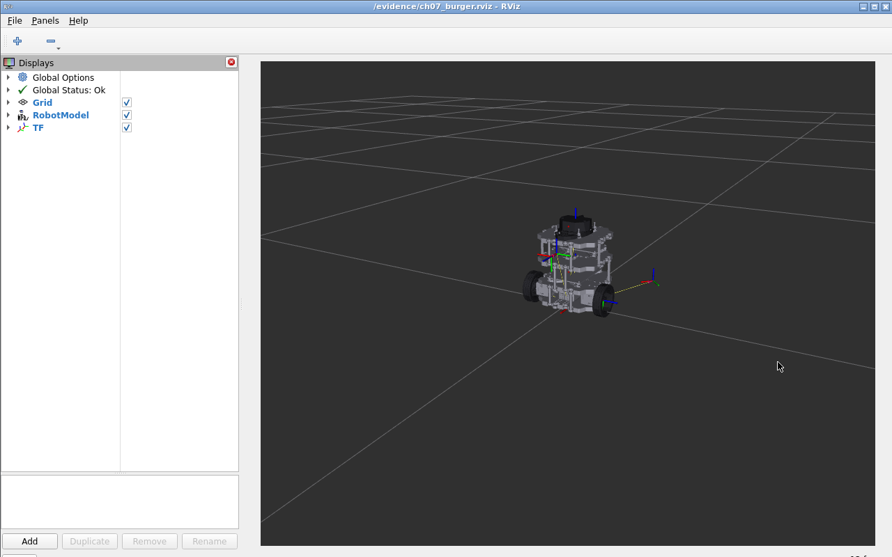
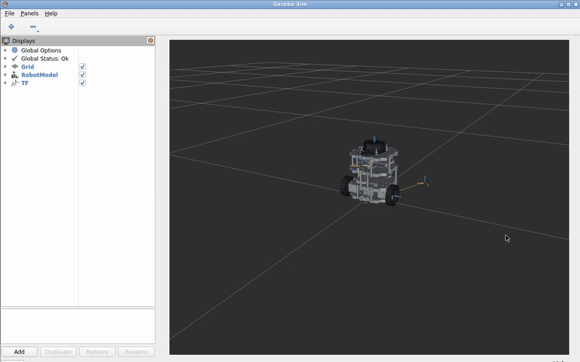

# 第7章 实验指导书：TF2 坐标变换系统

连接、双端分工与构建见[公共双端环境](ch00_common_setup.md#ch07-ch08)。TF C++ 节点在 COM260 运行，Gazebo、RViz 与关节滑块在 x86 Humble 容器运行。下述教学 TF 与仿真 TF 分轮运行，避免同名 frame 被多个广播器同时发布。

## 当前仓库仿真验证：查询 TurtleBot3 Burger 传感器 TF

### 实验目标

在 Gazebo 发布的真实 TF 图上练习 `tf2_echo`、`view_frames` 和 RViz TF 显示，确认传感器 frame 与底盘 frame 的关系。

### 运行步骤

```bash
cd ~/ROS2_RISCV_COM260
CH01=course_support/k3_com260_kit/scripts/x86-gazebo.bash
RUN_ID=$(date -u +%Y%m%dT%H%M%SZ)-ch07
bash "$CH01" start "$RUN_ID"
```

另开终端：

```bash
source ~/.config/ros2-course-com260/env.bash
ros2 topic info /tf
ros2 run tf2_ros tf2_echo base_link laser_link
ros2 run tf2_tools view_frames
```

### 观察与验收

RViz 中应能看到机器人 TF；`tf2_echo` 输出平移和旋转。frame 名称以 `ros2 topic echo /tf` 实际输出为准。源码：`src_k3_pico_itx/robot_sim_demo/models/turtlebot3_burger/model.sdf`、`src_k3_pico_itx/robot_sim_demo/config/gazebo2_bridge.yaml`。

在 x86 启动终端结束首轮仿真，再继续下面的教学 TF 练习：

```bash
bash "$CH01" stop "$RUN_ID"
```

> **实验课时**：2 课时（90 分钟） | TurtleBot3 Burger Gazebo 仿真

---

## 实验目标
1. 掌握 TF2 广播与监听的核心 API
2. 实现多传感器坐标系对齐
3. 熟练使用 TF2 调试工具

---

## 练习 7.1：TF 广播和监听基础（约 30 分钟）

### 任务
1. 编写 `tf_broadcaster.cpp`：以 20Hz 频率发布 `odom` → `base_link` 动态变换（圆形轨迹运动），同时发布 `base_link` → `laser_frame` 静态变换。
2. 编写 `tf_listener.cpp`：监听并每秒输出 `laser_frame` 相对于 `base_link` 的位姿。

### 步骤
1. 创建独立 C++ 包 `tf_demo_lab_cpp`，完整参考代码位于 `src_k3_com260_kit/tf_demo_lab_cpp/`。已有工作区先核对内容，避免覆盖。

```bash
source ~/.config/ros2-course-com260/env.bash
mkdir -p ~/my_tf_com260_ws/src
cd ~/my_tf_com260_ws/src
ros2 pkg create tf_demo_lab_cpp --build-type ament_cmake --license Apache-2.0 \
  --dependencies rclcpp geometry_msgs tf2 tf2_ros tf2_geometry_msgs
cd tf_demo_lab_cpp
```

将下方广播器和监听器分别保存为 `src/tf_broadcaster.cpp`、`src/tf_listener.cpp`。本练习的 `CMakeLists.txt` 如下：

```cmake
cmake_minimum_required(VERSION 3.8)
project(tf_demo_lab_cpp)
find_package(ament_cmake REQUIRED)
find_package(rclcpp REQUIRED)
find_package(geometry_msgs REQUIRED)
find_package(tf2 REQUIRED)
find_package(tf2_ros REQUIRED)
find_package(tf2_geometry_msgs REQUIRED)
foreach(node tf_broadcaster tf_listener)
  add_executable(${node} src/${node}.cpp)
  target_compile_features(${node} PRIVATE cxx_std_17)
  ament_target_dependencies(${node} rclcpp geometry_msgs tf2 tf2_ros tf2_geometry_msgs)
  install(TARGETS ${node} DESTINATION lib/${PROJECT_NAME})
endforeach()
ament_package()
```

编写完两个源文件后构建：

```bash
source ~/.config/ros2-course-com260/env.bash
cd ~/my_tf_com260_ws
python3 -m colcon build --packages-select tf_demo_lab_cpp --symlink-install
source install/setup.bash
```

每个运行终端先执行 `source ~/.config/ros2-course-com260/env.bash`，再执行 `source ~/my_tf_com260_ws/install/setup.bash`。

2. 运行广播器：`ros2 run tf_demo_lab_cpp tf_broadcaster`
3. 运行监听器：`ros2 run tf_demo_lab_cpp tf_listener`
4. 验证：`ros2 run tf2_ros tf2_echo base_link laser_frame`

### 参考代码

**tf_broadcaster.cpp** 核心片段：
```cpp
#include <chrono>
#include <cmath>
#include <memory>
#include <stdexcept>
#include <vector>
#include "rclcpp/rclcpp.hpp"
#include "geometry_msgs/msg/transform_stamped.hpp"
#include "tf2_ros/transform_broadcaster.h"
#include "tf2_ros/static_transform_broadcaster.h"

class TFBroadcaster : public rclcpp::Node
{
public:
  TFBroadcaster() : Node("tf_broadcaster")
  {
    const double rate = declare_parameter("rate_hz", 20.0);
    step_ = declare_parameter("angle_step", 0.05);
    if (!std::isfinite(rate) || rate <= 0.0 || !std::isfinite(step_)) {
      throw std::invalid_argument("rate_hz must be positive and angle_step finite");
    }
    dynamic_ = std::make_unique<tf2_ros::TransformBroadcaster>(*this);
    static_ = std::make_unique<tf2_ros::StaticTransformBroadcaster>(*this);
    std::vector<geometry_msgs::msg::TransformStamped> transforms;
    auto add = [&](const char * child, double x, double y, double z) {
      geometry_msgs::msg::TransformStamped t;
      t.header.stamp = now(); t.header.frame_id = "base_link"; t.child_frame_id = child;
      t.transform.translation.x = x; t.transform.translation.y = y; t.transform.translation.z = z;
      t.transform.rotation.w = 1.0; transforms.push_back(t);
    };
    add("laser_frame", 0.2, 0.0, 0.1);
    add("camera_frame", 0.15, 0.0, 0.25);
    add("imu_link", 0.0, 0.0, 0.05);
    add("left_wheel", 0.0, 0.15, -0.05);
    add("right_wheel", 0.0, -0.15, -0.05);
    static_->sendTransform(transforms);
    RCLCPP_INFO(get_logger(), "已发送 5 个静态 TF 变换；动态频率 %.1f Hz，角步长 %.3f rad", rate, step_);
    timer_ = create_wall_timer(std::chrono::duration<double>(1.0 / rate), [this]() {
      geometry_msgs::msg::TransformStamped t;
      t.header.stamp = now(); t.header.frame_id = "odom"; t.child_frame_id = "base_link";
      t.transform.translation.x = std::cos(angle_); t.transform.translation.y = std::sin(angle_);
      t.transform.rotation.z = std::sin(angle_ / 2.0); t.transform.rotation.w = std::cos(angle_ / 2.0);
      dynamic_->sendTransform(t); angle_ += step_;
    });
  }
private:
  double angle_{0.0}, step_{0.05};
  std::unique_ptr<tf2_ros::TransformBroadcaster> dynamic_;
  std::unique_ptr<tf2_ros::StaticTransformBroadcaster> static_;
  rclcpp::TimerBase::SharedPtr timer_;
};
int main(int argc, char ** argv)
{
  rclcpp::init(argc, argv);
  rclcpp::spin(std::make_shared<TFBroadcaster>());
  rclcpp::shutdown();
  return 0;
}
```

**tf_listener.cpp**：

```cpp
#include <chrono>
#include <memory>
#include "rclcpp/rclcpp.hpp"
#include "geometry_msgs/msg/point_stamped.hpp"
#include "tf2_geometry_msgs/tf2_geometry_msgs.hpp"
#include "tf2_ros/buffer.h"
#include "tf2_ros/transform_listener.h"
using namespace std::chrono_literals;
class TFListener : public rclcpp::Node
{
public:
  TFListener() : Node("tf_listener"), buffer_(get_clock()), listener_(buffer_)
  {
    timer_ = create_wall_timer(1s, [this]() {
      if (!buffer_.canTransform("base_link", "laser_frame", tf2::TimePointZero, tf2::durationFromSec(2.0))) {
        RCLCPP_WARN(get_logger(), "等待 laser_frame 变换超时"); return;
      }
      try {
        auto t = buffer_.lookupTransform("base_link", "laser_frame", tf2::TimePointZero);
        const auto & p = t.transform.translation;
        const auto & q = t.transform.rotation;
        RCLCPP_INFO(get_logger(), "Laser→Base: pos=(%.3f, %.3f, %.3f), quat=(%.3f, %.3f, %.3f, %.3f)",
          p.x, p.y, p.z, q.x, q.y, q.z, q.w);
        geometry_msgs::msg::PointStamped point, camera;
        point.header.frame_id = "laser_frame"; point.point.x = 1.0; point.point.y = 0.5;
        const auto transform = buffer_.lookupTransform("camera_frame", "laser_frame", tf2::TimePointZero);
        tf2::doTransform(point, camera, transform);
        RCLCPP_INFO(get_logger(), "激光点 (1.0,0.5,0.0) → 相机系: (%.3f, %.3f, %.3f)",
          camera.point.x, camera.point.y, camera.point.z);
      } catch (const tf2::TransformException & e) {
        RCLCPP_WARN(get_logger(), "坐标变换失败: %s", e.what());
      }
    });
  }
private:
  tf2_ros::Buffer buffer_;
  tf2_ros::TransformListener listener_;
  rclcpp::TimerBase::SharedPtr timer_;
};
int main(int argc, char ** argv)
{
  rclcpp::init(argc, argv); rclcpp::spin(std::make_shared<TFListener>());
  rclcpp::shutdown(); return 0;
}
```

本广播器按实验正文使用角步长 0.05 rad（20 Hz）；原参考 Python 源码使用 0.02 rad，两者不同。本章不将教学圆形 TF 当作实际里程计。

---

## 练习 7.2：多传感器坐标对齐（约 30 分钟）

### 任务
为 TurtleBot3 Burger 扩展多传感器 TF 树：在 `base_link` 下添加 `camera_frame`、`imu_link`、`left_wheel` 和 `right_wheel` 四个子系，实现激光雷达点到相机坐标系的对齐变换。

### 步骤
1. 在 `tf_broadcaster.cpp` 中扩展静态变换广播：
   - `base_link` → `camera_frame`：(x=0.15, z=0.25)
   - `base_link` → `imu_link`：(x=0.0, z=0.05)
   - `base_link` → `left_wheel`：(y=0.15, z=-0.05)
   - `base_link` → `right_wheel`：(y=-0.15, z=-0.05)
2. 在 `tf_listener.cpp` 中实现激光→相机坐标转换：
```cpp
geometry_msgs::msg::PointStamped point, camera;
point.header.frame_id = "laser_frame";
point.point.x = 1.0; point.point.y = 0.5;
const auto transform = buffer_.lookupTransform(
  "camera_frame", "laser_frame", tf2::TimePointZero);
tf2::doTransform(point, camera, transform);
```

上述完整监听器已包含这一转换。按给定静态偏移，理论点为 (1.05, 0.50, -0.15) m；实际结果须从本轮输出核对。
3. 运行 `view_frames` 验证完整的 TF 树结构。

---

## 练习 7.3：TF 调试工具使用（约 30 分钟）

### 任务
使用 TF2 三大调试工具诊断和验证坐标系系统。

### 步骤
1. **tf2_echo**：实时查看任意两坐标系间变换
```bash
ros2 run tf2_ros tf2_echo base_link laser_frame
ros2 run tf2_ros tf2_echo odom base_link
ros2 run tf2_ros tf2_echo camera_frame laser_frame
```
2. **tf2_monitor**：监视所有 TF 发布者，查看帧率和延迟
```bash
ros2 run tf2_ros tf2_monitor
```
3. **view_frames**：生成 PDF 坐标树并分析
```bash
ros2 run tf2_tools view_frames
# 查看命令输出指示的 frames*.pdf（Humble可能在文件名中加入时间戳）
```

### 思考题
1. 如何判断 TF 树中是否存在环路？
2. 如果 `lookupTransform` 频繁报 `ExtrapolationException`，说明什么？如何修复？
3. 为什么要使用 `canTransform` 而不是直接 `lookupTransform`？

---

## 练习 4：TF 仿真查询 — 查询 TurtleBot3 Burger 传感器坐标系（约 15 分钟）

### 目标
启动仿真后，使用 TF2 查询 LiDAR 和 Camera 相对于 base_link 的位置，计算传感器安装偏移。

### 步骤

**步骤1：启动仿真**

先在 COM260 各教学节点终端按 `Ctrl+C`，停止练习 7.1～7.3 的广播器和监听器，再在 x86 执行：

```bash
cd ~/ROS2_RISCV_COM260
RUN_ID=$(date -u +%Y%m%dT%H%M%SZ)-ch07-sensors
bash course_support/k3_com260_kit/scripts/x86-gazebo.bash start "$RUN_ID"
```

**步骤2：编写 src/tf_lookup.cpp**

回到 COM260：先执行 `cd ~/my_tf_com260_ws/src/tf_demo_lab_cpp`，再保存下列源码并修改本包 CMakeLists.txt。
```cpp
#include <chrono>
#include <memory>
#include "rclcpp/rclcpp.hpp"
#include "tf2_ros/buffer.h"
#include "tf2_ros/transform_listener.h"
using namespace std::chrono_literals;
class TfLookup : public rclcpp::Node
{
public:
  TfLookup() : Node("tf_lookup"), buffer_(get_clock()), listener_(buffer_)
  {
    timer_ = create_wall_timer(2s, [this]() {
      for (const char * frame : {"laser_link", "camera_link"}) {
        try {
          const auto t = buffer_.lookupTransform("base_link", frame, tf2::TimePointZero);
          const auto & p = t.transform.translation;
          RCLCPP_INFO(get_logger(), "%s 位置: x=%.3f, y=%.3f, z=%.3f", frame, p.x, p.y, p.z);
        } catch (const tf2::TransformException & e) {
          RCLCPP_WARN(get_logger(), "%s TF查询失败: %s", frame, e.what());
        }
      }
    });
  }
private:
  tf2_ros::Buffer buffer_;
  tf2_ros::TransformListener listener_;
  rclcpp::TimerBase::SharedPtr timer_;
};
int main(int argc, char ** argv)
{
  rclcpp::init(argc, argv); rclcpp::spin(std::make_shared<TfLookup>());
  rclcpp::shutdown(); return 0;
}
```

在 `CMakeLists.txt` 的 `ament_package()` 前增加以下内容，然后重新编译：

```cmake
add_executable(tf_lookup src/tf_lookup.cpp)
target_compile_features(tf_lookup PRIVATE cxx_std_17)
ament_target_dependencies(tf_lookup rclcpp tf2 tf2_ros geometry_msgs)
install(TARGETS tf_lookup DESTINATION lib/${PROJECT_NAME})
```

**步骤3：运行**
```bash
source ~/.config/ros2-course-com260/env.bash
cd ~/my_tf_com260_ws
python3 -m colcon build --packages-select tf_demo_lab_cpp --symlink-install
source install/setup.bash
ros2 run tf_demo_lab_cpp tf_lookup
```

原示例只查询 LiDAR；这里依照本练习目标同时查询 LiDAR 与 Camera。Burger 使用 `laser_link`、`camera_link`，应先以实际 TF 树核对，不沿用不存在的 `laser` frame。

**✓ 验证**：终端输出 LiDAR 和 Camera 相对 base_link 的位置坐标。用 `ros2 run tf2_tools view_frames` 查看完整 TF 树。

### 思考题
1. TF 树中 `base_footprint` 和 `base_link` 的区别是什么？
2. 如果 TF 查询超时，如何处理？

结束查询后在 COM260 按 `Ctrl+C`，并在 x86 执行 `bash course_support/k3_com260_kit/scripts/x86-gazebo.bash stop "$RUN_ID"`。

## 实际运行证据

COM260 和 x86 各通过 31 项 TF 检查，包含 20 Hz 广播、五个静态 frame、历史插值、未来时刻拒绝、三次超时退出与晚加入监听器。激光点转换实测为 `(1.050, 0.500, -0.150) m`；完整位姿日志包含四元数。独立学生包从空目录完成两阶段构建和运行，见[建包 CAST](images/ch07/ch07-board-practice.cast)。详细记录见[第七章实测证据](runtime_evidence.md#ch07)。


[TF 连续原速录像](images/ch07/ch07-cross-tf.mp4) · [跨机查询 CAST](images/ch07/ch07-cross-query.cast)。画面来自 x86 真实 RViz，广播器运行于 COM260，固定系为 `odom`。



Burger 的 LiDAR 和 Camera 相对 `base_link` 的实际平移分别为 `(-0.032, 0.000, 0.162) m`、`(0.045, 0.000, 0.120) m`。见[板端查询 CAST](images/ch07/ch07-board-burger-tf.cast)及[TF 树 PDF](images/ch07/ch07-burger-frames.pdf)。



[Gazebo 连续原速录像](images/ch07/ch07-burger-gazebo.mp4)。停止后的 87 个 odom 样本中，末 20 条线速度和角速度均为零。
