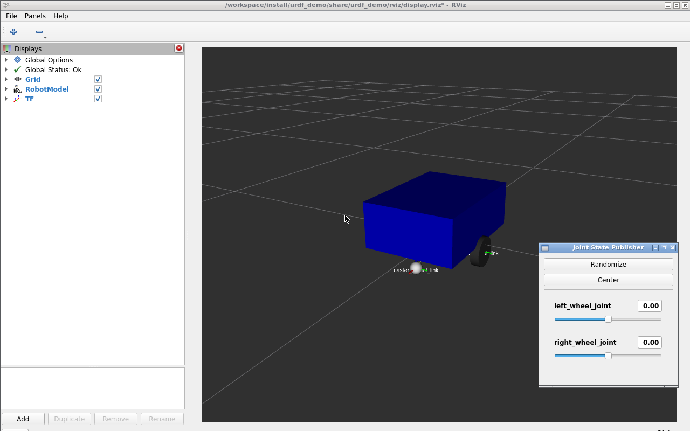
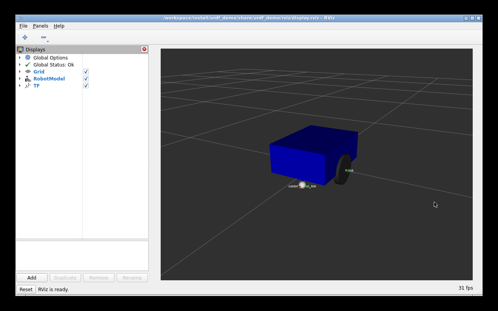
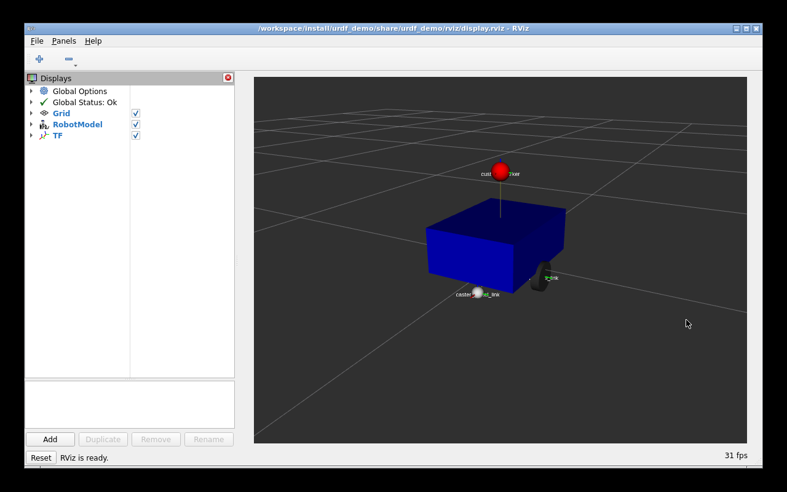
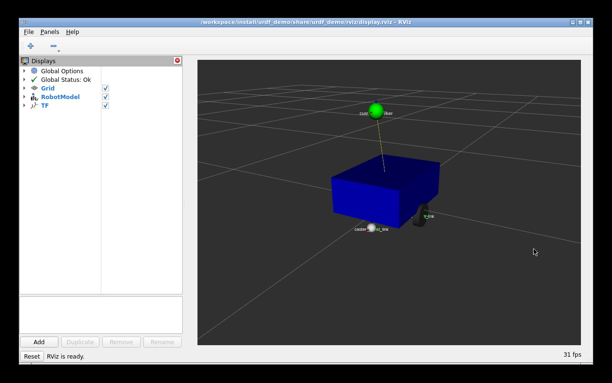

# 第8章 实验指导书：URDF/Xacro 机器人建模

连接与构建见[公共双端环境](ch00_common_setup.md#ch07-ch08)。本章模型包安装在独立 COM260 目录；Xacro、关节 GUI 与 RViz 在 x86 Humble 容器运行。

建模练习保留原课程的 5 kg 双轮模型，配套教案保留 10 kg 四轮模型，用于学习 URDF/Xacro、关节与 TF；Gazebo 运动仿真使用 TurtleBot3 Burger。

## 当前仓库仿真验证：Xacro 模型与 Gazebo/RViz 对照

### 实验目标

验证 Xacro 展开、Robot State Publisher 和 RViz RobotModel，并将课程自定义 URDF 与 `robot_sim_demo` 的 TurtleBot3 Burger SDF 模型进行对照。

### 运行步骤

```bash
cd ~/ROS2_RISCV_COM260
CH08=course_support/k3_com260_kit/scripts/x86-ch07-ch08.bash
RUN_ID=$(date -u +%Y%m%dT%H%M%SZ)-ch08-model
bash "$CH08" start "$RUN_ID" urdf_demo_ros2 display_xacro.launch.py use_gui:=false
bash "$CH08" exec "$RUN_ID" bash -c 'xacro "$(ros2 pkg prefix urdf_demo_ros2)/share/urdf_demo_ros2/urdf/mybot.xacro" > /tmp/mybot.urdf; xmllint --noout /tmp/mybot.urdf; check_urdf /tmp/mybot.urdf'
```

结束这一轮模型展示后，另开一轮查看 Gazebo 模型：

```bash
bash "$CH08" stop "$RUN_ID"
RUN_ID=$(date -u +%Y%m%dT%H%M%SZ)-ch08-gazebo
bash course_support/k3_com260_kit/scripts/x86-gazebo.bash start "$RUN_ID"
```

### 观察与验收

RViz 应显示 Xacro 模型及其 TF；Gazebo 显示 TurtleBot3 Burger 传感器模型。源码：`src_k3_com260_kit/urdf_demo_ros2/urdf/`、`src_k3_pico_itx/robot_sim_demo/models/turtlebot3_burger/model.sdf`。

在 x86 执行 `bash course_support/k3_com260_kit/scripts/x86-gazebo.bash stop "$RUN_ID"`，结束本轮 Gazebo 后再进入独立建模练习。

## 实际运行证据

Xacro、URDF 和参数检查共 34 项通过；从空目录建立的学生包完成普通模型和 marker 文件构建，运行检查 6 项通过。COM260 C++ 查询 x86 关节 TF 成功；详细结果见[第八章实测证据](runtime_evidence.md#ch08)。


[连续原速录像](images/ch08/ch08-joints.mp4) · [学生建包 CAST](images/ch08/ch08-practice.cast) · [COM260 关节查询 CAST](images/ch08/ch08-board-joint-tf.cast)。真实 GUI 记录的左右轮角度从 0 变为约 `1.783` / `-1.953 rad`，按 Center 后回到 0。

> **实验课时**：2 课时（90 分钟） | 课程建模练习

---

## 实验目标
1. 编写基础 URDF 描述机器人结构
2. 使用 XACRO 宏实现参数化建模
3. RViz2 可视化完整机器人模型

---

## 练习 8.1：基础 URDF 编写（约 30 分钟）

### 任务
编写一个简单差速机器人 URDF，包含：
- `base_link`：底盘长方体 (0.4×0.3×0.15)，蓝色，mass=5kg
- `left_wheel_link` / `right_wheel_link`：两个轮子 (cylinder, r=0.05, l=0.03)
- `left_wheel_joint` / `right_wheel_joint`：`continuous` 类型
- `caster_wheel_link`：万向轮 (sphere, r=0.02)

### 步骤

先在 x86 的 Humble 课程容器内创建独立练习包；以下操作以容器 shell 为执行环境，图形会话由公共环境入口提供。建模包只安装资源，无 Python 业务节点。

```bash
source /opt/ros/humble/setup.bash
mkdir -p ~/my_urdf_com260_ws/src
cd ~/my_urdf_com260_ws/src
ros2 pkg create urdf_demo --build-type ament_cmake --license Apache-2.0
cd urdf_demo
mkdir -p urdf launch rviz
```

1. 在 `~/my_urdf_com260_ws/src/urdf_demo/urdf/` 下创建 `simple_robot.urdf`
2. 运行 xacro 解析验证：`xacro urdf/simple_robot.urdf`
3. 使用 `check_urdf` 工具验证语法：`check_urdf <(xacro urdf/simple_robot.urdf)`



完整参考：[simple_robot.urdf](../src_k3_com260_kit/urdf_demo/urdf/simple_robot.urdf)。创建的 plain URDF 与下一节 Xacro 展开后的 link、joint 和几何体应一致。

### 提示
```xml
<geometry>
  <cylinder radius="0.05" length="0.03"/>
</geometry>
<!-- visual/collision 内的圆柱体默认沿 Z 轴，需要旋转到 Y 轴 -->
<origin rpy="1.5708 0 0"/>
```

---

## 练习 8.2：XACRO 参数化建模（约 30 分钟）

### 任务
将练习 8.1 的 URDF 改写为 XACRO 文件 `simple_robot.xacro`：
1. 定义 `<xacro:property>`：`wheel_radius`, `wheel_width`, `chassis_length`, `chassis_width`, `chassis_height`
2. 编写 `<xacro:macro name="wheel" params="name reflect">` 消除重复代码
3. 实例化左右轮：`<xacro:wheel name="left" reflect="1"/>`

### 步骤
1. 编写 `simple_robot.xacro`，参考 `src_k3_com260_kit/urdf_demo/urdf/simple_robot.xacro`
2. 将参考 [display.launch.py](../src_k3_com260_kit/urdf_demo/launch/display.launch.py) 与 [display.rviz](../src_k3_com260_kit/urdf_demo/rviz/display.rviz) 分别保存到练习包同名目录；在 `CMakeLists.txt` 中的 `ament_package()` 前添加 `install(DIRECTORY launch urdf rviz DESTINATION share/${PROJECT_NAME})`。在 `package.xml` 中声明 xacro、robot_state_publisher、joint_state_publisher、joint_state_publisher_gui、rviz2、launch_ros、ament_index_python 运行依赖。构建后运行：

```bash
source /opt/ros/humble/setup.bash
cd ~/my_urdf_com260_ws
colcon build --packages-select urdf_demo --symlink-install
source install/setup.bash
ros2 launch urdf_demo display.launch.py
```

3. 修改参数值（如 `wheel_radius`），观察模型变化

---

## 练习 8.3：RViz2 可视化机器人模型（约 30 分钟）

### 任务
配置 RViz2 完整显示机器人模型。

### 步骤
1. 在 RViz2 中添加 `RobotModel` 插件
2. 设置 Description Topic 为 `/robot_description`
3. 添加 `TF` 插件显示坐标系
4. 将 Fixed Frame 设为 `base_link`
5. 运行 `joint_state_publisher_gui`，拖动滑块测试关节运动
6. 保存 RViz 配置到 `urdf_demo/rviz/display.rviz`

`use_gui:=false` 使用无图形界面的 `joint_state_publisher`；默认 `use_gui:=true` 使用滑块程序 `joint_state_publisher_gui`。两者均发布 `/joint_states`，同一轮只启动一个。轮子转轴为关节 Y 轴，圆柱几何旋转放在 visual/collision，避免 GUI 中绕错误轴转动。



图中轮半径由 `0.05 m` 改为 `0.08 m`，其余底盘尺寸保持不变；恢复原半径后继续后续练习。

### 思考题
1. `robot_state_publisher` 和 `joint_state_publisher` 的分工有何不同？
2. 如果 RViz 显示 "No transform from [left_wheel] to [base_link]"，可能是什么原因？
3. XACRO 宏中的 `*origin` 参数传递 block 时如何实现默认值？

---

## 练习 4：XACRO 自定义标记 — 为课程模型添加视觉标记（约 15 分钟）

### 目标
修改本章课程模型的 xacro 文件，在 base_link 上方添加一个红色球体标记，并在 RViz 中可视化。

### 步骤

**步骤1：编辑 xacro 文件**
在练习包 `urdf/` 下将 `simple_robot.xacro` 复制为 `marked_robot.xacro`，随后在新文件的 `<robot>` 下、`base_link` 元素之外添加 marker link 和 joint（不能嵌套到 `<link>` 内）；完整示例为 [marked_robot.xacro](../src_k3_com260_kit/urdf_demo/urdf/marked_robot.xacro)：
```xml
<link name="custom_marker">
  <visual>
    <geometry>
      <sphere radius="0.03"/>
    </geometry>
    <material name="red_marker">
      <color rgba="1.0 0.0 0.0 1.0"/>
    </material>
  </visual>
</link>

<joint name="marker_joint" type="fixed">
  <parent link="base_link"/>
  <child link="custom_marker"/>
  <origin xyz="0 0 0.3" rpy="0 0 0"/>
</joint>
```

**步骤2：启动 RViz 验证**
```bash
cd ~/my_urdf_com260_ws
colcon build --packages-select urdf_demo --symlink-install
source install/setup.bash
ros2 launch urdf_demo display.launch.py \
  model:="$(ros2 pkg prefix urdf_demo)/share/urdf_demo/urdf/marked_robot.xacro"
```
在 RViz 中添加 RobotModel，确认红色球体出现在机器人顶部。

**步骤3：修改 marker 位置和颜色**
改变 `<origin xyz="..." />` 和 `<color rgba="..." />` 参数，重新启动观察变化。

**✓ 验证**：RViz 中课程模型顶部显示自定义红色球体标记，位置正确。





### 思考题
1. 如何在 xacro 宏中定义一个参数化的 marker，支持不同颜色和大小？
2. `<visual>` 和 `<collision>` 有什么区别？为什么 marker 可以省略碰撞？
