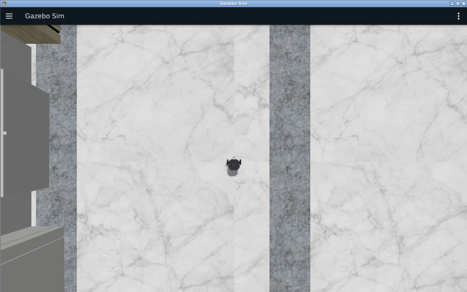
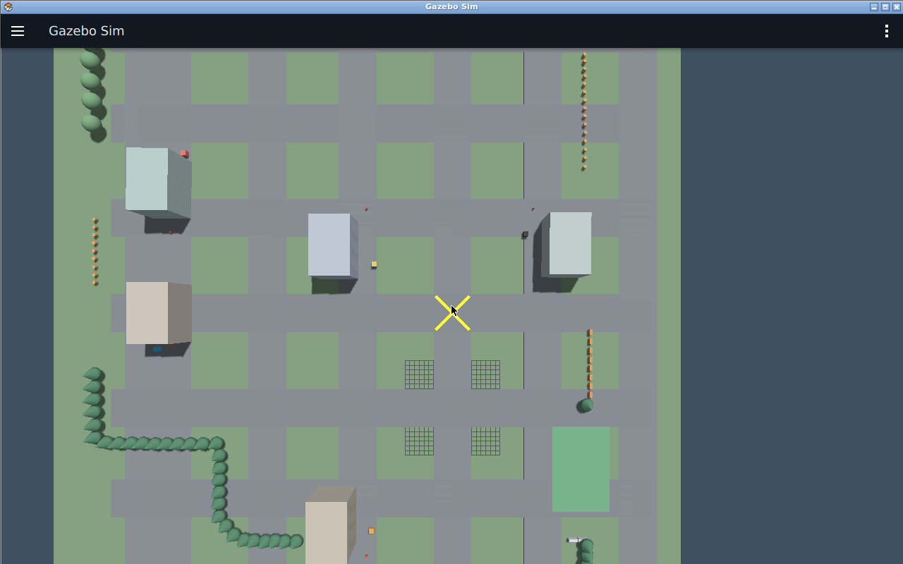
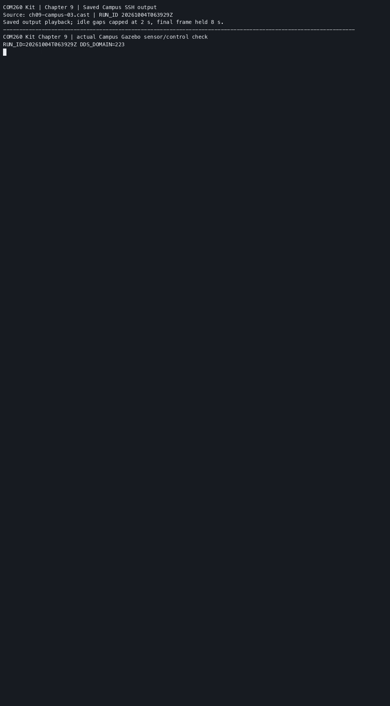

# 第9章 实验指导书：Gazebo 仿真（COM260 Kit）

> 本章使用 COM260 Kit 运行 C++17 节点，x86 Humble/Harmonic 容器运行 Gazebo、RViz 和 ros2_control。执行端标注为“COM260”或“x86 容器”，终端之间不可混用工作区。
>
> 从原课程保留空世界、传感器、控制器、数据订阅四项练习；车型统一为 TurtleBot3 Burger。原 Gazebo Classic 插件改为 Harmonic 系统插件和 ROS-Gazebo Bridge，控制仍由真正的 `diff_drive_controller` 完成。

### 双端准备

先按[公共环境](ch00_common_setup.md)准备第 1～6 章基础镜像。第 9～10 章使用独立工作区。在能够通过 `ssh com260` 和 `ssh duomaomao` 连接两台设备的访问端，从课程仓库根目录同步副本；先用 `-anvi` 检查，再将该选项改为 `-avi` 执行：

```bash
for host in com260 duomaomao; do
  ssh "$host" 'mkdir -p ~/ROS2_RISCV_COM260_CH09_CH10'
  rsync -anvi --relative setup_course_k3_com260_kit.sh \
    course_support/k3_com260_kit src_k3_com260_kit \
    src_k3_pico_itx/robot_sim_demo "$host:ROS2_RISCV_COM260_CH09_CH10/"
done
```

原版与 Pico 文件仅作为只读资源复用；不要在设备副本中覆盖其他章节工作区。

**x86 宿主终端**：进入课程仓库副本，构建一次镜像和课程包：

```bash
cd ~/ROS2_RISCV_COM260_CH09_CH10
bash course_support/k3_com260_kit/scripts/x86-ch09-ch10.bash build-image
bash course_support/k3_com260_kit/scripts/x86-ch09-ch10.bash build
bash course_support/k3_com260_kit/scripts/x86-ch09-ch10.bash start ch09
```

每个 x86 容器终端使用：

```bash
cd ~/ROS2_RISCV_COM260_CH09_CH10
podman exec -it ros2-com260-ch09 bash --noprofile --norc
source /opt/gz_ros2_control_ws/install/setup.bash
source /workspace/install/setup.bash
```

**COM260 终端**：

```bash
cd ~/ROS2_RISCV_COM260_CH09_CH10
bash setup_course_k3_com260_kit.sh --build-ch09
source ~/.config/ros2-course-com260-ch09-ch10/env.bash
```

两端 `ROS_DOMAIN_ID` 一致；不要同时启动其他章节仿真。Humble 默认 ros2_control 仿真二进制对应 Fortress，本章镜像按官方固定版本源码编译 Harmonic 插件，不混装两种插件。


## 当前仓库仿真验证：ISCAS Museum、Bridge 与多传感器

### 实验目标

使用当前 Gazebo Sim Harmonic 入口验证世界加载、机器人 spawn、ROS-Gazebo Bridge、LiDAR、相机和底盘控制。

### 运行步骤

```bash
source /opt/gz_ros2_control_ws/install/setup.bash
source /workspace/install/setup.bash
ros2 launch sim_demo sim_bringup.launch.py \
  world:="$(ros2 pkg prefix sim_demo)/share/sim_demo/worlds/museum.sdf" \
  gui:=true rviz:=true sensor_profile:=lab
```

另开终端：

```bash
source /workspace/install/setup.bash
ros2 topic echo /clock --once
ros2 topic info /scan
ros2 topic echo /camera/camera_info --once
ros2 topic echo /odom --once
```

### 观察与验收

Gazebo 应加载 Museum 场景并生成 TurtleBot3 Burger；RViz 可显示 RobotModel、TF 和 LaserScan。观察 `/clock`、传感器与 `/odom`；源码位于 `src_k3_com260_kit/sim_demo/`。Museum 演示结束后按 Ctrl+C，再开始空世界练习。

> **实验课时**：2 课时（90 分钟） | TurtleBot3 Burger Gazebo 仿真

---

## 实验目标
1. 搭建 Gazebo 仿真环境并 spawn 机器人模型
2. 配置 LiDAR + Camera 传感器插件
3. 使用 ros2_control 差速驱动控制机器人运动

---

## 练习 9.1：Gazebo 环境搭建与 Spawn 机器人（约 30 分钟）

### 任务
编写 `sim_bringup.launch.py`，启动 Gazebo + 空世界 + spawn TurtleBot3 Burger 模型。

### 步骤
1. 在 COM260 新建练习工作区和 C++ 包，参考 `src_k3_com260_kit/sim_demo/`：

```bash
source ~/.config/ros2-course-com260-ch09-ch10/env.bash
mkdir -p ~/my_sim_com260_ws/src
cd ~/my_sim_com260_ws/src
ros2 pkg create sim_demo --build-type ament_cmake --license Apache-2.0 \
  --dependencies rclcpp sensor_msgs
cd sim_demo
mkdir -p launch config gui models urdf worlds rviz
```

本章模型由完整 SDF、URDF、Bridge、世界、GUI 和 RViz 资源共同组成。以下命令仅用于刚创建的练习包：先复制参考资源、构建文件和参考订阅器，后续步骤逐项改写对应文件。已有练习包先核对自己的修改，不重复覆盖。

```bash
REFERENCE=~/ROS2_RISCV_COM260_CH09_CH10/src_k3_com260_kit/sim_demo
cp "$REFERENCE/package.xml" "$REFERENCE/CMakeLists.txt" .
cp -R "$REFERENCE/launch" "$REFERENCE/config" "$REFERENCE/gui" "$REFERENCE/models" \
  "$REFERENCE/urdf" "$REFERENCE/worlds" "$REFERENCE/rviz" .
cp "$REFERENCE/src/sensor_reader.cpp" src/sensor_reader.cpp
```

网格和 Museum 场景资源复用已安装的 `robot_sim_demo`。练习工作区只包含当前 `sim_demo`，不能把原版同名包一起加入构建。

2. 编写 Launch 文件启动 Gazebo：
```python
"""Chapter 9 Burger simulation with real ros2_control and Gazebo Harmonic sensors."""
import os
from pathlib import Path

from ament_index_python.packages import get_package_share_directory
from launch import LaunchDescription
from launch.actions import DeclareLaunchArgument, ExecuteProcess, OpaqueFunction, SetEnvironmentVariable, TimerAction
from launch.conditions import IfCondition, UnlessCondition
from launch.substitutions import LaunchConfiguration
from launch_ros.actions import Node
from launch_ros.parameter_descriptions import ParameterValue


def start_simulation(context):
    share = Path(get_package_share_directory('sim_demo'))
    assets = Path(get_package_share_directory('robot_sim_demo'))
    profile = LaunchConfiguration('sensor_profile').perform(context)
    if profile not in ('lab', 'teacher'):
        raise ValueError('sensor_profile must be lab or teacher')
    sdf = (share / 'models' / f'burger_{profile}.sdf').read_text()
    sdf = sdf.replace('@CONTROLLERS_FILE@', str(share / 'config' / 'diff_drive.yaml'))
    description = (share / 'urdf' / 'burger_control.urdf').read_text()
    world = LaunchConfiguration('world')
    sim_time = ParameterValue(LaunchConfiguration('use_sim_time'), value_type=bool)
    return [
        SetEnvironmentVariable('GZ_PARTITION', LaunchConfiguration('gz_partition')),
        SetEnvironmentVariable('GZ_SIM_RESOURCE_PATH', str(assets / 'models') + os.pathsep + os.environ.get('GZ_SIM_RESOURCE_PATH', '')),
        ExecuteProcess(cmd=['gz', 'sim', '-r', '--gui-config', LaunchConfiguration('gui_config'), world],
                       output='screen', condition=IfCondition(LaunchConfiguration('gui'))),
        ExecuteProcess(cmd=['gz', 'sim', '-r', '-s', '--headless-rendering', world],
                       output='screen', condition=UnlessCondition(LaunchConfiguration('gui'))),
        Node(package='robot_state_publisher', executable='robot_state_publisher',
             name='robot_state_publisher', output='screen',
             parameters=[{'robot_description': description, 'use_sim_time': sim_time}]),
        Node(package='ros_gz_bridge', executable='parameter_bridge', name='sensor_bridge', output='screen',
             parameters=[{'config_file': str(share / 'config' / 'bridge.yaml'), 'use_sim_time': sim_time}]),
        Node(package='ros_gz_image', executable='image_bridge', name='camera_bridge',
             arguments=['/camera/image_raw'], parameters=[{'use_sim_time': sim_time}]),
        TimerAction(period=3.0, actions=[Node(
            package='ros_gz_sim', executable='create', name='spawn_burger', output='screen',
            arguments=['-world', LaunchConfiguration('world_name'), '-string', sdf,
                       '-name', 'turtlebot3_burger', '-x', LaunchConfiguration('spawn_x'),
                       '-y', LaunchConfiguration('spawn_y'), '-z', LaunchConfiguration('spawn_z'),
                       '-Y', LaunchConfiguration('spawn_yaw')])]),
        Node(package='controller_manager', executable='spawner', output='screen',
             arguments=['joint_state_broadcaster', '--controller-manager-timeout', '60']),
        Node(package='controller_manager', executable='spawner', output='screen',
             arguments=['diff_drive_controller', '--controller-manager-timeout', '60']),
        Node(package='rviz2', executable='rviz2', output='screen',
             arguments=['-d', str(share / 'rviz' / 'sensors.rviz')],
             parameters=[{'use_sim_time': sim_time}], condition=IfCondition(LaunchConfiguration('rviz'))),
    ]


def generate_launch_description():
    share = Path(get_package_share_directory('sim_demo'))
    return LaunchDescription([
        DeclareLaunchArgument('world', default_value=str(share / 'worlds' / 'empty.sdf')),
        DeclareLaunchArgument('world_name', default_value='default'),
        DeclareLaunchArgument('gui', default_value='true'),
        DeclareLaunchArgument('gui_config', default_value=str(Path(get_package_share_directory('robot_sim_demo')) / 'gui' / 'museum.gui.config')),
        DeclareLaunchArgument('rviz', default_value='false'),
        DeclareLaunchArgument('sensor_profile', default_value='lab'),
        DeclareLaunchArgument('use_sim_time', default_value='true'),
        DeclareLaunchArgument('gz_partition', default_value='com260_ch09_ch10'),
        DeclareLaunchArgument('spawn_x', default_value='0.0'),
        DeclareLaunchArgument('spawn_y', default_value='0.0'),
        DeclareLaunchArgument('spawn_z', default_value='0.010'),
        DeclareLaunchArgument('spawn_yaw', default_value='0.0'),
        OpaqueFunction(function=start_simulation),
    ])
```
3. Launch 使用 `ros_gz_sim create` 生成 Burger SDF，同时由 `robot_state_publisher` 提供包含控制接口的 URDF。`@CONTROLLERS_FILE@` 在 Launch 中替换为安装后的 YAML 路径。
4. 将修改后的练习源码传到 x86 独立练习目录。以下在能连接两台设备的**访问端**执行；只同步源码，不复制 COM260 的 `build/`、`install/`：

```bash
SIM_STAGE=$(mktemp -d)
rsync -av com260:my_sim_com260_ws/src/sim_demo/ "$SIM_STAGE/sim_demo/"
ssh duomaomao 'mkdir -p ~/ros2_course_com260_ch09_ch10_humble_ws/output/exercises/ch09_ws/src/sim_demo'
rsync -av "$SIM_STAGE/sim_demo/" \
  duomaomao:ros2_course_com260_ch09_ch10_humble_ws/output/exercises/ch09_ws/src/sim_demo/
```

在 **x86 容器**构建，再启动自己编写的 Launch：

```bash
source /opt/gz_ros2_control_ws/install/setup.bash
source /workspace/install/setup.bash
cd /workspace/output/exercises/ch09_ws
colcon build --packages-select sim_demo --symlink-install --cmake-args -DCMAKE_BUILD_TYPE=Debug
source install/setup.bash
ros2 pkg prefix sim_demo
ros2 launch sim_demo sim_bringup.launch.py
```

`ros2 pkg prefix` 应指向 `/workspace/output/exercises/ch09_ws/install/sim_demo`。默认加载本包 `empty.sdf`。后续修改 SDF、YAML 或 Launch 后，先停止当前仿真，重新同步源码并构建；每个新的 x86 容器终端在课程环境之后追加 `source /workspace/output/exercises/ch09_ws/install/setup.bash`。已运行的进程不会自动重读配置。
5. 使用 `gz topic -l` 验证模型已加载

### 验证
```bash
gz topic -l                 # 列出 Gazebo 话题
ros2 topic list             # 列出 ROS 2 话题
ros2 control list_controllers       # 检查仿真硬件连接的控制器
ros2 topic echo /ground_truth/odom --once
```

---

## 练习 9.2：传感器插件配置（约 30 分钟）

### 任务
在 TurtleBot3 Burger 的仿真模型中添加 LiDAR 和 Camera 传感器。Harmonic 使用 SDF `<sensor>` 和 Bridge；控制接口仍放在 URDF `<ros2_control>` 中。

### 步骤
1. 编辑 `models/burger_lab.sdf` 对应 link 内的 `<sensor>`。本练习保留 360 点、180° 扫描；教案的 360° 示例由 `sensor_profile:=teacher` 单独选择。

**LiDAR 插件**：
```xml
<sensor name="laser" type="gpu_lidar">
        <always_on>true</always_on>
        <update_rate>8</update_rate>
        <topic>/scan</topic>
        <gz_frame_id>laser_link</gz_frame_id>
        <visualize>true</visualize>
        <ray>
          <scan>
            <horizontal>
              <samples>360</samples>
              <resolution>1</resolution>
              <min_angle>-1.570796</min_angle>
              <max_angle>1.570796</max_angle>
            </horizontal>
          </scan>
          <range>
            <min>0.12</min>
            <max>12.0</max>
            <resolution>0.01</resolution>
          </range>
          <noise>
            <type>gaussian</type>
            <mean>0</mean>
            <stddev>0.002</stddev>
          </noise>
        </ray>
      </sensor>
```

**Camera 插件**：
```xml
<sensor name="front_camera" type="camera">
        <pose>0.020 0 0 0 0 0</pose>
        <always_on>true</always_on>
        <update_rate>4</update_rate>
        <topic>/camera/image_raw</topic>
        <gz_frame_id>camera_optical_frame</gz_frame_id>
        <visualize>true</visualize>
        <camera name="front_camera">
          <horizontal_fov>1.047</horizontal_fov>
          <image>
            <width>640</width>
            <height>480</height>
            <format>R8G8B8</format>
          </image>
          <clip>
            <near>0.05</near>
            <far>8.0</far>
          </clip>
          <camera_info_topic>/camera/camera_info</camera_info_topic>
        </camera>
      </sensor>
```

2. 改完模型后按9.1步骤4重新同步、构建，在 x86 容器停止空世界，使用上面的 Museum 命令重启仿真；先加载练习 overlay，确认 `ros2 pkg prefix sim_demo` 指向练习目录，再验证话题：
```bash
ros2 topic echo /scan
ros2 run rqt_image_view rqt_image_view /camera/image_raw
```

---

## 练习 9.3：ros2_control 差速驱动控制（约 30 分钟）

### 任务
配置 `diff_drive_controller` 并通过 `/cmd_vel` 控制机器人运动。

### 步骤
1. 在 URDF 中声明轮关节速度命令和位置／速度反馈，再在 SDF 中加载 Harmonic 控制插件：
```xml
<ros2_control name="GazeboSimSystem" type="system">
  <hardware><plugin>gz_ros2_control/GazeboSimSystem</plugin></hardware>
  <joint name="wheel_left_joint">
    <command_interface name="velocity"/>
    <state_interface name="position"/><state_interface name="velocity"/>
  </joint>
  <joint name="wheel_right_joint">
    <command_interface name="velocity"/>
    <state_interface name="position"/><state_interface name="velocity"/>
  </joint>
</ros2_control>

<!-- 下列插件放入 SDF 的 model 元素 -->
<plugin filename="gz_ros2_control-system" name="gz_ros2_control::GazeboSimROS2ControlPlugin">
  <robot_param>robot_description</robot_param>
  <robot_param_node>robot_state_publisher</robot_param_node>
  <parameters>@CONTROLLERS_FILE@</parameters>
  <ros>
    <remapping>/cmd_vel_unstamped:=/cmd_vel</remapping>
    <remapping>/diff_drive_controller/odom:=/odom</remapping>
  </ros>
</plugin>
```

2. 编写控制器配置 YAML (`config/diff_drive.yaml`)：
```yaml
controller_manager:
  ros__parameters:
    update_rate: 50
    use_sim_time: true
    joint_state_broadcaster:
      type: joint_state_broadcaster/JointStateBroadcaster
    diff_drive_controller:
      type: diff_drive_controller/DiffDriveController

diff_drive_controller:
  ros__parameters:
    left_wheel_names: [wheel_left_joint]
    right_wheel_names: [wheel_right_joint]
    wheel_separation: 0.16
    wheel_radius: 0.033
    cmd_vel_timeout: 1.0
    use_stamped_vel: false
    publish_rate: 50.0
    enable_odom_tf: true
    odom_frame_id: odom
    base_frame_id: base_footprint
    position_feedback: true
    open_loop: false
```

Burger 轮距为 0.16 m、轮半径为 0.033 m；原 XBot 的 0.3 m／0.05 m 不适用于该车型。Humble 参数使用 `enable_odom_tf` 控制 TF，控制器持续发布 `/odom`，不使用原文不存在的 `publish_odom` 参数。

3. YAML或控制接口改动后按9.1步骤4重新同步、构建并重启仿真。Launch 已通过 spawner 加载两个控制器，检查它们均为 `active`；若按步骤手动加载，不要再次运行 Launch 中的 spawner：
```bash
ros2 control list_controllers
ros2 control list_hardware_interfaces
```

4. 发布速度指令控制运动：
```bash
# 前进
ros2 topic pub /cmd_vel geometry_msgs/msg/Twist \
  "{linear: {x: 0.3}, angular: {z: 0.0}}" -1

# 左转
ros2 topic pub /cmd_vel geometry_msgs/msg/Twist \
  "{linear: {x: 0.0}, angular: {z: 0.8}}" -1
```

发送单次命令后，观察 `/odom` 速度先变化，并在无新命令约 1 秒后接近零。再次发转向命令观察 yaw 变化；停止时可显式发送零速度：

```bash
ros2 topic pub --once /cmd_vel geometry_msgs/msg/Twist "{}"
ros2 topic echo /odom --field twist.twist
```

### 思考题
1. `diff_drive_controller` 如何将 `cmd_vel` 的线速度和角速度分解为左右轮速？
2. 为什么需要 `cmd_vel_timeout` 参数？如果设为 0 会怎样？
3. 控制器发布的里程计话题和 `enable_odom_tf: true` 产生的 TF 分别是什么？

---

## 练习 4：Gazebo 传感器数据订阅 — 处理 /scan 和 /camera（约 15 分钟）

### 目标
订阅仿真中的 LiDAR 和 Camera 数据，处理并输出传感器数据摘要。

### 步骤

**步骤1：启动仿真（x86 容器）**
先 Ctrl+C 停止上一节的仿真 Launch、rqt 和速度发布命令；同一轮只保留一个 Gazebo 与控制器管理器。

```bash
source /opt/gz_ros2_control_ws/install/setup.bash
source /workspace/install/setup.bash
source /workspace/output/exercises/ch09_ws/install/setup.bash
ros2 launch sim_demo sim_bringup.launch.py
```

**步骤2：编写 sensor_reader.cpp（COM260）**
```cpp
#include <algorithm>
#include <cmath>
#include <limits>
#include <memory>
#include "rclcpp/rclcpp.hpp"
#include "sensor_msgs/msg/image.hpp"
#include "sensor_msgs/msg/laser_scan.hpp"

class SensorReader : public rclcpp::Node
{
public:
  SensorReader() : Node("sensor_reader")
  {
    scan_ = create_subscription<sensor_msgs::msg::LaserScan>("/scan", rclcpp::SensorDataQoS(),
      [this](sensor_msgs::msg::LaserScan::ConstSharedPtr msg) {
        float nearest = std::numeric_limits<float>::infinity(), farthest = 0.0F;
        for (const float range : msg->ranges) {
          if (msg->range_min < range && range < msg->range_max) {
            nearest = std::min(nearest, range);
            farthest = std::max(farthest, range);
          }
        }
        if (std::isfinite(nearest)) {
          RCLCPP_INFO(get_logger(), "LiDAR: %.2frad, %zu 点, 最近: %.2fm, 最远: %.2fm",
            msg->angle_max - msg->angle_min, msg->ranges.size(), nearest, farthest);
        }
      });
    image_ = create_subscription<sensor_msgs::msg::Image>("/camera/image_raw", rclcpp::SensorDataQoS(),
      [this](sensor_msgs::msg::Image::ConstSharedPtr msg) {
        RCLCPP_INFO_THROTTLE(get_logger(), *get_clock(), 2000, "Camera: %ux%u, 编码: %s",
          msg->width, msg->height, msg->encoding.c_str());
      });
  }
private:
  rclcpp::Subscription<sensor_msgs::msg::LaserScan>::SharedPtr scan_;
  rclcpp::Subscription<sensor_msgs::msg::Image>::SharedPtr image_;
};

int main(int argc, char ** argv)
{
  rclcpp::init(argc, argv);
  rclcpp::spin(std::make_shared<SensorReader>());
  rclcpp::shutdown();
  return 0;
}
```

将以上代码保存为 `~/my_sim_com260_ws/src/sim_demo/src/sensor_reader.cpp`。使用下列 `CMakeLists.txt`：

```cmake
cmake_minimum_required(VERSION 3.8)
project(sim_demo)

find_package(ament_cmake REQUIRED)
find_package(rclcpp REQUIRED)
find_package(sensor_msgs REQUIRED)

add_compile_options(-Wall -Wextra -Wpedantic)

add_executable(sensor_reader src/sensor_reader.cpp)
target_compile_features(sensor_reader PRIVATE cxx_std_17)
ament_target_dependencies(sensor_reader rclcpp sensor_msgs)

install(TARGETS sensor_reader DESTINATION lib/${PROJECT_NAME})
install(DIRECTORY launch config gui models urdf worlds rviz DESTINATION share/${PROJECT_NAME})

ament_package()
```

**步骤3：编译并运行（COM260）**
```bash
source ~/.config/ros2-course-com260-ch09-ch10/env.bash
cd ~/my_sim_com260_ws
python3 -m colcon build --packages-select sim_demo --symlink-install
source install/setup.bash
ros2 run sim_demo sensor_reader
```

**✓ 验证**：终端持续输出 LiDAR 扫描角度、点数和距离范围，以及 Camera 图像尺寸。

### 思考题
1. LaserScan 消息中 `ranges` 数组的长度由哪个字段决定？
2. 如何判断 LiDAR 是否被遮挡（大量 NaN 值）？

## 实际运行证据

本章验收检查 Gazebo 会话输出的 `/clock`、`/scan`、`/odom` 和实体创建结果：



Campus PUCRS 验收需从独立世界生成 Burger 并采集实际 GUI：



[Museum 传感器与控制终端记录](images/ch09/ch09-gazebo.cast) · [Gazebo 原速录像](images/ch09/ch09-gazebo.mp4)。

Campus PUCRS 的 COM260 实测终端输出（[原始 CAST](images/ch09/ch09-campus.cast)）：



Campus 沿用原场景出生点 x=20 m，并使用校园专用相机视角。先停止当前仿真，再在 x86 容器运行：

```bash
source /opt/gz_ros2_control_ws/install/setup.bash
source /workspace/install/setup.bash
source /workspace/output/exercises/ch09_ws/install/setup.bash
ros2 launch sim_demo sim_bringup.launch.py \
  world:="$(ros2 pkg prefix sim_demo)/share/sim_demo/worlds/campus_pucrs.world.sdf" \
  world_name:=campus_pucrs spawn_x:=20.0 \
  gui_config:="$(ros2 pkg prefix sim_demo)/share/sim_demo/gui/campus_pucrs.gui.config" \
  gui:=true rviz:=true sensor_profile:=lab
```

结束后停止当前各 Launch、订阅与遥控，在 x86 宿主运行：

```bash
cd ~/ROS2_RISCV_COM260_CH09_CH10
bash course_support/k3_com260_kit/scripts/x86-ch09-ch10.bash stop ch09
```

实测结果和素材状态见[运行证据](runtime_evidence.md#ch09)。
