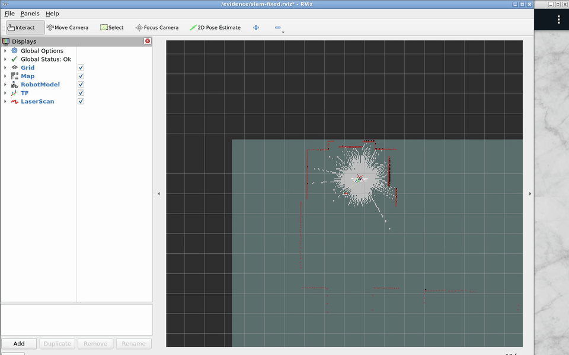
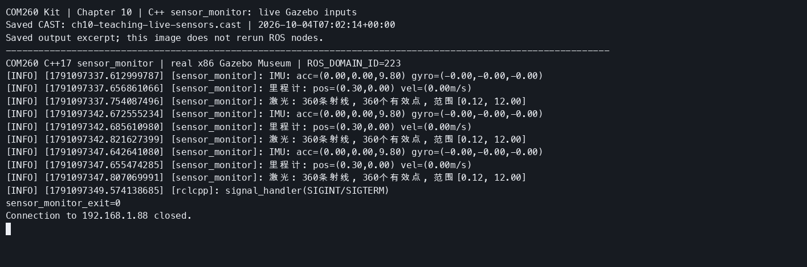
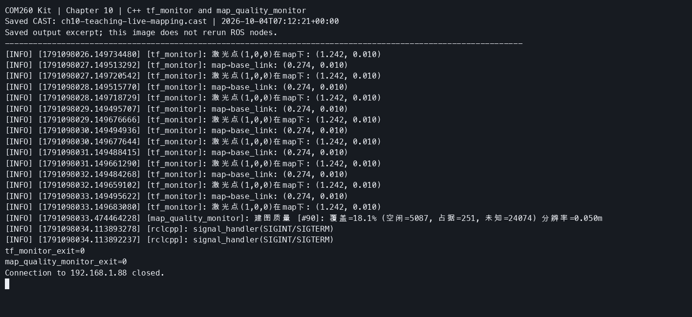
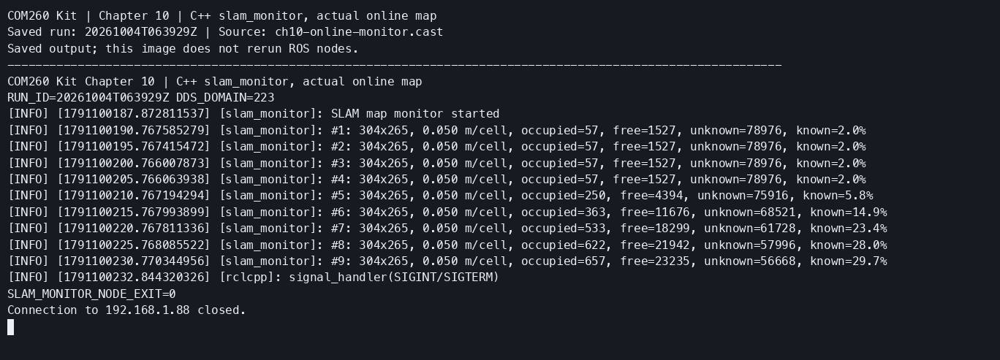
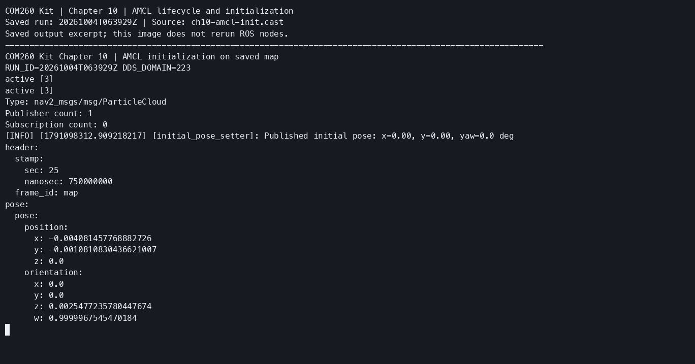
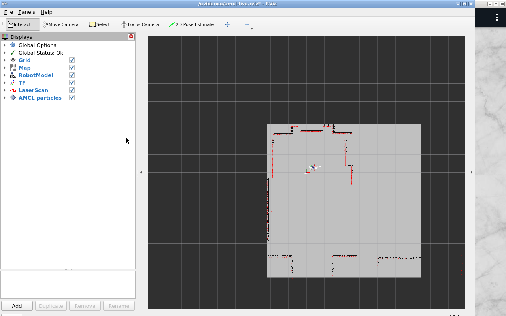
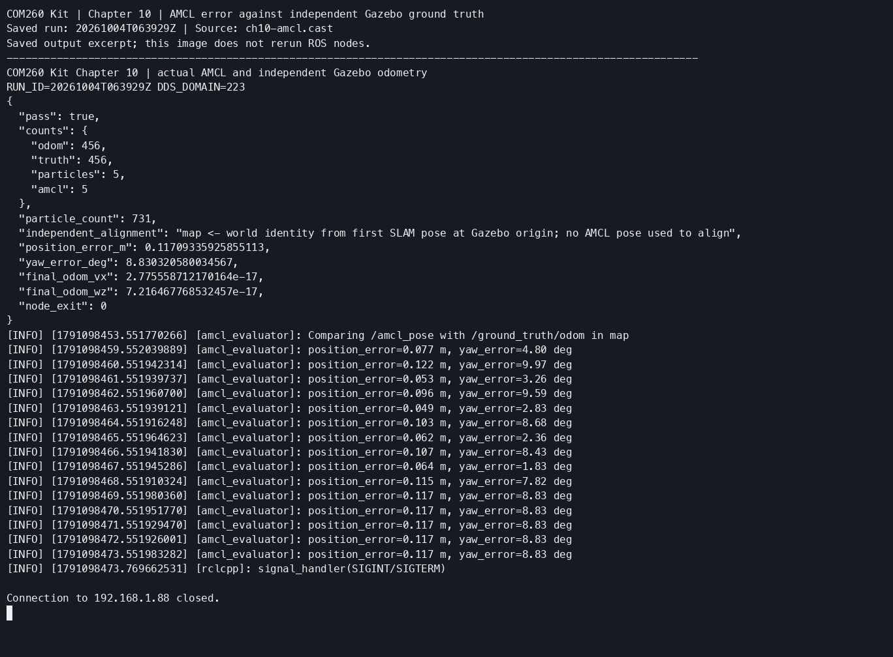
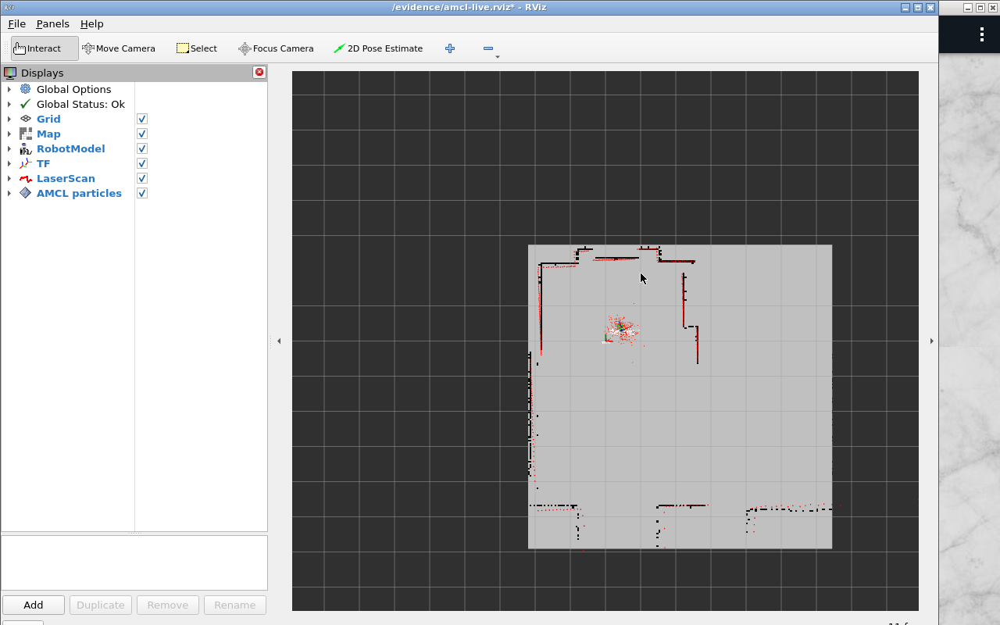
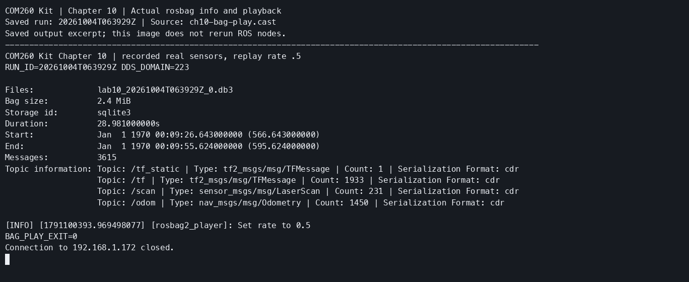
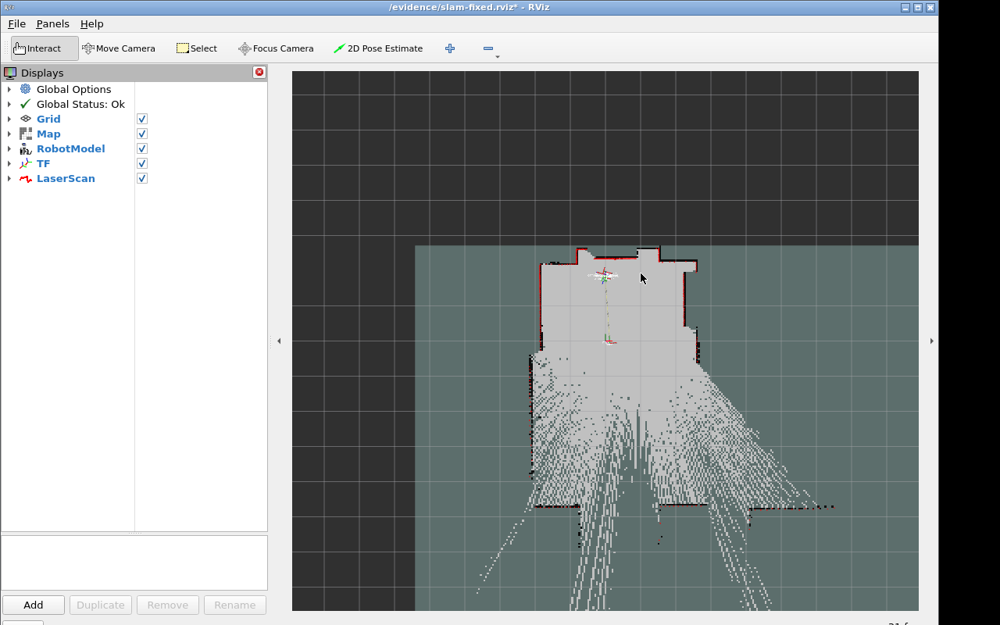

# 第10章 实验指导书：SLAM 建图与定位（COM260 Kit）

> COM260 运行 C++17 地图监控、初始位姿、定位评估和状态保存客户端；x86 Humble/Harmonic 容器运行 Gazebo、slam_toolbox、Nav2 AMCL、Cartographer 和 RViz。课程内容对应教案第 10～15 章，不能把 slam_toolbox 的结果当成 Hector、gmapping 或 Cartographer 的结果。
>
> 先完成[第 9 章的双端环境](ch09_lab.md#双端准备)。本章单独使用 `ch10` 容器；开始前停止第 9 章容器。地图和 bag 保存在 x86 的独立工作区 `~/ros2_course_com260_ch09_ch10_humble_ws/output/`，容器内对应 `/workspace/output/`。

**x86 宿主**：

```bash
cd ~/ROS2_RISCV_COM260_CH09_CH10
bash course_support/k3_com260_kit/scripts/x86-ch09-ch10.bash start ch10
podman exec -it ros2-com260-ch10 bash --noprofile --norc
source /opt/gz_ros2_control_ws/install/setup.bash
source /workspace/install/setup.bash
```

每个新的 x86 容器终端都加载上述两个 setup；每个 COM260 终端都加载：

```bash
source ~/.config/ros2-course-com260-ch09-ch10/env.bash
```

所有 GUI、后端 Launch、地图保存和 rosbag 命令在 **x86 容器**执行；四个 `slam_lab` C++ 入口与 `slam_map_runner` 在 **COM260** 执行，后端 Launch 通过 `start_monitor:=false` 关闭其附带的监控器。双方使用同一 DDS 域，不能混入其他章节的 `/clock`、`/scan` 或 `/map` 发布者。

### 安装全部依赖

x86 的后端依赖由第 9 章 `Containerfile.ch09-ch10` 一次构建。板端只编译客户端和 Cartographer 接口，不安装仿真或 SLAM 后端。

**COM260**：

```bash
cd ~/ROS2_RISCV_COM260_CH09_CH10
bash course_support/k3_com260_kit/scripts/prepare-ch09-ch10-interfaces.bash
bash setup_course_k3_com260_kit.sh --build-ch10
source ~/.config/ros2-course-com260-ch09-ch10/env.bash
ros2 interface show cartographer_ros_msgs/srv/WriteState
```

接口源码分别固定在 Cartographer 2.0.9002 和 Nav2 1.1.20 对应的官方提交；构建入口核对源码版本并拒绝覆盖已有未标记目录或有改动的源码。下载中断留下的干净、无 HEAD 仓库可重跑同一脚本；连续 60 秒低于 1024 B/s 的 HTTP 下载会终止并报错。仿真依赖不写入 COM260 系统。

如果板端不能稳定访问 GitHub，可在能联网的电脑准备两个已检出固定提交的官方 Git 仓库，放在 `~/ros2_ch09_ch10_interface_sources/{cartographer_ros,navigation2}`。保留 `.git`，只传源码，编译仍在 COM260 执行。先结束本组板端程序；若接口工作区已存在，先在 COM260 留存它：

```bash
deps="$HOME/ros2_course_com260_ch09_ch10_deps_ws"
if [ -e "$deps" ]; then
  test -f "$deps/.com260-ch09-ch10-deps" && \
  mv "$deps" "${deps}.before-offline-$(date +%Y%m%dT%H%M%S)"
fi
```

在保存源码的电脑运行以下命令。两个 `test` 必须成功；目标目录必须尚不存在，避免覆盖板端文件。

```bash
set -e
cd ~/ros2_ch09_ch10_interface_sources
test "$(git -C cartographer_ros rev-parse HEAD)" = 43cd92bc8c4bf1a90f50eddbbbd724a899ceebe1
test "$(git -C navigation2 rev-parse HEAD)" = a097086719c88f781aa59788eca29ac6ca5e56db
ssh com260 'set -e; d="$HOME/ros2_course_com260_ch09_ch10_deps_ws"; test ! -e "$d"; mkdir -p "$d/src"; touch "$d/.com260-ch09-ch10-deps"'
rsync -a cartographer_ros navigation2 com260:ros2_course_com260_ch09_ch10_deps_ws/src/
ssh com260 'cd ~/ROS2_RISCV_COM260_CH09_CH10 && bash course_support/k3_com260_kit/scripts/prepare-ch09-ch10-interfaces.bash'
```

准备脚本仍会核对两个 HEAD 和工作区是否干净，不更换源码版本；成功后继续执行上面的 `--build-ch10`。

## 当前仓库仿真验证：slam_toolbox 在线建图

### 实验目标

使用当前 ROS 2 Humble + Gazebo Harmonic 入口，验证激光、里程计、TF 输入经过 `slam_toolbox` 后产生地图更新，并用检查节点给机器人发送可重复运动。

### 运行步骤

```bash
source /opt/gz_ros2_control_ws/install/setup.bash
source /workspace/install/setup.bash

# 终端 1：Gazebo + slam_toolbox + RViz
ros2 launch slam_sim_demo_ros2 slam_demo.launch.py \
  use_gazebo:=true use_rviz:=true gz_headless:=false
```

```bash
# COM260
# COM260 终端：运动并检查地图增长
source ~/.config/ros2-course-com260-ch09-ch10/env.bash
ros2 run slam_sim_demo_ros2 slam_map_runner
ros2 topic echo /map --once
```

### 观察与验收

RViz 中添加 Map、LaserScan、TF；终端检查 `map_updates`、`known_cell_growth`、`odom_distance` 和 `scan_updates`，成功时输出 `slam-map-updated`。

源码：`src_k3_com260_kit/slam_sim_demo_ros2/`。本节验证的是 `slam_toolbox`，不把它的结果标为 Hector、gmapping 或 Cartographer 结果。演示结束后，先等待 `slam_map_runner` 退出并确认小车停止，再在 x86 的组合 Launch 终端按 Ctrl+C，停止 Gazebo、slam_toolbox 和 RViz；之后开始独立建包练习。

## 实际运行证据

`slam_toolbox`、传感器话题和地图更新检查素材：



原始录制：[ch10_slam.cast](images/ch10/ch10-slam.cast)。

> **实验平台**：Ubuntu 22.04 + ROS 2 Humble + Gazebo 仿真
>
> **预计时间**：2 课时（90 分钟）

## 实验准备：创建 slam_lab 功能包

```bash
source /opt/gz_ros2_control_ws/install/setup.bash
source /workspace/install/setup.bash

ros2 pkg prefix sim_demo
ros2 launch sim_demo sim_bringup.launch.py --show-args
```

### 创建目录

在 **COM260** 创建一个与课程参考包分离的新练习工作区：

```bash
source ~/.config/ros2-course-com260-ch09-ch10/env.bash
mkdir -p ~/my_slam_com260_ws/src
cd ~/my_slam_com260_ws/src
ros2 pkg create slam_lab --build-type ament_cmake --license Apache-2.0
cd slam_lab
mkdir -p src launch config/cartographer
```

最终目录必须是：

```text
slam_lab/
├── package.xml
├── CMakeLists.txt
├── src/
│   ├── slam_monitor.cpp
│   ├── initial_pose_setter.cpp
│   ├── amcl_evaluator.cpp
│   └── cartographer_state_saver.cpp
├── launch/
│   ├── online_mapping.launch.py
│   ├── amcl_localization.launch.py
│   └── cartographer_mapping.launch.py
└── config/
    ├── mapper_params_online_async.yaml
    ├── nav2_localization.yaml
    └── cartographer/
        └── burger_2d.lua
```

完整参考源码位于 `src_k3_com260_kit/slam_lab/`。下面逐个保存源文件；完成后把同一份练习源码传到 x86 独立练习目录，分别构建两种架构；x86 构建时安装后端 Launch 和 Cartographer 官方 Lua 资源。

### package.xml

文件路径：`~/my_slam_com260_ws/src/slam_lab/package.xml`

```xml
<?xml version="1.0"?>
<package format="3">
  <name>slam_lab</name>
  <version>0.1.0</version>
  <description>COM260 Kit C++ course examples for slam_lab.</description>
  <maintainer email="student@example.com">Student</maintainer>
  <license>Apache-2.0</license>
  <buildtool_depend>ament_cmake</buildtool_depend>
  <depend>rclcpp</depend>
  <depend>geometry_msgs</depend>
  <depend>nav_msgs</depend>
  <depend>tf2</depend>
  <depend>tf2_ros</depend>
  <depend>tf2_geometry_msgs</depend>
  <depend>cartographer_ros_msgs</depend>
  <exec_depend>ament_index_python</exec_depend>
  <exec_depend>launch</exec_depend>
  <exec_depend>launch_ros</exec_depend>
  <exec_depend>slam_toolbox</exec_depend>
  <exec_depend>nav2_bringup</exec_depend>
  <exec_depend>nav2_map_server</exec_depend>
  <exec_depend>cartographer_ros</exec_depend>
  <exec_depend>rviz2</exec_depend>
  <export><build_type>ament_cmake</build_type></export>
</package>
```

### CMakeLists.txt

文件路径：`~/my_slam_com260_ws/src/slam_lab/CMakeLists.txt`

```cmake
cmake_minimum_required(VERSION 3.8)
project(slam_lab)

find_package(ament_cmake REQUIRED)
find_package(rclcpp REQUIRED)
find_package(geometry_msgs REQUIRED)
find_package(nav_msgs REQUIRED)
find_package(tf2 REQUIRED)
find_package(tf2_ros REQUIRED)
find_package(tf2_geometry_msgs REQUIRED)
find_package(cartographer_ros_msgs REQUIRED)

add_compile_options(-Wall -Wextra -Wpedantic)

add_executable(slam_monitor src/slam_monitor.cpp)
target_compile_features(slam_monitor PRIVATE cxx_std_17)
ament_target_dependencies(slam_monitor rclcpp geometry_msgs nav_msgs tf2 tf2_ros tf2_geometry_msgs cartographer_ros_msgs)

add_executable(set_initial_pose src/initial_pose_setter.cpp)
target_compile_features(set_initial_pose PRIVATE cxx_std_17)
ament_target_dependencies(set_initial_pose rclcpp geometry_msgs nav_msgs tf2 tf2_ros tf2_geometry_msgs cartographer_ros_msgs)

add_executable(amcl_evaluator src/amcl_evaluator.cpp)
target_compile_features(amcl_evaluator PRIVATE cxx_std_17)
ament_target_dependencies(amcl_evaluator rclcpp geometry_msgs nav_msgs tf2 tf2_ros tf2_geometry_msgs cartographer_ros_msgs)

add_executable(save_cartographer_state src/cartographer_state_saver.cpp)
target_compile_features(save_cartographer_state PRIVATE cxx_std_17)
ament_target_dependencies(save_cartographer_state rclcpp geometry_msgs nav_msgs tf2 tf2_ros tf2_geometry_msgs cartographer_ros_msgs)

install(TARGETS slam_monitor set_initial_pose amcl_evaluator save_cartographer_state DESTINATION lib/${PROJECT_NAME})
install(DIRECTORY launch config DESTINATION share/${PROJECT_NAME})
# The board runs clients; the x86 backend image also installs Cartographer Lua resources.
if(EXISTS "/opt/ros/humble/share/cartographer/configuration_files")
  install(DIRECTORY /opt/ros/humble/share/cartographer/configuration_files/
    DESTINATION share/${PROJECT_NAME}/config/cartographer FILES_MATCHING PATTERN "*.lua")
endif()

ament_package()
```

### slam_monitor.cpp

文件路径：`~/my_slam_com260_ws/src/slam_lab/src/slam_monitor.cpp`

```cpp
#include <algorithm>
#include <cstdint>
#include <memory>
#include "nav_msgs/msg/occupancy_grid.hpp"
#include "rclcpp/rclcpp.hpp"

class SlamMonitor : public rclcpp::Node
{
public:
  SlamMonitor() : Node("slam_monitor")
  {
    subscription_ = create_subscription<nav_msgs::msg::OccupancyGrid>(
      "/map", rclcpp::QoS(1).reliable().transient_local(),
      [this](nav_msgs::msg::OccupancyGrid::ConstSharedPtr msg) {
        const auto occupied = std::count_if(msg->data.begin(), msg->data.end(),
          [](int8_t value) {return value >= 65;});
        const auto unknown = std::count_if(msg->data.begin(), msg->data.end(),
          [](int8_t value) {return value < 0;});
        const auto known = msg->data.size() - unknown;
        const double ratio = msg->data.empty() ? 0.0 : 100.0 * known / msg->data.size();
        RCLCPP_INFO(get_logger(),
          "#%zu: %ux%u, %.3f m/cell, occupied=%zu, free=%zu, unknown=%zu, known=%.1f%%",
          ++count_, msg->info.width, msg->info.height, msg->info.resolution,
          static_cast<size_t>(occupied), known - occupied, static_cast<size_t>(unknown), ratio);
      });
    RCLCPP_INFO(get_logger(), "SLAM map monitor started");
  }
private:
  size_t count_{0};
  rclcpp::Subscription<nav_msgs::msg::OccupancyGrid>::SharedPtr subscription_;
};

int main(int argc, char ** argv)
{
  rclcpp::init(argc, argv);
  rclcpp::spin(std::make_shared<SlamMonitor>());
  rclcpp::shutdown();
  return 0;
}
```

### initial_pose_setter.cpp

文件路径：`~/my_slam_com260_ws/src/slam_lab/src/initial_pose_setter.cpp`

```cpp
#include <chrono>
#include <cmath>
#include <memory>
#include <stdexcept>
#include <string>
#include <thread>
#include "geometry_msgs/msg/pose_with_covariance_stamped.hpp"
#include "rclcpp/rclcpp.hpp"

using namespace std::chrono_literals;

int main(int argc, char ** argv)
{
  rclcpp::init(argc, argv);
  int status = 0;
  auto node = std::make_shared<rclcpp::Node>("initial_pose_setter");
  try {
    const auto args = rclcpp::remove_ros_arguments(argc, argv);
    if (args.size() != 4) {throw std::invalid_argument("Usage: set_initial_pose X Y YAW_DEG [--ros-args ...]");}
    const auto number = [](const std::string & value) {
        size_t used = 0;
        const double result = std::stod(value, &used);
        if (used != value.size() || !std::isfinite(result)) {throw std::invalid_argument("Pose values must be finite numbers");}
        return result;
      };
    const double x = number(args[1]), y = number(args[2]), yaw_deg = number(args[3]);
    const double yaw = yaw_deg * std::acos(-1.0) / 180.0;
    auto pub = node->create_publisher<geometry_msgs::msg::PoseWithCovarianceStamped>("/initialpose", 10);
    const auto deadline = std::chrono::steady_clock::now() + 3s;
    while (rclcpp::ok() && pub->get_subscription_count() == 0 && std::chrono::steady_clock::now() < deadline) {
      rclcpp::spin_some(node);
      std::this_thread::sleep_for(100ms);
    }
    if (pub->get_subscription_count() == 0) {
      RCLCPP_WARN(node->get_logger(), "No /initialpose subscriber found; check whether AMCL is active");
    }
    geometry_msgs::msg::PoseWithCovarianceStamped msg;
    msg.header.frame_id = "map";
    msg.pose.pose.position.x = x;
    msg.pose.pose.position.y = y;
    msg.pose.pose.orientation.z = std::sin(yaw / 2.0);
    msg.pose.pose.orientation.w = std::cos(yaw / 2.0);
    msg.pose.covariance[0] = 0.25;
    msg.pose.covariance[7] = 0.25;
    msg.pose.covariance[35] = 0.0685;
    for (int i = 0; i < 3 && rclcpp::ok(); ++i) {
      msg.header.stamp = node->now();
      pub->publish(msg);
      rclcpp::spin_some(node);
      std::this_thread::sleep_for(200ms);
    }
    RCLCPP_INFO(node->get_logger(), "Published initial pose: x=%.2f, y=%.2f, yaw=%.1f deg", x, y, yaw_deg);
  } catch (const std::exception & error) {
    RCLCPP_ERROR(node->get_logger(), "%s", error.what());
    status = 2;
  }
  rclcpp::shutdown();
  return status;
}
```

### amcl_evaluator.cpp

文件路径：`~/my_slam_com260_ws/src/slam_lab/src/amcl_evaluator.cpp`

```cpp
#include <chrono>
#include <cmath>
#include <memory>
#include <string>
#include "geometry_msgs/msg/pose_stamped.hpp"
#include "geometry_msgs/msg/pose_with_covariance_stamped.hpp"
#include "nav_msgs/msg/odometry.hpp"
#include "rclcpp/rclcpp.hpp"
#include "tf2_geometry_msgs/tf2_geometry_msgs.hpp"
#include "tf2_ros/buffer.h"
#include "tf2_ros/transform_listener.h"

using namespace std::chrono_literals;

class AmclEvaluator : public rclcpp::Node
{
public:
  AmclEvaluator() : Node("amcl_evaluator"), buffer_(get_clock()), listener_(buffer_)
  {
    const auto topic = declare_parameter<std::string>("ground_truth_topic", "/ground_truth/odom");
    target_frame_ = declare_parameter<std::string>("target_frame", "map");
    amcl_sub_ = create_subscription<geometry_msgs::msg::PoseWithCovarianceStamped>("/amcl_pose", 10,
      [this](geometry_msgs::msg::PoseWithCovarianceStamped::ConstSharedPtr msg) {amcl_ = msg;});
    truth_sub_ = create_subscription<nav_msgs::msg::Odometry>(topic, 10,
      [this](nav_msgs::msg::Odometry::ConstSharedPtr msg) {truth_ = msg;});
    timer_ = create_wall_timer(1s, [this]() {evaluate();});
    RCLCPP_INFO(get_logger(), "Comparing /amcl_pose with %s in %s", topic.c_str(), target_frame_.c_str());
  }
private:
  static double yaw(const geometry_msgs::msg::Pose & pose)
  {
    const auto & q = pose.orientation;
    return std::atan2(2.0 * (q.w * q.z + q.x * q.y), 1.0 - 2.0 * (q.y * q.y + q.z * q.z));
  }
  geometry_msgs::msg::PoseStamped transform(
    const std_msgs::msg::Header & header, const geometry_msgs::msg::Pose & pose)
  {
    geometry_msgs::msg::PoseStamped input;
    input.header = header;
    input.pose = pose;
    return buffer_.transform(input, target_frame_, tf2::durationFromSec(0.2));
  }
  void evaluate()
  {
    if (!amcl_ || !truth_) {return;}
    try {
      const auto estimated = transform(amcl_->header, amcl_->pose.pose);
      const auto actual = transform(truth_->header, truth_->pose.pose);
      const double position_error = std::hypot(estimated.pose.position.x - actual.pose.position.x,
        estimated.pose.position.y - actual.pose.position.y);
      const double delta = yaw(estimated.pose) - yaw(actual.pose);
      const double yaw_error = std::abs(std::atan2(std::sin(delta), std::cos(delta))) * 180.0 / std::acos(-1.0);
      RCLCPP_INFO(get_logger(), "position_error=%.3f m, yaw_error=%.2f deg", position_error, yaw_error);
    } catch (const tf2::TransformException & error) {
      RCLCPP_WARN(get_logger(), "Cannot transform poses: %s", error.what());
    }
  }
  std::string target_frame_;
  tf2_ros::Buffer buffer_;
  tf2_ros::TransformListener listener_;
  geometry_msgs::msg::PoseWithCovarianceStamped::ConstSharedPtr amcl_;
  nav_msgs::msg::Odometry::ConstSharedPtr truth_;
  rclcpp::Subscription<geometry_msgs::msg::PoseWithCovarianceStamped>::SharedPtr amcl_sub_;
  rclcpp::Subscription<nav_msgs::msg::Odometry>::SharedPtr truth_sub_;
  rclcpp::TimerBase::SharedPtr timer_;
};

int main(int argc, char ** argv)
{
  rclcpp::init(argc, argv);
  rclcpp::spin(std::make_shared<AmclEvaluator>());
  rclcpp::shutdown();
  return 0;
}
```

### cartographer_state_saver.cpp

文件路径：`~/my_slam_com260_ws/src/slam_lab/src/cartographer_state_saver.cpp`

```cpp
#include <chrono>
#include <filesystem>
#include <memory>
#include <stdexcept>
#include <string>
#include "cartographer_ros_msgs/srv/finish_trajectory.hpp"
#include "cartographer_ros_msgs/srv/write_state.hpp"
#include "rclcpp/rclcpp.hpp"

using namespace std::chrono_literals;

int main(int argc, char ** argv)
{
  rclcpp::init(argc, argv);
  auto node = std::make_shared<rclcpp::Node>("cartographer_state_saver");
  int status = 0;
  try {
    const auto args = rclcpp::remove_ros_arguments(argc, argv);
    if (args.size() != 3) {throw std::invalid_argument("Usage: save_cartographer_state TRAJECTORY_ID SERVER_ABSOLUTE_PATH");}
    size_t used = 0;
    const int trajectory_id = std::stoi(args[1], &used);
    if (used != args[1].size() || trajectory_id < 0) {throw std::invalid_argument("Trajectory ID must be a nonnegative integer");}
    if (!std::filesystem::path(args[2]).is_absolute()) {throw std::invalid_argument("Output must be an absolute path on the Cartographer server");}
    auto finish = node->create_client<cartographer_ros_msgs::srv::FinishTrajectory>("/finish_trajectory");
    auto write = node->create_client<cartographer_ros_msgs::srv::WriteState>("/write_state");
    if (!finish->wait_for_service(10s)) {throw std::runtime_error("/finish_trajectory is unavailable");}
    if (!write->wait_for_service(10s)) {throw std::runtime_error("/write_state is unavailable");}
    auto finish_request = std::make_shared<cartographer_ros_msgs::srv::FinishTrajectory::Request>();
    finish_request->trajectory_id = trajectory_id;
    auto finish_future = finish->async_send_request(finish_request);
    if (rclcpp::spin_until_future_complete(node, finish_future, 30s) != rclcpp::FutureReturnCode::SUCCESS) {
      throw std::runtime_error("Failed to finish trajectory");
    }
    const auto finish_status = finish_future.get()->status;
    if (finish_status.code != 0) {throw std::runtime_error("Finish failed: " + finish_status.message);}
    auto write_request = std::make_shared<cartographer_ros_msgs::srv::WriteState::Request>();
    write_request->filename = args[2];
    write_request->include_unfinished_submaps = true;
    auto write_future = write->async_send_request(write_request);
    if (rclcpp::spin_until_future_complete(node, write_future, 30s) != rclcpp::FutureReturnCode::SUCCESS) {
      throw std::runtime_error("Failed to write Cartographer state");
    }
    const auto write_status = write_future.get()->status;
    if (write_status.code != 0) {throw std::runtime_error("Write failed: " + write_status.message);}
    RCLCPP_INFO(node->get_logger(), "Saved Cartographer state on server: %s", args[2].c_str());
  } catch (const std::exception & error) {
    RCLCPP_ERROR(node->get_logger(), "%s", error.what());
    status = 1;
  }
  rclcpp::shutdown();
  return status;
}
```

### online_mapping.launch.py

文件路径：`~/my_slam_com260_ws/src/slam_lab/launch/online_mapping.launch.py`

```python
#!/usr/bin/env python3

import os

from ament_index_python.packages import get_package_share_directory
from launch import LaunchDescription
from launch.actions import DeclareLaunchArgument, IncludeLaunchDescription
from launch.conditions import IfCondition
from launch.launch_description_sources import PythonLaunchDescriptionSource
from launch.substitutions import LaunchConfiguration
from launch_ros.actions import Node


def generate_launch_description():
    package_share = get_package_share_directory('slam_lab')
    slam_toolbox_share = get_package_share_directory('slam_toolbox')

    use_sim_time = LaunchConfiguration('use_sim_time')
    params_file = LaunchConfiguration('params_file')
    start_monitor = LaunchConfiguration('start_monitor')

    slam_launch = IncludeLaunchDescription(
        PythonLaunchDescriptionSource(
            os.path.join(
                slam_toolbox_share,
                'launch',
                'online_async_launch.py',
            )
        ),
        launch_arguments={
            'slam_params_file': params_file,
            'use_sim_time': use_sim_time,
        }.items(),
    )

    monitor_node = Node(
        package='slam_lab',
        executable='slam_monitor',
        name='slam_monitor',
        output='screen',
        parameters=[{'use_sim_time': use_sim_time}],
        condition=IfCondition(start_monitor),
    )

    return LaunchDescription([
        DeclareLaunchArgument(
            'use_sim_time',
            default_value='true',
            description='Use the Gazebo /clock topic',
        ),
        DeclareLaunchArgument(
            'params_file',
            default_value=os.path.join(
                package_share,
                'config',
                'mapper_params_online_async.yaml',
            ),
            description='Absolute path to the slam_toolbox parameter file',
        ),
        DeclareLaunchArgument(
            'start_monitor',
            default_value='true',
            description='Start the map statistics node',
        ),
        slam_launch,
        monitor_node,
    ])
```

### amcl_localization.launch.py

文件路径：`~/my_slam_com260_ws/src/slam_lab/launch/amcl_localization.launch.py`

```python
#!/usr/bin/env python3

import os

from ament_index_python.packages import get_package_share_directory
from launch import LaunchDescription
from launch.actions import DeclareLaunchArgument, IncludeLaunchDescription
from launch.conditions import IfCondition
from launch.launch_description_sources import PythonLaunchDescriptionSource
from launch.substitutions import LaunchConfiguration


def generate_launch_description():
    package_share = get_package_share_directory('slam_lab')
    nav2_share = get_package_share_directory('nav2_bringup')

    map_file = LaunchConfiguration('map')
    params_file = LaunchConfiguration('params_file')
    use_sim_time = LaunchConfiguration('use_sim_time')
    autostart = LaunchConfiguration('autostart')
    use_rviz = LaunchConfiguration('use_rviz')

    localization = IncludeLaunchDescription(
        PythonLaunchDescriptionSource(
            os.path.join(nav2_share, 'launch', 'localization_launch.py')
        ),
        launch_arguments={
            'map': map_file,
            'params_file': params_file,
            'use_sim_time': use_sim_time,
            'autostart': autostart,
        }.items(),
    )

    rviz = IncludeLaunchDescription(
        PythonLaunchDescriptionSource(
            os.path.join(nav2_share, 'launch', 'rviz_launch.py')
        ),
        launch_arguments={'use_sim_time': use_sim_time}.items(),
        condition=IfCondition(use_rviz),
    )

    return LaunchDescription([
        DeclareLaunchArgument(
            'map',
            description='Absolute path to the saved map YAML file',
        ),
        DeclareLaunchArgument(
            'params_file',
            default_value=os.path.join(
                package_share,
                'config',
                'nav2_localization.yaml',
            ),
            description='Absolute path to the Nav2 localization parameters',
        ),
        DeclareLaunchArgument('use_sim_time', default_value='true'),
        DeclareLaunchArgument('autostart', default_value='true'),
        DeclareLaunchArgument('use_rviz', default_value='true'),
        localization,
        rviz,
    ])
```

### cartographer_mapping.launch.py

文件路径：`~/my_slam_com260_ws/src/slam_lab/launch/cartographer_mapping.launch.py`

```python
#!/usr/bin/env python3

import os

from ament_index_python.packages import get_package_share_directory
from launch import LaunchDescription
from launch.actions import DeclareLaunchArgument
from launch.substitutions import LaunchConfiguration
from launch_ros.actions import Node


def generate_launch_description():
    package_share = get_package_share_directory('slam_lab')

    configuration_directory = LaunchConfiguration('configuration_directory')
    configuration_basename = LaunchConfiguration('configuration_basename')
    scan_topic = LaunchConfiguration('scan_topic')
    odom_topic = LaunchConfiguration('odom_topic')
    resolution = LaunchConfiguration('resolution')
    use_sim_time = LaunchConfiguration('use_sim_time')

    cartographer_node = Node(
        package='cartographer_ros',
        executable='cartographer_node',
        name='cartographer_node',
        output='screen',
        arguments=[
            '-configuration_directory',
            configuration_directory,
            '-configuration_basename',
            configuration_basename,
        ],
        parameters=[{'use_sim_time': use_sim_time}],
        remappings=[
            ('scan', scan_topic),
            ('odom', odom_topic),
        ],
    )

    occupancy_grid_node = Node(
        package='cartographer_ros',
        executable='cartographer_occupancy_grid_node',
        name='cartographer_occupancy_grid_node',
        output='screen',
        arguments=[
            '-resolution',
            resolution,
            '-publish_period_sec',
            '1.0',
        ],
        parameters=[{'use_sim_time': use_sim_time}],
    )

    return LaunchDescription([
        DeclareLaunchArgument(
            'configuration_directory',
            default_value=os.path.join(
                package_share,
                'config',
                'cartographer',
            ),
        ),
        DeclareLaunchArgument(
            'configuration_basename',
            default_value='burger_2d.lua',
        ),
        DeclareLaunchArgument('scan_topic', default_value='/scan'),
        DeclareLaunchArgument('odom_topic', default_value='/odom'),
        DeclareLaunchArgument('resolution', default_value='0.05'),
        DeclareLaunchArgument('use_sim_time', default_value='true'),
        cartographer_node,
        occupancy_grid_node,
    ])
```

### mapper_params_online_async.yaml

文件路径：`~/my_slam_com260_ws/src/slam_lab/config/mapper_params_online_async.yaml`

```yaml
slam_toolbox:
  ros__parameters:
    solver_plugin: solver_plugins::CeresSolver
    ceres_linear_solver: SPARSE_NORMAL_CHOLESKY
    ceres_preconditioner: SCHUR_JACOBI
    ceres_trust_strategy: LEVENBERG_MARQUARDT
    ceres_dogleg_type: TRADITIONAL_DOGLEG
    ceres_loss_function: None

    odom_frame: odom
    map_frame: map
    base_frame: base_link
    scan_topic: /scan
    use_map_saver: true
    mode: mapping

    debug_logging: false
    throttle_scans: 1
    transform_publish_period: 0.02
    map_update_interval: 5.0
    resolution: 0.05
    max_laser_range: 12.0
    minimum_time_interval: 0.5
    transform_timeout: 0.2
    tf_buffer_duration: 30.0
    stack_size_to_use: 40000000
    enable_interactive_mode: true

    use_scan_matching: true
    use_scan_barycenter: true
    minimum_travel_distance: 0.2
    minimum_travel_heading: 0.2
    scan_buffer_size: 10
    scan_buffer_maximum_scan_distance: 10.0
    link_match_minimum_response_fine: 0.1
    link_scan_maximum_distance: 1.5
    loop_search_maximum_distance: 3.0
    do_loop_closing: true
    loop_match_minimum_chain_size: 10
    loop_match_maximum_variance_coarse: 3.0
    loop_match_minimum_response_coarse: 0.35
    loop_match_minimum_response_fine: 0.45

    correlation_search_space_dimension: 0.5
    correlation_search_space_resolution: 0.01
    correlation_search_space_smear_deviation: 0.1

    loop_search_space_dimension: 8.0
    loop_search_space_resolution: 0.05
    loop_search_space_smear_deviation: 0.03

    distance_variance_penalty: 0.5
    angle_variance_penalty: 1.0
    fine_search_angle_offset: 0.00349
    coarse_search_angle_offset: 0.349
    coarse_angle_resolution: 0.0349
    minimum_angle_penalty: 0.9
    minimum_distance_penalty: 0.5
    use_response_expansion: true
```

### nav2_localization.yaml

文件路径：`~/my_slam_com260_ws/src/slam_lab/config/nav2_localization.yaml`

```yaml
amcl:
  ros__parameters:
    use_sim_time: true
    alpha1: 0.2
    alpha2: 0.2
    alpha3: 0.2
    alpha4: 0.2
    alpha5: 0.2
    base_frame_id: base_link
    beam_skip_distance: 0.5
    beam_skip_error_threshold: 0.9
    beam_skip_threshold: 0.3
    do_beamskip: false
    global_frame_id: map
    lambda_short: 0.1
    laser_likelihood_max_dist: 2.0
    laser_max_range: 12.0
    laser_min_range: 0.15
    laser_model_type: likelihood_field
    max_beams: 60
    max_particles: 2000
    min_particles: 500
    odom_frame_id: odom
    pf_err: 0.05
    pf_z: 0.99
    recovery_alpha_fast: 0.0
    recovery_alpha_slow: 0.0
    resample_interval: 1
    robot_model_type: nav2_amcl::DifferentialMotionModel
    save_pose_rate: 0.5
    sigma_hit: 0.2
    tf_broadcast: true
    transform_tolerance: 1.0
    update_min_a: 0.2
    update_min_d: 0.25
    z_hit: 0.5
    z_max: 0.05
    z_rand: 0.5
    z_short: 0.05
    scan_topic: scan
    set_initial_pose: false
    always_reset_initial_pose: false
    first_map_only: false

map_server:
  ros__parameters:
    use_sim_time: true
    yaml_filename: ''
    topic_name: map
    frame_id: map

lifecycle_manager_localization:
  ros__parameters:
    use_sim_time: true
    autostart: true
    node_names: [map_server, amcl]
    bond_timeout: 4.0
```

### burger_2d.lua

文件路径：`~/my_slam_com260_ws/src/slam_lab/config/cartographer/burger_2d.lua`

Cartographer 的 `map_builder.lua`、`trajectory_builder.lua` 及其依赖属于 x86 容器内已安装的官方软件包。CMake 在该容器构建时把基础 Lua 安装到本包配置目录，COM260 仅运行服务客户端，不需要这些后端文件。保存以下机器人配置为 `burger_2d.lua`。

```lua
include "map_builder.lua"
include "trajectory_builder.lua"

options = {
  map_builder = MAP_BUILDER,
  trajectory_builder = TRAJECTORY_BUILDER,

  map_frame = "map",
  tracking_frame = "base_link",
  published_frame = "odom",
  odom_frame = "odom",
  provide_odom_frame = false,
  publish_frame_projected_to_2d = true,

  use_odometry = true,
  use_nav_sat = false,
  use_landmarks = false,

  num_laser_scans = 1,
  num_multi_echo_laser_scans = 0,
  num_subdivisions_per_laser_scan = 1,
  num_point_clouds = 0,

  lookup_transform_timeout_sec = 0.2,
  submap_publish_period_sec = 0.3,
  pose_publish_period_sec = 0.005,
  trajectory_publish_period_sec = 0.03,

  rangefinder_sampling_ratio = 1.0,
  odometry_sampling_ratio = 1.0,
  fixed_frame_pose_sampling_ratio = 1.0,
  imu_sampling_ratio = 1.0,
  landmarks_sampling_ratio = 1.0,
}

MAP_BUILDER.use_trajectory_builder_2d = true

TRAJECTORY_BUILDER_2D.use_imu_data = false
TRAJECTORY_BUILDER_2D.min_range = 0.15
TRAJECTORY_BUILDER_2D.max_range = 12.0
TRAJECTORY_BUILDER_2D.missing_data_ray_length = 5.0
TRAJECTORY_BUILDER_2D.num_accumulated_range_data = 1

POSE_GRAPH.optimize_every_n_nodes = 90
POSE_GRAPH.constraint_builder.sampling_ratio = 0.3
POSE_GRAPH.constraint_builder.min_score = 0.55

return options
```

### 编译完整功能包

在 **COM260** 编译刚刚创建的练习包：

```bash
source ~/.config/ros2-course-com260-ch09-ch10/env.bash
cd ~/my_slam_com260_ws
python3 -m colcon build --packages-select slam_lab --symlink-install
source install/setup.bash
ros2 pkg prefix slam_lab
ros2 pkg executables slam_lab
```

需要运行练习包的 COM260 终端在课程环境之后追加 `source ~/my_slam_com260_ws/install/setup.bash`。不要在同一 colcon 源码范围内加入两个同名包。

在能通过 SSH 连接两台设备的**访问端**同步当前练习源码，不传二进制或安装产物：

```bash
SLAM_STAGE=$(mktemp -d)
rsync -av com260:my_slam_com260_ws/src/slam_lab/ "$SLAM_STAGE/slam_lab/"
ssh duomaomao 'mkdir -p ~/ros2_course_com260_ch09_ch10_humble_ws/output/exercises/ch10_ws/src/slam_lab'
rsync -av "$SLAM_STAGE/slam_lab/" \
  duomaomao:ros2_course_com260_ch09_ch10_humble_ws/output/exercises/ch10_ws/src/slam_lab/
```

在 **x86 容器**独立构建同一练习包：

```bash
source /opt/gz_ros2_control_ws/install/setup.bash
source /workspace/install/setup.bash
cd /workspace/output/exercises/ch10_ws
colcon build --packages-select slam_lab --symlink-install --cmake-args -DCMAKE_BUILD_TYPE=Debug
source install/setup.bash
ros2 pkg prefix slam_lab
```

输出应指向 `/workspace/output/exercises/ch10_ws/install/slam_lab`。后续每个 x86 容器终端都在课程环境之后加载此 overlay；修改后重新同步、构建并重启相关后端，避免读取课程参考包的旧配置。检查三个入口：

```bash
source /opt/gz_ros2_control_ws/install/setup.bash
source /workspace/install/setup.bash
source /workspace/output/exercises/ch10_ws/install/setup.bash
ros2 launch slam_lab online_mapping.launch.py --show-args
ros2 launch slam_lab amcl_localization.launch.py --show-args
ros2 launch slam_lab cartographer_mapping.launch.py --show-args
```

## 练习1：slam_toolbox 在线建图（约30分钟）

确认章首组合演示已停止。以下 Gazebo、SLAM、RViz、键盘遥控和观测命令分别使用独立终端；`tf2_echo`、`topic hz` 等持续观察命令用 Ctrl+C 退出后再执行下一条。

### 启动仿真

```bash
source /opt/gz_ros2_control_ws/install/setup.bash
source /workspace/install/setup.bash
source /workspace/output/exercises/ch10_ws/install/setup.bash

ros2 launch sim_demo sim_bringup.launch.py \
  world:="$(ros2 pkg prefix sim_demo)/share/sim_demo/worlds/museum.sdf" \
  gui:=true rviz:=false sensor_profile:=teacher
```

### 检查传感器和 TF
```bash
source /opt/gz_ros2_control_ws/install/setup.bash
source /workspace/install/setup.bash
source /workspace/output/exercises/ch10_ws/install/setup.bash

ros2 topic list | grep -E '^/(scan|odom|clock|tf|tf_static)$'
ros2 topic type /scan
ros2 topic echo /scan --once
ros2 topic echo /odom --once
ros2 run tf2_ros tf2_echo odom base_link
```



```bash
ros2 topic echo /scan --once --field header
ros2 run tf2_tools view_frames
```



### slam_toolbox 参数

```bash
source /opt/gz_ros2_control_ws/install/setup.bash
source /workspace/install/setup.bash
source /workspace/output/exercises/ch10_ws/install/setup.bash

SLAM_LAB_SHARE="$(ros2 pkg prefix slam_lab)/share/slam_lab"
test -f "$SLAM_LAB_SHARE/config/mapper_params_online_async.yaml"
grep -nE 'odom_frame|map_frame|base_frame|scan_topic|mode|resolution|max_laser_range|use_sim_time' \
  "$SLAM_LAB_SHARE/config/mapper_params_online_async.yaml"
```
### 启动在线异步建图

```bash
source /opt/gz_ros2_control_ws/install/setup.bash
source /workspace/install/setup.bash
source /workspace/output/exercises/ch10_ws/install/setup.bash

ros2 launch slam_lab online_mapping.launch.py \
  use_sim_time:=true \
  start_monitor:=false
```

```bash
source /opt/gz_ros2_control_ws/install/setup.bash
source /workspace/install/setup.bash
source /workspace/output/exercises/ch10_ws/install/setup.bash

ros2 node list | grep slam
ros2 topic info /map --verbose
ros2 topic echo /map --once --field info
ros2 service list | grep slam_toolbox
```
### 启动 RViz2

```bash
source /opt/gz_ros2_control_ws/install/setup.bash
source /workspace/install/setup.bash
source /workspace/output/exercises/ch10_ws/install/setup.bash

rviz2 --ros-args -p use_sim_time:=true
```

在 RViz2 中设置：

1. `Fixed Frame` 设为 `map`；
2. 添加 `Map`，Topic 设为 `/map`，Durability 设为 `Transient Local`；
3. 添加 `LaserScan`，Topic 设为 `/scan`；
4. 添加 `TF` 和 `RobotModel`；
5. 确认地图、激光扫描和机器人位姿重合。

配置完成后在 RViz2 中保存为 `/workspace/output/slam_view.rviz`，下次使用：

```bash
rviz2 -d /workspace/output/slam_view.rviz --ros-args -p use_sim_time:=true
```

### 键盘遥控并探索环境
```bash
source /opt/gz_ros2_control_ws/install/setup.bash
source /workspace/install/setup.bash
source /workspace/output/exercises/ch10_ws/install/setup.bash

ros2 run teleop_twist_keyboard teleop_twist_keyboard \
  --ros-args \
  -p speed:=0.3 \
  -p turn:=0.8
```

### 检查并保存地图

```bash
source /opt/gz_ros2_control_ws/install/setup.bash
source /workspace/install/setup.bash
source /workspace/output/exercises/ch10_ws/install/setup.bash

ros2 run nav2_map_server map_saver_cli \
  -t /map \
  -f "/workspace/output/maps/lab10_map" \
  --ros-args \
  -p use_sim_time:=true \
  -p save_map_timeout:=20.0

test -s "/workspace/output/maps/lab10_map.pgm" && \
test -s "/workspace/output/maps/lab10_map.yaml" && \
echo '地图文件保存成功'
ls -lh "/workspace/output/maps/lab10_map.pgm" "/workspace/output/maps/lab10_map.yaml"
```
### 可运行的 C++ 地图监控节点

```bash
# COM260
source ~/.config/ros2-course-com260-ch09-ch10/env.bash
source ~/my_slam_com260_ws/install/setup.bash
ros2 run slam_lab slam_monitor --ros-args -p use_sim_time:=true
```



---

## 练习2：加载地图并使用 AMCL 定位（约30分钟）

### 停止建图节点并确认地图文件

先在遥控终端停止运动并按 Ctrl+C；再分别停止练习1的 SLAM、地图监控、RViz 和 Gazebo Launch，确认它们退出。以下启动全新仿真，不与前一轮共享发布者。AMCL 与 slam_toolbox 都发布 `map→odom`，不能同时运行。

```bash
source /opt/gz_ros2_control_ws/install/setup.bash
source /workspace/install/setup.bash
source /workspace/output/exercises/ch10_ws/install/setup.bash

test -s "/workspace/output/maps/lab10_map.yaml"
test -s "/workspace/output/maps/lab10_map.pgm"
grep -E '^[[:space:]]*(image|resolution|origin|occupied_thresh|free_thresh):' \
  "/workspace/output/maps/lab10_map.yaml"
```

### 启动仿真

```bash
source /opt/gz_ros2_control_ws/install/setup.bash
source /workspace/install/setup.bash
source /workspace/output/exercises/ch10_ws/install/setup.bash

ros2 launch sim_demo sim_bringup.launch.py \
  world:="$(ros2 pkg prefix sim_demo)/share/sim_demo/worlds/museum.sdf" \
  gui:=true rviz:=false sensor_profile:=teacher
```

### 启动 AMCL 和地图服务器

```bash
source /opt/gz_ros2_control_ws/install/setup.bash
source /workspace/install/setup.bash
source /workspace/output/exercises/ch10_ws/install/setup.bash

ros2 launch slam_lab amcl_localization.launch.py \
  map:=/workspace/output/maps/lab10_map.yaml \
  use_sim_time:=true \
  use_rviz:=false \
  autostart:=true
```
检查生命周期状态：

```bash
source /opt/gz_ros2_control_ws/install/setup.bash
source /workspace/install/setup.bash
source /workspace/output/exercises/ch10_ws/install/setup.bash

ros2 lifecycle get /map_server
ros2 lifecycle get /amcl
ros2 topic info /map --verbose
ros2 topic echo /map --once --field info
```



### 启动 RViz2 并设置初始位姿

先在 COM260 的独立终端启动评估器，再发送初始位姿。`/amcl_pose` 在当前 Humble 镜像中 使用 reliable + transient_local；本章监控器保留 volatile 订阅，晚加入且机器人静止时会等待下一条位姿。应先开监控、再发初值或移动产生新观测，不把等待新消息误判为节点没有启动。

本章真值来自 Gazebo `/ground_truth/odom`，frame 为 `world`。只有在建图第一帧和当前仿真都从相同的 `spawn_x=0, spawn_y=0, spawn_yaw=0` 起步、地图坐标原点与该世界坐标一致时，才使用下列单位变换；其他地图或出生位姿必须依据独立标定确定 map 与 world 的关系，不能从 AMCL 估计反推来“对齐真值”。

```bash
# COM260 独立终端：保持该静态TF发布器运行
source ~/.config/ros2-course-com260-ch09-ch10/env.bash
ros2 run tf2_ros static_transform_publisher \
  --x 0 --y 0 --z 0 --roll 0 --pitch 0 --yaw 0 \
  --frame-id map --child-frame-id world
```

```bash
# COM260 另一个终端：保持评估器运行
source ~/.config/ros2-course-com260-ch09-ch10/env.bash
source ~/my_slam_com260_ws/install/setup.bash
ros2 run slam_lab amcl_evaluator --ros-args -p use_sim_time:=true
```

评估器比较最近收到的位姿，运动期间两种消息的时间戳可能不同；数值作为观测记录，静止后检查误差更易解释，不将其当成完成时间同步的精度测量。进入其他建图或定位轮次前，停止这两个终端。

```bash
source /opt/gz_ros2_control_ws/install/setup.bash
source /workspace/install/setup.bash
source /workspace/output/exercises/ch10_ws/install/setup.bash

rviz2 -d /opt/ros/humble/share/nav2_bringup/rviz/nav2_default_view.rviz \
  --ros-args -p use_sim_time:=true
```

在 RViz2 中：

1. `Fixed Frame` 设为 `map`；
2. 确认 `Map` 的 Topic 是 `/map`，Durability 为 `Transient Local`，保证晚打开 RViz 时能收到地图；
3. 添加或确认 `LaserScan` 的 Topic 是 `/scan`；
4. 点击 `2D Pose Estimate`，在地图中点击机器人位置并拖动箭头指定朝向；
5. 添加 `nav2_rviz_plugins/ParticleCloud`，Topic 设为 `/particle_cloud`，Reliability 设为 `Best Effort`；其消息为 `nav2_msgs/msg/ParticleCloud`，不能用 `PoseArray` 显示项。观察粒子云是否逐渐收敛到机器人附近。



```bash
# COM260
source ~/.config/ros2-course-com260-ch09-ch10/env.bash
source ~/my_slam_com260_ws/install/setup.bash

# 可以按地图实际位置修改三个数值，yaw 单位为度
ros2 run slam_lab set_initial_pose 0.0 0.0 0.0 \
  --ros-args -p use_sim_time:=true
```

### 验证 AMCL 输出

```bash
source /opt/gz_ros2_control_ws/install/setup.bash
source /workspace/install/setup.bash
source /workspace/output/exercises/ch10_ws/install/setup.bash

ros2 topic echo /amcl_pose --once
ros2 topic echo /particle_cloud --once
ros2 run tf2_ros tf2_echo map base_link
```



Nav2 AMCL 的粒子话题是 `/particle_cloud`。移动机器人后可观察频率：

```bash
ros2 topic hz /amcl_pose
```

### 进行移动和全局重定位测试

```bash
source /opt/gz_ros2_control_ws/install/setup.bash
source /workspace/install/setup.bash
source /workspace/output/exercises/ch10_ws/install/setup.bash

ros2 run teleop_twist_keyboard teleop_twist_keyboard \
  --ros-args -p speed:=0.2 -p turn:=0.6
```

先在地图中移动到不同区域，再停止机器人并观察 `/amcl_pose` 是否稳定。要测试全局重定位，先在 RViz2 中给出明显错误的初始位姿，然后执行：

```bash
ros2 service list | grep reinitialize
ros2 service call /reinitialize_global_localization std_srvs/srv/Empty "{}"
```



---

## 练习3：Cartographer 2D 建图和地图导出（扩展，约30分钟）

> 使用 `museum.sdf` 世界文件模拟"两层"地图的两次独立建图流程。
###  检查 Cartographer 和楼层资源

```bash
source /opt/gz_ros2_control_ws/install/setup.bash
source /workspace/install/setup.bash
source /workspace/output/exercises/ch10_ws/install/setup.bash

ros2 pkg prefix cartographer_ros
ros2 pkg executables cartographer_ros | grep -E 'cartographer_node|occupancy_grid|pbstream'

WORLD_DIR="$(ros2 pkg prefix sim_demo)/share/sim_demo/worlds"
ls -lah "$WORLD_DIR"
```

使用现有的 `museum.sdf` 作为建筑世界：

```bash
FLOOR_WORLD="$WORLD_DIR/museum.sdf"
test -f "$FLOOR_WORLD" && echo '博物馆世界文件已找到'
```

Shell 变量只在当前终端有效。后续打开新终端时，需要重新设置 `WORLD_DIR` 和 `FLOOR_WORLD`。

### 创建完整 Lua 配置

完整的 `burger_2d.lua` 已在实验准备部分给出，并安装在 `slam_lab` 中。Cartographer 官方基础 Lua 文件也必须位于同一目录。检查：

```bash
source /opt/gz_ros2_control_ws/install/setup.bash
source /workspace/install/setup.bash
source /workspace/output/exercises/ch10_ws/install/setup.bash

CARTO_LAB_CONFIG="$(ros2 pkg prefix slam_lab)/share/slam_lab/config/cartographer"
test -f "$CARTO_LAB_CONFIG/burger_2d.lua"
test -f "$CARTO_LAB_CONFIG/map_builder.lua"
test -f "$CARTO_LAB_CONFIG/trajectory_builder.lua"
ls -1 "$CARTO_LAB_CONFIG" | head
```

若任何 `test` 失败，回到“burger_2d.lua”和“编译完整功能包”步骤，确认在 x86 容器构建练习包后加载正确 overlay；基础 Lua 由本包 CMake 从官方安装目录自动安装。配置中的 `provide_odom_frame = false` 是因为 TurtleBot3 Burger 仿真已经提供 `odom -> base_footprint -> base_link`；若实际机器人没有这条 TF，应按实际 TF 架构修改。

### 启动第一轮 Cartographer

先停止练习1或练习2的遥控、SLAM/AMCL、地图服务器、评估器、map→world静态TF、RViz 和 Gazebo Launch，确认节点退出。打开终端1启动全新仿真：

```bash
source /opt/gz_ros2_control_ws/install/setup.bash
source /workspace/install/setup.bash
source /workspace/output/exercises/ch10_ws/install/setup.bash

WORLD_DIR="$(ros2 pkg prefix sim_demo)/share/sim_demo/worlds"
FLOOR_WORLD="$WORLD_DIR/museum.sdf"

ros2 launch sim_demo sim_bringup.launch.py \
  world:="$FLOOR_WORLD" gui:=true rviz:=false sensor_profile:=teacher
```

打开终端2，同时启动 Cartographer 和栅格地图节点：

```bash
source /opt/gz_ros2_control_ws/install/setup.bash
source /workspace/install/setup.bash
source /workspace/output/exercises/ch10_ws/install/setup.bash

ros2 launch slam_lab cartographer_mapping.launch.py \
  scan_topic:=/scan \
  odom_topic:=/odom \
  resolution:=0.05 \
  use_sim_time:=true
```

打开终端3遥控和终端4 RViz2：

```bash
# 终端3
source /opt/gz_ros2_control_ws/install/setup.bash
source /workspace/install/setup.bash
source /workspace/output/exercises/ch10_ws/install/setup.bash
ros2 run teleop_twist_keyboard teleop_twist_keyboard \
  --ros-args -p speed:=0.2 -p turn:=0.6
```

```bash
# 终端4
source /opt/gz_ros2_control_ws/install/setup.bash
source /workspace/install/setup.bash
source /workspace/output/exercises/ch10_ws/install/setup.bash
rviz2 --ros-args -p use_sim_time:=true
```

RViz2 的 `Fixed Frame` 设为 `map`，添加 `/map`、`/scan` 和 `TF`。确认 Cartographer 的地图在机器人移动时更新。

### 保存并导出第一轮地图

先查看当前轨迹编号。通常新启动的 Cartographer 轨迹编号为 `0`，但应以 `/submap_list` 实际输出为准：

```bash
ros2 topic echo /submap_list --once
ros2 service list | grep -E 'finish_trajectory|write_state'
```

建图完成后，在终端5运行实验准备部分完整给出的状态保存节点：

```bash
# COM260
source ~/.config/ros2-course-com260-ch09-ch10/env.bash
source ~/my_slam_com260_ws/install/setup.bash

ros2 run slam_lab save_cartographer_state \
  0 "/workspace/output/maps/floor1.pbstream"
```

在 x86 容器检查或转换后端文件：

```bash
source /opt/gz_ros2_control_ws/install/setup.bash
source /workspace/install/setup.bash
source /workspace/output/exercises/ch10_ws/install/setup.bash
test -s "/workspace/output/maps/floor1.pbstream" && echo 'floor1 状态保存成功'
```

该节点依次调用 ROS 2 的 `/finish_trajectory` 和 `/write_state` 服务，并检查返回状态。客户端失败会返回非零退出码；保存路径位于 x86 容器，必须在 x86 检查文件，不能在 COM260 的同名路径检查。

停止 Cartographer 节点后，将状态转换为 Nav2 可读取的地图：

```bash
ros2 run cartographer_ros cartographer_pbstream_to_ros_map \
  -pbstream_filename "/workspace/output/maps/floor1.pbstream" \
  -map_filestem "/workspace/output/maps/floor1_map" \
  -resolution 0.05

ls -lh "/workspace/output/maps/floor1_map.pgm" "/workspace/output/maps/floor1_map.yaml"
```

### 3.5 第二轮地图

第二轮必须使用全新的仿真和 Cartographer 进程。先停止第一轮的 Gazebo、Cartographer、occupancy grid 和 teleop，再执行：

```bash
# 终端1：重新启动仿真（同一世界，模拟第二层）
source /opt/gz_ros2_control_ws/install/setup.bash
source /workspace/install/setup.bash
source /workspace/output/exercises/ch10_ws/install/setup.bash

WORLD_DIR="$(ros2 pkg prefix sim_demo)/share/sim_demo/worlds"
FLOOR_WORLD="$WORLD_DIR/museum.sdf"

ros2 launch sim_demo sim_bringup.launch.py \
  world:="$FLOOR_WORLD" gui:=true rviz:=false sensor_profile:=teacher
```

使用与第一轮相同的 Cartographer 和遥控命令，完成探索后保存：

```bash
# COM260
source ~/.config/ros2-course-com260-ch09-ch10/env.bash
source ~/my_slam_com260_ws/install/setup.bash

ros2 run slam_lab save_cartographer_state \
  0 "/workspace/output/maps/floor2.pbstream"
```

在 x86 容器检查或转换后端文件：

```bash
source /opt/gz_ros2_control_ws/install/setup.bash
source /workspace/install/setup.bash
source /workspace/output/exercises/ch10_ws/install/setup.bash
ros2 run cartographer_ros cartographer_pbstream_to_ros_map \
  -pbstream_filename "/workspace/output/maps/floor2.pbstream" \
  -map_filestem "/workspace/output/maps/floor2_map" \
  -resolution 0.05

ls -lh "/workspace/output/maps/floor2_map.pgm" "/workspace/output/maps/floor2_map.yaml"
```

---

## 练习4：rosbag 回放建图（约15分钟）

### 录制建图数据

先停止运动，再退出所有 SLAM、AMCL、Cartographer、occupancy grid、RViz 和 Gazebo Launch。打开终端1重新启动仿真：

```bash
source /opt/gz_ros2_control_ws/install/setup.bash
source /workspace/install/setup.bash
source /workspace/output/exercises/ch10_ws/install/setup.bash

ros2 launch sim_demo sim_bringup.launch.py \
  world:="$(ros2 pkg prefix sim_demo)/share/sim_demo/worlds/museum.sdf" \
  gui:=true rviz:=false sensor_profile:=teacher
```

打开终端2，先确认传感器和控制话题已经就绪：

```bash
source /opt/gz_ros2_control_ws/install/setup.bash
source /workspace/install/setup.bash
source /workspace/output/exercises/ch10_ws/install/setup.bash

ros2 topic list | grep -E '^/(scan|odom|tf|tf_static|cmd_vel)$'
ros2 topic info /scan --verbose
ros2 topic info /cmd_vel --verbose
```

在终端2开始录制：

```bash
source /opt/gz_ros2_control_ws/install/setup.bash
source /workspace/install/setup.bash
source /workspace/output/exercises/ch10_ws/install/setup.bash

mkdir -p "/workspace/output/bags"
BAG_DIR="/workspace/output/bags/lab10_$(date +%Y%m%d_%H%M%S)"
printf '%s\n' "$BAG_DIR" | tee "/workspace/output/bags/latest_bag.txt"

ros2 bag record --use-sim-time -o "$BAG_DIR" \
  /scan /odom /tf /tf_static
```

`--use-sim-time` 让录制时间戳与仿真消息头、TF 使用同一 `/clock` 时间轴；不要把 `/clock` 加入录制列表，回放由 `--clock` 生成唯一时钟。看到 `All requested topics are subscribed` 后保持终端2运行。打开终端3遥控机器人覆盖环境：

```bash
source /opt/gz_ros2_control_ws/install/setup.bash
source /workspace/install/setup.bash
source /workspace/output/exercises/ch10_ws/install/setup.bash

ros2 run teleop_twist_keyboard teleop_twist_keyboard \
  --ros-args \
  -p speed:=0.3 \
  -p turn:=0.8
```

`/cmd_vel` 直接进入本章 `diff_drive_controller`，由 gz_ros2_control 写入轮关节速度接口。

探索完成后在录制终端按 Ctrl+C，等待出现 `Recording stopped` 后检查包内容：

```bash
source /opt/gz_ros2_control_ws/install/setup.bash
source /workspace/install/setup.bash
source /workspace/output/exercises/ch10_ws/install/setup.bash

BAG_DIR="$(cat "/workspace/output/bags/latest_bag.txt")"
test -d "$BAG_DIR"
ros2 bag info "$BAG_DIR"
```



### 回放数据并建图

停止遥控并退出整个 Gazebo Launch，确保 sensor_bridge、robot_state_publisher、控制器管理器和仿真时钟均退出，避免回放期间存在两套传感器或 TF 发布者。再打开终端1检查：

```bash
source /opt/gz_ros2_control_ws/install/setup.bash
source /workspace/install/setup.bash
source /workspace/output/exercises/ch10_ws/install/setup.bash

ros2 node list | grep -E 'sensor_bridge|robot_state_publisher|controller_manager|slam_toolbox|amcl|cartographer'
ros2 topic info /scan --verbose
ros2 topic info /odom --verbose
ros2 topic info /clock --verbose
```

节点过滤命令应无输出，`/scan`、`/odom` 与 `/clock` 应不存在或显示 `Publisher count: 0`。然后启动同步建图：

```bash
source /opt/gz_ros2_control_ws/install/setup.bash
source /workspace/install/setup.bash
source /workspace/output/exercises/ch10_ws/install/setup.bash

SLAM_PARAMS="$(ros2 pkg prefix slam_lab)/share/slam_lab/config/mapper_params_online_async.yaml"
ros2 launch slam_toolbox online_sync_launch.py \
  slam_params_file:="$SLAM_PARAMS" \
  use_sim_time:=true
```

看到 `/slam_toolbox` 节点后，打开终端2回放：

```bash
source /opt/gz_ros2_control_ws/install/setup.bash
source /workspace/install/setup.bash
source /workspace/output/exercises/ch10_ws/install/setup.bash

BAG_DIR="$(cat "/workspace/output/bags/latest_bag.txt")"
test -d "$BAG_DIR"
ros2 bag play "$BAG_DIR" --clock --rate 0.5
```

打开终端3运行 RViz2，固定坐标系设为 `map`，观察地图是否随着回放生成：

```bash
source /opt/gz_ros2_control_ws/install/setup.bash
source /workspace/install/setup.bash
source /workspace/output/exercises/ch10_ws/install/setup.bash

rviz2 --ros-args -p use_sim_time:=true
```

如果练习1已经保存 RViz 配置，也可以运行：

```bash
rviz2 -d "/workspace/output/slam_view.rviz" \
  --ros-args -p use_sim_time:=true
```

RViz2 的 `Fixed Frame` 设为 `map`，添加 `/map`、`/scan` 和 `TF`。地图消息更新与 RViz 显示分别检查：若 RViz 有持续着色器错误，先恢复可用图形环境，不能只凭日志声称显示通过。



回放过程中打开终端4验证数据来源、地图和 TF：

```bash
source /opt/gz_ros2_control_ws/install/setup.bash
source /workspace/install/setup.bash
source /workspace/output/exercises/ch10_ws/install/setup.bash

ros2 node list | grep -E 'rosbag2_player|slam_toolbox'
ros2 topic info /clock --verbose
ros2 topic info /scan --verbose
ros2 topic info /odom --verbose
ros2 topic info /map --verbose
ros2 topic echo /map --once --field info
ros2 run tf2_ros tf2_echo map base_link
```

看到 `map -> base_link` 连续输出后停止 `tf2_echo`。`/clock`、`/scan` 和 `/odom` 应各有一个来自 `rosbag2_player` 的发布者，`/map` 应由 `slam_toolbox` 发布。`/tf` 同时包含 rosbag 回放的里程计 TF 和 slam_toolbox 发布的 `map -> odom`，因此可能有两个发布者，这是正常现象。偶尔出现一条 `Message Filter dropping message ... queue is full` 通常是启动瞬间的缓存抖动；如果持续出现，停止回放并把 `--rate 0.5` 降到 `--rate 0.2`。

回放结束后保存地图：

```bash
source /opt/gz_ros2_control_ws/install/setup.bash
source /workspace/install/setup.bash
source /workspace/output/exercises/ch10_ws/install/setup.bash

mkdir -p "/workspace/output/maps"
ros2 topic info /map --verbose

ros2 run nav2_map_server map_saver_cli \
  -t /map \
  -f "/workspace/output/maps/lab10_replayed_map" \
  --ros-args \
  -p use_sim_time:=true \
  -p save_map_timeout:=20.0

test -s "/workspace/output/maps/lab10_replayed_map.pgm" && \
test -s "/workspace/output/maps/lab10_replayed_map.yaml" && \
echo '回放地图保存成功'
ls -lh "/workspace/output/maps/lab10_replayed_map.pgm" \
       "/workspace/output/maps/lab10_replayed_map.yaml"
```


### 结束实验

实时仿真轮次先停止遥控和运动检查，确认 `/odom` 速度接近零，再停止后端与 Gazebo；离线回放轮次停止 rosbag player、同步建图和 RViz。x86 宿主停止本章容器：

```bash
cd ~/ROS2_RISCV_COM260_CH09_CH10
bash course_support/k3_com260_kit/scripts/x86-ch09-ch10.bash stop ch10
```

各算法、独立练习工作区、地图文件和素材的验收记录见[运行证据](runtime_evidence.md#ch10)。Cartographer 两轮均为同一 Museum 的独立二维建图，不代表真实多楼层三维重建。
