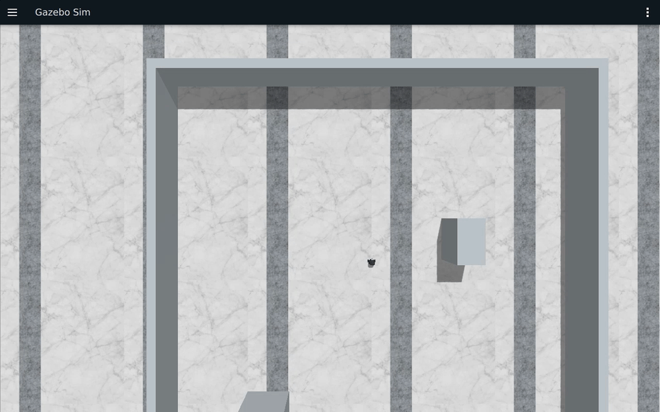
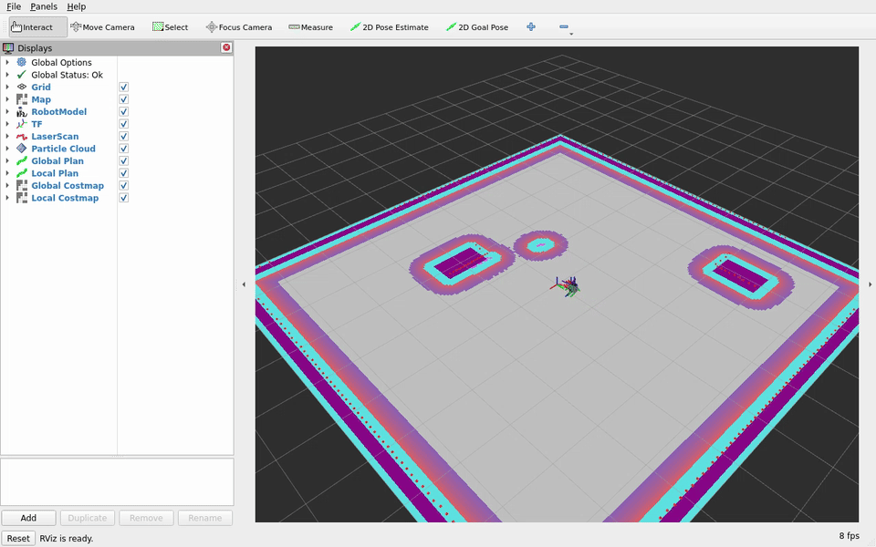

# 第11章 实验手册: Nav2 自主导航

COM260 运行 C++17 导航程序，x86 运行 Gazebo、Nav2 和 RViz。

## 当前仓库仿真验证：Nav2 生命周期与导航目标

### 实验目标

在 TurtleBot3 Burger 导航实验场景中启动 Nav2，检查定位组、规划组和控制组的生命周期，并发送一个 `NavigateToPose` 目标。

### 运行步骤

先按下方“准备工作”构建并启动。COM260 终端加载环境后执行：

```bash
source ~/.config/ros2-course-com260-ch18-ch19/env.bash
ros2 lifecycle get /map_server
ros2 lifecycle get /amcl
ros2 lifecycle get /planner_server
ros2 lifecycle get /controller_server
ros2 lifecycle get /bt_navigator
ros2 run navigation_client_cpp bt_navigator_client --ros-args \
  -p use_sim_time:=true -p x:=1.0 -p y:=0.0
```

### 观察与验收

检查五个节点 active，RViz 地图、路径与代价地图可见，并以 `/odom` 和 Action 终态判断运动结果。

## 实际运行证据

Nav2 导航、恢复行为与动态避障的运行示例：



[四目标截图](images/ch11/goals.png)与[完整原速录像（94.5 秒）](images/ch11/goals.mp4)；[四航点截图](images/ch11/waypoints.png)与[完整原速录像（95.7 秒）](images/ch11/waypoints.mp4)；[两圈巡逻截图](images/ch11/patrol.png)与[完整原速录像（188.1 秒）](images/ch11/patrol.mp4)。



[RViz 截图](images/ch11/dynamic-rviz.png)与[完整原速录像（180.8 秒）](images/ch11/dynamic-rviz.mp4)展示扫描注入、停止注入及两圈巡逻；另见[Gazebo 截图](images/ch11/dynamic-gazebo.png)和[完整原速录像（180.6 秒）](images/ch11/dynamic-gazebo.mp4)。合成障碍显示在 RViz 代价地图中，Gazebo 展示机器人运动。

恢复练习见[障碍截图](images/ch11/recovery.png)、[Gazebo 原速录像（76.4 秒）](images/ch11/recovery.mp4)、[RViz 截图](images/ch11/recovery-rviz.png)及[RViz 原速录像（76.6 秒）](images/ch11/recovery-rviz.mp4)。观察 Spin、BackUp，以及移除障碍并恢复地图后机器人继续向 `(4,0)` 导航的过程。

运行数据见[运行证据](runtime_evidence.md#ch11)、[结构化结果](images/ch11/validation-results.json)、[原始数据](images/ch11/runtime-data.tar.gz)及[媒体校验](images/ch11/media-validation.json)。

## 环境说明

本实验使用 TurtleBot3 Burger 和 Gazebo 导航场景，场景包含四周墙体和两处定位参照物。配套地图大小为 200×200、分辨率 0.05 m、原点 (-5,-5)。场景文件见[Gazebo 场景](../course_support/k3_com260_kit/config/navigation-lab.sdf)和[配套地图](../course_support/k3_com260_kit/config/navigation-lab-map.yaml)。

控制链为 Nav2 → `/cmd_vel` → Gazebo 桥 → Burger。已有遥控节点必须停止，不能与导航器同时发速度。

Gazebo 真实激光保留 `/scan`，合成障碍发布到 `/scan_injected`。AMCL 只订阅真实激光；代价地图用两个独立观测源接收二者，避免合成扫描覆盖真实障碍。注入观测缓存保留 0.2 秒；停止注入后缓存过期，残留栅格由后续真实激光清除。该接线由本章启动文件完成。

## 准备工作

先完成[公共双端环境](ch00_common_setup.md)及[Nav2 公共环境](nav2_common_setup.md)的依赖准备。将仓库放到两端 `~/ROS2_RISCV_COM260_CH18_CH19`。六个 C++ 程序位于 [navigation_lab_cpp](../src_k3_com260_kit/navigation_lab_cpp/README.md)。

### COM260

两端使用同一 DDS 域。将下例 IP 替换为两台设备的实际有线地址。

```bash
cd ~/ROS2_RISCV_COM260_CH18_CH19
export ROS_DOMAIN_ID=182
export CYCLONEDDS_URI='<CycloneDDS><Domain><General><Interfaces><NetworkInterface address="192.168.1.88"/></Interfaces><AllowMulticast>false</AllowMulticast></General><Discovery><ParticipantIndex>auto</ParticipantIndex><MaxAutoParticipantIndex>100</MaxAutoParticipantIndex><Peers><Peer Address="127.0.0.1"/><Peer Address="192.168.1.172"/></Peers></Discovery></Domain></CycloneDDS>'
bash setup_course_k3_com260_kit.sh --build-ch18
bash setup_course_k3_com260_kit.sh --build-ch19
source ~/.config/ros2-course-com260-ch18-ch19/env.bash
```

工作区为 `~/ros2_course_com260_ch18_ch19_ws`。两个入口都运行对应包的 `known_inputs` 测试；全部构建后可执行 `python3 -m colcon test-result --test-result-base ~/ros2_course_com260_ch18_ch19_ws/build --verbose` 查看结果。

### x86

```bash
cd ~/ROS2_RISCV_COM260_CH18_CH19
export ROS_DOMAIN_ID=182
export CYCLONEDDS_URI='<CycloneDDS><Domain><General><Interfaces><NetworkInterface address="192.168.1.172"/></Interfaces><AllowMulticast>false</AllowMulticast></General><Discovery><ParticipantIndex>auto</ParticipantIndex><MaxAutoParticipantIndex>100</MaxAutoParticipantIndex><Peers><Peer Address="127.0.0.1"/><Peer Address="192.168.1.88"/></Peers></Discovery></Domain></CycloneDDS>'
bash course_support/k3_com260_kit/scripts/x86-ch18-ch19.bash build-image
bash course_support/k3_com260_kit/scripts/x86-ch18-ch19.bash build
```

工作区为 `~/ros2_course_com260_ch18_ch19_humble_ws`。保持 X11 `:1` 桌面登录。

### 启动仿真 + Nav2

x86 终端执行：

```bash
cd ~/ROS2_RISCV_COM260_CH18_CH19
export RUN_ID="$(date -u +%Y%m%dT%H%M%SZ)-planning"
bash course_support/k3_com260_kit/scripts/x86-ch18-ch19.bash start-lab "$RUN_ID"
```


每个独立练习从初始位姿 (0,0,0) 开始。完成一个练习后，在 x86 用下列命令停止，再用新的 RUN_ID 启动；不要在已移动的机器人上只重置 AMCL 位姿。

```bash
bash course_support/k3_com260_kit/scripts/x86-ch18-ch19.bash stop "$RUN_ID"
```

COM260 每个新终端都先 `source ~/.config/ros2-course-com260-ch18-ch19/env.bash`。四个导航程序共享 [navigator.hpp](../src_k3_com260_kit/navigation_lab_cpp/include/navigation_lab_cpp/navigator.hpp)：发布初始位姿、等待定位及 Nav2 active、发送 Action、处理反馈和结果。Ctrl+C / SIGTERM 请求取消当前 Action；随后仍需从 `/odom` 检查停车。

`FollowWaypoints` 原始反馈从 0 编号；`stop_on_failure=false` 时 Action 可能跳过失败航点后返回 SUCCEEDED，因此程序还打印并检查 `missed_waypoints`。有漏点不能判为“四个航点均到达”。接口定义见 [Humble FollowWaypoints](https://github.com/ros-navigation/navigation2/blob/humble/nav2_msgs/action/FollowWaypoints.action)。

## 练习1: goToPose 单点导航 (~15 分钟)

### 目标
使用 C++ `rclcpp_action` 调用 `NavigateToPose` 接口，实现单目标点自主导航, 理解 `NavigateToPose` action 的反馈结构。

### 知识点

`NavigateToPose` 的 action 反馈包含以下字段:

| 字段 | 类型 | 说明 |
|------|------|------|
| `distance_remaining` | float32 | 到目标的剩余距离 (米) |
| `navigation_time` | Duration | 已导航时间 |
| `estimated_time_remaining` | Duration | 预计剩余时间 |

### 代码

源码位置: `src_k3_com260_kit/navigation_lab_cpp/src/go_to_pose_demo.cpp`

```cpp
#include <array>
#include "navigation_lab_cpp/navigator.hpp"

int main(int argc, char ** argv) {
  init_navigation(argc, argv);
  auto nav = std::make_shared<Navigator>();
  bool passed = nav->ready();
  const double pi = std::acos(-1.0);
  const std::array<std::array<double, 3>, 4> goals{{
    {3, 0, 0}, {3, 2, pi / 2}, {0, 2, pi}, {0, 0, -pi / 2}}};
  if (passed) {
    for (std::size_t i = 0; i < goals.size() && !stop_navigation; ++i) {
      RCLCPP_INFO(nav->get_logger(), "--- Goal %zu/4 ---", i + 1);
      const auto & p = goals[i];
      if (!nav->navigate(p[0], p[1], p[2])) { passed = false; }
    }
  }
  rclcpp::shutdown();
  return passed && !stop_navigation ? 0 : 1;
}
```

### 运行
```bash
# 确认仿真和 Nav2 已启动后
ros2 run navigation_lab_cpp go_to_pose_demo --ros-args -p use_sim_time:=true
```

### 观察
- 终端输出: `distance_remaining` 逐渐减小, `estimated_time_remaining` 动态更新
- RViz2 (`param_demo_cpp/rviz/navigation.rviz`) 已预置以下显示:
  - **Map** (`/map`) — 静态地图
  - **Global Costmap** (`/global_costmap/costmap`) — 全局代价地图
  - **Local Costmap** (`/local_costmap/costmap`) — 局部代价地图
  - **Global Plan** (`/plan`) — 全局规划路径 (红色)
  - **Local Plan** (`/local_plan`) — 局部规划轨迹 (绿色)
  - **Particle Cloud** (`/particle_cloud`) — AMCL 粒子云
  - **工具栏** — 提供初始位姿和目标位姿工具
- 如果 RViz2 中未自动显示数据, 检查 `Fixed Frame` 是否为 `map`, 以及 Nav2 是否已正常启动

### 验收标准
- [ ] 机器人依次到达 4 个目标点
- [ ] 终端正确显示 `distance_remaining` 和 `estimated_time_remaining`
- [ ] 理解 `goToPose` 对应异步 Action：C++ 用结果 future 等待完成，并通过 feedback 回调读取反馈

---

## 练习2: followWaypoints 多点导航 (~15 分钟)

### 目标
掌握 `FollowWaypoints` action 的航点序列导航, 理解其反馈机制 (与 `NavigateToPose` 不同)。

### 知识点
- `FollowWaypoints` 的反馈仅包含 `current_waypoint` (uint32) — **没有** `distance_remaining`
- 机器人依次导航到序列中的每个航点
- 默认 `waypoint_follower` 到达每个航点后停留 200ms

### 代码

源码位置: `src_k3_com260_kit/navigation_lab_cpp/src/follow_waypoints_demo.cpp`

```cpp
#include "navigation_lab_cpp/navigator.hpp"

int main(int argc, char ** argv) {
  init_navigation(argc, argv);
  auto nav = std::make_shared<Navigator>();
  const bool passed = nav->ready() && nav->follow_waypoints();
  rclcpp::shutdown();
  return passed ? 0 : 1;
}
```

### 运行
```bash
ros2 run navigation_lab_cpp follow_waypoints_demo --ros-args -p use_sim_time:=true
```

### 观察
- `current_waypoint` 原始值递增为 0 → 1 → 2 → 3；旁边的 `waypoint` 按 1/4 → 4/4 显示，完成后核对 SUCCEEDED 和没有 `missed_waypoint`
- RViz2 中观察机器人按顺序通过所有航点

### 验收标准
- [ ] 机器人按顺序访问所有 4 个航点
- [ ] 终端正确显示 `current_waypoint` 序号
- [ ] 将 `stop_on_failure` 设为 `true` 再测试 （在 x86 修改 `src_k3_com260_kit/navigation_lab_cpp/config/navigation_lab.yaml`，重新执行 `x86-ch18-ch19.bash build`，停止并重新启动仿真）

---

## 练习3: 恢复行为与动态障碍 (~20 分钟)

### 目标
了解 Nav2 的恢复行为 (Spin, BackUp, ClearCostmap) 触发条件, 并通过合成 LaserScan 模拟动态障碍物。

### 3.1 恢复行为 Demo

在目标 `(4,0)` 放置可移除障碍，观察导航受阻时的恢复行为。

启动新的仿真后，在**启动仿真的 x86 终端**放置障碍，沿用该终端的仓库目录和 `RUN_ID`。方盒中心为 `(4,0)`，尺寸为 `0.6 × 0.6 × 0.5 m`，由 Gazebo 真实激光感知：

```bash
bash course_support/k3_com260_kit/scripts/x86-ch18-ch19.bash exec "$RUN_ID" \
  env GZ_PARTITION="$RUN_ID" ros2 run ros_gz_sim create \
  -world default -file /course-config/recovery-obstacle.sdf \
  -name recovery_obstacle -x 4 -y 0 -z 0.25
```

加载包含方盒占用区域的配套地图，返回 `result=0` 表示成功。静态障碍在 ClearCostmap 后仍存在，便于观察完整恢复流程。

```bash
bash course_support/k3_com260_kit/scripts/x86-ch18-ch19.bash exec "$RUN_ID" \
  ros2 service call /map_server/load_map nav2_msgs/srv/LoadMap \
  '{map_url: /course-config/recovery-map.yaml}' | grep -o 'result=[0-9]*'
```

源码位置: `src_k3_com260_kit/navigation_lab_cpp/src/recovery_demo.cpp`

```cpp
#include "navigation_lab_cpp/navigator.hpp"

int main(int argc, char ** argv) {
  init_navigation(argc, argv);
  auto nav = std::make_shared<Navigator>();
  const bool passed = nav->ready() && nav->navigate(4, 0, 0);
  rclcpp::shutdown();
  return passed ? 0 : 1;
}
```

#### 运行
在 COM260 终端执行：

```bash
ros2 run navigation_lab_cpp recovery_demo --ros-args -p use_sim_time:=true
```

在启动仿真的 x86 终端用 `podman logs --follow "ros2-com260-$RUN_ID"` 观察 Nav2 日志。确认自动执行的 `spin` 和 `backup` 完成后，按 Ctrl+C 结束日志跟随，再在同一终端移除障碍；服务应返回 `data: true`：

```bash
bash course_support/k3_com260_kit/scripts/x86-ch18-ch19.bash exec "$RUN_ID" \
  env GZ_PARTITION="$RUN_ID" gz service -s /world/default/remove \
  --reqtype gz.msgs.Entity --reptype gz.msgs.Boolean --timeout 5000 \
  --req 'name: "recovery_obstacle" type: MODEL'
```

随后加载回原地图，同样确认 `result=0`：

```bash
bash course_support/k3_com260_kit/scripts/x86-ch18-ch19.bash exec "$RUN_ID" \
  ros2 service call /map_server/load_map nav2_msgs/srv/LoadMap \
  '{map_url: /course-config/navigation-lab-map.yaml}' \
  | grep -o 'result=[0-9]*'
```

继续等待同一个 `(4,0)` 导航任务完成，并检查 `/odom` 停止反馈。此方盒仅用于练习 3 的恢复条件；按“准备工作”重启仿真后再进行其他练习。

#### 观察
- 当机器人在障碍物前卡住时, 自动触发 Spin (原地旋转) 或 BackUp (后退)
- 终端输出 `number_of_recoveries` 字段 (在 `NavigateToPose` feedback 中)
- RViz2 中观察代价地图清除和重新规划

### 3.2 合成激光扫描注入 (模拟动态障碍物)

使用合成 LaserScan 模拟动态障碍物：按 ROS 时钟以 10 Hz 发布到 `/scan_injected`，障碍相对激光坐标系 `laser_link` 中的 (2.0, 0.0) 做圆周运动。合成扫描直接进入代价地图，不会在 Gazebo 中创建实体。代价地图同时接收真实 `/scan`；观察注入期间的障碍以及停止注入后的清除情况。

基于预计算二维占用地图的 `fake_laser` 无法感知新生成的 Gazebo 实体；本实验使用 Gazebo 仿真激光，可感知练习 3.1 中的实体障碍。

源码位置: `src_k3_com260_kit/navigation_lab_cpp/src/scan_injector.cpp`

```cpp
#include <cmath>
#include <rclcpp/rclcpp.hpp>
#include <rclcpp/create_timer.hpp>
#include <sensor_msgs/msg/laser_scan.hpp>

class ScanInjector : public rclcpp::Node {
public:
  ScanInjector() : Node("scan_injector") {
    publisher_ = create_publisher<sensor_msgs::msg::LaserScan>("/scan_injected", 10);
    timer_ = rclcpp::create_timer(this, get_clock(), rclcpp::Duration::from_seconds(0.1),
      [this] { publish_scan(); });
  }
private:
  void publish_scan() {
    angle_ += 0.02;
    const double pi = std::acos(-1.0);
    const double x = 2.0 + 0.8 * std::sin(angle_ * 0.5), y = 0.8 * std::cos(angle_ * 0.5);
    const double distance = std::hypot(x, y), bearing = std::atan2(y, x);
    sensor_msgs::msg::LaserScan scan;
    scan.header.frame_id = "laser_link";
    scan.header.stamp = now();
    scan.angle_min = -pi;
    scan.angle_max = pi;
    scan.angle_increment = pi / 180;
    scan.time_increment = 1.0 / 360 / 180;
    scan.scan_time = 0.1;
    scan.range_min = 0.1;
    scan.range_max = 3.5;
    scan.ranges.assign(360, 3.5);
    scan.intensities.assign(360, 0.0);
    for (std::size_t i = 0; i < scan.ranges.size(); ++i) {
      const double theta = -pi + i * pi / 180;
      if (std::abs(theta - bearing) < 0.05 && distance > 0.1 && distance < 3.0) {
        scan.ranges[i] = distance;
      }
    }
    publisher_->publish(scan);
  }
  double angle_ = 0;
  rclcpp::Publisher<sensor_msgs::msg::LaserScan>::SharedPtr publisher_;
  rclcpp::TimerBase::SharedPtr timer_;
};

int main(int argc, char ** argv) {
  rclcpp::init(argc, argv);
  rclcpp::spin(std::make_shared<ScanInjector>());
  rclcpp::shutdown();
}
```

#### 运行
```bash
# COM260 新终端: 启动 scan 注入器
ros2 run navigation_lab_cpp scan_injector --ros-args -p use_sim_time:=true
```

#### 观察
- 合成障碍物在激光坐标系中以圆形轨迹在 (2.0, 0.0) 附近移动
- RViz2: 局部代价地图上观察到移动的障碍物
- 机器人尝试绕过障碍物

### 验收标准
- [ ] 恢复 demo 显示 `distance_remaining`, `navigation_time`, `estimated_time_remaining` 全部正确
- [ ] 机器人卡住时触发 Spin/BackUp 行为
- [ ] scan_injector 发布的消息被 Nav2 接收, 代价地图中显示动态障碍物

---

## 练习4: 导航过程监控 (~15 分钟)

### 目标
编写一个监控节点, 实时监听导航过程中的关键话题, 理解 Nav2 各模块间的数据流。

### 代码

源码位置: `src_k3_com260_kit/navigation_lab_cpp/src/nav_monitor.cpp`

```cpp
#include <array>
#include <geometry_msgs/msg/twist.hpp>
#include <nav_msgs/msg/odometry.hpp>
#include <nav_msgs/msg/path.hpp>
#include <rclcpp/rclcpp.hpp>

class NavMonitor : public rclcpp::Node {
public:
  NavMonitor() : Node("nav_monitor") {
    plan_ = create_subscription<nav_msgs::msg::Path>("/plan", 10, [this](const nav_msgs::msg::Path & msg) {
      if (msg.poses.empty()) { return; }
      const auto & first = msg.poses.front().pose.position;
      const auto & last = msg.poses.back().pose.position;
      const std::array<double, 4> key{first.x, first.y, last.x, last.y};
      if (count_ == 0 || key != last_key_) {
        RCLCPP_INFO(get_logger(), "New global plan #%u", ++count_);
        last_key_ = key;
      }
    });
    local_ = create_subscription<nav_msgs::msg::Path>("/local_plan", 10, [this](const nav_msgs::msg::Path & msg) {
      RCLCPP_INFO(get_logger(), "Local plan: %zu poses", msg.poses.size());
    });
    cmd_ = create_subscription<geometry_msgs::msg::Twist>("/cmd_vel", 10, [this](const geometry_msgs::msg::Twist & msg) {
      RCLCPP_INFO(get_logger(), "Cmd vel: linear=%.2f angular=%.2f", msg.linear.x, msg.angular.z);
    });
    odom_ = create_subscription<nav_msgs::msg::Odometry>("/odom", rclcpp::SensorDataQoS(),
      [](const nav_msgs::msg::Odometry &) {});
  }
private:
  unsigned count_ = 0;
  std::array<double, 4> last_key_{};
  rclcpp::Subscription<nav_msgs::msg::Path>::SharedPtr plan_, local_;
  rclcpp::Subscription<geometry_msgs::msg::Twist>::SharedPtr cmd_;
  rclcpp::Subscription<nav_msgs::msg::Odometry>::SharedPtr odom_;
};

int main(int argc, char ** argv) {
  rclcpp::init(argc, argv);
  rclcpp::spin(std::make_shared<NavMonitor>());
  rclcpp::shutdown();
}
```

### 运行
```bash
# 与任一导航 demo 同时运行
ros2 run navigation_lab_cpp nav_monitor --ros-args -p use_sim_time:=true
```

### 观察
监控器按路径首尾点变化计数：机器人移动也会改变起点，不能将计数增长单独视为障碍触发重规划的证据；应结合注入时刻、整条路径和速度变化判断。

- 全局规划重规划次数 — 障碍物触发新规划时计数递增
- `/local_plan` 的轨迹长度变化 — 反映避障机动
- `/cmd_vel` 速度指令 — 观察减速转向行为

### 验收标准
- [ ] 终端显示全局路径重规划事件
- [ ] 终端显示局部路径姿态数量
- [ ] 终端同步显示速度指令变化

---

## 练习5: 多圈巡逻导航 (~15 分钟)

### 目标
使用 `followWaypoints` 实现多圈巡逻任务, 结合反馈判断每圈完成状态。

### 代码

源码位置: `src_k3_com260_kit/navigation_lab_cpp/src/waypoint_patrol.cpp`

```cpp
#include "navigation_lab_cpp/navigator.hpp"

int main(int argc, char ** argv) {
  init_navigation(argc, argv);
  auto nav = std::make_shared<Navigator>();
  bool passed = nav->ready();
  for (int lap = 1; passed && lap <= 2 && !stop_navigation; ++lap) {
    RCLCPP_INFO(nav->get_logger(), "=== Patrol lap %d/2 ===", lap);
    passed = nav->follow_waypoints();
    RCLCPP_INFO(nav->get_logger(), "Lap %d %s", lap, passed ? "complete" : "interrupted");
  }
  rclcpp::shutdown();
  return passed && !stop_navigation ? 0 : 1;
}
```

### 运行
```bash
ros2 run navigation_lab_cpp waypoint_patrol --ros-args -p use_sim_time:=true
```

### 观察
- 机器人完成 2 圈巡逻 (每圈 4 个航点)
- 终端显示 `current_waypoint` 从 0 → 3（对应第 1/4 → 4/4 个航点），然后开始下一圈
- 如果某圈失败, `passed` 变为 `false`, 循环结束并停止巡逻

### 验收标准
- [ ] 机器人完成指定圈数的巡逻
- [ ] 每圈之间终端正确显示圈数信息
- [ ] 理解 `followWaypoints` 发送任务后仍需等待 Action 完成并检查结果

---

## 练习6: 综合挑战 — 自主巡逻 + 动态避障 (~20 分钟)

### 目标
结合 scan_injector 和 waypoint_patrol, 观察导航系统在动态障碍物环境中的表现。

### 步骤
```bash
# x86 终端: Gazebo、Nav2 和 RViz 已由 start-lab 启动
# COM260 终端1: 巡逻程序
ros2 run navigation_lab_cpp waypoint_patrol --ros-args -p use_sim_time:=true
# COM260 终端2: 巡逻启动后等待几秒, 再启动 scan_injector
ros2 run navigation_lab_cpp scan_injector --ros-args -p use_sim_time:=true
```

### 观察
1. 无干扰时: 机器人正常巡逻
2. 注入合成障碍物后机器人绕行:
   - `/plan` 全局路径重规划
   - `/local_plan` 局部轨迹调整
   - `/cmd_vel` 速度变化 (减速 + 转向)
3. 停止 scan_injector 后: 机器人恢复原路径

### 思考题
- `followWaypoints` 和循环 `goToPose` 的区别?
- 如果某个航点不可达, `stop_on_failure` 两种设置 (`true`/`false`) 的行为差异?
- 在 `fake_laser` 环境中，为什么 Gazebo 中 spawn 实体不显示在 LaserScan 中? (提示: `fake_laser` 的原理)

### 验收标准
- [ ] 动态障碍物注入后, 巡逻路径改变
- [ ] 障碍物移除后, 机器人恢复原计划
- [ ] 终端显示全局路径重规划和避障机动事件

---

## 常用调试命令

```bash
# 查看所有话题
ros2 topic list

# 查看导航 action 反馈 (实时)
ros2 action send_goal /navigate_to_pose nav2_msgs/action/NavigateToPose "{}"

# 查看行为树状态
ros2 param get /bt_navigator default_nav_to_pose_bt_xml

# 查看生命周期节点状态
ros2 service call /bt_navigator/get_state lifecycle_msgs/srv/GetState "{}"

# 手动清除代价地图
ros2 service call /global_costmap/clear_entirely_global_costmap nav2_msgs/srv/ClearEntireCostmap "{}"

# 查看机器人位姿
ros2 topic echo /amcl_pose

# 查看速度指令
ros2 topic echo /cmd_vel
```

## 常见问题

| 问题 | 原因 | 解决 |
|------|------|------|
| `Navigator::ready()` 等待超时 | 未收到定位消息或 Nav2 未激活 | 检查 `/amcl_pose` 与 Nav2 生命周期状态，初始位姿由 `ready()` 发布，也可在 RViz 中用 2D Pose Estimate |
| 机器人不移动 | lifecycle 节点未激活 | 检查 launch 是否传了 `autostart:=true` |
| `followWaypoints` 反馈无 `distance_remaining` | `FollowWaypoints` action 只提供 `current_waypoint` | 改用 `NavigateToPose` 的 feedback 获取距离 |
| Gazebo 中实体不影响导航 | 实体未被激光扫描到，或代价地图未接收 `/scan` | 检查实体碰撞几何、`/scan` 数据和代价地图观测源配置 |
| 导航目标被拒绝 | 目标点在障碍物内或不可达 | 检查 RViz2 代价地图, 确认目标点在 free 区域 |
