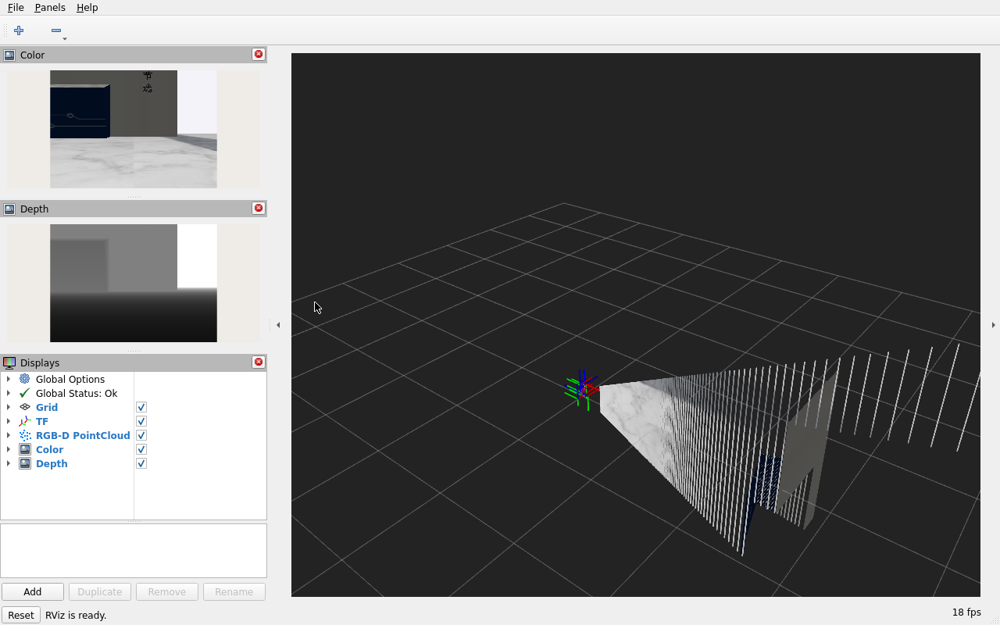
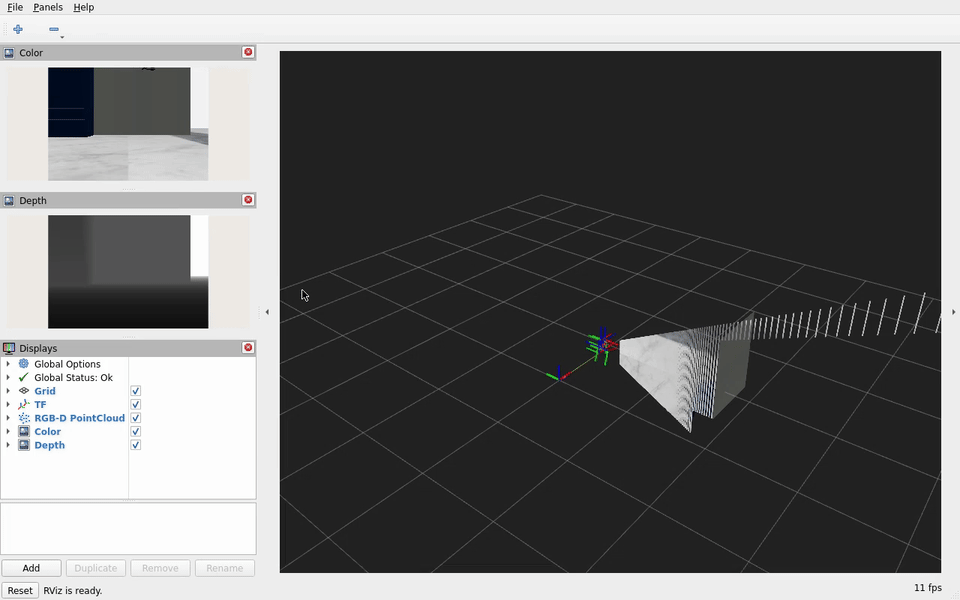
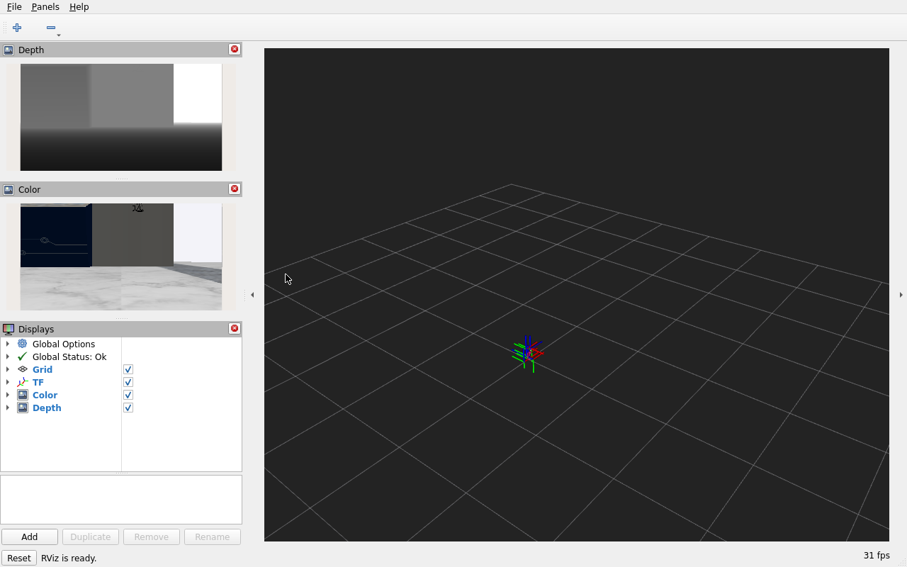
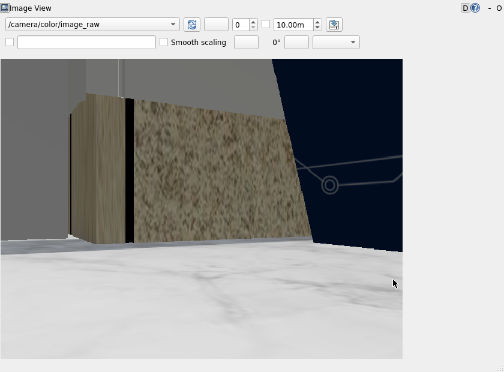
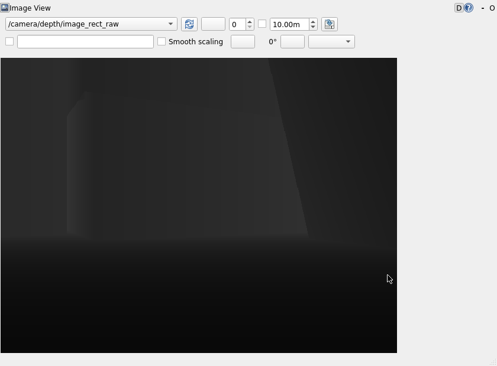

# 第12章 实验指导书：RealSense 多传感器数据采集与融合

## 仿真验证：RGB-D 话题与点云输出

### 实验目标

采集彩色图、深度图、相机内参与点云，使用 `ros2 topic`、`rqt_image_view` 和 RViz 检查数据质量。COM260 运行 C++ 数据处理节点，x86 运行 Gazebo RGB-D 传感器和显示工具。Gazebo 的彩色图和深度图使用同一光心；D415/D435 的 USB 驱动、出厂标定及硬件同步需要接入真实相机后检验。

### 运行步骤

先完成[第22章公共环境](ch00_common_setup.md#ch22)。以下每个 x86 新终端都先执行：

```bash
cd ~/ROS2_RISCV_COM260_CH22_CH23
source ~/.config/ros2-course-com260-ch22-ch23/dds.bash
```

x86 终端 1：

```bash
bash course_support/k3_com260_kit/scripts/x86-ch22-ch23.bash start-camera ch12
```

x86 终端 2：

```bash
bash course_support/k3_com260_kit/scripts/x86-ch22-ch23.bash exec ch12 bash
ros2 topic list | grep /camera
ros2 topic hz /camera/color/image_raw
# Ctrl+C 结束频率统计后再执行下一条
ros2 topic echo /camera/color/camera_info --once
```

### 观察与验收

RViz 同时显示彩色图、深度图和彩色点云。默认图像为 640×480，目标采样频率为每仿真秒 30 帧；实际墙钟频率取决于仿真速度。检查消息时间戳、图像尺寸、深度范围和内参，不把仿真时间频率等同于真实相机的 USB 吞吐量。

## 实际运行证据





[连续 RViz 录像](images/ch22/ch12-rgbd-motion.mp4)。数据和验收条件见[第22章运行证据](runtime_evidence.md#ch22)。

> **对应理论章节**：第22章《多传感器融合SLAM》\
> **实验课时**：2课时\
> **实验代码**：`src_k3_com260_kit/realsense_lab/`，Shell 入口位于 `course_support/k3_com260_kit/scripts/realsense_launch.sh`。

## 实验目标
- 理解深度相机的多路数据输出：彩色图、深度图、内参与点云
- 掌握 realsense2_camera 驱动在 ROS 2 Humble 下的安装与启动
- 学会用 launch 参数控制点云与深度对齐的开关
- 能用 rqt_image_view、RViz2 可视化 RGB-D 数据
- 了解多传感器融合中时间同步（`enable_sync`）的作用

## 实验环境
- COM260：Bianbu、ROS 2 Humble、C++17
- x86：Humble / Gazebo Harmonic 课程容器，RGB-D 仿真传感器
- RealSense D400 系列相机（D415/D435，用于实机部分）
- rqt_image_view、RViz2
- ros2 bag（数据集录制，可选）

## 参考代码说明

`realsense_lab` 使用 `ament_cmake` 安装 Launch 和 RViz 配置。传感器驱动由 Gazebo 或 `realsense2_camera` 提供；同步与融合 C++ 节点位于 `sensor_fusion_cpp`。

```text
src_k3_com260_kit/realsense_lab/
├── launch/realsense.launch.py    # 选择仿真或真实相机
├── launch/rgbd_sim.launch.py     # Museum 场景、RGB-D 与 IMU
├── rviz/acquisition.rviz
├── CMakeLists.txt
└── package.xml
```

- `realsense.launch.py` 默认使用 RGB-D 仿真；`pointcloud:=true` 发布点云和对齐深度。档位为 `640x480x30` 或 `1280x720x15`。
- `simulation:=false` 委托 `realsense2_camera/rs_launch.py`，传入相同的深度、彩色档位及 `enable_sync:=true`。真实设备需先安装 Humble 驱动并确认 `rs-enumerate-devices` 能枚举相机；此模式不能在未连接相机时作为实机通过结果。
- `realsense_launch.sh` 提供默认 RGB-D、`pointcloud`、`highres` 三种启动模式。

| 话题 | 类型 | 说明 |
|------|------|------|
| `/camera/color/image_raw` | `sensor_msgs/msg/Image` | 彩色图像 |
| `/camera/depth/image_rect_raw` | `sensor_msgs/msg/Image` | 深度图像，32FC1，米 |
| `/camera/color/camera_info` | `sensor_msgs/msg/CameraInfo` | 彩色内参 |
| `/camera/depth/camera_info` | `sensor_msgs/msg/CameraInfo` | 深度内参 |
| `/camera/color/points` | `sensor_msgs/msg/PointCloud2` | 彩色点云（pointcloud:=true） |
| `/camera/aligned_depth_to_color/image_raw` | `sensor_msgs/msg/Image` | 对齐深度（pointcloud:=true） |

## 实验步骤

1. 安装依赖并构建实验包：

按[公共环境](ch00_common_setup.md#ch22)分别构建两端。COM260 终端执行：

```bash
cd ~/ROS2_RISCV_COM260_CH22_CH23
bash setup_course_k3_com260_kit.sh --build-ch22
source ~/.config/ros2-course-com260-ch22-ch23/env.bash
source ~/.config/ros2-course-com260-ch22-ch23/dds.bash
```

2. 启动数据采集（二选一，切换模式前先停止正在运行的容器）：

x86 终端 1：

```bash
# Launch 入口：默认 RGB-D、点云和对齐深度
bash course_support/k3_com260_kit/scripts/x86-ch22-ch23.bash start-camera ch12

# Shell 入口：默认 RGB-D，不生成点云
# bash course_support/k3_com260_kit/scripts/realsense_launch.sh rgbd ch12
# bash course_support/k3_com260_kit/scripts/realsense_launch.sh pointcloud ch12
# bash course_support/k3_com260_kit/scripts/realsense_launch.sh highres ch12
```



3. 检查话题频率与内参：

x86 终端 2 进入容器。每条 `hz` 命令观察几秒后按 Ctrl+C，再执行下一条。

```bash
bash course_support/k3_com260_kit/scripts/x86-ch22-ch23.bash exec ch12 bash
ros2 topic hz /camera/color/image_raw
ros2 topic hz /camera/depth/image_rect_raw
ros2 topic echo /camera/color/camera_info --once
```

4. 可视化：

启动时已打开 RViz，包含彩色图、深度图和 `/camera/color/points`。也可在 x86 容器终端逐个打开图像工具；关闭窗口后继续下一条。

```bash
ros2 run rqt_image_view rqt_image_view /camera/color/image_raw
ros2 run rqt_image_view rqt_image_view /camera/depth/image_rect_raw
```

放大图像工具窗口，确认选中的话题与命令一致。





5. （可选）录制数据集供后续章节使用：

在 x86 容器终端执行，录制期间可在另一容器终端运行键盘控制；先用空格停车，再结束键盘控制。

```bash
ros2 bag record --use-sim-time /camera/color/image_raw /camera/depth/image_rect_raw \
  /camera/color/camera_info /camera/depth/camera_info \
  -o /workspace/realsense_dataset
# Ctrl+C 正常结束录制，随后查看录包
ros2 bag info /workspace/realsense_dataset
```

录包目录对应 x86 的 `~/ros2_course_com260_ch22_ch23_humble_ws/realsense_dataset`。重新录制时使用新的目录名。

6. 实验结束：在容器终端执行 `exit` 返回 x86 主机，再停止本次仿真。

```bash
bash course_support/k3_com260_kit/scripts/x86-ch22-ch23.bash stop ch12
```

## 实验结果与分析

- 彩色和深度图的时间戳间隔对应约 30 Hz（高分辨率档位约 15 Hz）；墙钟帧率随仿真负载变化。真实相机需另行检查稳定帧率及出厂标定。
- 仿真中两路图像同光心，对齐深度直接使用同一深度图；这不能验证 D415 双光心标定误差。
- 真实驱动的 `align_depth.enable:=true` 用于把深度投影到彩色光心，`enable_sync:=true` 用于驱动内帧同步。22.5.3 节的消息过滤器进一步按时间戳匹配 IMU、激光与图像。

## 思考题

1. 关闭 `pointcloud:=false` 后哪些话题会消失？驱动内部少做了哪些计算？
2. 深度图 `image_rect_raw` 与点云 `PointCloud2` 各适合什么下游算法？
3. 为什么点云需要"深度对齐到彩色"？（提示：彩色与深度镜头光心不同）
4. 结合 22.5.3 节，说明驱动内 `enable_sync` 与消息过滤器 `ApproximateTimeSynchronizer` 的关系。
