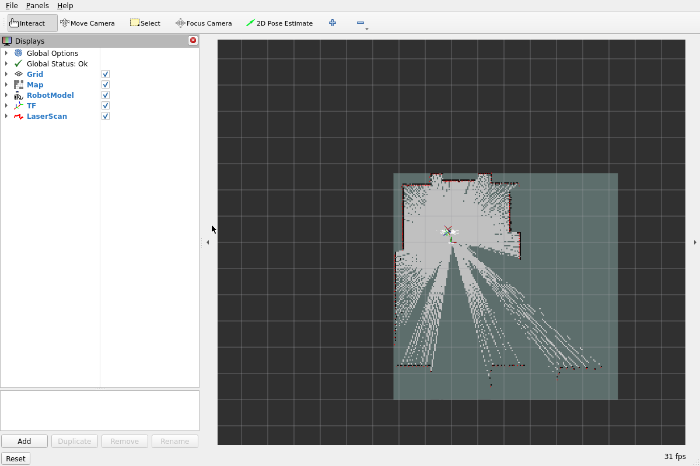
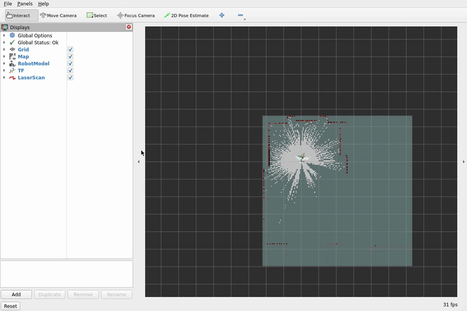

# 第13章 实验指导书：SLAM 一键建图综合实训

## Gazebo 仿真环境一键 SLAM 建图

### 实验目标

一键启动 Gazebo（TurtleBot3 Burger + ISCAS Museum）、slam_toolbox 在线建图与 RViz，再用 `slam_map_runner` 自动遍历环境，观察 `/map` 的实时生长过程与建图质量指标（已知栅格、占据率、探索率）。

### 运行步骤

先完成[第 23 章公共环境](ch00_common_setup.md#ch23)。**x86 终端 1**：

```bash
cd ~/ROS2_RISCV_COM260_CH22_CH23
source ~/.config/ros2-course-com260-ch22-ch23/dds.bash
bash course_support/k3_com260_kit/scripts/x86-ch22-ch23.bash start-slam ch13
```

**COM260 终端 1**：

```bash
source ~/.config/ros2-course-com260-ch22-ch23/env.bash
source ~/.config/ros2-course-com260-ch22-ch23/dds.bash
ros2 run slam_bringup_lab slam_map_runner --ros-args -p use_sim_time:=true
```

### 观察与验收

RViz 中 `/map` 随机器人运动逐渐扩展，扫描点云与墙体对齐；节点每 5 次地图更新打印一次「已知 / 占据 / 空闲 / 探索率」。满足「地图更新不少于 2 次、起点至当前位置的直线位移大于 0.2 m、已知栅格增长大于 100」后，机器人停止并输出 `slam-map-updated`。TF 树应为 `map→odom→base_link→laser_link`。

## 实际运行证据





[连续 RViz 录像](images/ch23/ch13-slam-motion.mp4)。数值见[第23章运行证据](runtime_evidence.md#ch23)。

> **对应理论章节**：第23章《SLAM与导航综合实训》（SLAM 一键建图部分）\
> **实验课时**：2课时\
> **实验代码**：[`slam_bringup_lab`](../src_k3_com260_kit/slam_bringup_lab/)

## 实验目标

- 掌握一键 SLAM 建图的组成：仿真环境 + 激光雷达 + slam_toolbox + RViz
- 理解 launch 参数 `gui` / `use_rviz` / `drive` 的作用
- 会用自动遍历节点 `slam_map_runner` 驱动机器人完成建图
- 能解读建图质量指标：已知栅格、占据率、探索率
- 学会保存地图供后续导航实验使用

## 实验环境

- COM260：Bianbu、ROS 2 Humble、C++17
- x86：Humble / Gazebo Sim Harmonic 课程容器
- slam_toolbox、RViz2、tf2_tools、nav2_map_server
- TurtleBot3 Burger + ISCAS Museum

Shell 启动方式：在 x86 主机执行 `bash course_support/k3_com260_kit/scripts/slam_bringup.sh ch13`，与上面的 Launch 入口二选一。

## 参考代码说明

```text
src_k3_com260_kit/slam_bringup_lab/
├── launch/slam_bringup.launch.py  # 组合启动 Gazebo + SLAM + RViz
├── src/slam_map_runner.cpp       # 自动建图与地图增长检查
├── CMakeLists.txt
└── package.xml
```

- Launch 启动 `robot_sim_demo/gazebo2.launch.py`，设置 `rviz:=false`、`drive:=false`，随后启动 slam_toolbox 和 RViz。`gui` 与 `use_rviz` 控制图形窗口。
- C++ 节点订阅 `/odom`、`/map`，发布 `/cmd_vel`；以 8 秒为周期运动：前 2 s 左转 0.6 rad/s，2～4.5 s 前进 0.25 m/s，4.5～6.5 s 右转，其后前进。达到验收条件会提前结束，不保证执行完整周期或覆盖全部房间。
- 运动周期和 25 秒运行上限使用仿真时间；无输入、暂停或过慢的仿真最多等待 180 秒墙钟时间。Ctrl+C 与超时均发送停车指令。

## 实验步骤

1. 构建实验包：

**COM260**：

```bash
cd ~/ROS2_RISCV_COM260_CH22_CH23
bash setup_course_k3_com260_kit.sh --build-ch23
```

**x86**：

```bash
cd ~/ROS2_RISCV_COM260_CH22_CH23
bash course_support/k3_com260_kit/scripts/x86-ch22-ch23.bash build
```

2. 一键启动建图：

**x86 终端 1**：

```bash
cd ~/ROS2_RISCV_COM260_CH22_CH23
source ~/.config/ros2-course-com260-ch22-ch23/dds.bash
bash course_support/k3_com260_kit/scripts/x86-ch22-ch23.bash start-slam ch13
```

容器执行 `ros2 launch slam_bringup_lab slam_bringup.launch.py`。使用桌面时等待 RViz 出现地图与激光；无图形显示时，在上述命令末尾增加 `gui:=false use_rviz:=false`，通过终端观察地图更新。

3. 另开终端运行自动遍历节点：

**COM260 终端 1**：

```bash
source ~/.config/ros2-course-com260-ch22-ch23/env.bash
source ~/.config/ros2-course-com260-ch22-ch23/dds.bash
ros2 run slam_bringup_lab slam_map_runner --ros-args -p use_sim_time:=true
```

4. 观察 RViz 中 `/map` 的扩展过程与 runner 终端的栅格统计；在「1. 左转 / 2. 前进 / 3. 右转 / 4. 前进」的周期性运动中，观察地图在前向运动时的增长。

5. （可选）自动遍历结束后，对遗漏区域用键盘遥控补充。**COM260 同一终端**：

```bash
ros2 run teleop_twist_keyboard teleop_twist_keyboard
```

保持该终端焦点，按键移动；先按空格停车，再按 Ctrl+C 退出。覆盖率较低时，应补充探索后再保存用于导航的地图。

6. 保存地图（第14章导航实验直接使用）。**x86 终端 2**：

```bash
cd ~/ROS2_RISCV_COM260_CH22_CH23
source ~/.config/ros2-course-com260-ch22-ch23/dds.bash
bash course_support/k3_com260_kit/scripts/x86-ch22-ch23.bash exec ch13 \
  ros2 run nav2_map_server map_saver_cli -f /maps/office_map --ros-args -p use_sim_time:=true
```

容器的 `/maps` 对应 x86 的 `~/maps`。确认输出 `Map saved successfully`，并生成 `~/maps/office_map.yaml` 和 `~/maps/office_map.pgm`。

7. 在 COM260 按 Ctrl+C 停止仍在运行的节点，再在 **x86** 停止仿真：

```bash
cd ~/ROS2_RISCV_COM260_CH22_CH23
bash course_support/k3_com260_kit/scripts/x86-ch22-ch23.bash stop ch13
```

随后进入[第14章 实验指导书](ch14_lab.md)。

## 实验结果与分析

- 探索率 = 已知栅格数 / 地图总栅格数，占据率 = 占据栅格数 / 已知栅格数，两者分别反映环境覆盖程度与墙体占比。
- TF 树 `map→odom→base_link→laser_link` 说明里程计与激光雷达外参正确接入，是 slam_toolbox 能正确建图的前提。
- 保存的 `office_map.yaml` / `office_map.pgm` 用于下一实验的定位导航。自动检查通过只说明地图已增长，地图仍需覆盖导航起点、目标点和连接通道。

## 思考题

1. `slam_demo.launch.py` 为什么设置 `use_gazebo:=false`？如果另行用 `drive:=true` 的 `gazebo2.launch.py` 启动第二套仿真，两套 `/scan`、`/odom` 会如何？
2. 探索率的两种变化趋势：机器人停在原地 vs 原地自转，探索率分别如何变化？为什么？
3. 占据率偏高（如 >30%）通常说明什么问题？
4. 自动遍历的 8 秒周期运动能否保证全覆盖？与手动键盘建图相比优劣各是什么？
