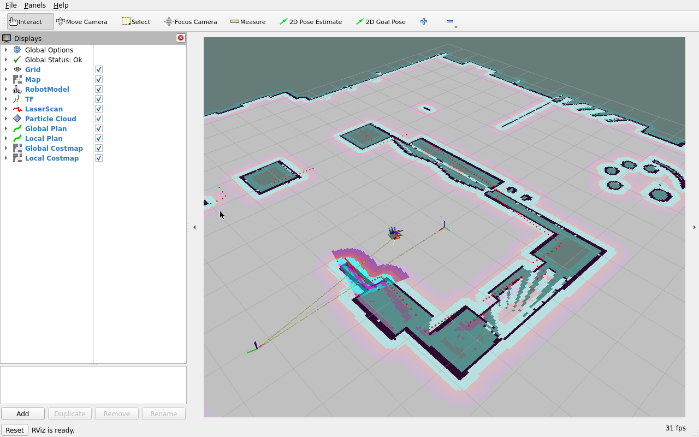
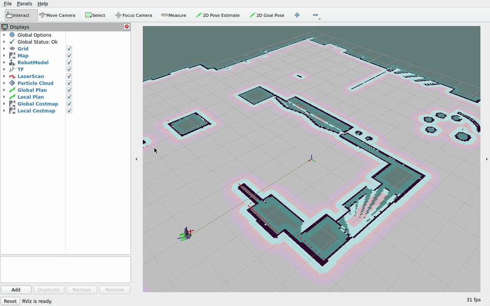
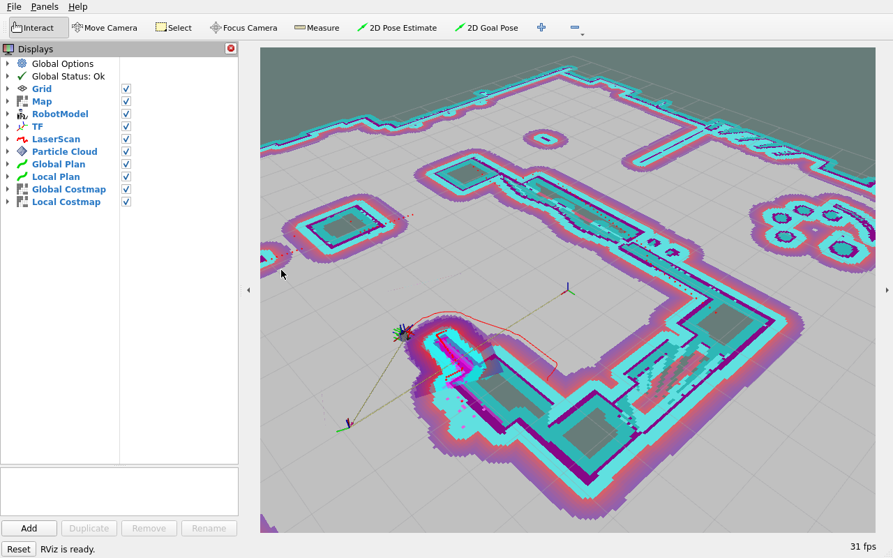

# 第14章 实验指导书：Nav2 一键导航综合实训

## 仿真验证：Gazebo 仿真环境一键 Nav2 导航

### 实验目标

一键启动 Gazebo（TurtleBot3 Burger + ISCAS Museum）、Nav2 导航栈与 RViz，再用 `nav_goal_runner` 依次发送 4 个目标点完成自动巡航，观察 AMCL 粒子云、全局/局部路径与 Nav2 生命周期节点状态。本章与第13章同属第23章综合实训的「先建图、后导航」流程。

### 运行步骤

先完成[第23章公共环境](ch00_common_setup.md#ch23)，停止第13章仿真。

```bash
# x86 终端 1
cd ~/ROS2_RISCV_COM260_CH22_CH23
source ~/.config/ros2-course-com260-ch22-ch23/dds.bash
bash course_support/k3_com260_kit/scripts/x86-ch22-ch23.bash start-nav ch14
# 无 GUI 环境可追加 gui:=false use_rviz:=false
```

```bash
# COM260 终端：自动巡航
source ~/.config/ros2-course-com260-ch22-ch23/env.bash
source ~/.config/ros2-course-com260-ch22-ch23/dds.bash
ros2 run nav_bringup_lab nav_goal_runner --ros-args -p use_sim_time:=true
```

### 观察与验收

RViz 中依次出现地图、粒子云、全局路径与局部路径，机器人自主行驶到各目标点；`nav_goal_runner` 实时打印「距目标: x.xx m」并在到达后输出耗时与行驶距离，最终汇总「导航完成: 4/4 个目标成功到达」。`/amcl`、`/bt_navigator`、`/planner_server`、`/controller_server` 生命周期状态均为 active。源码：`src_k3_com260_kit/nav_bringup_lab/`（默认地图 `Software_Museum.yaml`）。

> 注意：本实验启动前先停止第13章 SLAM 的全部进程——两套 launch（建图/导航）都会启动 Gazebo 与同名节点，同时运行会造成话题冲突。

## 实际运行证据

真实运行的组合 launch、多点自动巡航、生命周期检查与代价地图输出：





[连续 RViz 录像](images/ch23/ch14-nav-rviz.mp4)。目标结果与停车反馈见[第23章运行证据](runtime_evidence.md#ch23)。

按 Ctrl+C 取消当前任务，等待节点返回后检查机器人停止。



[取消与停车 GIF](images/ch23/ch14-cancel.gif) · [35 秒连续录像](images/ch23/ch14-cancel.mp4)

> **对应理论章节**：第23章《SLAM与导航综合实训》（Nav2 一键导航部分）
> **实验课时**：2课时\
> **实验代码**：`src_k3_com260_kit/nav_bringup_lab/`（C++ 节点与 Launch），Shell 入口为 `course_support/k3_com260_kit/scripts/nav2_bringup.sh`

## 实验目标
- 掌握一键 Nav2 导航的组成：仿真环境 + Nav2 栈 + RViz
- 理解 AMCL 定位、全局/局部代价地图与行为树在导航中的角色
- 会用 `nav_goal_runner` 发送多点导航目标并解读反馈
- 会用生命周期工具检查 Nav2 节点状态
- 理解地图在 SLAM 与导航之间的衔接（第13章建图 → 本章导航）

## 实验环境
- COM260：Bianbu / ROS 2 Humble / C++17
- x86：Humble / Gazebo Harmonic / Nav2 课程容器
- `param_demo_cpp`（地图 `Software_Museum.yaml` 和导航参数）
- `robot_sim_demo`（TurtleBot3 Burger + ISCAS Museum）
- RViz2、rclcpp_action

## 参考代码说明

```text
src_k3_com260_kit/nav_bringup_lab/
├── launch/nav_bringup.launch.py
├── src/nav_goal_runner.cpp
├── CMakeLists.txt
└── package.xml
```

- Launch 组合 Gazebo、Nav2 与 RViz，关闭自动速度发布，初始位姿为 `(5.0, 0.0, -2.0)`。
- `nav_goal_runner` 等待 AMCL、BT Navigator、规划器、控制器均为 active，设置初始位姿后依次发送四个目标：`(3,-1,-2)`、`(2,1.5,1.57)`、`(5,0.5,0)`、`(1,-0.5,3.14)`。它读取真实 Action 结果和里程计，不以请求被接受代替到达。
- 单目标最长等待 180 秒墙钟时间。失败或超时后停止后续目标；Ctrl+C 取消当前目标并等待取消结果。
- `nav2_bringup.sh` 自动查找 x86 的 `~/maps/office_map.yaml`，存在时装载该地图，否则使用 `Software_Museum.yaml`。自建地图必须覆盖起点和目标点；第13章自动验收只确认地图发生增长，未覆盖的区域需要继续手动探索。

## 实验步骤

1. 构建实验包：

COM260 终端：

```bash
cd ~/ROS2_RISCV_COM260_CH22_CH23
bash setup_course_k3_com260_kit.sh --build-ch23
source ~/.config/ros2-course-com260-ch22-ch23/env.bash
source ~/.config/ros2-course-com260-ch22-ch23/dds.bash
```

2. （可选）把第13章保存的地图放到默认位置，`nav2_bringup.sh` 会自动发现并覆盖默认地图：

```bash
# x86 主机；第13章按手册保存后已在此处
ls ~/maps/office_map.yaml ~/maps/office_map.pgm
```

3. 一键启动导航（二选一）：

```bash
# x86 终端 1，二选一
cd ~/ROS2_RISCV_COM260_CH22_CH23
source ~/.config/ros2-course-com260-ch22-ch23/dds.bash
bash course_support/k3_com260_kit/scripts/x86-ch22-ch23.bash start-nav ch14
# Shell 方式，自动探测 office_map.yaml：
# bash course_support/k3_com260_kit/scripts/nav2_bringup.sh ch14
```

4. 另开终端运行自动巡航：

```bash
# COM260 新终端
source ~/.config/ros2-course-com260-ch22-ch23/env.bash
source ~/.config/ros2-course-com260-ch22-ch23/dds.bash
ros2 run nav_bringup_lab nav_goal_runner --ros-args -p use_sim_time:=true
```

5. 观察与巡检：

x86 终端 2：

```bash
cd ~/ROS2_RISCV_COM260_CH22_CH23
source ~/.config/ros2-course-com260-ch22-ch23/dds.bash
bash course_support/k3_com260_kit/scripts/x86-ch22-ch23.bash exec ch14 bash
ros2 lifecycle get /amcl
ros2 lifecycle get /bt_navigator
ros2 topic echo /plan --once            # 全局路径
ros2 topic echo /amcl_pose --once       # AMCL 定位结果
```

6. （可选）用 RViz 的 "Nav2 Goal" 按钮手动下发目标，或在终端用 2D Goal Estimate 纠正初始位姿。

7. 自动巡航结束后检查停车：在 x86 容器终端执行 `ros2 topic echo /odom --once --field twist.twist`，线速度和角速度应归零。提前结束时先在 COM260 按 Ctrl+C，等当前目标取消，再检查速度。最后执行 `exit` 返回 x86，停止仿真：

```bash
bash course_support/k3_com260_kit/scripts/x86-ch22-ch23.bash stop ch14
```

## 实验结果与分析

- 巡航过程中「距目标: x.xx m」的 `distance_remaining` 反馈随实际路径变化，最终返回 SUCCEEDED；每个目标到达后打印耗时与行驶距离，说明局部规划（DWB）持续修正机器人朝向并最终收敛。
- `/amcl` 等 4 个节点生命周期为 active，说明 Nav2 调用图（BT NavigateToPose）已激活，导航动作才能被接受。
- 若第 2 步放置了 `office_map.yaml`，`nav2_bringup.sh` 会打印「使用地图: ~/maps/office_map.yaml」——这就完成了「第13章建图 → 本章装载定位导航」的完整闭环。
- AMCL 粒子云从初始位姿（5.0, 0.0, -2.0）附近逐渐收敛，`/amcl_pose` 反映收敛后的定位结果。

## 思考题

1. 若目标点落在未知区域或被障碍物完全挡住，`nav_goal_runner` 会打印什么？Nav2 全局规划器如何表现？
2. AMCL 的初始位姿为什么重要？`nav_goal_runner` 如何设置它？设置错误会有什么后果？
3. 为什么运行 `nav_goal_runner` 必须加 `-p use_sim_time:=true`？（提示：与第22章仿真时钟的关系）
4. 为什么必须先停掉第13章 SLAM 的进程再启动本章导航？两套流程共用哪些节点名与话题？