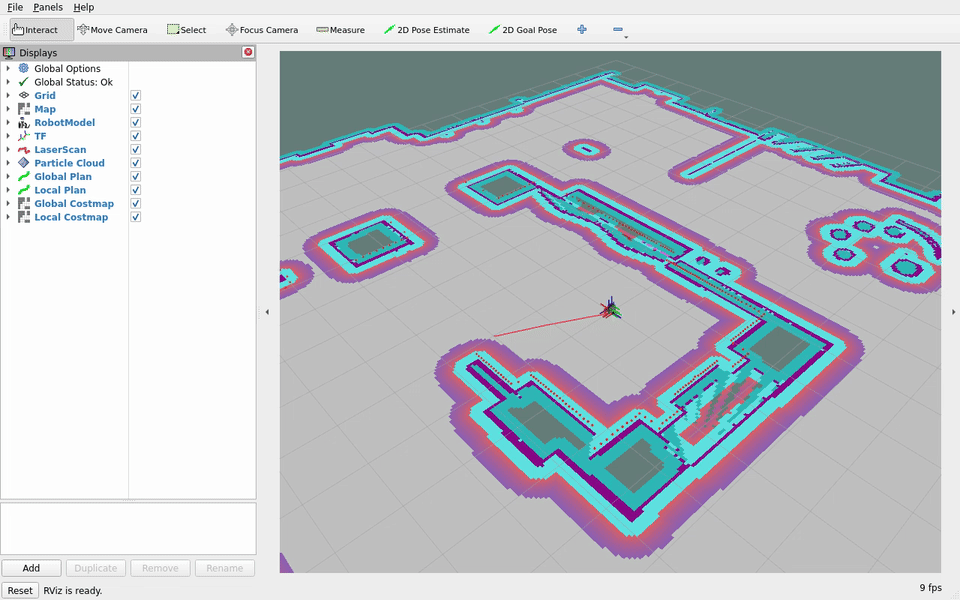
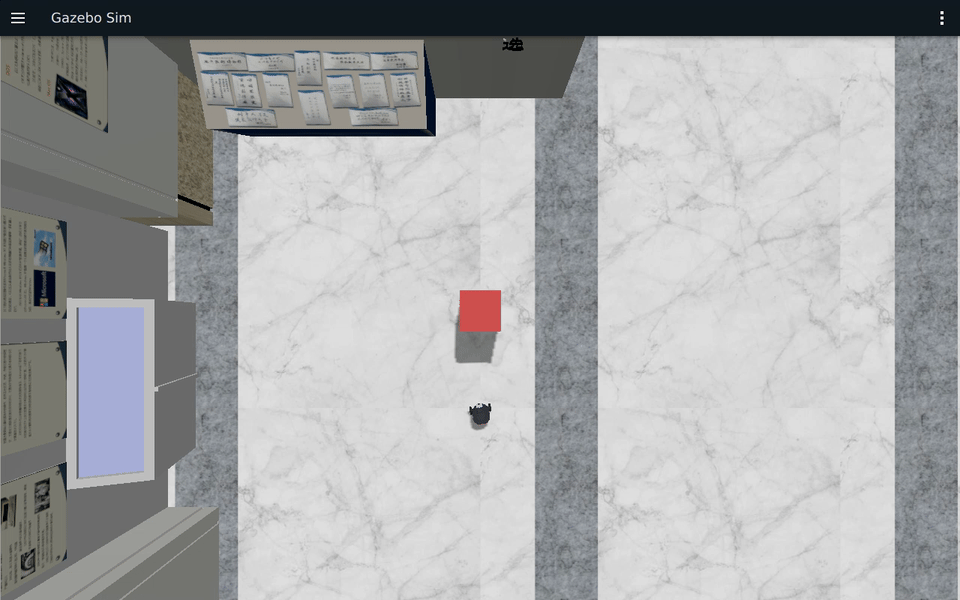
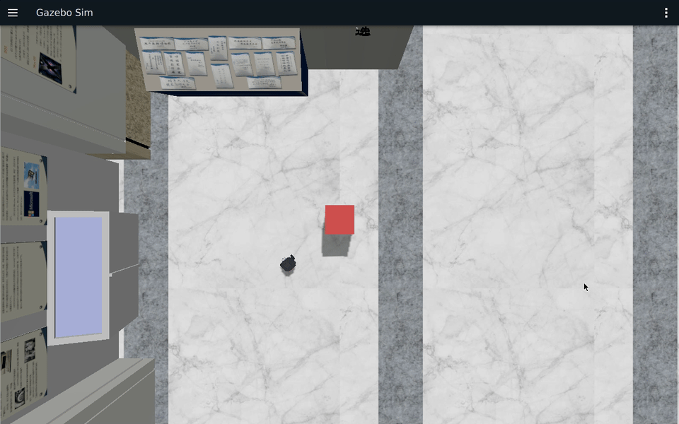
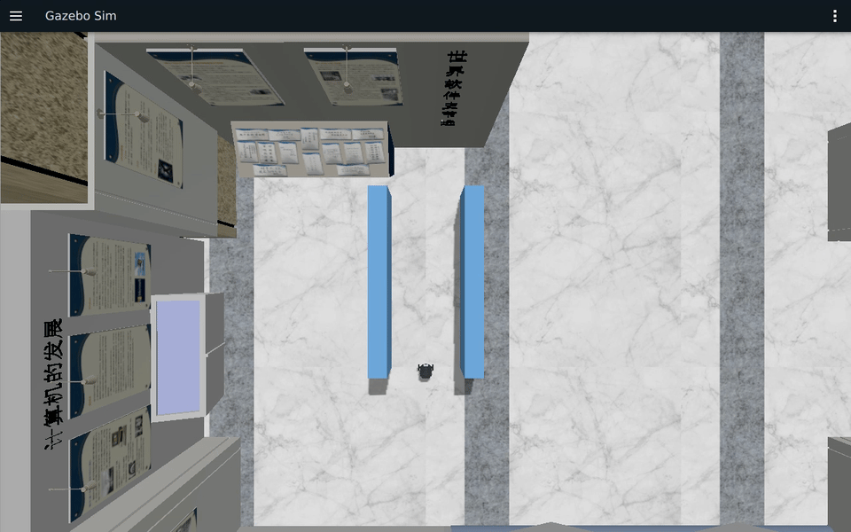

# 第 18～19 章教案示例运行说明

对应[全局路径规划教案](../teaching_docs_k3_com260_kit/ch18_全局路径规划.md)和[局部路径规划教案](../teaching_docs_k3_com260_kit/ch19_局部路径规划.md)。本页说明教案中的算法示例与配置；COM260 运行 C++17 示例，x86 运行 Gazebo / Nav2 / RViz。

## 1. 双端准备与构建

先完成[公共双端环境](ch00_common_setup.md)和[Nav2 公共环境](nav2_common_setup.md)。将本仓库放到两端的 `~/ROS2_RISCV_COM260_CH18_CH19`。

本章使用固定版本的 `nav2_msgs` underlay、Museum 地图、Burger 模型和第 16～17 章的 RViz 镜像。示例代码位于 `src_k3_com260_kit/` 的功能包中，构建到本章独立工作区。

| 章节 | 包 | 作用 |
|---|---|---|
| 18 | `grid_path_planner` | Dijkstra/A*、SVG、真实代价地图订阅 |
| 18 | `hybrid_astar_planner` | 带朝向和足迹检查的运动基元搜索 |
| 18 | `path_optimizer` | 平滑、修剪、重采样、代价优化 |
| 19 | `dwa_planner` | 动态窗口、评分、COM260 闭环控制 |
| 19 | `rpp_controller` | 纯追踪原理、速度与前瞻调参 |

共用 `costmap_demo` 的栅格类型，以及已有的 `global_planner_client`、`navigation_client_cpp` C++ Action 客户端。

### COM260

两端使用同一 DDS 域。将下例 IP 替换为两台设备的实际有线地址。

```bash
cd ~/ROS2_RISCV_COM260_CH18_CH19
export ROS_DOMAIN_ID=182
export CYCLONEDDS_URI='<CycloneDDS><Domain><General><Interfaces><NetworkInterface address="192.168.1.88"/></Interfaces><AllowMulticast>false</AllowMulticast></General><Discovery><ParticipantIndex>auto</ParticipantIndex><MaxAutoParticipantIndex>100</MaxAutoParticipantIndex><Peers><Peer Address="127.0.0.1"/><Peer Address="192.168.1.172"/></Peers></Discovery></Domain></CycloneDDS>'
bash setup_course_k3_com260_kit.sh --build-ch18
bash setup_course_k3_com260_kit.sh --build-ch19
source ~/.config/ros2-course-com260-ch18-ch19/env.bash
```

工作区为 `~/ros2_course_com260_ch18_ch19_ws`。两个入口都运行对应包的 `known_inputs` 测试；全部构建后可执行 `python3 -m colcon test-result --test-result-base ~/ros2_course_com260_ch18_ch19_ws/build --verbose` 查看结果。

### x86

```bash
cd ~/ROS2_RISCV_COM260_CH18_CH19
export ROS_DOMAIN_ID=182
export CYCLONEDDS_URI='<CycloneDDS><Domain><General><Interfaces><NetworkInterface address="192.168.1.172"/></Interfaces><AllowMulticast>false</AllowMulticast></General><Discovery><ParticipantIndex>auto</ParticipantIndex><MaxAutoParticipantIndex>100</MaxAutoParticipantIndex><Peers><Peer Address="127.0.0.1"/><Peer Address="192.168.1.88"/></Peers></Discovery></Domain></CycloneDDS>'
bash course_support/k3_com260_kit/scripts/x86-ch18-ch19.bash build-image
bash course_support/k3_com260_kit/scripts/x86-ch18-ch19.bash build
```

工作区为 `~/ros2_course_com260_ch18_ch19_humble_ws`。保持 X11 `:1` 桌面登录。

## 2. 第 18 章算法示例

在 COM260 新终端先加载本章环境：

```bash
source ~/.config/ros2-course-com260-ch18-ch19/env.bash
mkdir -p ~/ros2_course_com260_ch18_ch19_ws/results
cd ~/ros2_course_com260_ch18_ch19_ws/results
ros2 run grid_path_planner grid_path_planner
ros2 run hybrid_astar_planner hybrid_astar_planner
ros2 run path_optimizer path_optimizer
```

Dijkstra/A* 使用同一张 5 × 5 m、分辨率 0.1 m 的地图，从 (-2, -2) 到 (2, 2)。检查总代价相同，再比较扩展节点数与耗时；查看 `dijkstra.svg`、`astar.svg` 中的路径是否绕开黑色障碍。

Hybrid-A* 从 (-1, -1, 0) 到 (1, 1, 0)，教学实现的目标容忍度为位置 < 0.5 m、朝向 ≤ 15°，同时检查每个运动子步的圆形足迹。它没有实现解析 Reeds–Shepp 连接，不能用它的耗时代表官方 Smac 插件。

路径优化需保持起终点，检查线段碰撞与重采样间距。B 样条采用夹持三次控制曲线；它不保证经过全部中间控制点。代价优化的 `max_shift` 是位移限制，不是障碍净距保证。

## 3. 启动仿真和切换插件

x86 终端执行：

```bash
cd ~/ROS2_RISCV_COM260_CH18_CH19
export RUN_ID="$(date -u +%Y%m%dT%H%M%SZ)-planning"
bash course_support/k3_com260_kit/scripts/x86-ch18-ch19.bash start "$RUN_ID" navfn dwb
```

允许的规划器为 `navfn`、`astar`、`smac2d`、`hybrid`；控制器为 `dwb`、`rpp`、`mppi`。参数见 [planning.yaml](../course_support/k3_com260_kit/config/planning.yaml)。切换时先停止当前仿真，再生成新 RUN_ID 启动，使 Nav2 加载所选插件。

```bash
bash course_support/k3_com260_kit/scripts/x86-ch18-ch19.bash stop "$RUN_ID"
export RUN_ID="$(date -u +%Y%m%dT%H%M%SZ)-rpp"
bash course_support/k3_com260_kit/scripts/x86-ch18-ch19.bash start "$RUN_ID" astar rpp
```

COM260 查询就绪状态，等待以下节点均为 `active [3]`：

```bash
source ~/.config/ros2-course-com260-ch18-ch19/env.bash
ros2 lifecycle get /planner_server
ros2 lifecycle get /controller_server
ros2 lifecycle get /bt_navigator
ros2 param get /planner_server GridBased.plugin
ros2 param get /controller_server FollowPath.plugin
```

Gazebo 刚启动时可能暂缺 map/odom TF。必须等地图、机器人、扫描和 TF 就绪后再发送目标。

## 4. 实际地图上的路径规划

COM260 运行自编 A*：

```bash
ros2 run grid_path_planner grid_planner_node --ros-args \
  -p use_sim_time:=true -p goal_x:=1.0 -p goal_y:=0.0
```

在 RViz 添加 Path 显示，话题选择 `/planned_path`。再运行 Nav2 C++ Action 客户端生成 `/plan`：

```bash
ros2 run global_planner_client global_planner_client --ros-args \
  -p use_sim_time:=true -p goal_x:=1.0 -p goal_y:=0.0
```

自编 A* 的默认目标为 `(3, 2)`。在 Museum 地图中，该位置代价为 253，属于内切障碍区；直接运行默认入口会返回无可行路径并退出 1，这是明确拒绝不可通行目标。NavFn 的 `tolerance` 可以选择附近目标，不能据此推断原目标可达或输出路径已有足够净距。

规划器对比采用已确认空闲的 `(2, -1)`，从相同初始位姿发送相同目标，保存 Path、规划耗时、路径长度和转角变化。碰撞检查要结合代价地图，不能只凭 Action 的成功状态验收。Nav2 返回的 planning_time 使用 ROS 时钟；仿真时可能因时钟更新粒度显示为 0，另记录墙钟 Action 往返时间，两者都不等同于纯 CPU 计算耗时。

## 5. 第 19 章控制与停止

先运行数值示例：

```bash
ros2 run dwa_planner dwa_planner
ros2 run rpp_controller rpp_controller
```

### Nav2 控制器

依次在全新仿真中选择 `dwb`、`rpp`、`mppi`，由 COM260 发送相同目标：

```bash
ros2 run navigation_client_cpp bt_navigator_client --ros-args \
  -p use_sim_time:=true -p x:=1.0 -p y:=0.0
ros2 topic echo /odom --once
```

验收目标被接受、终态 SUCCEEDED、实际机器人发生位移，并在结束后归零。目标误差从 `map → base_link` TF 计算；停止从 `/odom.twist.twist` 的连续尾段采样判断，不能只检查 `/cmd_vel`。

### 自编 DWA 闭环

使用全新仿真。COM260 终端一：

```bash
source ~/.config/ros2-course-com260-ch18-ch19/env.bash
ros2 run dwa_planner dwa_controller --ros-args -p use_sim_time:=true
```

终端二加载相同环境，待节点已订阅后发送路径：

```bash
source ~/.config/ros2-course-com260-ch18-ch19/env.bash
ros2 run global_planner_client global_planner_client --ros-args \
  -p use_sim_time:=true -p goal_x:=1.0 -p goal_y:=0.0
```

DWA 节点按真实 odom/scan 运行，默认限速 0.15 m/s。到达路径终点 0.1 m 内后发送停止并退出；按 Ctrl+C 也会发送停止。odom 或 scan 的接收间隔超过 0.5 s 时停止发送运动速度。不要同时运行 NavigateToPose 或其他 `/cmd_vel` 控制源。

## 6. 障碍和 0.8 m 走廊

每个场景使用全新仿真，避免上一个任务的位姿、障碍或代价地图影响对比。

### 障碍避让

x86 在已启动的仿真中添加有真实碰撞几何的 0.3 × 0.3 × 0.5 m 箱体，中心为 `(0.8, 0)`：

```bash
bash course_support/k3_com260_kit/scripts/x86-ch18-ch19.bash exec "$RUN_ID" \
  env GZ_PARTITION="$RUN_ID" ros2 run ros_gz_sim create \
  -world default -file /course-config/planning-obstacle.sdf -name course_obstacle \
  -x 0.8 -y 0.0 -z 0.25
```

等待激光与代价地图更新，再向 `(1.5, 0)` 规划/导航。分别记录自编 DWA 和 Nav2 DWB/RPP 的路径、实际轨迹、最近障碍距离与停止情况。RPP 依赖全局规划器提供绕障路径，不将碰撞前停止等同于已完成避障通行。

本箱体场景的 DWB 使用 **3.0 s 预测时域**；默认 1.7 s 在此场景未完成导航。保持 `planning.yaml` 中其余权重、足迹和目标容差，在发送目标前于 COM260 执行：

```bash
ros2 service call /lifecycle_manager_navigation/manage_nodes \
  nav2_msgs/srv/ManageLifecycleNodes '{command: 3}'
ros2 param set /controller_server FollowPath.sim_time 3.0
ros2 service call /lifecycle_manager_navigation/manage_nodes \
  nav2_msgs/srv/ManageLifecycleNodes '{command: 0}'
ros2 param get /controller_server FollowPath.sim_time
ros2 lifecycle get /controller_server
```

两次服务响应须为 `success=True`，参数为 `3.0`，节点重新进入 `active [3]` 后再导航。这里先 RESET 再 STARTUP，使控制器按新参数重新配置；不能仅看到参数设置成功就推断内部轨迹生成器已更新。该设置用于 DWB 箱体场景；启动全新仿真会重新加载默认配置。

### 走廊配置练习

使用 `navfn dwb` 的全新仿真，添加两堵静态墙：

```bash
bash course_support/k3_com260_kit/scripts/x86-ch18-ch19.bash exec "$RUN_ID" \
  env GZ_PARTITION="$RUN_ID" ros2 run ros_gz_sim create \
  -world default -file /course-config/corridor.sdf -name course_corridor
```

墙体覆盖 x=0～2 m，中心 y=±0.5 m、厚度 0.2 m，因此内侧净宽为 **0.8 m**。在 COM260 向 `(2.2, 0)` 发送导航目标，检查通过时的横向偏差、墙体净距、终点误差与停止状态。

自适应控制器切换设计题：提出区域判断、切换时机、速度连续性和失败回退方案。

## 7. 运行示例与参考结果

### 第 18 章：算法与规划

以下示例中，Dijkstra 与 A* 的栅格步进代价均为 **65.9411**，路径均为 57 点；扩展节点为 2423 / 680，耗时为 5.786 / 2.502 ms。简化 Hybrid-A* 输出 18 点，末位姿 `(0.78518, 0.72034, 0.15)` 满足其教学容忍度。


[终端截图](images/nav2_ch18_ch19/algorithm-examples.png)、[原始 CAST](images/nav2_ch18_ch19/algorithm-examples.cast)、[Dijkstra 路径图](images/nav2_ch18_ch19/dijkstra.svg)、[A* 路径图](images/nav2_ch18_ch19/astar.svg)。

自编 A* 在真实地图上到 `(1,0)` 生成 21 点，60 个线段采样的最大代价为 0，终点误差 0.0354 m；默认 `(3,2)` 代价为 253，程序正确拒绝并退出 1。[原始记录](images/nav2_ch18_ch19/grid-node.cast)。

以下四组使用相同空闲目标 `(2,-1)` 和 DWB 默认配置。C++ 规划入口成功后，用同参数的 5 次独立 Action 请求检查规划结果和往返时间；导航再由 C++ 客户端完成。

| 规划器 | 路径点 / 长度 m | 转角总量 rad | ROS 规划时间 ms | 墙钟往返中位数 ms | 导航终点误差 m | RViz 原速视频 |
|---|---:|---:|---:|---:|---:|---|
| NavFn / Dijkstra | 88 / 2.2441 | 1.1028 | 0.0 | 24.049 | 0.0992 | [65 秒](images/nav2_ch18_ch19/navfn-free-rviz.mp4) |
| NavFn / A* | 89 / 2.2481 | 0.9732 | 5.0 | 23.292 | 0.0967 | [65 秒](images/nav2_ch18_ch19/astar-free-rviz.mp4) |
| Smac 2D | 41 / 2.3031 | 1.1199 | 2.0 | 10.607 | 0.1096 | [65 秒](images/nav2_ch18_ch19/smac2d-free-rviz.mp4) |
| Smac Hybrid-A* | 32 / 2.2422 | 0.6069 | 8.0 | 16.579 | 0.1094 | [65 秒](images/nav2_ch18_ch19/hybrid-free-rviz.mp4) |

所有路径的独立代价检查均低于 253，所有导航均 SUCCEEDED 且停稳。ROS 规划时间为 0 表示该次计算没有跨过仿真时钟更新，不表示没有计算开销；表中时延不是 CPU 基准排名。



GIF 为 NavFn 原片第 8～43 秒，原速。另见 [NavFn 截图](images/nav2_ch18_ch19/navfn-free-rviz.png)、[A* 截图](images/nav2_ch18_ch19/astar-free-rviz.png)、[Smac 2D 截图](images/nav2_ch18_ch19/smac2d-free-rviz.png)、[Hybrid-A* 截图](images/nav2_ch18_ch19/hybrid-free-rviz.png)。

### 第 19 章：控制器与场景

三种官方控制器使用相同初始位姿、NavFn 规划器和空闲目标 `(1,0)`。

| 控制器 | 记录时长 s | 终点误差 m | 跟踪 RMS m | 停车 | 原速视频 |
|---|---:|---:|---:|---|---|
| DWB | 14.319 | 0.0985 | 0.0076 | 通过 | [55 秒](images/nav2_ch18_ch19/dwb-free-gazebo.mp4) |
| RPP | 16.351 | 0.0957 | 0.0063 | 通过 | [55 秒](images/nav2_ch18_ch19/rpp-free-gazebo.mp4) |
| MPPI | 19.285 | 0.0977 | 0.0111 | 通过 | [50 秒](images/nav2_ch18_ch19/mppi-free-gazebo.mp4) |

箱体场景目标均为 `(1.5,0)`。DWB 按第 6 节将预测时域设为 3.0 s，其余设置不变；RPP 使用默认配置，自编 DWA 限速 0.15 m/s。

| 控制器 | 记录时长 s | 行驶距离 m | 终点误差 m | 跟踪 RMS m | 最小箱体净距 m | 原速视频 |
|---|---:|---:|---:|---:|---:|---|
| DWB（3.0 s） | 124.900 | 1.9787 | 0.0968 | 0.0227 | 0.0796 | [140 秒](images/nav2_ch18_ch19/dwb-box-lookahead-gazebo.mp4) |
| RPP | 59.933 | 2.3573 | 0.1063 | 0.0192 | 0.2690 | [140 秒](images/nav2_ch18_ch19/rpp-box-full-gazebo.mp4) |
| 自编 DWA | 62.799 | 1.9930 | 0.1410 | 0.0653 | 0.1344 | [110 秒](images/nav2_ch18_ch19/dwa-box-gazebo.mp4) |

三组均到点并停稳。时长从启动客户端计至尾段采样结束，包含启动、恢复行为和结束采样；跟踪 RMS 相对于每次更新的全局路径，不是同一条固定参考曲线。净距由仿真 odom、箱体几何和 0.22 m 验收半径计算。以上是单次场景结果，不作为普遍性能排名。DWA 的到达阈值针对转换后的路径终点，表中误差针对请求的地图目标，两者不是同一数值。



GIF 为原片第 12～47 秒。[DWA 截图](images/nav2_ch18_ch19/dwa-box-gazebo.png)、[DWB 截图](images/nav2_ch18_ch19/dwb-box-lookahead-gazebo.png)。



GIF 为原片第 25～60 秒。[RPP 截图](images/nav2_ch18_ch19/rpp-box-full-gazebo.png)。

DWB 使用默认配置通过净宽 **0.8 m** 的走廊：目标 `(2.2,0)`，行驶 2.0547 m，最大横向偏差 0.1117 m，按 0.22 m 半径计算的最小墙体净距 **0.0683 m**，终点误差 **0.0977 m**，停车通过。



GIF 为第 10～45 秒。[65 秒原速视频](images/nav2_ch18_ch19/corridor-gazebo.mp4)、[截图](images/nav2_ch18_ch19/corridor-gazebo.png)。

### 停止与输入异常

测试 DWA 的 SIGINT、SIGTERM 和扫描输入失联时，先确认机器人实际运动，再检查 `/odom` 连续尾段停车；输入失联后，应在发出清理信号前确认机器人已停止。SIGINT 返回 1；SIGTERM 的 `ros2 run` 外层进程返回 -15，需通过实际里程计确认停车。无效限速返回 2，隔离域无输入超时返回 1。

[SIGINT 记录](images/nav2_ch18_ch19/dwa-cancel.cast)、[SIGTERM 记录](images/nav2_ch18_ch19/dwa-term.cast)、[输入失联记录](images/nav2_ch18_ch19/dwa-stale.cast)、[失联停车 30 秒原速视频](images/nav2_ch18_ch19/dwa-stale-gazebo.mp4)。

### 原始数据与复核

[结构化结果](images/nav2_ch18_ch19/validation-results.json)记录目标、时刻和误差；可结合[原始数据包](images/nav2_ch18_ch19/runtime-data.tar.gz)中的里程计、路径和日志复算。文件信息见[源码 SHA-256](images/nav2_ch18_ch19/source-sha256.json)及[媒体校验清单](images/nav2_ch18_ch19/media-validation.json)，构建记录见 [COM260](images/nav2_ch18_ch19/board-build.cast) 和 [x86](images/nav2_ch18_ch19/x86-build.cast)。视频按原速录制，分辨率为 1280×800、帧率为 12 fps；GIF 为文中标注的原速片段。

目标验收为地图坐标误差 ≤ 0.25 m；停车要求最后 2 秒满足 `|vx| < 0.02 m/s`、`|wz| < 0.03 rad/s`。RViz 可能出现 GLSL 或粒子云 QoS 提示，应结合地图、路径、机器人运动和数值记录判断导航状态。

停止仿真：

```bash
bash course_support/k3_com260_kit/scripts/x86-ch18-ch19.bash stop "$RUN_ID"
```
