# COM260 实际运行证据

本版结果来自 COM260 当前环境，原版和 Pico 结果仅作参考。环境准备见[公共双端环境](ch00_common_setup.md)。

**按教案章节查阅运行证据**

[1 概述](#ch01) · [2 核心编程](#ch02) · [3 话题](#ch03) · [4 服务](#ch04) · [5 动作](#ch05) · [6 参数与 Launch](#ch06) · [7 TF2](#ch07) · [8 URDF/Xacro](#ch08) · [9 Gazebo](#ch09)

[10 贝叶斯框架](#ch10) · [11 ICP 与 PLICP](#ch11) · [12 Hector SLAM](#ch12) · [13 粒子滤波](#ch13) · [14 AMCL](#ch14) · [15 Cartographer](#ch15)

[16 Nav2 架构](#ch16) · [17 全局代价地图](#ch17) · [18 全局路径规划](#ch18) · [19 局部路径规划](#ch19) · [20 行为树与恢复行为](#ch20) · [21 视觉 SLAM](#ch21) · [22 多传感器融合](#ch22) · [23 综合实训](#ch23)

共用实验记录见[实验 10 · SLAM 建图与定位](#lab10)和[实验 11 · Nav2 自主导航](#lab11)。

## 第 1 章 ROS 2 概述与架构设计

验证日期：2026-09-16；源码基线：`96d9c90490573aeb8e06c8c32bf421a40544f3a5`。章节入口：[实验手册](ch01_lab.md)、[教师教案](../teaching_docs_k3_com260_kit/ch01_ROS2概述与架构.md)。

| 验证项 | 本轮结果 |
|---|---|
| COM260 连接及系统 | SSH 公钥连接成功；设备为 SpacemiT K3 Com260 IFX，Bianbu 4.0.6，riscv64，内核 6.18.3-generic |
| COM260 工具 | ROS 2 Humble，CycloneDDS 0.10.5，Python 3.14.4，CMake 4.2.3，GDB 17.1，clangd 21 |
| 第一章依赖解析 | 安装前 apt 模拟退出码 0；新增 312 个包，升级 0、删除 0；安装后核对依赖与入口 |
| x86 环境 | Ubuntu 24.04.4 宿主；rootless Ubuntu 22.04.5/Humble 容器；X11 `:1` 可读取 |
| COM260 构建 | 原样复用 `lifecycle_demo_cpp` 和 `robot_sim_demo`；Debug 构建及测试退出码 0；10 项资源 pytest 通过，colcon 实际汇总 60 项、0 错误、0 失败、0 跳过 |
| x86 构建和测试 | 独立工作区构建 `robot_sim_demo` 成功；10 项 pytest 通过，colcon 汇总 11 项、0 失败 |
| 最终源码身份 | COM260 58 个、x86 54 个源码／支持文件与本地 SHA-256 一致。核对范围包含最终视图配置，较初始构建多出独立设置文件；教学源码始终未改动 |
| 1.1 安装验证 | C++ talker/listener 收发递增消息；节点、话题及 `/chatter` 查询通过 |
| 1.2 建包 | 独立新建 `~/my_ros2_com260_ws`，空工作区构建、ament_cmake 建包、编译及加载查询均成功 |
| 1.3 域隔离 | Domain 0 收到；Domain 1 观察 10 秒未收到（预期 timeout 124）；恢复 Domain 0 后收到；教案 Domain 42 设置和恢复通过 |
| 双端基线 | 双向消息、互相发现、跨端参数查询、隔离与恢复、x86 `/clock` 到 COM260 全部通过 |
| 1.5 仿真和传感器 | Museum/Burger、RViz 模型及相机显示正常；COM260 收到 clock、scan、image、CameraInfo、odom、tf、tf_static 七个话题 |
| 1.5 键盘 | i/j/l/k 前进、左右转、停止通过；最终速度为零；1668 条 odom 样本，Δx=0.754500 m，四元数 z 分量跨度 0.693004（不是 yaw 角）；遥控程序与验收脚本退出码 0 |
| 生命周期 | 默认未配置，完整手动迁移、cleanup 后计数重置、再次激活、shutdown、独立 autostart 均通过；激活速度 0.1，停用／关闭归零；C++ 节点退出码 0 |
| 1.6 IDE | Remote-SSH 连接 COM260；RuyiSDK 扩展、clangd 补全、Native Debug/GDB、configure/activate 断点及 Watch 0→1 单步通过 |
| 文档与媒体 | 原实验手册 18 处、教案 4 处素材位置均对应本轮证据；IDE/RViz 截图、Gazebo 连续录像及内嵌 GIF 已归档；4 份 CAST 均以退出事件 0 结束，5 份 MP4、Gazebo 和生命周期 GIF 完整解码通过 |
| 结束状态 | x86 本轮容器已停止；COM260 节点图为空、生命周期进程退出；构建目录与 IDE 环境保留供下次使用 |

镜像 ID：`442a2715c72365056f1028363f4bbbc6cea5ac3ae93d0268cea64fd82cf3d1b1`；Gazebo Sim 8.15.0、RViz 11.2.28。容器使用软件渲染；同轮一个 30 秒观察窗口内仿真时间推进约 10.397 秒，本轮不将墙上时间等同于仿真时间。

### 本轮素材与运行编号

| 范围 | 本地记录编号 | 可直接打开的素材 |
|---|---|---|
| 环境、同步和构建 | `20260916T060019Z`；成功构建 `20260916-build-module` | [构建 CAST](images/ch01/ch01-build.cast)、[构建终端视频](images/ch01/ch01-build.mp4) |
| 安装验证、建包、域隔离 | `20260916T061640Z-foundations` | [基础练习 CAST](images/ch01/ch01-foundations.cast)、[终端视频](images/ch01/ch01-foundations.mp4) |
| 双端 DDS 和生命周期 | 仿真实例 `20260916T0630-com260-ch01`；生命周期记录 `20260916-lifecycle-cli-stop` | [生命周期 CAST](images/ch01/ch01-lifecycle.cast)、[终端视频](images/ch01/ch01-lifecycle.mp4) |
| IDE | `20260916-ide` | [configure](images/ch01/ide-configure-breakpoint.png)、[activate](images/ch01/ide-activate-breakpoint.png)、[Watch 0](images/ch01/ide-count-zero.png)、[Watch 1](images/ch01/ide-count-one.png) |
| GUI、传感器和遥控 | `20260916T064703Z-com260-teleop` | [Gazebo 连续录像](images/ch01/ch01-gazebo.mp4)、[配对终端 CAST](images/ch01/ch01-teleop.cast)、[配对终端视频](images/ch01/ch01-teleop.mp4) |

Gazebo 原始录制时间为 06:55:25～06:57:55 UTC，共 150 秒；正式 MP4 保留开头连续 56 秒，原速、无拼接，覆盖静止、前进、左右转和最终停止。正文开始／结束图取自原录像第 2／54 秒。后半段重开 RViz 后存在窗口遮挡，完整原片保存在本地原始采集目录，未作为正文演示。配对 COM260 CAST 起点为 06:55:21 UTC，遥控进程约在其第 50 秒正常退出。

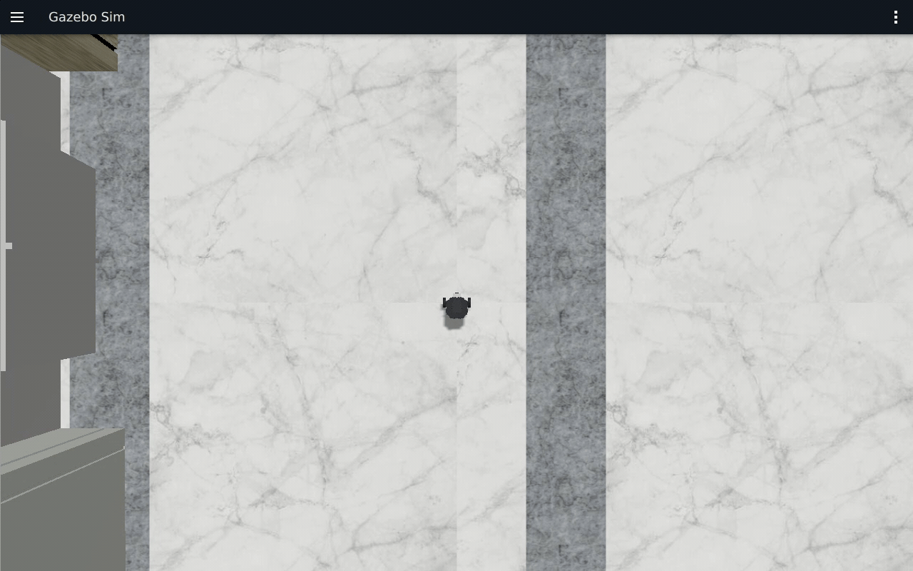

GIF 取自上述录像第 30～56 秒，连续 26 秒、原速、12 帧/秒、1280×800，保留前进、左右转与停止过程。

RViz 前后图来自同一仿真实例，按顺序采集；为保证 Gazebo 录制不被遮挡，期间暂时关闭本轮 RViz，运动结束后重新打开。模型放大图随后使用同一实例的 1900×1000 窗口配置采集；之前的前后图窗口为 1200×800。IDE、基础练习和生命周期分别采集，不合称同一轮同步演示。

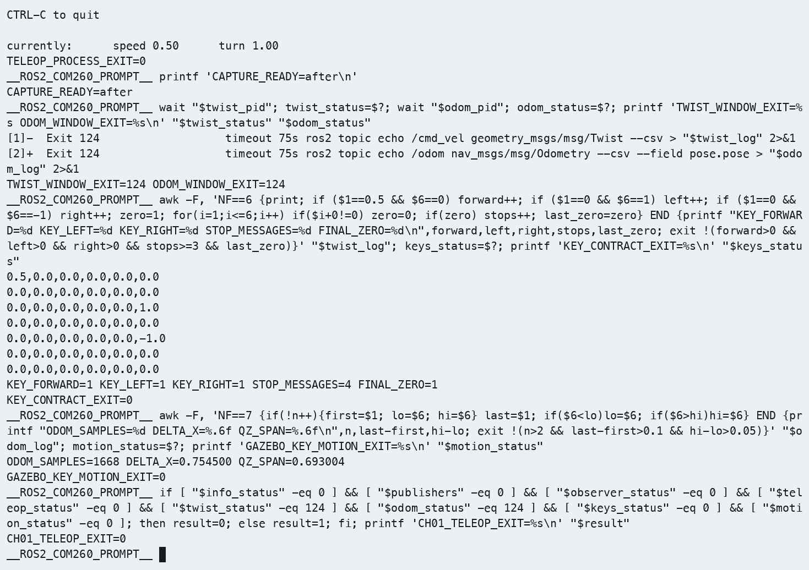

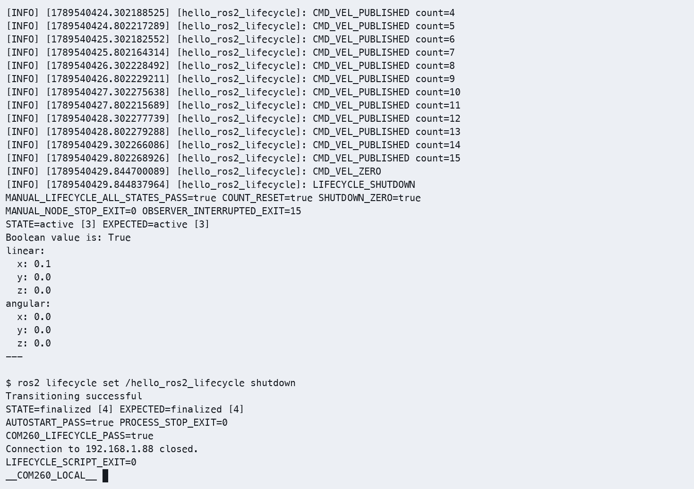

### 可复核的运行记录与实际差异

- 键盘消息与运动反馈：最后一条 Twist 六个分量均为 0；限时观察进程的 124 是预期观察窗口结束。
- 生命周期：实际发布端为 RELIABLE、VOLATILE、KEEP_LAST(10)。主动停止 ROS CLI 观察者时退出码 15，与 C++ 节点的正常退出码 0 分别记录。
- IDE 控制端：RuyiSDK VSCode 扩展已安装；使用原生 GCC/GDB，未安装 RuyiSDK CLI。clangd 的 5 项 unused-includes 提示保留，未修改课程头文件。
- Bianbu 的 colcon 模块存在，但初始没有独立 `colcon` 命令；安装器和板端步骤已使用 `python3 -m colcon`，复跑成功。建包练习的许可证占位提示与 CMake 弃用警告保留。
- 跨机查询的短发现窗口曾漏报远端节点，恢复域后的 5 秒观察也曾不足；最终使用 `--no-daemon --spin-time 10`，恢复接收窗口 20 秒。初次传感器探针的 JSON 布尔类型转换和生命周期零值解析错误仅涉及验证脚本，修正后重新采集。

## 第 2 章 ROS 2 核心编程基础

验证日期：2026-09-16；章节入口：[实验手册](ch02_lab.md)、[教师教案](../teaching_docs_k3_com260_kit/ch02_核心编程基础.md)。课程内容、练习编号与输入值沿用原章，节点采用 C++17／rclcpp。新增两个包位于 `src_k3_com260_kit/`，仿真继续原样复用 `src_k3_pico_itx/robot_sim_demo`。

`odom_monitor` 从 `/odom` 的 `twist.twist` 字段读取线速度、角速度，并为位置、航向及速度标注单位。下表记录基础节点与位置／航向验证；速度输出的源码指纹、构建、已知输入和 Gazebo 联动结果见“速度输出验证”一节。

| 验证项 | 本轮结果与证据 |
|---|---|
| 构建 | `--build-ch02` 构建 `hello_pkg_cpp`、`name_demo_cpp` 成功；独立新建 `~/my_hello_com260_ws` 并编译练习包；[受管构建截图](images/ch02/ch02-course-build.png)与[基础 CAST](images/ch02/ch02-basics.cast)。这两个包未注册单元测试，本章结论来自以下运行验收 |
| 源码一致性（修改前） | 原实测时 COM260 65 个、x86 54 个源码和支持文件与本地 SHA-256 一致。三个 lab 完整 C++ 程序与实际编译源码一致；两个教案程序和 CMake 共 4 个文件也与板端一致。新增速度输出后的 `odom_monitor.cpp` 指纹见下方验证记录 |
| 定时节点与重命名 | 启动标记、从 1 开始的递增计数通过，实测回调间隔约 1 秒。`/hello_node`、`/hello2` 同时存在 |
| 命名空间和参数 | `/student/name_demo`、命名空间 `/student`、`serial=7`；未传入的 `global_serial` 实际为 -1 |
| 日志级别 | 默认 INFO 不含 DEBUG；节点 DEBUG 含四个级别，第 3 次 ERROR 仅一次；全局 ERROR 和节点 WARN 过滤正确 |
| 节流 | 源码阈值为 2000 ms；本轮节流警告相邻间隔为 2.0、3.0 秒，均不短于阈值。它限制最短间隔，并不保证每隔恰好 2 秒输出 |
| rqt_graph | 真实 GUI 显示 `/talker → /chatter → /listener`，并显示仿真传感器与 RViz 的连接；[连续 GUI 录像](images/ch02/ch02-rqt-graph.mp4)。[完整 talker 接口截图](images/ch02/ch02-talker-node-info.png)、[CLI CAST](images/ch02/ch02-graph.cast) |
| rqt_console | 收到 COM260 `logger_demo` 的 Debug、Info、Warn、Error；第 3 次 ERROR 与节流警告可见；[GUI 录像](images/ch02/ch02-rqt-console.mp4) |
| RViz | 同轮仿真中的 RobotModel 状态为 Ok，激光与相机可见；[无遮挡截图](images/ch02/ch02-rviz.png) |
| 原输入运动 | `linear.x=0.2 m/s`、`angular.z=0.5 rad/s`；收到 102 条对应速度消息和 1053 条位姿样本；从约 `(0, 0, 0)` 到 `(0.281051 m, 0.686597 m, 2.374500 rad)`；yaw 使用完整四元数公式计算 |
| 里程计速度输出（验证通过） | 原有运动记录未覆盖 `twist.twist` 速度反馈。包含速度输出的程序已完成板端构建、已知输入和独立 Gazebo 联动验证，详见下方验证记录 |
| 停止 | 显式零速度发布退出 0；最后一条 Twist 六个分量均为 0；末尾 30 条位姿的 x、y、yaw 跨度均为 0 |
| 教案独立程序 | `my_robot_pkg/my_node` 构建并逐秒计数；`my_first_pkg/my_node` 与重命名的 `/my_node2` 均收到 `/scan`，每帧 240 点、frame 为 `laser_link` |
| 退出与清理 | 课程 C++ 节点均正常退出 0；有限观察窗口为预期 timeout 124。COM260 节点图为空。临时图形容器超时后由 Podman 强制结束，课程仿真停止成功；回环服务及本机 SSH 隧道已关闭，练习工作空间保留 |
| 媒体交付 | 原 lab 11 处、教案 2 处素材位置均已替换为本轮证据；另补充 Gazebo 和教案程序证明。5 份 CAST 均以退出 0 结束；7 份 MP4、4 份 GIF 完整解码通过 |

### 连续录像与实际运行编号

仿真实例为 `20260916T0730-com260-ch02`。Gazebo、rqt_console、rqt_graph 是该实例运行期间先后录制的独立片段，不是同步拼接画面。

| 范围 | 运行编号／采集时间（UTC） | 正式素材 |
|---|---|---|
| 建包、节点、命名空间、日志 | `20260916-ch02-basics` | [CAST](images/ch02/ch02-basics.cast)、[完整终端 MP4](images/ch02/ch02-basics.mp4)；内嵌 GIF 为第 87～117 秒的连续片段 |
| ERROR 过滤清屏补拍 | `20260916-ch02-error-filter` | [CAST](images/ch02/ch02-error-filter.cast)，重新运行并正常退出，避免上一轮 DEBUG 输出残留干扰截图 |
| 教案最小节点与 `/scan` | `20260916-ch02-teacher` | [CAST](images/ch02/ch02-teacher.cast)、[MP4](images/ch02/ch02-teacher.mp4) |
| 运动与停止 | `20260916-ch02-motion` | [CAST](images/ch02/ch02-motion.cast)、[MP4](images/ch02/ch02-motion.mp4) |
| Gazebo GUI | 原片 07:39:37～07:41:17 | [MP4](images/ch02/ch02-gazebo.mp4)、[GIF](images/ch02/ch02-gazebo.gif)，均取原片第 18～53 秒，35 秒、原速、连续无拼接，覆盖静止、运动、停止 |
| rqt_console GUI | 原片 07:49:45 起，40 秒 | [MP4](images/ch02/ch02-rqt-console.mp4)、[GIF](images/ch02/ch02-rqt-console.gif)，均为开头连续 25 秒；COM260 日志节点在本段中重新启动和正常停止 |
| rqt_graph GUI | 原片 07:52:37 起，40 秒 | [MP4](images/ch02/ch02-rqt-graph.mp4)、[GIF](images/ch02/ch02-rqt-graph.gif)，均为开头连续 30 秒，包含刷新后出现 talker/listener；配对[节点查询 CAST](images/ch02/ch02-graph.cast)、[MP4](images/ch02/ch02-graph.mp4) |

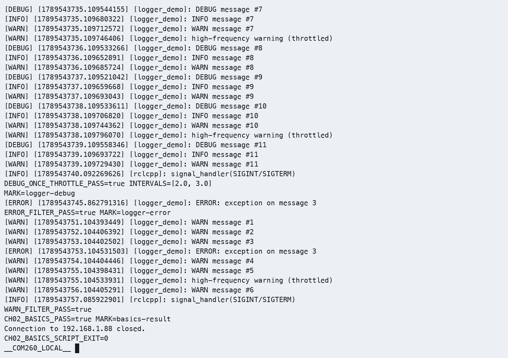

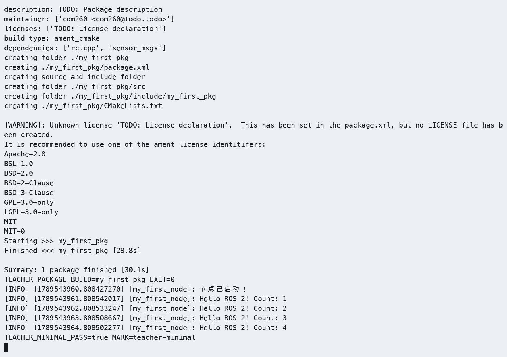

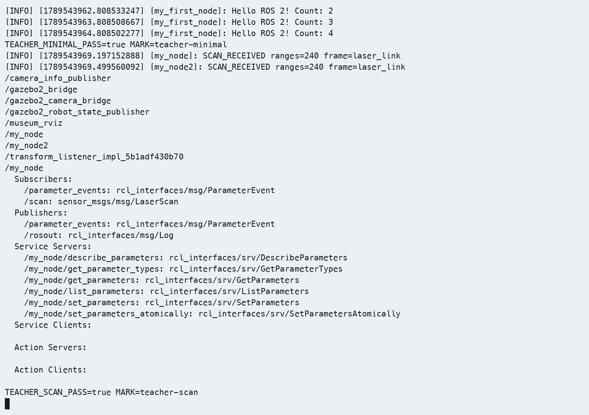

### 本轮修正与复现边界

- 保留原课程内容与编号。补齐教案要求的真正 `/scan` 订阅程序；原先只有通用定时器和 `/chatter` listener，不能证明激光订阅。命名空间说明修正为影响相对名称，不会隔离 DDS 域和绝对话题。
- 板端继续使用 `python3 -m colcon`；独立建包保留 ROS 工具生成的许可证占位警告，CMake 弃用警告未影响构建。未安装第三章或更后面的依赖。
- x86 使用第一章同一基础镜像，rqt_graph 1.3.2、rqt_console 2.0.3。录制时另开临时 rootless GUI 容器，用独立虚拟桌面显示 rqt，通过仅绑定回环地址的 SSH 转发操作；正式课程仍可直接在 x86 桌面运行这两个工具。
- 最初在禁用 capabilities 的仿真容器内安装录制工具失败，未改变基础镜像；之后改用临时 GUI 容器。第一次跨容器录屏因共享内存录成黑屏，改用 `ximagesrc remote=true` 后重新录制并逐帧解码、抽帧检查。一次脚本同步未完成就启动的失败记录也单独保留。正式材料只引用成功的新记录。
- Gazebo 使用软件渲染，墙上时间与仿真时间不同；上表位置与角度取自实际 `/odom`，未按输入速度乘以墙上时间推算。RViz 图在同一仿真运动停止后重新打开窗口采集。

### 速度输出验证：COM260 与 Gazebo 联动通过

运行编号 `20260916T153020Z-ch02-velocity`，日期 2026-09-16。本轮只更新课程和独立练习目录中的 `odom_monitor.cpp`。源码 SHA-256 为 `a3f1de4ea13e1ccdcdd323ae6150a344be70c67ed8aa95e36ce35c642080a228`，本地与 COM260 两处副本一致。

| 验证项 | 结果 |
|---|---|
| 课程工作区构建 | `~/ros2_course_com260_ws` 仅重编译 `hello_pkg_cpp`，退出码 0 |
| 独立练习构建 | `~/my_hello_com260_ws` 重编译 `hello_pkg_cpp`，退出码 0 |
| 已知输入验证 | 两个工作区的可执行文件均在 COM260 运行；将 `/odom` 重映射到隔离话题 `/com260_velocity_check/odom`，使用 Domain 171、仅本机通信 |
| 静止消息 | 输入 `vx=0、wz=0`；两个可执行文件分别收到并正确输出 30 条 |
| 运动消息 | 输入 `vx=0.2 m/s、wz=0.5 rad/s`；两个可执行文件分别收到并正确输出 30 条 |
| 停止消息 | 输入 `vx=0、wz=0`；两个可执行文件分别收到并正确输出 30 条 |
| 位置与航向 | 三组已知位置和四元数转换后的 yaw 均与节点输出一致；每个可执行文件共核对 90 条输出 |
| 退出与清理 | 两个节点退出码均为 0；隔离域和课程域查询为空，无本轮节点残留 |
| Gazebo 联动 | 在独立 x86 容器中完成下述速度与反馈验证 |

[本轮 COM260 真实终端记录（CAST）](images/ch02/ch02-velocity-input.cast)。记录保留 CycloneDDS 在本机回环接口上禁用组播的提示；同机发现和消息接收成功。已知输入验证只证明程序能正确读取并输出消息字段，不能代替 Gazebo 运动验收。

真实 Gazebo 验证使用同一运行编号。x86 中实际安装的 Burger 模型、启动文件与本地 SHA-256 一致；容器镜像 ID 为 `442a2715c72365056f1028363f4bbbc6cea5ac3ae93d0268cea64fd82cf3d1b1`。COM260 在 15:43:39～15:44:17 UTC 运行验证：先静止 6 秒，再持续发送 `linear.x=0.2、angular.z=0.5` 约 12 秒，最后发送零速度并观察约 12 秒，结束前再次归零。

| 原始 `/odom` 验证项 | 本次实际结果 |
|---|---|
| 数据来源 | `/odom`，frame 为 `odom`、child frame 为 `base_footprint`；记录位置、完整四元数、六个速度分量和消息时间戳 |
| 样本 | 共 847 条原始消息，其中发现阶段 10 条、静止 210 条、运动 306 条、停止观察 321 条；C++ 输出 757 条 |
| 静止 | 线速度和角速度均接近 0，仅有浮点残差 |
| 运动 | 稳定段速度中位数为 `0.199999999978 m/s`、`0.499999999949 rad/s`，起步阶段有加速过程 |
| 停止 | 发送零速度后进入静止；末尾 30 条样本的速度为 0，x、y 跨度均为 0 |
| 位姿变化 | 从约 `(0, 0, 0)` 到 `(0.028218 m, 0.799155 m, 3.081000 rad)`，平面位移约 0.799653 m |
| 程序输出 | 各阶段原始消息的 `x、y、yaw、vx、wz` 按日志显示精度可与 C++ 输出对应；节点退出码为 0 |
| 清理 | x86 仅停止本轮命名容器；剩余课程容器为 0，COM260 课程域节点与本轮验证进程均为 0 |

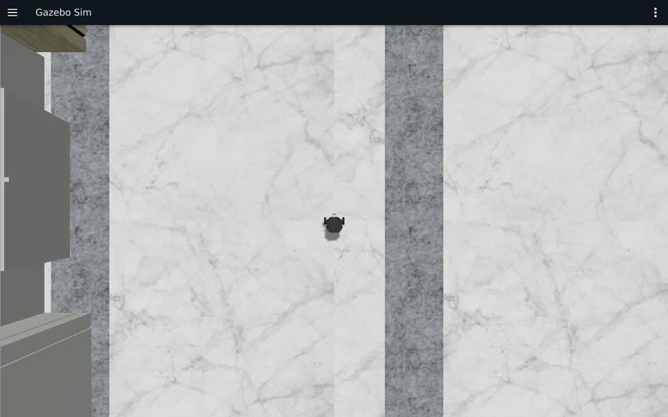

[完整终端 CAST](images/ch02/ch02-velocity.cast)、[Gazebo 连续 MP4](images/ch02/ch02-velocity-gazebo.mp4)。终端 GIF 从本次真实 CAST 回放生成；GUI 原片录于 15:43:18～15:44:58 UTC，正式 MP4/GIF 取约第 24～62 秒，共约 38 秒、原速且无拼接，与同轮终端的三个阶段对应。全长原片、原始消息、构建日志和验证脚本归档于本地工作目录。

### 构建规则与支持脚本验证

2026-09-17，运行编号 `20260917T075120Z-review-fixes`。参考包的三个目标改用与手册一致的 `target_compile_features(... cxx_std_17)`；安装器和 x86 辅助脚本补充失败原因、容器状态判断及 `linear.x` 数值解析；GDB 包装脚本移除重复环境加载。四个 C++ 源文件、RViz 配置及已有 71 份媒体均未改动。本节记录构建和脚本验证，运动录像的采集时间见各素材条目。

| 验证项 | 实际结果 |
|---|---|
| 源码身份 | COM260 的 65 个、x86 的 54 个源码与支持文件逐项 SHA-256 与本地一致 |
| 课程工作区 | 安装器 `--build-ch02` 构建两个包成功，总计约 42.0 秒 |
| 独立练习工作区 | 更新并备份练习包 CMake，构建 `hello_pkg_cpp` 成功，约 29.1 秒 |
| 里程计已知输入 | 两个重新构建的程序各收到并正确输出 90 条静止、运动、停止夹具消息；Domain 171、仅本机通信，均退出 0；此项不等同 Gazebo 运动反馈验证 |
| 节点检查 | `hello_node` 从 1 递增且启动标记仅一次；DEBUG 运行包含四个级别、第 3 次 ERROR 仅一次及节流警告；ERROR 过滤正确；`/student/name_demo` 持续运行期间可查询 `serial=7`，四次节点运行均退出 0 |
| GDB 环境 | 实际调用安装后的包装脚本，确认 CycloneDDS、Domain 0、`ROS_LOCALHOST_ONLY=0` 均正确加载 |
| x86 真实运行 | 在本轮独立仿真容器内，脚本读取 COM260 的 `linear.x=0.1`，确认生命周期 `active [3]` 与节点可见 |
| 停止 | COM260 生命周期 shutdown 成功、发布零速度并退出 0；x86 正常停止成功，第二次停止明确报告实例已不存在并返回 0 |
| 最终清理 | COM260 的 Domain 0／171 节点和课程 C++ 进程均为 0；x86 本轮容器已移除，剩余课程容器为 0 |
| 错误路径 | 本地 15 项检查通过，其中 11 项使用替身命令覆盖容器缺失、查询失败、标签不符、停止失败、数值和状态判定；其余 4 项检查 Mac 实际入口及错误提示。替身检查与上述真实双端运行分别记录 |
| 媒体 | 当前 13 份 MP4、8 份 GIF 完整解码通过；11 份 CAST 结束码为 0；文件哈希与采集记录一致 |

本次 `hello_pkg_cpp/CMakeLists.txt` SHA-256 为 `fb8e38a5a9dcb01c02b38f4fcf9949d743636890b0d857a3a82249ba4ace89cd`；`x86-gazebo.bash` SHA-256 为 `8298c5d79237a2106c7651c36c30aea04096fb7607744c15843cb451af732647`。

## 第 3 章 话题通信（Topics）

2026-09-21 完成第三章 C++17／rclcpp 适配与实测。入口为[实验手册](ch03_lab.md)和[教师教案](../teaching_docs_k3_com260_kit/ch03_话题通信.md)。新增四包位于 `src_k3_com260_kit/`；仿真原样复用 `src_k3_pico_itx/robot_sim_demo`，本章另用 `ch03_square.rviz` 观察轨迹。

### 环境、源码与逐项结果

| 项目 | 本轮实际结果 |
|---|---|
| 环境 | COM260：SpacemiT K3 Com260 IFX、riscv64、Bianbu 4.0.6、ROS 2 Humble；x86：Ubuntu 24.04、rootless Podman、Humble/Harmonic 课程镜像。两端 CycloneDDS，跨机 Domain 0；消息数值与 QoS 隔离验收使用 Domain 171 |
| 源码身份 | 本地与 COM260 的 31 个文件、x86 的 81 个文件 SHA-256 一致；独立练习目录中 14 个 C++／消息定义文件与交付一致。构建和运行均使用这些文件 |
| 课程构建 | `--build-ch03` 构建 `topic_demo_interfaces`、`topic_demo_cpp`、`sensor_interfaces`、`sensor_pub_cpp`；COM260 初次约 2 分 55 秒，最终增量构建 4.13 秒；x86 四包约 23.2 秒。均成功 |
| 接口测试 | `sensor_interfaces` 的一个 pytest 用例通过。最终只汇总本章目录：`2 tests, 0 errors, 0 failures, 0 skipped` 包括 pytest 用例及其 CTest 包装，不是两个独立测试。其他三个包未注册单元测试，其功能由以下运行验收覆盖 |
| 独立建包 | 在 `~/my_topics_com260_ws` 实际创建三个练习包，构建约 2 分 18 秒成功，接口测试通过。首次裸 `colcon` 返回 127；保留已创建目录，改用 `python3 -m colcon` 继续构建成功 |
| GPS Point | `/gps_position` 从 `(0,1,0)` 开始，x 逐次加 1、y=2x+1；七个已知样本全部一致，均值周期约 1.00003 秒。C++ 订阅者距离输出与 `hypot(x,y)` 一致；独立练习也通过 |
| 核心 Gps | `/gps_info` 首条为 `working,1,2`，先发布再按 1.03／1.01 缩放；七个样本及订阅日志吻合，周期约 1 秒 |
| SensorData／Person | SensorData 为 `25.5,60,1013.25,sensor_01`；Person 为 `Li Ming,20,1.75`，类型为 string／int32／float64。课程与独立练习均通过，周期约 1 秒 |
| 教案 String | `teacher_talker` 与 `teacher_listener` 从 `Hello ROS 2: 0` 收发，七个样本，课程均值周期约 0.49997 秒；与核心 Gps 示例分别命名 |
| QoS 四组 | A（可靠→可靠）、B（可靠→尽力）、C（尽力→尽力）收到消息，CLI 退出 0；D（尽力→可靠）报告 RELIABILITY 不兼容，8 秒内无数据、退出 124，为预期负例。两工作区均通过 |
| 执行器 | 0.8 秒回调下，单线程最大同时执行数为 1；四线程执行器观察到 2 个回调重叠、多个线程 ID；四节点可发现。课程与独立练习均通过 |
| 真实传感器 | C++ `scan_subscriber` 收到 240 个距离采样点，frame=`laser_link`，角度约 -3.14159～3.14159 rad，正常退出。CLI 实际 `/scan` 发布者为 `gazebo2_bridge`，RELIABLE／KEEP_LAST(10)；SensorDataQoS 订阅兼容 |
| 接收频率 | 06:53:15 UTC 起验证，`hz --spin-time 10 --window 20`：`/scan` 各次报告 2.562～2.710 Hz，末次 2.638 Hz；`/camera/image_raw` 0.645～1.298 Hz，末次 1.292 Hz。这是本轮软件渲染及网络下按墙钟测得的接收频率，不是模型的标称频率 |
| rqt_graph | x86 实际显示 `/gps_publisher → /gps_position → /gps_subscriber` 与 `/sensor_publisher → /sensor_data`；保留刷新前后连续录像。选择 `Nodes/Topics (all)` 并取消隐藏叶子话题，CLI 观察节点仍被 Debug 过滤器隐藏 |
| 无时钟负例 | 隔离 Domain 171 中无 `/clock`；`square_driver use_sim_time:=true` 等待 5 秒后报告未收到仿真时钟，退出 1，不发送运动命令 |
| 方形与速度订阅 | COM260 C++ 控制器完成四边后退出 0，C++ Twist 订阅者实际收到直行 0.2 m/s、转弯 1.57 rad/s 和零速。详细 `/odom` 结果见下表 |

### 完整方形运动

仿真运行编号 `20260921T0610-ch03`，`drive=false`，运动前检查 `/cmd_vel` 无其他发布者、`/odom` 恰有一个发布者。控制端使用 ROS `/clock` 计时；启动等待仍使用 5 秒墙钟，软件渲染较慢时不会按墙钟提前结束运动。

| 观察量 | 实际值 |
|---|---|
| 四段直行 | 速度 0.2 m/s；按收到的命令与仿真时钟测得 4.999、5.001、5.000、5.000 秒 |
| 四次转弯 | 角速度 1.57 rad/s；测得 0.999、0.998、1.000、1.000 秒 |
| `/odom` 轨迹跨度 | x=1.005672 m，y=1.004887 m |
| 终点 `/odom` | x=-0.044779 m，y=0.005092 m，yaw=-0.003185 rad |
| `/odom` 起终点距离 | 0.045068 m；表示里程计闭合误差，不代表 Gazebo 世界坐标真值的误差 |
| 停止 | 最后 30 个样本的绝对速度均小于 0.01，末条 vx=0、wz=0；控制器退出 0 |
| 采样量 | `/odom` 1488 条、`/cmd_vel` 230 条、`/clock` 6593 条 |

本轮验收允许跨度 0.85～1.2 m、里程计闭合误差小于 0.15 m。它验证开环方形练习及结束停止，不表示精密定位或无打滑控制。Gazebo 画面保留实际运动和最终位置，不修饰成理想闭合轨迹。

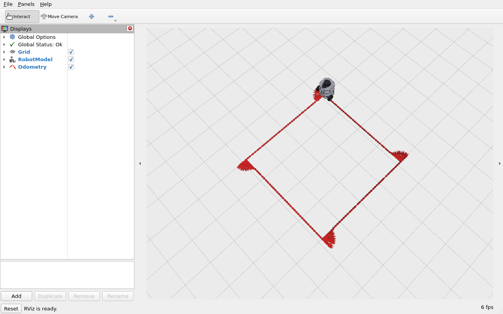

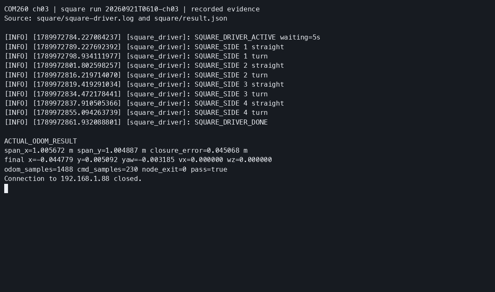

### 素材与复核入口

| 内容 | 本轮素材与时间边界 |
|---|---|
| 消息、接口、QoS、执行器 | [原始 CAST](images/ch03/ch03-topics.cast)，119.839 秒；[GIF](images/ch03/ch03-topics.gif)约 53.37 秒、[MP4](images/ch03/ch03-topics.mp4)约 53.35 秒。终端回放压缩超过 2 秒的空闲等待；终端截图直接从该 CAST 导出。标为“对应课程入口”的节点由已安装 C++ 二进制启动，CLI 查询命令实际执行 |
| 方形完整终端 | [CAST](images/ch03/ch03-square.cast)，包括运动前检查、实时 `/odom`、控制器日志和最终断言；[结果展示 CAST](images/ch03/ch03-square-result.cast)在板端读取同轮保存的日志与 JSON，用于清晰展示截图，未重新执行运动 |
| Gazebo GUI | [连续 MP4](images/ch03/ch03-square-gazebo.mp4)约 94.92 秒，[GIF](images/ch03/ch03-square-gazebo.gif)47.5 秒。原片从 06:39:29 UTC 起，取第 10～105 秒连续片段，覆盖完整四边运动和停止；MP4 原速，GIF 为同片段 2 倍速预览 |
| RViz GUI | [连续 MP4](images/ch03/ch03-square-rviz.mp4)约 94.92 秒，[GIF](images/ch03/ch03-square-rviz.gif)47.5 秒。同一仿真实例、同为 06:39:29 UTC 起录制，取第 10～105 秒，MP4 原速、GIF 2 倍速；在课程专用虚拟显示上显示实际 ROS 话题 |
| rqt_graph GUI | [连续 MP4](images/ch03/ch03-rqt-graph.mp4)65 秒，06:46:52 UTC 起，包含话题节点重新启动后刷新出现 GPS／SensorData 的过程；[截图](images/ch03/ch03-rqt-graph.png)。与方形录像属于同一仿真实例的不同时间段 |
| 传感器与时钟 | [节点／QoS／无时钟负例 CAST](images/ch03/ch03-simulation-checks.cast)保留初次测频未收到数据的告警；[延长发现窗口后的测频 CAST](images/ch03/ch03-sensor-rates.cast)实际出现频率样本。不能仅凭 timeout=124 判断测频成功 |

所有 GUI 录像来自连续窗口采集，未用静态截图拼接。终端展示与 GUI 录像分别标记来源。2026-09-21 采集的 31 份本章素材已做哈希及格式校验：19 张 PNG、4 份 MP4、3 份 GIF、5 份 CAST；视频／GIF 全量解码无错误，CAST 均以退出事件 0 结束。已目检全部截图及 GUI 首／中／末抽帧，并在运行时观察 RViz 和 rqt_graph；建包、停止行为与有线运动的结果见[专项验证](#ch03-ch04-validation)。

### 复现说明

- 板端入口使用 `python3 -m colcon`；首次失败构建与后续成功记录分别保存，不覆盖失败事实。
- 测频初次只等待 10 秒，未取得数据；本轮延长发现窗口并要求实际出现频率样本后通过。CLI 可见节点不等于已接收消息。
- RViz 的 Odometry 箭头尺寸应放在 `Shape` 子项，修正后实际重新加载并录制。固定系为 `odom`，500 个历史箭头覆盖本次运动；第一章配置保持原状。
- QoS A 显式传入 `--qos-reliability reliable`，避免依赖 CLI 默认策略。教案同步澄清共享指针生命周期、RMW 默认 QoS、接口变更后的依赖重编译，以及丢消息提示不等于 QoS 不兼容。

结束检查：COM260 的 Domain 0／171 均无节点，本轮课程 C++ 进程为空；x86 的本轮仿真与临时 GUI 容器均已释放。

## 第 4 章 服务通信（Services）

2026-09-22 在 COM260 与 x86 Humble 容器完成服务通信实测。章节入口：[实验手册](ch04_lab.md)、[教师教案](../teaching_docs_k3_com260_kit/ch04_服务通信.md)。

### 构建与服务验收

| 项目 | 本轮实际结果 |
|---|---|
| 环境与源码 | COM260：K3 Com260 IFX、riscv64、Bianbu 4.0.6、Humble／CycloneDDS；x86：Ubuntu 24.04、rootless Humble/Harmonic 课程容器。七个新包及安装器／仿真辅助脚本共 31 个文件，两端与本地 SHA-256 一致；独立练习源码亦一致 |
| 双端构建 | COM260 `--build-ch04` 与 x86 Humble 容器均完成七包构建；所有 C++ 节点按目标要求至少 C++17，结合编译命令和 CMake 检测的默认标准核对。`teacher_client` 已在两端编译通过 |
| 独立练习 | 新建 `~/my_services_com260_ws`，真实创建并编译 `service_demo_lab_cpp`、`weather_interfaces`、`weather_srv`、`speed_interfaces`、`speed_control` 五包 |
| 统计边界 | 七包没有注册单元测试。本轮课程工作区 26 组、独立练习 25 组服务行为检查通过；一组可能含多个输入，并非 51 个单元测试。隔离使用 Domain 171／172、LOCALHOST_ONLY=1 |
| AddTwoInts | 5+10=15，默认 5+3=8，-5+3=-2；非法整数退出 2；`service list/type/find/call` 全部通过 |
| 超时与重试 | 3 秒服务延迟，1 秒等待、3 次尝试、2 秒间隔：客户端约 7.241 秒退出 1，三次超时符合预期。清理未决请求不会取消已发送的远端工作 |
| 等待上线 | `client_wait` 服务缺失时三次尝试失败；在启动客户端 3 秒后启动服务，第二次尝试返回 15、退出 0。独立工作区也通过 |
| 多客户端 | 两个异步客户端同时发 11+12 与 21+22，得到 23、43；课程和练习均约在 3.002／6.002 秒完成。服务端日志确认回调串行处理 |
| WeatherQuery | Beijing=26.5/Sunny、Shanghai=24/Cloudy、Shenzhen=30/Rainy；首尾空白和混合大小写归一化通过；空值及未知城市返回 0/Unknown city |
| 教案程序 | `teacher_server`、`teacher_client sync/async/timeout/retry` 四种正常模式均返回 30；异步日志先打印请求已发出，再处理响应。6 秒服务延迟触发教案 5 秒轮询超时；无服务的 retry 有限三次失败；非法模式退出 2 |
| 速度输入边界 | 14 组非法请求涵盖三字段各自的 NaN、±inf，超出线／角速度正负边界及负时长，均返回 false，未产生运动消息。±1.0／±2.0 与零时长合法，后者只发布零速度；非法 CLI 数字退出 2、业务拒绝退出 1 |
| 隔离域速度消息 | 0.2/0/3 与 0/1/2 分别采集 31／21 条 Twist，末条均为零；这部分仅证明发布行为，实际运动另由下方 Gazebo `/odom` 验证 |

### 实际运动与跨机请求

仿真实例 `20260922T0332-ch04`，`drive=false`。开始前 `/cmd_vel` 没有其他发布者，`/odom` 恰有一个发布者。服务端保持原章墙钟计时，未改成第三章的仿真时钟计时。

| 请求 | `/odom` 变化 | 消息与停止 |
|---|---|---|
| linear=0.2，angular=0，duration=3 | 前进 0.400000 m，航向基本不变 | 31 条速度消息，首条到零速约 3.005547 s；客户端退出 0；最终 vx=0、wz=0 |
| linear=0，angular=1，duration=2 | 航向增加 0.992000 rad，位置基本不变 | 21 条速度消息，首条到零速约 2.003421 s；客户端退出 0；最终 vx=0、wz=0 |

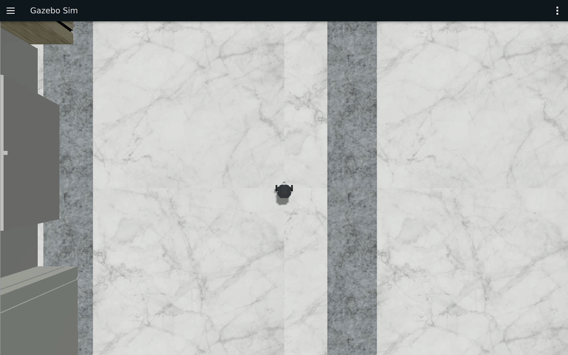

同轮统计 `/odom` 580 条、`/clock` 1078 条、`/scan` 109 条、`/tf` 668 条；停止清理期间追加的零速和样本不并入这一汇总。最终里程计约 `(x=0.400000 m, y=0, yaw=0.992000 rad)`。软件渲染下仿真慢于实时，不能将墙钟 3 秒／2 秒等同于仿真 3 秒／2 秒，因此不预设 0.6 m／2 rad 的结果。

Greeting 使用真实 C++ `server`／`client` 双向跨机运行，固定请求 HAN／20，响应均为 `Hi HAN. I'm server!`。同一探针持续订阅仿真 Topic，累计样本为：

| 方向 | `/scan`：前／基线／调用期间／后 | `/odom` | `/tf` |
|---|---|---|---|
| COM260 Server → x86 Client | 5 / 15 / 62 / 71 | 34 / 92 / 368 / 424 | 42 / 120 / 468 / 538 |
| x86 Server → COM260 Client | 5 / 11 / 15 / 23 | 28 / 83 / 103 / 153 | 37 / 104 / 130 / 197 |

这里箭头表示服务提供端与调用端的组合；两方向都是客户端发请求、服务器返回响应。持续 Topic 数据没有被服务调用替代。

### 素材与复核入口

| 内容 | 本轮素材 |
|---|---|
| 实际构建 | [COM260 七包 CAST](images/ch04/ch04-course-build.cast)、[独立建包与五包构建 CAST](images/ch04/ch04-practice-build.cast) |
| 服务完整行为检查 | [课程工作区 CAST](images/ch04/ch04-services-course.cast)、[独立练习 CAST](images/ch04/ch04-services-practice.cast)，保留真实执行路径及预期负例退出码 |
| 原章截图与终端展示 | [展示 CAST](images/ch04/ch04-services-display.cast)、[GIF](images/ch04/ch04-services.gif)、[MP4](images/ch04/ch04-services.mp4)。在板端读取同轮保存的日志与 JSON，明确标记为结果展示；截图直接导出自该 CAST，没有重写节点输出 |
| Gazebo | [连续原速 MP4](images/ch04/ch04-gazebo.mp4)为 03:27:47～03:28:47 UTC 连续 60 秒、1280×800、12 fps；[GIF](images/ch04/ch04-gazebo.gif)取第 8～48 秒，以 2 倍速播放 20 秒、960×600 |
| 同轮速度与反馈 | [速度请求／里程计 CAST](images/ch04/ch04-speed-sim.cast)，03:27:53 UTC 启动板端探针；两次请求都在上述录像内完成 |
| COM260 服务端 → x86 客户端 | [板端传感器与服务 CAST](images/ch04/ch04-greeting-board-server.cast)、[x86 客户端 CAST](images/ch04/ch04-greeting-x86-client.cast) |
| x86 服务端 → COM260 客户端 | [x86 服务端 CAST](images/ch04/ch04-greeting-x86-server.cast)、[板端客户端与传感器 CAST](images/ch04/ch04-greeting-board-client.cast) |

2026-09-22 服务通信验证的 26 份素材完成哈希及格式校验：12 张 PNG、10 份 CAST、2 份 MP4、2 份 GIF。CAST 均为 v3、最终退出事件为 0；预期失败案例的实际 1／2 退出码另在验收内部核对。MP4／GIF 全量解码通过；终端 GIF 约 26.19 秒、MP4 约 26.20 秒，压缩了超过 2 秒的空闲。已目检全部 PNG 和 Gazebo 首／中／末抽帧，确认 Burger 位置与朝向变化；原章 lab 五个截图槽位和教案两个槽位均保留对应新素材，另补充教案模式、并发、跨机和边界证据。建包、停止行为与有线运动的结果见[专项验证](#ch03-ch04-validation)。

### 复现说明

- 首轮默认自动发现没有让 COM260 收到仿真数据；x86 容器内部里程计正常，UFW 配置为未启用。仅指定远端地址后恢复跨机节点发现，但关闭组播时同机节点还需要回环对端。最终两端使用 `127.0.0.1` 加对端地址、自动 ParticipantIndex 的单播配置，速度与双向 Greeting 都通过；未断言具体路由器或无线硬件故障。复现步骤见[公共环境](ch00_common_setup.md#dds-unicast)。
- 改变 DDS 配置后，旧 CLI daemon 曾返回 `!rclpy.ok()`；检查使用独立节点／`--no-daemon`，最终已停止本轮 daemon。单播配置只作用于课程进程，未修改系统网络、防火墙或持久环境文件。
- 反向 Greeting 的首轮验收服务器先达到 45 秒自动退出期限，客户端随后未收到响应；协调两端同时启动后验证通过。
- CMake 按目标声明 C++17。实验客户端超时后清理未决请求；教案的同步、异步、超时及重试模式使用独立可执行入口。

结束检查：COM260 的 Domain 0／171／172 无节点，第四章课程 C++ 进程为 0；x86 本轮命名容器已停止，课程仿真容器列表为空。

### 第 3、4 章联合验证：建包、停止行为与有线运动

验证日期：2026-09-22；运行记录：`20260922T-review-fixes`。检查范围包括从空目录按手册逐步建包、运动中止后的返回值与零速度反馈，以及有线连接下的完整方形运动和速度服务。

#### 建包、源码与中止行为

| 检查 | 本次实际结果 |
|---|---|
| 源码身份与构建 | 11 包共 58 文件在本地、COM260 与 x86 的 SHA-256 一致。COM260 第三章四包与第四章七包构建成功；x86 的 `topic_demo_cpp` 和 `speed_control` 构建成功。第三章接口测试通过，第四章仍未注册单元测试 |
| 学生逐步建包 | 从两个空工作区执行手册 `ros2 pkg create`，按当时步骤写入源码／XML／CMake，10 个构建阶段全部通过。第四章第一次构建时目录只有 server.cpp、client.cpp；之后才加入教案目标。此项不复制最终参考包配置 |
| 学生程序运行 | 新工作区 GPS 前三组为 `(0,1,0)`、`(1,3,0)`、`(2,5,0)`；SensorData、Person、5+10=15、Beijing=26.5/Sunny 均通过 |
| 隔离中止检查 | 课程与新练习工作区各 9 项通过：无时钟、启动等待中止、方形 SIGINT／SIGTERM、仿真时钟暂停后中止、速度服务 SIGINT／SIGTERM、C++ 客户端收到中断失败，以及空闲服务停止。Domain 179，无时钟及尚未运动时未发运动命令 |
| 中止语义 | 方形中止退出 1，不打印 DONE；速度服务返回 `success=false / motion interrupted`，服务端及实际 C++ 客户端均退出 1。空闲服务停止退出 0。暂停时钟的方形也能退出 |
| 速度正常值与边界回归 | 两工作区各 4 组行为检查，涵盖原两组运动、正负边界零时长、14 个非法请求及 CLI 返回码；非法请求不发 Twist。31／21 条正常速度消息的末条均为零 |
| 真实 Gazebo 中止反馈 | 6 项检查通过，其中 5 项涉及运动中止，最后 10 个 `/odom` 样本的绝对线／角速度均小于 0.01；另 1 项为空闲停止。反馈断言在测试清理补发零速之前执行 |

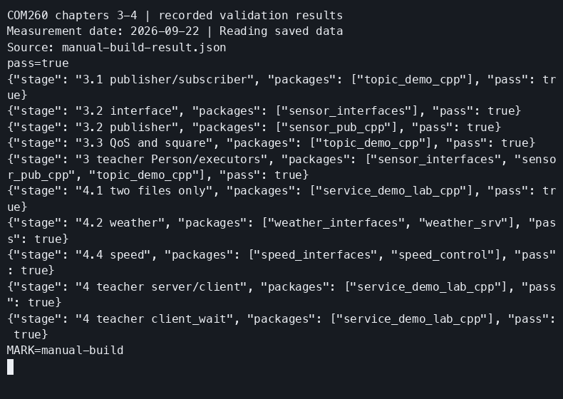

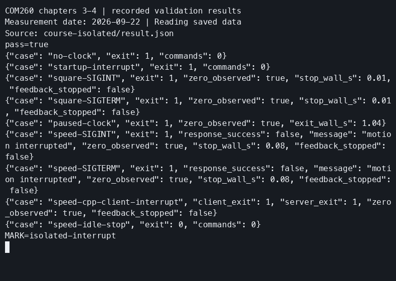

隔离检查没有 Gazebo，其日志字段 `feedback_stopped=false` 表示本项未检查里程计，不作为运动反馈结论；真实反馈在下图及独立 Gazebo CAST 中核对。

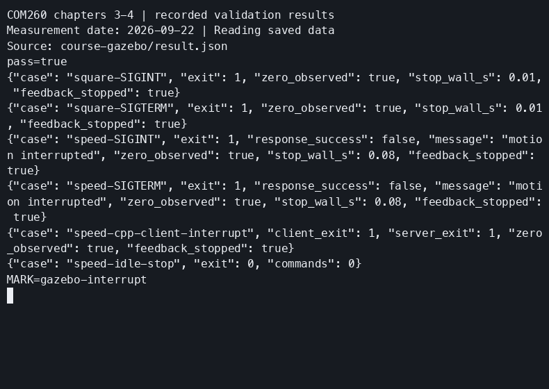

#### 有线路径下的正常运动

无线链路的 25 次 ping 平均约 266 ms、最大约 743 ms，方形轨迹未达到跨度门槛。有线连接平均约 0.331 ms、最大约 0.386 ms，按相同轨迹阈值验证通过。两端课程进程显式绑定有线地址，配置方法见[多网卡选择有线路径](ch00_common_setup.md#dds-wired)。

方形仿真实例 `20260922T-review-wired-square`，05:17:36 UTC 启动板端验收。四段直行仍为 0.2 m/s × 5 秒仿真时间，四次转弯仍为 1.57 rad/s × 1 秒；实测各段约 5.002～5.007 秒与 0.999～1.004 秒，程序完成后退出 0。

| 观察量 | 实际结果 |
|---|---|
| `/odom` 跨度 | x=1.006820 m，y=1.004632 m；仍使用 0.85～1.2 m 门槛 |
| 闭合误差 | 0.002019 m，仍使用小于 0.15 m 门槛；仅表示里程计结果 |
| 终点 | x=-0.001020 m，y=0.001742 m，yaw=0.006235 rad；vx=0、wz=0 |
| 正常停止复核 | 原始探针共记录 257 条 Twist，其中控制器 238 条（含 5 条约隔 100 ms 的零速），随后测试清理另外记录 19 条零速。按原始 JSONL 独立复核清理前窗口：停止后有 76 条里程计反馈，末 30 条速度均小于 0.01；不把清理零速计为控制器停止证明 |

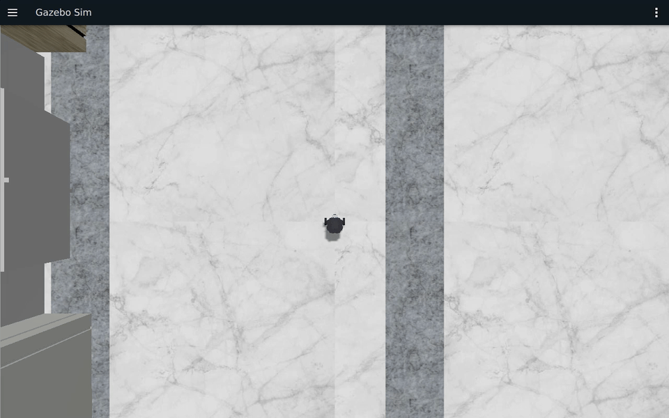

[方形原速 MP4](images/ch03/ch03-square-wired.mp4) · [实际运行 CAST](images/ch03/ch03-square-wired.cast) · [停止画面](images/ch03/ch03-square-wired.png)。原片从 05:17:15.813 UTC 开始，保留第 15～93 秒的连续 78 秒，覆盖完整运动与停止；GIF 为同段 2 倍速、39 秒。未修改 Gazebo 画面或轨迹。

速度仿真实例 `20260922T-review-wired-speed`，05:28:05 UTC 开始速度请求与录像采集；沿用原章墙钟计时。开始时里程计约 `(0.383200, 0, 0.937000)`，来自该实例此前一次通过的请求；下表位移和转角按各请求的起终点差值计算。

| 请求 | `/odom` 变化 | 命令和停止 |
|---|---|---|
| 0.2 m/s，0 rad/s，3 s | 前进 0.218600 m | 31 条 Twist，首条至零速约 3.005756 s；客户端退出 0，反馈归零 |
| 0 m/s，1 rad/s，2 s | 航向增加 0.723000 rad | 21 条 Twist，首条至零速约 2.003690 s；客户端退出 0，反馈归零 |

本轮停止清理前累计 `/odom` 492 条、`/clock` 9731 条、`/scan` 78 条、`/tf` 653 条。软件渲染及录屏下仿真慢于实时，实际位移和转角不写成理想的 0.6 m／2 rad。

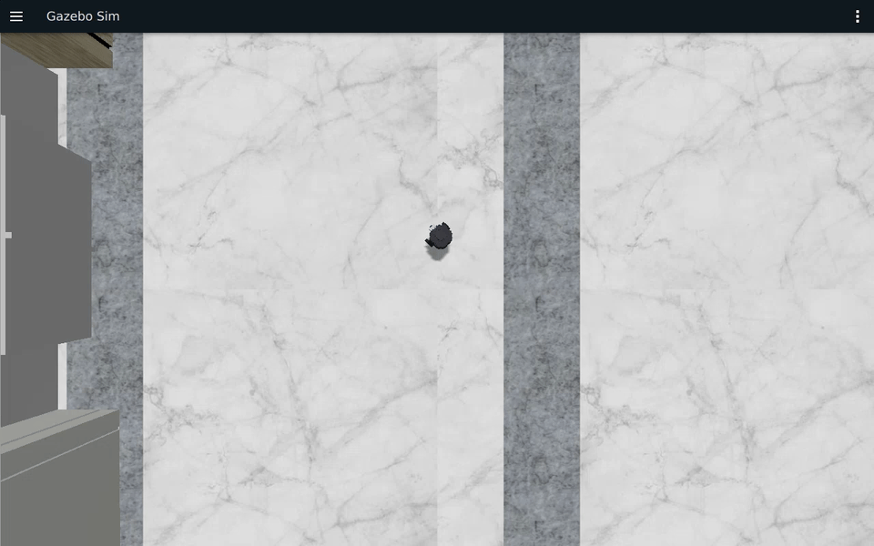

[速度原速 MP4](images/ch04/ch04-speed-wired.mp4) · [同轮请求与里程计 CAST](images/ch04/ch04-speed-wired.cast) · [停止画面](images/ch04/ch04-speed-wired.png)。原片从 05:28:01.654 UTC 开始，保留前 33 秒连续画面；GIF 为同段 2 倍速、约 16.5 秒。两组请求均在录像内完成。

#### 验证素材与统计范围

| 内容 | 原始记录 |
|---|---|
| 双端构建 | [COM260 CAST](images/ch04/ch03-ch04-validation-board-build.cast)、[x86 CAST](images/ch04/ch03-ch04-validation-x86-build.cast) |
| 手册逐步建包 | [10 阶段 CAST](images/ch04/ch03-ch04-validation-manual-build.cast) |
| 运行与隔离中止 | [课程工作区 CAST](images/ch04/ch03-ch04-validation-course-checks.cast)、[新练习工作区 CAST](images/ch04/ch03-ch04-validation-practice-checks.cast) |
| 真实中止反馈 | [Gazebo 中止 CAST](images/ch04/ch03-ch04-validation-gazebo-interrupt.cast) |
| 已保存结果展示 | [CAST](images/ch04/ch03-ch04-validation-results.cast)、[GIF](images/ch04/ch03-ch04-validation-results.gif)、[MP4](images/ch04/ch03-ch04-validation-results.mp4)；明确标为读取已测结果，没有重新执行实验 |

第三章素材共 34 份（19 PNG／6 CAST／5 MP4／4 GIF），第四章共 40 份（14 PNG／18 CAST／4 MP4／4 GIF）。74 份素材的哈希、格式、视频全量解码和 CAST 退出事件核对通过；GUI 画面完成首／中／末抽帧检查。各项数据按运行编号与采集时间对应，本地链接、锚点和完整 C++ 示例与源码一致性检查通过。

结束检查：COM260 的 Domain 0／171／172／179／182 无其他节点，课程 C++ 进程为空；x86 仿真与录制进程已退出，活动课程仿真容器为 0。

## 第 5 章 动作通信（Actions）

验证日期：2026-09-22；记录组 `20260922T103700Z`。章节入口：[实验手册](ch05_lab.md)、[教师教案](../teaching_docs_k3_com260_kit/ch05_动作通信.md)。动作服务与客户端在 COM260（riscv64／Bianbu 4.0.6／ROS 2 Humble）运行，Gazebo Burger/Museum 在 x86 Humble 容器运行。

| 验证项 | 实际结果与证据 |
|---|---|
| 双端构建与源码身份 | 第五章十包、第六章一包均构建成功。58 个源码和支持文件在本地、COM260、x86 的 SHA-256 一致。[板端构建](images/ch05/ch05-ch06-board-build.cast)、[x86 构建](images/ch05/ch05-ch06-x86-build.cast)；本批包未注册单元测试，以下为独立运行验收 |
| 学生从空目录建包 | 第五章 16 个创建／构建／查询阶段通过，其中 7 个编译阶段；按手册当时已有的文件逐步建包，不直接复制最终包配置。[命令、返回码与源码摘要](images/ch05/ch05-manual-build.json) |
| 课程动作检查 | 31 项通过：核心五步反馈与结果 10、两种洗碗练习、取消与忙碌拒绝、最后一盘完成前取消、Tracking 进度、非法目标、无／过期里程计、取消及中断。[运行 CAST](images/ch05/ch05-action-contract.cast) |
| 新练习工作区 | 26 项通过；八个学生新建包实际运行，核心两包使用课程工作区。[运行 CAST](images/ch05/ch05-manual-actions.cast) |
| 基础 Tracking | 目标 `(2,1,0)`，90 次反馈，累计进度最终为 2.2360679775 m、剩余距离 0。本入口仅做向量进度计算，不控制机器人 |
| Gazebo Tracking | 独立 `server_gazebo` 使用真实 `/odom`；正常到达、取消状态 5、进程中断状态 6 均通过；三次结束后的反馈速度均归零 |
| 位姿导航 | 目标 `(2,1,1.57)` 正常结束；三秒自动取消、忙碌目标拒绝、中断后客户端失败退出均通过；均在验收清理补发零速之前检查停车反馈 |

31 项动作检查中，控制器的异常输入与过期反馈使用隔离 Domain 197 的人工里程计；这些检查只证明控制逻辑。下表和 GUI 录像来自真实 Gazebo 里程计，没有注入人工位姿。

| 真实 Gazebo 轮次 | 到达位置 x/y（m） | yaw（rad） | 到目标距离（m） | 正常运动采样 |
|---|---:|---:|---:|---:|
| `tracking-gazebo-wired-02` | 1.915284 / 0.955748 | 0.481367 | 0.095578 | 567 条 odom |
| `pose-gazebo-wide-02` | 1.915074 / 0.955580 | 1.522078 | 0.095842 | 668 条 odom |

两者位置误差均小于 0.10 m；位姿导航 yaw 误差约 2.75°，小于 3°。目标成功后及取消／中断后，末十个里程计样本的绝对线速度小于 0.01 m/s、角速度小于 0.02 rad/s；这不等同于地图或世界坐标的定位精度。

[Tracking 原速录像](images/ch05/ch05-tracking-gazebo.mp4) · [同轮 COM260 CAST](images/ch05/ch05-tracking-gazebo.cast)。原片开始于 12:43:04.823 UTC，保留第 2.177 秒起约 42.083 秒的连续画面，覆盖正常目标、取消与中断；GIF 为同段 2 倍速。

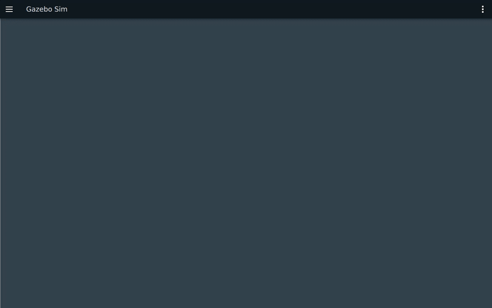

[位姿导航原速录像](images/ch05/ch05-pose-gazebo.mp4) · [同轮 COM260 CAST](images/ch05/ch05-pose-gazebo.cast)。原片开始于 12:45:58.644 UTC，保留第 0.356 秒起约 47.750 秒的连续画面；GIF 为同段 2 倍速。手册导航终端截图读取同轮保存的 C++ 日志，画面已注明其来源，见[已保存结果展示 CAST](images/ch05/ch05-ch06-saved-results.cast)。

原手册 image-25～32、image-47 共九处截图均有对应素材。基础洗碗与 Tracking 的[终端 GIF](images/ch05/ch05-actions.gif)由[实际 SSH CAST](images/ch05/ch05-actions.cast)渲染，压缩空闲等待时间；GUI 录像没有拼接运动片段。

链路曾因回程走 Wi-Fi 而出现超过一秒的里程计间隔，Tracking 正确中止。确认双向有线路由后重新验证，未放宽过期保护。GUI 采用 x86 容器内独立 Xvfb 显示会话，以 1280×800 固定画幅采集真实 Gazebo 窗口；画面中的机器人、场景和运动均来自本轮仿真。原速 MP4 为 12 fps，GIF 为 960×600／10 fps／2 倍速。课程桌面运行方法仍见公共环境。

## 第 6 章 参数系统与 Launch 文件

验证日期：2026-09-22；记录组 `20260922T103700Z`。章节入口：[实验手册](ch06_lab.md)、[教师教案](../teaching_docs_k3_com260_kit/ch06_参数与Launch.md)。参数与速度节点使用 C++17；Python 仅用于 Launch 和验收工具。

| 验证项 | 实际结果与证据 |
|---|---|
| 独立学生建包 | 6 个创建／构建／查询阶段通过，其中 3 个编译阶段；先构建参数节点，之后添加 YAML/Launch，再添加速度节点。[逐步记录](images/ch06/ch06-manual-build.json) |
| 参数与速度契约 | 课程工作区和新练习工作区各 48 项通过，覆盖参数类型、范围、NaN/Inf、枚举、启动覆盖值、YAML 启动／加载／Launch、禁用编辑与恢复、频率及中断零速。[课程 CAST](images/ch06/ch06-parameter-contract.cast)、[学生工作区 CAST](images/ch06/ch06-manual-parameters.cast) |
| 核心参数生命周期 | param2 更新为 2、param4 为 4，param5 在第二轮删除，共执行三轮；结果由实际安装的 `param_demo` 核验 |
| 两个完整教案示例 | 从教案代码独立编译并运行；max_speed 更新为 3.5，动态 speed 更新为 4.5，-1.0 被拒绝且保持原值。[教案运行记录位于此 CAST 末段](images/ch05/ch05-action-contract.cast) |
| C++ talker/listener | `use_rviz=false` 时只有两个示例节点；`true` 时增加 RViz，实际 `/chatter` 收发通过。RViz 的独立演示尚未加载地图，因此固定坐标系警告符合该示例的数据内容 |
| 仿真条件关闭 | 最终 Launch 的 gui/rviz/drive 均为 false 时，未启动巡航与 RViz，`/cmd_vel` 发布者为 0，229 条里程计反馈保持静止。[CAST](images/ch06/ch06-launch-off.cast) |
| C++ 巡航开启 | `drive=true` 实际启动 C++ `patrol_driver`；观察到 0.12 m/s 直行与 0.45 rad/s 转向，246 条命令、392 条里程计；中断后零速及实际反馈归零。[CAST](images/ch06/ch06-patrol-gazebo.cast) |
| 出生位置参数 | `spawn_x=0.5`、`spawn_y=-0.5` 时，Gazebo Scene 查询确认模型初始 x=0.5、y=-0.5、z≈0.0099902。该值来自模型世界位置，不把相对里程计原点当作出生坐标 |
| Nav2 组合启动 | Humble Nav2 1.1.20，九个导航／定位生命周期节点及两个 costmap 节点均为 active，`/navigate_to_pose` Action 存在；实际收到地图、激光和里程计。[查询 CAST](images/ch06/ch06-nav2.cast) |

Nav2 地图为 992×992、分辨率约 0.05 m/格，原点 `(-25,-25)`。RViz 使用 `map` 固定坐标系、`/robot_description` 模型与真实传感器；截图的 Global Status 为 Ok。

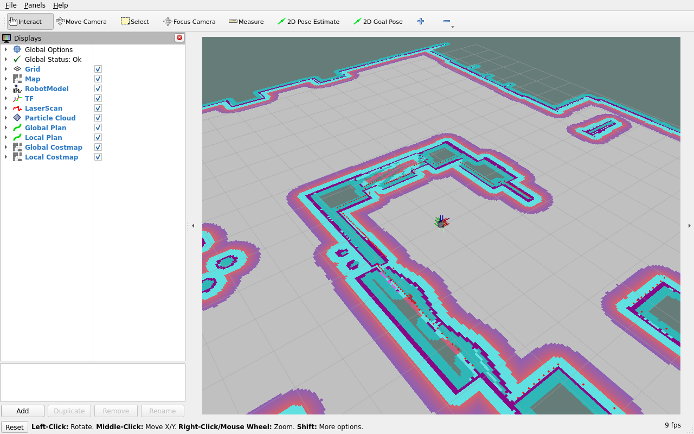

动态调速由 COM260 的 C++ `speed_ctrl` 控制 x86 Gazebo，10 项实际反馈检查通过。每阶段观察 2.2 秒，舍去前 0.7 秒，按余下里程计样本计算中位数：

| 阶段 | 设置的线／角速度 | 实际反馈中位数（m/s，rad/s） |
|---|---|---|
| 默认 | 0.2 / 0.0 | 0.200 / 0.000 |
| 加速直行 | 0.5 / 0.0 | 0.500 / 0.000 |
| 左转 | 0.5 / 1.0 | 0.500 / 1.000 |
| 右转 | 0.5 / -1.0 | 0.500 / -1.000 |
| 停止转动 | 0.5 / 0.0 | 0.500 / 0.000 |
| 倒车 | -0.3 / 0.0 | -0.300 / 0.000 |
| 完全停止 | 0.0 / 0.0 | 0.000 / 0.000 |
| 禁用后保存 0.4 / 0.5 | enable_control=false | 0.000 / 0.000 |
| 恢复控制 | enable_control=true | 0.400 / 0.500 |

第十项为运动中 SIGINT：程序退出 0，最后十个里程计样本停止；此断言在清理工具补发零速之前完成。独立参数契约检查覆盖约 10 Hz 发布频率；单独 SIGTERM 的验证见下方“巡航时限与信号停止”。

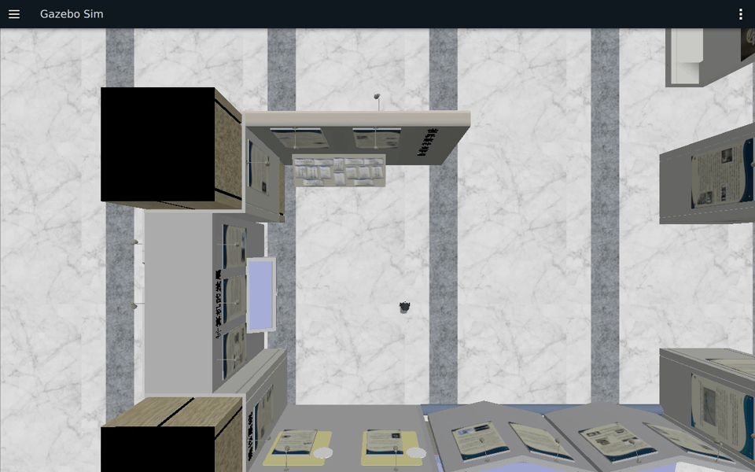

[调速原速录像](images/ch06/ch06-speed-gazebo.mp4) · [同轮 COM260 CAST](images/ch06/ch06-speed-gazebo.cast)。原片始于 12:48:06.215 UTC，保留第 1.785 秒起约 33.167 秒连续画面，覆盖全部九组参数状态及中断；GIF 为同段 2 倍速。

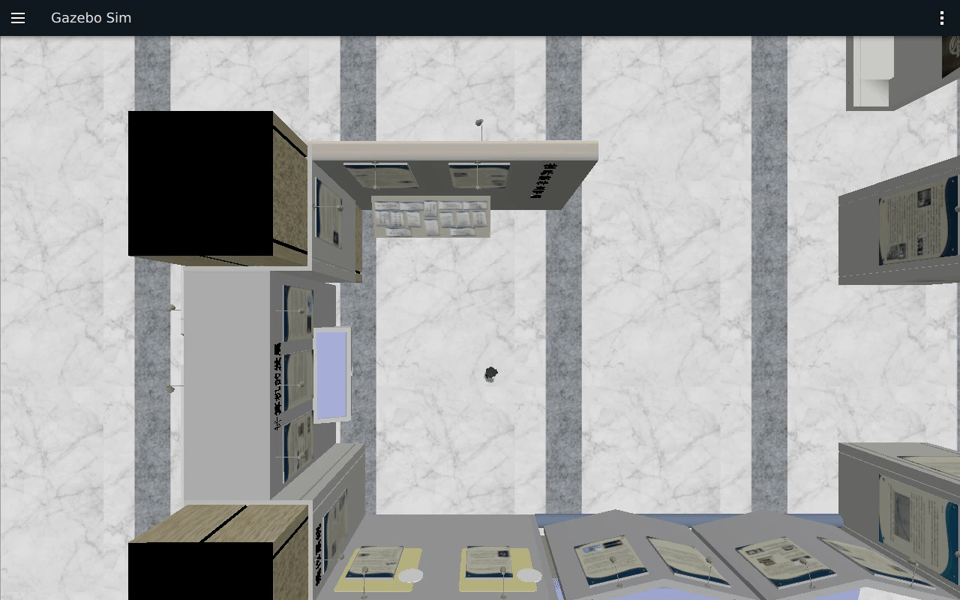

[巡航原速录像](images/ch06/ch06-patrol-gazebo.mp4)始于原片 12:56:54.725 UTC 后第 0.275 秒，保留约 22.583 秒连续画面；GIF 为同段 2 倍速。这段记录展示巡航的一部分及中断停车，不作为完整闭环路线测量。

原手册 image-48～72 共 25 处截图均有对应素材；参数操作见[真实 SSH CAST](images/ch06/ch06-parameters.cast)及[终端 GIF](images/ch06/ch06-parameters.gif)。image-60～62 读取已保存的 x86 talker/listener 日志，标明来源；image-63 和 Nav2 截图直接采集真实 RViz 窗口。GUI 采集方式、分辨率和帧率与第五章相同。

Humble 适配包括：YAML 使用节点完整名称 `/param_demo`；Nav2 的 `use_composition` 使用 `False`；CycloneDDS 自动 participant 索引上限为 100；先解析 C++ 巡航条件，再包含固定关闭共享驱动的仿真。相关操作均体现在源码和公共环境中。

### 巡航时限与信号停止

记录组 `20260922T135846Z-followup`。`gazebo_ch06.launch.py` 将 `drive_loop`、`drive_duration` 显式传入 C++ 巡航节点；其余 C++ 源码与上述运行记录相同。两端重新安装第六章包，58 个源码和支持文件与本地指纹一致。[COM260 构建](images/ch06/ch06-launch-board-build.cast)，x86 构建及运行见[巡航 CAST](images/ch06/ch06-patrol-options.cast)。此前普通巡航录像保留原采集时间；本组单独验证时限参数。

| 巡航配置 | 实际结果 |
|---|---|
| `drive=true, drive_loop=false, drive_duration=12.0` | C++ 节点自动退出 0；从 Launch 启动至观察到节点退出约 12.97 秒，其中包含节点启动开销。收到 6 条零速命令、309 条 odom，x 方向跨度约 0.27558 m，末十条反馈停车 |
| `drive=true, drive_loop=true, drive_duration=3.0` | 观察至 Launch 启动后约 10.79 秒仍运行；最后用 SIGINT 停止并确认反馈归零 |
| `drive=true, drive_loop=false, drive_duration=0.0` | 观察至 Launch 启动后约 10.42 秒仍运行；最后用 SIGINT 停止并确认反馈归零 |
| `drive=false` | 无巡航进程，`/cmd_vel` 发布者为 0，115 条 odom 保持静止 |

以上使用 x86 隔离 Domain 201 的真实 Gazebo。参数通过节点服务读取，停车断言在停止仿真之前执行；[结构化结果](images/ch06/ch06-patrol-options.json)与 CAST 对应。

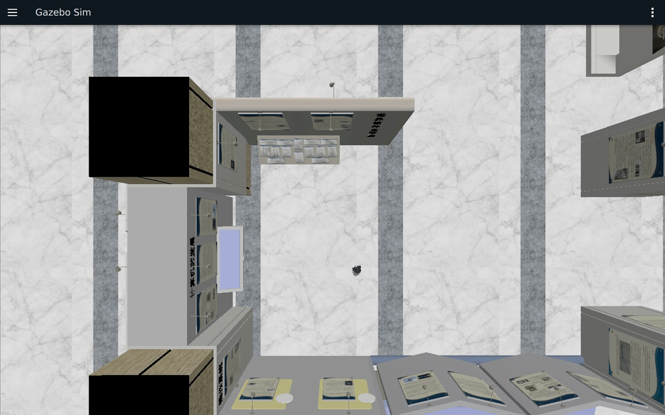

[完整原速 MP4](images/ch06/ch06-patrol-timed.mp4)始于 14:07:42.449 UTC，长 15.5 秒、1280×800／12 fps，包含 Gazebo 启动等待、运动及停车。GIF 取原片第 8 秒起的 7.5 秒连续画面，保持原速，960×600／10 fps。画面来自独立 Xvfb :99 中的真实 Gazebo。

COM260 课程与学生工作区分别在 Domain 198／199 重跑 48 项参数检查。每次只发送待测的 SIGINT 或 SIGTERM，随后等待退出与零速消息，断言前不发送另一信号。两份程序均退出 0、各收到 5 条零速消息；SIGTERM 后首条零速延迟分别约 19 ms／101 ms。忽略 SIGTERM 的替身被同一等待逻辑判为超时失败，清理发生在判定之后。

[课程工作区 CAST](images/ch06/ch06-parameters-course-signal.cast) · [学生工作区 CAST](images/ch06/ch06-parameters-practice-signal.cast) · [信号结果与验收器负例](images/ch06/ch06-signal-results.json)。这两份记录提供独立 SIGTERM 证据；前面的参数记录保留其采集版本，不作为单独 TERM 停车的依据。

两章共 35 PNG、19 CAST、5 MP4、7 GIF，以及两份逐步建包 JSON 和两份停止验证 JSON。文件指纹、格式、视频完整解码、CAST 退出事件、本地链接和章节锚点检查通过；五段 Gazebo 录像完成抽帧目检。结束时 COM260 课程 C++ 进程为 0，本组 CLI daemon 未运行，x86 活动课程仿真容器为 0。

## 第 7 章 TF2 坐标变换系统

验证日期：2026-10-04；运行组 `20261004T061759Z-ch07-ch08`；章节入口：[实验手册](ch07_lab.md)、[教师教案](../teaching_docs_k3_com260_kit/ch07_TF2坐标变换.md)。本组基于 `1e59d17` 的独立 COM260 源码目录验证，C++17／Humble，业务节点运行于 COM260；可视化运行于 x86。

| 验证项 | 实际结果 |
|---|---|
| 两端构建 | COM260 两个 TF 包、x86 四个 TF／模型包成功；Debug 构建，两端 TF 包生成 `compile_commands.json` |
| 源码身份 | COM260 的 17 个、x86 的 35 个源码／资源文件与本地 SHA-256 一致，包含最终 listener 位姿输出和模型 RViz 配置 |
| 核心 C++ 示例 | 欧拉角转四元数、四元数转欧拉角、坐标转换、广播器和监听器通过 |
| TF 综合检查 | COM260 与 x86 各 31 项通过：圆轨迹、单位四元数、五个静态 frame、最新变换、历史查询及插值、未来外推拒绝、晚加入监听器、三次超时 |
| 20 Hz 练习 | COM260 实测 19.997649 Hz／80 样本；x86 20.000311 Hz／80 样本 |
| 10／100 Hz 参数 | COM260 10.000529／100.009865 Hz；x86 9.999742／99.996276 Hz，分别 40／400 样本 |
| 位置和点转换 | `laser_frame` 到 `base_link` 平移 `(0.2,0,0.1)`，四元数 `(0,0,0,1)`；激光点 `(1,0.5,0)` 到相机为 `(1.05,0.5,-0.15) m` |
| 历史与失败路径 | 查询当前时钟两秒前的变换成功；未来时刻被拒绝；不存在的 frame 恰好尝试三次并退出 1（预期失败），整体验收退出 0 |
| 教案 10 Hz 主示例 | 独立 `teaching_dynamic` 的 100 ms 定时器实测 COM260 10.001325 Hz／44 样本，x86 9.997412 Hz／47 样本；平移持续变化，节点退出 0 |
| 独立学生包 | 从空目录建 `tf_demo_lab_cpp`，先编译 broadcaster/listener，再加入 lookup 编译；监听输出完整位姿及转换点，节点正常退出 |
| 跨机教学 TF | COM260 广播，x86 查询最新／历史变换并执行 `tf2_monitor`、`view_frames`；RViz 显示真实圆轨迹 |
| Burger 传感器 | x86 Gazebo 发布，COM260 C++ 每两秒查询；LiDAR 相对底盘 `(-0.032,0,0.162) m`，Camera `(0.045,0,0.120) m` |
| 运动结束 | Gazebo 连续录像包含运动和停车；停止观察收到 87 条 odom，末 20 条线／角速度均为 0 |

[COM260 构建日志](images/ch07/ch07-board-build.log) · [x86 构建日志](images/ch07/ch07-x86-build.log) · [COM260 源码指纹](images/ch07/board-source-match.json) · [x86 源码指纹](images/ch07/x86-source-match.json)。

[板端 TF CAST](images/ch07/ch07-board-tf.cast)／[结果 JSON](images/ch07/ch07-board-tf.json) · [x86 TF CAST](images/ch07/ch07-x86-tf.cast)／[结果 JSON](images/ch07/ch07-x86-tf.json) · [学生建包 CAST](images/ch07/ch07-board-practice.cast) · [教案板端定时器](images/ch07/ch07-board-teaching-dynamic.json)／[x86 定时器](images/ch07/ch07-x86-teaching-dynamic.json)。

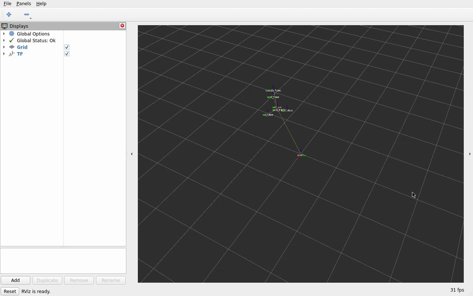

[TF 原速 MP4](images/ch07/ch07-cross-tf.mp4) · [COM260 广播 CAST](images/ch07/ch07-board-cross-tf.cast) · [x86 查询 CAST](images/ch07/ch07-cross-query.cast)。跨机使用有线接口和显式 DDS peer；教学 TF 与 Gazebo TF 分轮运行，避免重复 `odom → base_link`。

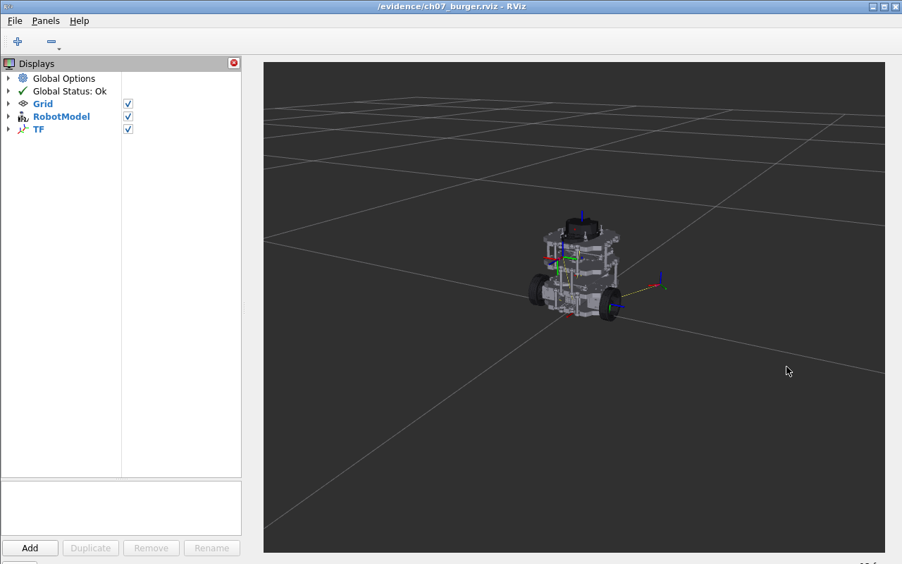

[COM260 双传感器查询 CAST](images/ch07/ch07-board-burger-tf.cast) · [真实 TF 树 PDF](images/ch07/ch07-burger-frames.pdf)。传感器 frame 名称采用实际模型的 `laser_link` 和 `camera_link`。

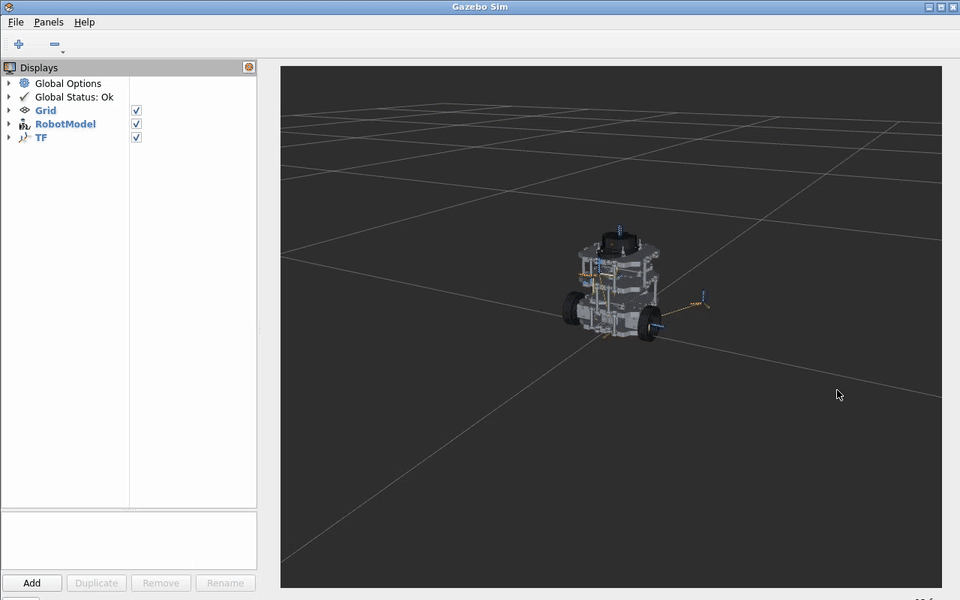

[Gazebo 原速 MP4](images/ch07/ch07-burger-gazebo.mp4) · [停止反馈 JSON](images/ch07/ch07-burger-stop.json)。此录像中的短程运动由 x86 ROS CLI 发送速度指令，用于观察 TF 与仿真变化；不把它描述为 COM260 自动控制轨迹。

## 第 8 章 URDF/Xacro 机器人建模

章节入口：[实验手册](ch08_lab.md)、[教师教案](../teaching_docs_k3_com260_kit/ch08_URDF机器人建模.md)。验证日期及运行组同第七章。模型资源为 XML／Xacro，启动编排保留 Python Launch；本章业务状态发布使用 ROS 标准节点。建模练习使用原课程的 5 kg 双轮与 10 kg 四轮教学模型，Gazebo 运动仿真使用 Burger。

| 验证项 | 实际结果 |
|---|---|
| 模型检查 | 34 项通过，包含普通 URDF、等价 Xacro、marker、10 kg 四轮教学模型、激光开关及 mybot 的展开和 `check_urdf` |
| 实验模型参数 | 底盘 `0.4×0.3×0.15 m`／5 kg；双轮半径 `0.05 m`、宽 `0.03 m`；万向球半径 `0.02 m`；连续轮关节 Y 轴与圆柱视觉轴一致 |
| 学生建包 | 空目录创建 ament_cmake 资源包，逐项保存模型／Launch／RViz，再复制 `simple_robot.xacro` 为 `marked_robot.xacro` 添加正文片段、重建并加载；运行 6 项通过 |
| 关节 GUI | 201 个 JointState 样本；左右轮从 0 改到 `1.783168`／`-1.952814 rad`，Center 后归零，TF 四元数随之变化 |
| 标记修改 | 红球半径 `0.03 m`、位置 `(0,0,0.3)`；另外实际加载绿色 `(0.1,0,0.4)` 变体，模型变化可见 |
| 轮径修改 | 半径 `0.05→0.08 m` 的独立变体在 RViz 正常显示 |
| 教案模型 | 10 kg 与四轮宏单独检查；`use_lidar` 两种值分别包含／移除激光 link，四轮宏展示几何组合，不代表滚子动力学 |
| COM260 跨端查询 | C++ `time_query` 收到 x86 RSP 的左轮变换 `(0,0.15,-0.025) m`，点 `(1,0,0)` 变为 `(1,0.15,-0.025) m`，退出 0 |

[模型 JSON](images/ch08/ch08-models.json) · [学生建包 CAST](images/ch08/ch08-practice.cast)／[运行 JSON](images/ch08/ch08-practice.json) · [关节与 TF 原始样本](images/ch08/ch08-joints.json) · [COM260 关节 TF CAST](images/ch08/ch08-board-joint-tf.cast)。

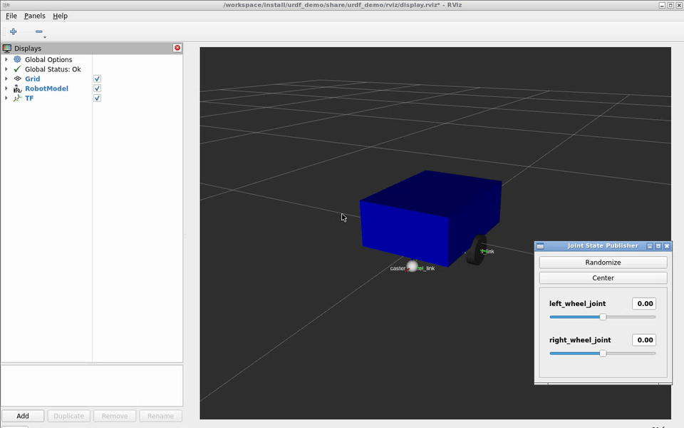

[20 秒原速录像](images/ch08/ch08-joints.mp4)。轮子是均匀圆柱，绕轴转动时外观不易辨认；滑块角度和轮 frame 的 TF 旋转共同证明关节状态变化。

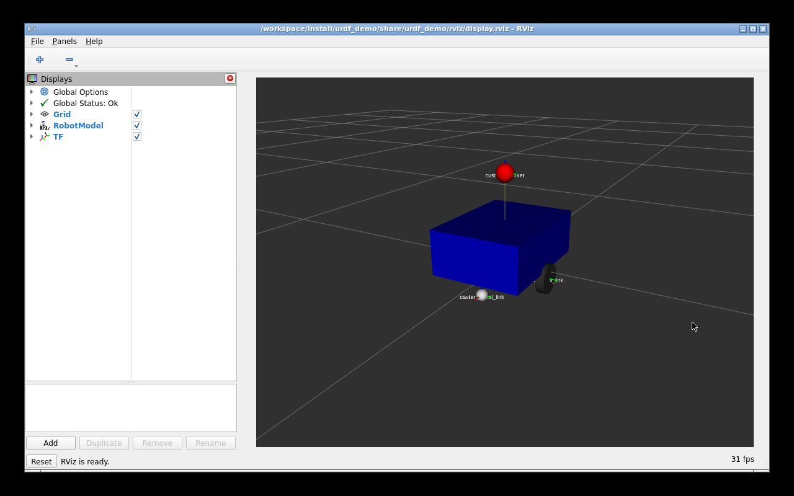

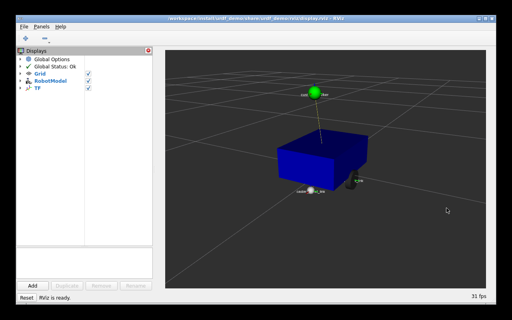

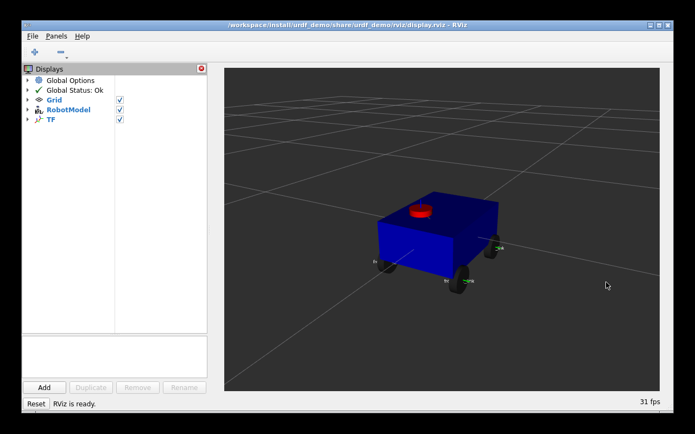

第七、八章三段 MP4 都是 x86 私有 Xvfb `:99` 中真实应用的连续 20 秒画面，1280×800、12 fps；GIF 来自对应整段，保持原速、960×600、10 fps。三段视频均完整解码，并对首／中／末帧目检；原始失败尝试和被遮挡画面留在本地验证目录，不作为正文展示。

上述视频与首组检查使用隔离工作区 `~/ros2_course_com260_ch07_ch08_ws`、`~/ros2_course_com260_ch07_ch08_humble_ws`；学生练习另建空目录。公开入口另在以下公共工作区完成实测。

### 第七、八章公共工作区入口

运行组 `20261004T103512Z-public-entry`。COM260 使用 `~/ros2_course_com260_ws`，x86 使用 `~/ros2_course_com260_humble_ws`；直接执行正文提供的脚本与固定路径，执行前保留工作区备份。

| 验证项 | 实际结果 |
|---|---|
| COM260 构建 | `--build-ch07`、`--build-ch08` 成功，四个包均解析到公共工作区；C++ TF 检查 31 项通过，教学定时器 10.000078 Hz／44 样本 |
| x86 构建 | `x86-ch07-ch08.bash build-image`、`build` 成功，四包完成构建 |
| 模型入口 | 普通 URDF 默认 GUI 与 mybot Xacro 的 `use_gui:=false` 两种路径均通过 `start`、`exec`、`stop`；再次停止返回 0，RViz 显示模型且状态为 Ok |
| 跨机查询 | Domain 0、有线接口及显式 DDS peer；COM260 C++ 收到普通模型左轮 `(0,0.15,-0.025) m`、mybot 左轮 `(0,0.125,0.1) m`，点转换正确，均退出 0 |
| Gazebo 入口 | `x86-gazebo.bash start` 后收到 odom；COM260 每两秒查询激光与相机，各得到 4 个正确样本，节点退出 0，`stop` 成功 |
| 原有包保留 | COM260 原 26 包的 1572 个安装文件、x86 原 23 包的 1539 个安装文件 SHA-256 均不变 |
| 源码与清理 | 两端 40 个源码／资源／入口脚本与本地指纹一致；结束时本组 COM260 TF 进程与 x86 课程容器均为 0 |

[完整结果与源码指纹](images/ch07/ch07-ch08-public-entry.json) · [COM260 构建及回归 CAST](images/ch07/ch07-public-board-build-02.cast) · [x86 构建 CAST](images/ch07/ch07-public-x86-build.cast) · [Gazebo 与板端传感器查询 CAST](images/ch07/ch07-public-gazebo.cast)。

[模型启动／查询／停止 CAST](images/ch08/ch08-public-models-02.cast) · [COM260 普通模型查询 CAST](images/ch08/ch08-public-simple-query.cast) · [COM260 mybot 查询 CAST](images/ch08/ch08-public-mybot-query.cast) · [普通模型实际 RViz 窗口](images/ch08/simple-public-rviz.png) · [mybot 实际 RViz 窗口](images/ch08/mybot-public-rviz.png)。

## 第 9 章 Gazebo 仿真

运行编号 `20261004T063929Z`。COM260 运行 C++17 课程节点，x86 独立 Humble / Harmonic 容器运行 Burger、Gazebo 和官方控制器；原版、Pico 和其他章节的仿真资源保持独立。图形采集使用同一课程镜像的派生采集镜像及独立 Xvfb 桌面，画面来自实际 Gazebo/RViz 窗口。

| 项目 | 实际结果 |
| --- | --- |
| 官方控制插件 | gz_ros2_control Humble 固定源 `392112557b08830b9c7f9bf65ab2a8325c7a85f0`，按 `GZ_VERSION=harmonic` 构建成功 |
| 控制器 | `joint_state_broadcaster`、`diff_drive_controller` 均 active；控制循环 50 Hz，指令超时 1 秒 |
| 实验传感器 | `/scan` 360 点、180°、`laser_link`；RGB / CameraInfo 均 640×480；IMU 帧 `imu_link`；实际收到 scan、image、camera_info、imu、odom、独立 ground_truth 及 clock |
| 直行与停止 | 单次 0.3 m/s 指令，150 条反馈；最大 vx 约 0.300，超时尾段线／角速度均接近 0 |
| 旋转与停止 | 单次 0.8 rad/s 指令，150 条反馈；最大 wz 约 0.800，超时尾段线／角速度均接近 0 |
| 非默认出生高度 | wrapper传入 `spawn_z:=1.0`；暂停物理后Gazebo Scene中Burger实体 `pose.position.z=1.0`。[结果](images/ch09/ch09-spawn-z-result.json)和[原始Scene响应](images/ch09/ch09-spawn-z-scene.txt)；二维里程计不用于高度判断 |
| Campus 场景 | 独立 Campus GUI 启动成功，两控制器 active；COM260 六类输入、0.3 m/s 与 0.8 rad/s 的单次命令及超时停止均通过，读取节点退出 0。[CAST](images/ch09/ch09-campus.cast)与[结构化结果](images/ch09/ch09-campus-result.json) |
| C++ 读取 | `sensor_reader` 跨机收到真实激光和相机，SIGINT 退出 0；已知输入检查独立验证范围边界、NaN/Inf 过滤和图像尺寸 |

[COM260 实际控制与传感器记录](images/ch09/ch09-gazebo.cast)、[连续 Gazebo 录像](images/ch09/ch09-gazebo.mp4)。GIF 从同一原片第 6～36 秒截取，原速、连续，不拼接。

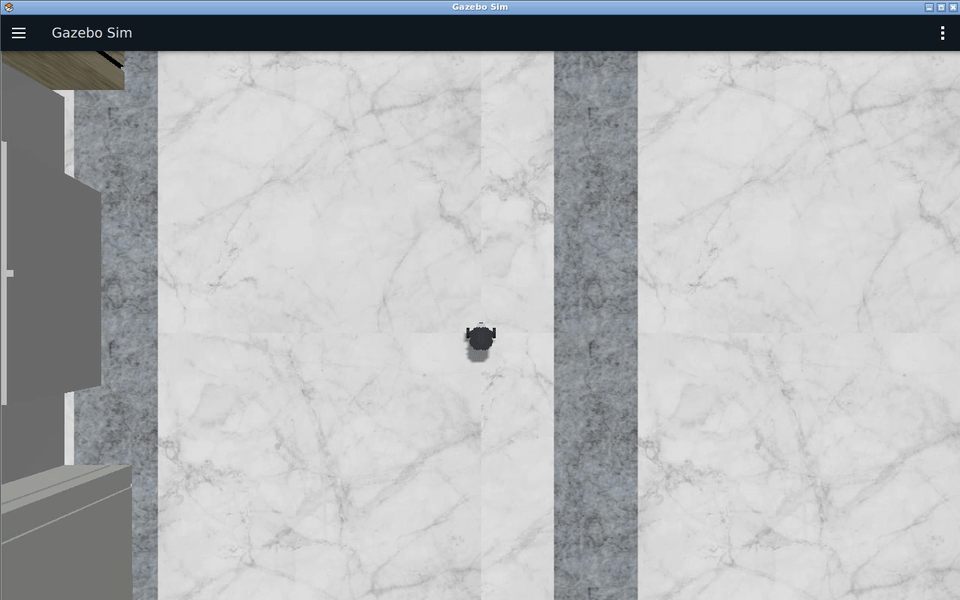

Campus 的[场景截图](images/ch09/ch09-campus.png)来自实际 Gazebo 窗口；[终端 GIF](images/ch09/ch09-campus.gif)由同轮 COM260 SSH CAST 渲染，原记录19.608秒，压缩超过2秒的空闲等待、末帧停留8秒后为12.36秒，输出内容不变。

## 第 10 章 SLAM 基本概念与贝叶斯框架

在教案给定的预测和观测输入下，C++ `bayes_demo` 得到后验均值 `(0.110476, 0.000000, 0.025238)`，三个协方差对角项均为 `0.052381`。[COM260 输出](images/ch10/ch10-teaching-numerics.cast)和 [x86 输出](images/ch10/ch10-teaching-x86-numerics.txt)均可按程序名查阅。

接入 Gazebo 后，COM260 的 `sensor_monitor` 读到一帧 360 个有效激光点，静止时 IMU 的 z 轴加速度为 9.80 m/s²，节点退出码为 0。[传感器记录](images/ch10/ch10-teaching-live-sensors.cast)

### 实验 10 · SLAM 建图与定位（第 10～15 章共用）

配套实验为[第10章 实验指导书：SLAM 建图与定位](ch10_lab.md)。实验运行编号为 `20261004T063929Z`。仿真激光为独立的 360 点／360° profile；slam_toolbox、AMCL、Cartographer 和回放按顺序运行，每次切换退出上一套地图发布者。教材中的简化 ICP、Hector、粒子滤波和图优化示例用于展示算法结构；数值样例及真实输入接入分别记录，不能据此推断定位精度或生产环境稳定性。

| 项目 | 实际结果 |
| --- | --- |
| C++ 帮助节点已知输入 | COM260 和 x86 均通过 7 项：地图分类、激光边界、初始位姿三次发布、非有限值拒绝、0.5 m／30°已知误差、Cartographer Finish→Write 顺序及服务拒绝 |
| slam_toolbox 地图增长 | `slam_map_runner` 收到 5 次地图更新，已知栅格增加 3732，里程计位移 0.270 m，12 次激光消息，退出 0 |
| 完整在线入口 | `online_mapping.launch.py` 与 COM260 `slam_monitor` 收到 9 次地图，末次 304×265、occupied=657、free=23235、unknown=56668、known=29.7%，节点退出 0；[真实统计](images/ch10/ch10-online-monitor.cast)与[连续RViz录像](images/ch10/ch10-slam.mp4)对应，GIF截取该40秒原片第7～35秒 |
| 保存地图 | `lab10_map` 为 173×173、0.05 m/格，PGM/YAML 保存成功 |
| AMCL 接口 | map_server 和 amcl 均 active；实际粒子接口为 `nav2_msgs/msg/ParticleCloud`，Best Effort；RViz 地图采用 Transient Local |
| 初始位姿 | COM260 C++ 节点三次发布 (0,0,0)，收到 `/amcl_pose`；RViz `2D Pose Estimate` 另一次实际发布 (1.000,1.033,1.571 rad) |
| AMCL 运动与停止 | 收到 456 条里程计／独立真值、5 次 AMCL 位姿与粒子云，末次 731 粒子；尾段线／角速度接近 0，评估节点退出 0 |
| AMCL 误差 | 本段停稳后位置误差 0.117 m、偏航误差 8.83°。`map` 与 Gazebo `world` 的对齐基于建图首帧和同一仿真出生原点，未使用 AMCL 估计反推真值。运动时异步最新消息包含时间差，不能当成时间同步精度测试 |
| 全局重定位 | 错误初始位姿后调用 `/reinitialize_global_localization` 返回成功，记录了粒子重置后的实际转动和粒子图；未单独量化全局重定位收敛精度。后续教学监控质量值 0.44，仅为教材公式输出 |
| Cartographer 第一轮 | 新仿真／新后端 trajectory 0；14 次地图更新，已知栅格增长 4976，位移 0.335 m；保存 184395 字节 pbstream，并转换 PGM/YAML |
| Cartographer 第二轮 | 重新启动仿真和后端；14 次地图更新，已知栅格增长 5019，位移 0.338 m；保存 171490 字节 pbstream，并转换 PGM/YAML |

两次 Cartographer 使用同一个 Museum 世界，验证的是两次独立 2D 建图和导出流程，不代表真实多楼层或 3D 扫描。

[SLAM 地图增长记录](images/ch10/ch10-slam.cast)、[AMCL 初始化记录](images/ch10/ch10-amcl-init.cast)、[AMCL 实际误差记录](images/ch10/ch10-amcl.cast)、[AMCL 连续界面录像](images/ch10/ch10-amcl.mp4)、[Cartographer 第一轮](images/ch10/ch10-cartographer-floor1.cast)、[第二轮](images/ch10/ch10-cartographer-floor2.cast)、[C++ 已知输入](images/ch10/ch09-10-known-inputs.cast)。

教案节点的双端已知输入记录见 [COM260 数值](images/ch10/ch10-teaching-numerics.cast)、[COM260 ROS 输入](images/ch10/ch10-teaching-ros.cast)、[x86 数值](images/ch10/ch10-teaching-x86-numerics.txt)、[x86 ROS 输入](images/ch10/ch10-teaching-x86-ros.txt)。[接口清单](images/ch10/ch10-teaching-interfaces.json)记录两端 96 份 Cartographer/Nav2 消息与服务文件的逐文件 SHA-256 一致性。

真实输入接入另见 [传感器](images/ch10/ch10-teaching-live-sensors.cast)、[TF 与地图](images/ch10/ch10-teaching-live-mapping.cast)、[巡航停止](images/ch10/ch10-teaching-live-patrol.cast)、[AMCL](images/ch10/ch10-teaching-live-amcl.cast)、[Cartographer](images/ch10/ch10-teaching-live-cartographer.cast)。Cartographer 地图含中间占据概率，原教案按严格等于 0／100 分类时两者可能均为 0%；这不等同于地图没有已知区域，其已知覆盖率实际为 33.5%。

#### 录包与半速回放

实际录制使用 `--use-sim-time`，话题为 `/scan /odom /tf /tf_static`。SQLite 包包含 3615 条消息、28.981 秒仿真时间：scan 231、odom 1450、tf 1933、tf_static 1。`ros2 bag info` 的 1970 日期是相对仿真时钟的格式化显示，实际采集身份由运行编号和 CAST 的 UTC 时间戳记录。

退出实时 Gazebo、桥、RSP 和控制器后，以 `--clock --rate 0.5` 回放。实测时钟速率 0.4999976；scan、odom、clock 均只有 `rosbag2_player` 一个发布者，map 由 `slam_toolbox` 发布。11 次地图更新，已知格从1640增加到13169；离线303×265、0.05m/格地图已保存PGM/YAML。当前Humble的同一个slam_toolbox进程创建两个TF端点，因此回放期TF端点共3个，不能据此误判存在两个SLAM进程。

[原始回放记录](images/ch10/ch10-bag-play.cast)、[实际来源与速率结果](images/ch10/ch10-bag-play-result.json)、[连续回放录像](images/ch10/ch10-bag-play.mp4)。

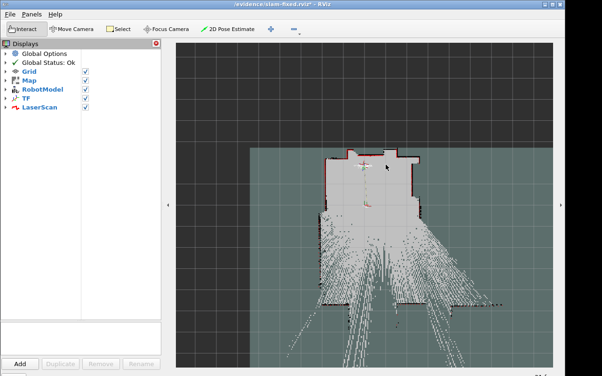

#### 构建与复现边界

COM260 在没有 build/install 的新工作区，使用固定官方源码和原样公开 `prepare-ch09-ch10-interfaces.bash` 构建三个接口包成功；96份安装接口与已验证版本逐项一致，随后13项原生C++已知输入复测通过。Cartographer源码在板端直接获取；Nav2直连下载中途停滞，保留失败记录后改用访问端获取的固定提交Git源码缓存，编译仍在COM260完成。因此这里验证通过的是源码缓存恢复路径，不能视为板端直连下载全部成功。[构建与回归CAST](images/ch10/ch10-interface-bootstrap.cast)、[结构化结果](images/ch10/ch10-interface-bootstrap.json)及[源码获取恢复检查](images/ch10/ch10-interface-recovery.json)分别记录实际结果。

公开板端setup和手册学生空目录建包另行实跑。学生两端28文件SHA-256一致，16份正文完整代码块与构建输入一致；双端各7项已知输入、4个Launch入口和资源检查通过。

[公开板端setup记录](images/ch10/ch10-public-setup.cast)、[学生从空目录建包](images/ch10/ch10-student-board-build.cast)、[学生COM260已知输入](images/ch10/ch10-student-board-known.cast)、[学生x86已知输入](images/ch10/ch10-student-x86-known.cast)、[学生Launch和资源检查](images/ch10/ch10-student-resources.cast)、[公开x86构建入口](images/ch10/ch10-public-x86-build.cast)、[学生验收清单](images/ch10/ch10-student-validation.json)。这些CAST均以退出码0结束。

Campus GUI资源独立安装与检查见[双端课程和练习目录验证](images/ch09/ch09-gui-resources.cast)。Harmonic要求`showTitleBar`属性声明布尔类型，本章使用独立GUI副本；原版和Pico文件保持原样。

最终四个参考包共63个源码与资源文件在本地、COM260和x86逐项SHA-256一致，见[源文件清单](images/ch10/ch10-source-validation.json)。四包共21条编译命令，均为Debug并满足C++17；[编译记录](images/ch10/ch10-compile-commands.json)保留实际命令检查结果。Campus GUI资源的增量安装不改变已验证的C++程序。

## 第 11 章 ICP 与 PLICP 扫描匹配

C++ `icp_demo` 在无噪声已知输入上的误差为 0。100 点带噪样本中，ICP 迭代 21 次后停在局部极小值，最近邻误差为 0.453940 m。结构化墙面样本中，PLICP 迭代 5 次，平移误差为 0.004886 m，角度误差为 0.018187°。[COM260 数值输出](images/ch10/ch10-teaching-numerics.cast) · [x86 数值输出](images/ch10/ch10-teaching-x86-numerics.txt)

给 `scan_matcher` 输入静止扫描序列，两端的 `scan_matcher_stationary` 用例均通过。[COM260 接口记录](images/ch10/ch10-teaching-ros.cast) · [x86 接口记录](images/ch10/ch10-teaching-x86-ros.txt)

## 第 12 章 Hector SLAM

C++ `hector_demo` 的双线性插值结果为 0.15。栅格更新后，占据格、空闲格和未知格的概率分别为 0.993307、0.182426 和 0.5。[COM260 数值输出](images/ch10/ch10-teaching-numerics.cast) · [x86 数值输出](images/ch10/ch10-teaching-x86-numerics.txt)

简化 Hector 节点接入 Gazebo 后，记录到 37 条地图消息、97 条位姿消息和 780 条里程计消息。机器人静止期间估计位姿仍有漂移。[运行记录](images/ch10/ch10-teaching-hector-live.cast) · [位姿与里程计数据](images/ch10/ch10-teaching-hector-result.json)

## 第 13 章 gmapping 粒子滤波 SLAM

C++ `particle_demo` 在 4 个粒子权重均匀时得到有效粒子数 4，权重集中在一个粒子时得到 1。重采样示例输出 8 个粒子。[COM260 数值输出](images/ch10/ch10-teaching-numerics.cast) · [x86 数值输出](images/ch10/ch10-teaching-x86-numerics.txt)

教案的仿真实例检查激光、里程计与 TF 输入。共用实验录到 231 条扫描、1450 条里程计、1933 条动态 TF 和 1 条静态 TF。该次建图回放使用 slam_toolbox，完整 gmapping 建图未实测。[录包与回放结果](images/ch10/ch10-bag-play-result.json) · [回放记录](images/ch10/ch10-bag-play.cast)

## 第 14 章 AMCL 定位

COM260 上的教学节点接收到仿真粒子云。运动与停止测试获得 456 条里程计消息，末次粒子云有 731 个粒子。以停稳后的位姿对照 Gazebo 真值，位置误差为 0.117 m，偏航误差为 8.83°。全局重定位另行检查了服务调用和粒子重置，收敛精度未单独测量。[教学节点输出](images/ch10/ch10-teaching-live-amcl.cast) · [误差记录](images/ch10/ch10-amcl.cast) · [RViz 截图](images/ch10/ch10-amcl-rviz.png) · [RViz 连续录像](images/ch10/ch10-amcl.mp4)

## 第 15 章 Cartographer 图优化 SLAM

C++ `graph_demo` 的图优化误差由 21.992503610 降至显示精度下的 0，优化后的第二个位姿为 `(2, 0, 0)`。[COM260 数值输出](images/ch10/ch10-teaching-numerics.cast) · [x86 数值输出](images/ch10/ch10-teaching-x86-numerics.txt)

在纯定位模式下加载已保存的 pbstream，轨迹 0 为 `FROZEN`，新轨迹 1 为 `ACTIVE`，可查询从 `map` 到 `base_link` 的变换。两轮二维建图与导出数据见[实验 10](#lab10)。[纯定位运行记录](images/ch10/ch10-teaching-pure-localization.cast) · [轨迹状态与 TF](images/ch10/ch10-teaching-pure-localization-result.json)

## 第 16 章 Nav2 架构与核心组件

[第 16 章教案](../teaching_docs_k3_com260_kit/ch16_Nav2架构与核心组件.md)、[双端环境](ch00_common_setup.md#ch16)。配套实验见[实验 11 的六个练习](#lab11)。

### 规划、导航与行为树

| 项目 | 实际结果与证据 |
| --- | --- |
| 公开规划入口 | C++ `global_planner_client` 从 `(0,0)` 到 `(3,2)` 生成 313 个路径点，退出码 0。[CAST](images/nav2_ch16_ch17/20261108T142740Z-packages/planner.cast)、[结果](images/nav2_ch16_ch17/20261108T142740Z-packages/board/planner.json) |
| 原目标 `(3,2,0)` | SUCCEEDED；147.991 秒、2437 条里程计；停稳 TF 为 `(3.1718,2.0013)`，原坐标误差 **0.1719 m ≤ 0.25 m**，尾段停止。[CAST](images/nav2_ch16_ch17/20261108T142740Z-packages/original-goal.cast)、[数值与原始里程计](images/nav2_ch16_ch17/20261108T142740Z-packages/board/navigation/goal-3-2.json) |
| 五点任务 | 五次 SUCCEEDED，每点暂停 3 秒；224.489 秒、3873 条里程计。逐点误差 `0.0832, 0.0971, 0.0970, 0.0985, 0.0978` m，五点均停止。[CAST](images/nav2_ch16_ch17/20261108T142740Z-packages/five-goals.cast)、[逐点 TF](images/nav2_ch16_ch17/20261108T142740Z-packages/board/navigation/five-goals.json) |
| 原行为树序列 | 教学树先到 `(1,0,0)`，自定义树再到目标 `(0,-1,0)`，均 SUCCEEDED；后者 1113 条里程计、尾段停止。0.1 低电量测试输入返回 ABORTED，并停止。[CAST](images/nav2_ch16_ch17/20261108T142740Z-packages/original-trees.cast) |
| 到达后动作 | Wait 实测 **2.00 个仿真秒**；Spin 成功，里程计累计旋转 **6.3057 rad**，对应请求 6.2832 rad。[状态与里程计](images/nav2_ch16_ch17/20261108T142740Z-packages/board/trees/post-arrival.json)、[CAST](images/nav2_ch16_ch17/20261108T142740Z-packages/post-arrival.cast) |
| 取消与退出信号 | 提前取消、SIGINT、SIGTERM 均取得 CANCELED，程序按约定返回 1；分别 169／160／156 条里程计确认尾段停止。[CAST](images/nav2_ch16_ch17/20261108T142740Z-packages/cancel-signals.cast) |
| Action 异常 | 隔离域内目标拒绝、执行中止、取消不响应共 3 项通过；取消不响应约 11.26 秒退出。此项使用可控服务端。[CAST](images/nav2_ch16_ch17/20261108T142740Z-packages/action-failures.cast) |

### 终点条件与行为树

原目标 `(3,2)` 处于原始代价 253 区域，规划器可能选择邻近可达终点。独立 [Launch](../course_support/k3_com260_kit/launch/nav2-teaching.launch.py) 将 NavFn 容差设为 0.15 m，目标检查器和 DWB 的 XY 容差均为 0.10 m，减少规划偏移与提前停止的累积误差。进度检测距离为 0.10 m，超时保留 10 秒；旧 0.5 m 平移要求会在末段转向完成前触发失败。原目标、0.25 m 验收阈值、机器人足迹和第 6 章默认参数均保持不变。

自定义树增加 `PipelineSequence` 与 1 Hz 重规划，保留电量阈值、等待 2 秒和旋转 6.2832 rad。验收使用原 `(0,-1,0)`，没有用其他目标的成功替代。电量来自明确发布的 BatteryState 测试消息，不代表物理电池或充电功能。

终点取停止后的 map→base_link TF，同时检查实际 `/odom` 速度。AMCL 消息受更新阈值影响，末条消息可能早于真实停止位置。仿真数值不作为物理机器人定位精度结论。

### 导航截图与录像

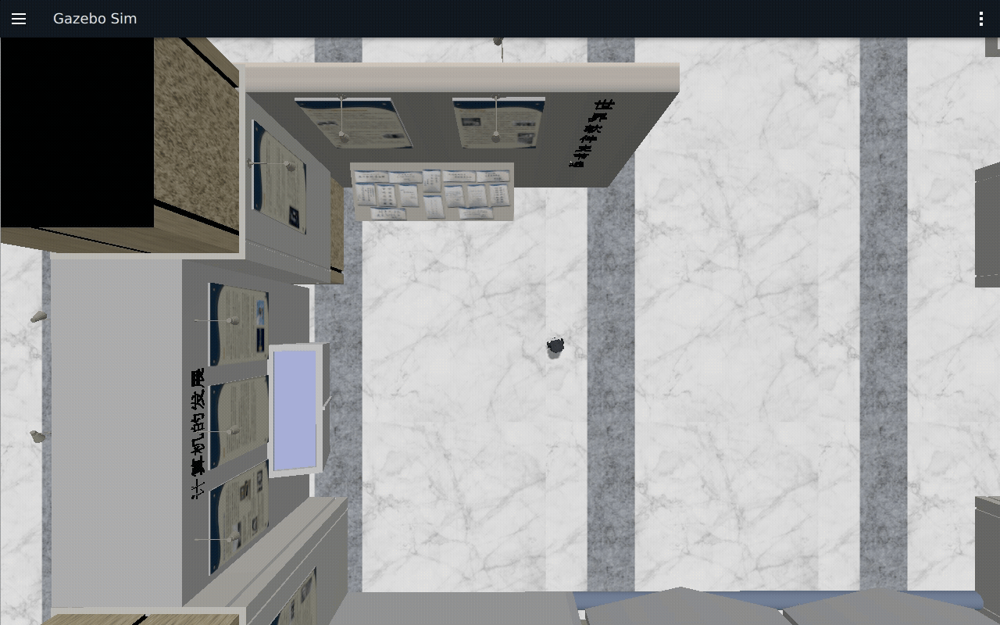

[180 秒 Gazebo 原片](images/nav2_ch16_ch17/20261108T142740Z-packages/x86/original-tree-gazebo.mp4)；GIF 为第 25～100 秒原速片段。

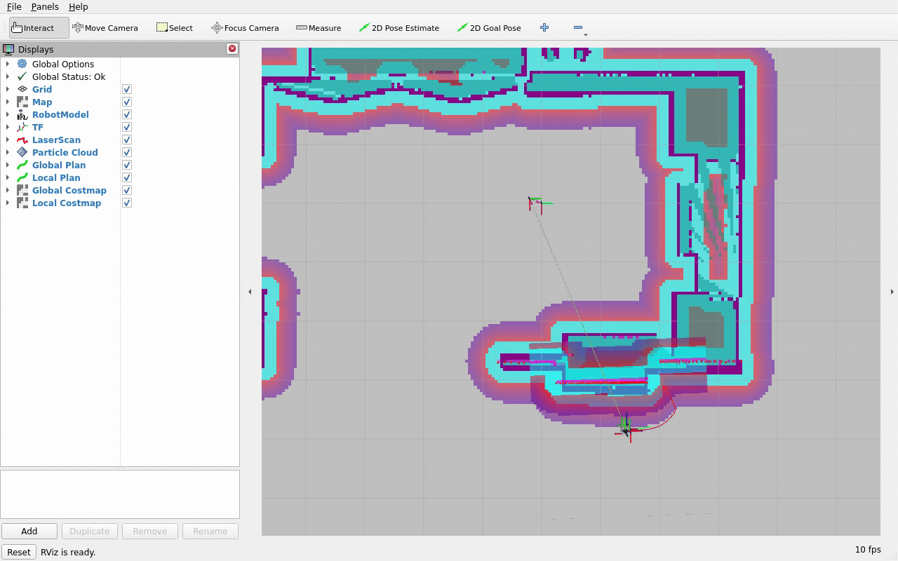

[180 秒原目标 RViz 连续录像](images/nav2_ch16_ch17/20261108T142740Z-packages/x86/planner-goal-rviz.mp4)覆盖规划、运动和终点状态；GIF 为第 100～180 秒原速片段。

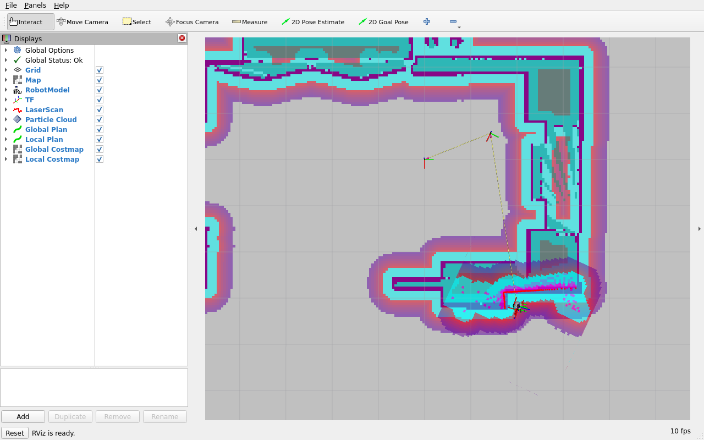

[360 秒五点 RViz 原片](images/nav2_ch16_ch17/20261108T142740Z-packages/x86/five-goals-rviz.mp4)显示路径、机器人位置及代价地图变化。

### 双端构建与联合检查

批次 `20261108T142740Z-packages` 同时覆盖本章和[第 17 章代价地图](#ch17)。COM260 运行 9 个 C++17 教学入口，x86 正式 `ch06-nav2` 镜像运行 Nav2 1.1.20、Burger／Museum 与 RViz；两端使用有线 CycloneDDS、Domain 181。Nav2 接口源码固定为 `a097086719c88f781aa59788eca29ac6ca5e56db`。环境、构建、源码和媒体均绑定此批次，完整清单见[运行索引](images/nav2_ch16_ch17/validation-runs.json)。

当前 x86 入口使用独立 `ch16-ch17-nav2` 镜像，包含同版本 RViz 的退出修复；其[启动、使用与退出验收](#rviz-exit)单独记录。上述课程用例的原始记录保持对应原镜像。

| 项目 | 实际结果与证据 |
| --- | --- |
| 双端构建 | 板端通过统一 setup 的 `--build-ch16`／`--build-ch17` 构建 7 个实例包，x86 通过 `x86-ch16-ch17.bash build` 构建；两端各 9 个 C++17 Debug 编译单元和可执行文件，ELF 分别为 RISC-V、x86-64。[COM260](images/nav2_ch16_ch17/20261108T142740Z-packages/build-board.cast)、[x86](images/nav2_ch16_ch17/20261108T142740Z-packages/build-x86.cast)、[二进制与编译信息](images/nav2_ch16_ch17/20261108T142740Z-packages/validation-results.json) |
| 确定输入 | 两端各 12 项代价数值与 31 项 ROS 接口检查通过，包含重复 configure、PGM/YAML 语义、保留地图、无效输入拒绝、激光清除／标记和点云高度过滤。[COM260](images/nav2_ch16_ch17/20261108T142740Z-packages/checks-board.cast)、[x86](images/nav2_ch16_ch17/20261108T142740Z-packages/checks-x86.cast) |
| 真实地图与传感器 | 11 项检查通过：992×992 Museum 地图的几何和全部像素与 Nav2 Map Server 一致；真实 LaserScan／TF 产生教学栅格，C++ 调试节点收到两张真实代价地图；无效规划器、负取消延时与服务缺失按预期失败。[CAST](images/nav2_ch16_ch17/20261108T142740Z-packages/live-checks.cast) |
| 公开入口 | `start`、`exec`、`stop` 和重复 `stop` 通过；本轮课程容器为 0，x86 桌面仍可访问。[启动](images/nav2_ch16_ch17/20261108T142740Z-packages/start.cast)、[停止](images/nav2_ch16_ch17/20261108T142740Z-packages/stop.cast) |

两章的课程媒体来自 `20261108T142740Z-packages` 的实际 Gazebo／RViz 窗口，主机录屏，原速连续保存；[采集时间、格式、派生片段与 SHA-256](images/nav2_ch16_ch17/20261108T142740Z-packages/media-validation.json)分别登记。4 份 MP4 和 3 份 GIF 完成整段解码，关键帧已目检。

[源码指纹](images/nav2_ch16_ch17/20261108T142740Z-packages/source-validation.json)确认本地、COM260 与 x86 的 47 个构建源文件逐项一致，实跑结束后再次核对一致；[结构化结果](images/nav2_ch16_ch17/20261108T142740Z-packages/validation-results.json)、原始终端记录、服务端日志、里程计、验证脚本和媒体均列于[批次清单](images/nav2_ch16_ch17/20261108T142740Z-packages/manifest.json)。Python 仅用于 Launch、采集和验证，教学执行示例为 C++17。

[服务端运行日志](images/nav2_ch16_ch17/20261108T142740Z-packages/x86/nav2.log)保留调度周期超时、RViz GLSL 与粒子云 QoS 提示，以及取消时的 `Failed to get result for follow_path in node halt`。原 RViz 的退出码 -11 已在[独立镜像中修复并复测](#rviz-exit)。地图与实际代价变化已目检，粒子云显示不作为验收依据；导航、取消和停车反馈均独立验证。无效规划器与低电量的失败日志对应负向用例。

### RViz 启动、使用与退出

批次 `20261108T172828Z-rviz-acceptance` 使用公开 `x86-ch16-ch17.bash` 入口与独立镜像 `ch16-ch17-nav2`。基于 RViz 11.2.28 的[小型补丁](../course_support/k3_com260_kit/containers/rviz-close.patch)在接受窗口关闭时停止渲染，并将显示插件库的释放延后到相关 ROS 对象销毁之后。第 6 章镜像、共享配置与教学 C++ 源码保持原样。

| 检查 | 实际结果 |
| --- | --- |
| 构建与启动 | x86 9 个包构建成功；RViz 显示地图、机器人、激光和代价地图，Global Status 为 OK |
| 交互与导航 | 取消关闭后仍可导航；C++ 客户端目标 `(1,0)` 返回 SUCCEEDED，停稳 TF 误差 0.0971 m，336 条里程计样本确认尾段停止；拖动视角和调整窗口大小正常 |
| 关闭窗口 | 保存询问选择 Discard，RViz 进程正常结束，退出码 0 |
| 重启与信号退出 | 分别重新启动并运行约 45 秒，SIGINT、SIGTERM 的进程退出码均为 0；退出后 Nav2 仍为 active |
| 隔离与清理 | 原镜像 ID、系统软件包清单与 1,846 个原版、Pico 及共享文件哈希未变化；本次容器已停止移除，桌面保持可用 |

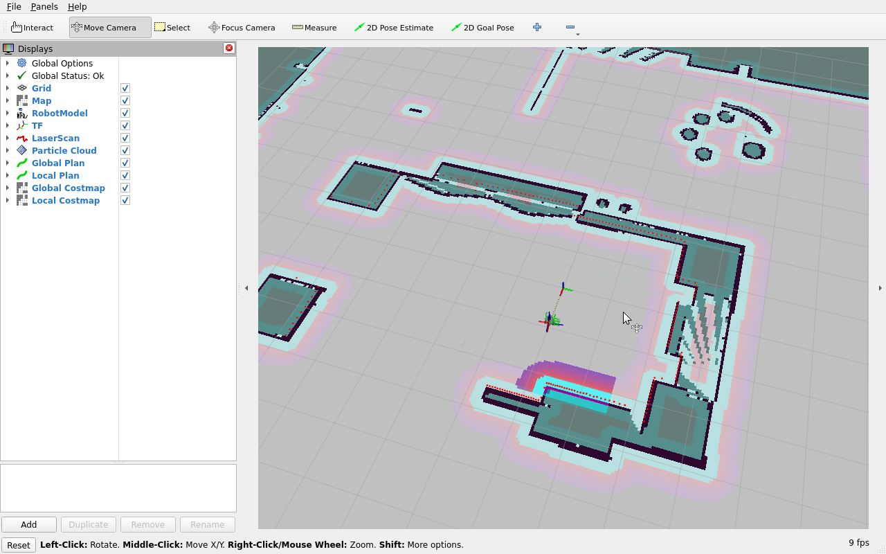

[35 秒连续导航录像](images/nav2_ch16_ch17/rviz_close/navigation.mp4)为本批次实际窗口录制，1280×800、12 fps，整段解码和关键帧目检通过。构建、导航、三种退出的原始日志及源码／媒体 SHA-256 见[验证记录](images/nav2_ch16_ch17/rviz_close/verification.json)。本次专项回归在 x86 完成，COM260 与整章用例沿用上方独立批次；粒子云 QoS 提示仍保留，不计入显示通过项。

### 实验 11 · Nav2 自主导航（第 16～20 章共用）

使用原六个练习、目标坐标和方向、四航点及两圈巡逻规则。COM260 原生运行 `navigation_lab_cpp` 的六个 C++17 入口，x86 运行 Burger / Humble Nav2。原 XBot-U 场景与地图未随仓库提供，本实验补充独立 `navigation-lab` 场景及与其几何一致的地图；原 Museum 入口继续用于教案示例。

**六个练习通过构建、联动运行、停车及媒体验收。** 教案中的规划器对比和走廊结果仍对应各自示例。

| 原练习 | 实际结果 |
|---|---|
| 1. goToPose 四目标 | 四次 `NavigateToPose` 均 SUCCEEDED；位置误差 0.0984 / 0.0965 / 0.0853 / 0.0975 m；2603 条 odom，结束后停稳；反馈含距离及预计时间 |
| 2. FollowWaypoints 四航点 | 真实 `FollowWaypoints`；`stop_on_failure=false` 和 `true` 分别运行原四航点，反馈索引覆盖 0～3、无遗漏，均退出 0 并停稳。这两次目标均可达，不作为失败分支验证 |
| 3. 恢复行为与合成 LaserScan | 在原 `(4,0)` 目标处放置方盒并加载对应地图；Nav2 自动 Spin 和 BackUp 均完成，随后移除障碍并恢复正常地图，同一个目标 SUCCEEDED，位置误差 0.0974 m；2225 条 odom、退出 0 并停稳。收到 349 份合成扫描，ROS 时间间隔中位数 0.1 s，坐标系 `laser_link`；反馈含距离、导航时间、预计时间和恢复次数 |
| 4. 导航过程监控 | 原 C++ 监控节点 15 秒内输出 12 次路径首尾变化、270 条局部路径和 287 条速度记录，正常退出；路径首尾计数不是独立的障碍重规划次数 |
| 5. 两圈巡逻 | 两次 `FollowWaypoints` 均成功、两圈完成且无遗漏；4652 条 odom，退出 0 并停稳 |
| 6. 自主巡逻与动态避障 | 按仿真时钟第 5 秒开始注入、第 70 秒停止，保持原 10 Hz 和圆形轨迹；收到 645 份合成扫描，其中 354 份在静态空闲区域测到障碍代价。停止注入后观测位置代价恢复为 0，原两圈均成功、无遗漏；4432 条 odom，退出 0 并停稳 |

真实激光保留 `/scan`，合成数据发布 `/scan_injected`；AMCL 只接收真实激光，代价地图分别缓存两个观测源。注入缓存保留 0.2 ROS 秒，停止后由真实扫描清除残留。恢复方盒与配套地图只用于练习 3；原 C++ 目标、扫描算法和 0.22 m 机器人半径均未改动。

双端构建通过，第 18～19 章的五项算法测试仍通过。本地、COM260、x86 的 20 个本次源码与配置文件逐项 SHA-256 一致；`stop_on_failure=true` 的覆盖值单独登记，测试后恢复 false。原 `start` 入口的 Museum 地图、单目标导航和 RViz 正常退出另有回归记录。

截图与录像见[实验手册](ch11_lab.md#实际运行证据)。7 份 MP4、2 份 GIF 均完整解码，并抽查关键画面；MP4 是实际窗口的连续原速录像，GIF 为原速节选。数值、命令、源码哈希与各次结果见[结构化结果](images/ch11/validation-results.json)，原始日志和里程计见[当前原始数据](images/ch11/runtime-data.tar.gz)，媒体时长及文件哈希见[校验记录](images/ch11/media-validation.json)。

## 第 17 章 全局代价地图

[第 17 章教案](../teaching_docs_k3_com260_kit/ch17_全局代价地图.md)、[双端环境](ch00_common_setup.md#ch17)。构建、已知输入以及 Museum 地图和激光的跨机检查见[双端构建与联合检查](#nav2-build-checks)。配套实验见[实验 11 的六个练习](#lab11)。

### 障碍物、膨胀层与参数恢复

| 项目 | 实际结果与证据 |
| --- | --- |
| 动态障碍 | 箱体区域原始最大代价 **0 → 254 → 0**，分别对应加入前、加入后、移除后；箱体已移除。[CAST](images/nav2_ch16_ch17/20261108T142740Z-packages/costmap.cast)、[原始栅格统计](images/nav2_ch16_ch17/20261108T142740Z-packages/board/costmap/removed.json) |
| 膨胀与清除 | 系数 1／10 时膨胀栅格代价总和为 5139580／1713890；系数已恢复为 3，全局与局部清除服务返回，地图继续更新 |
| 配置题与恢复 | 机器人半径 0.3 m、膨胀 0.6 m、分辨率 0.05 m；局部 60×60 栅格对应 3×3 m，update_frequency 参数为 5 Hz。原半径 0.22 m／膨胀 0.55 m 等值均已读回确认恢复；参数频率不作为实际发布率。[配置结果](images/nav2_ch16_ch17/20261108T142740Z-packages/board/exercise-config.json)、[最终读回](images/nav2_ch16_ch17/20261108T142740Z-packages/parameters-final.cast) |

### RViz 代价地图

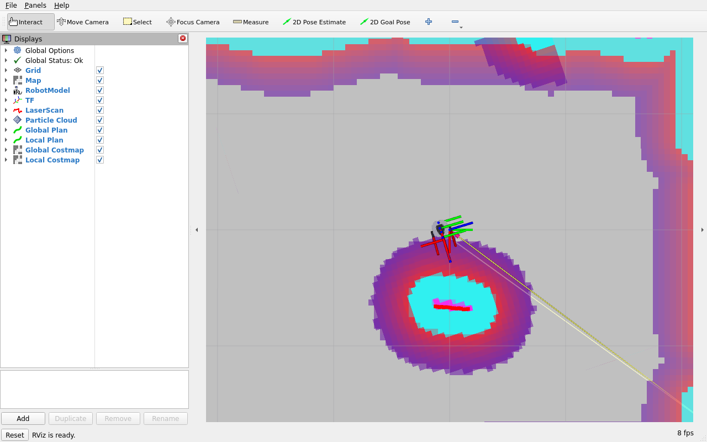

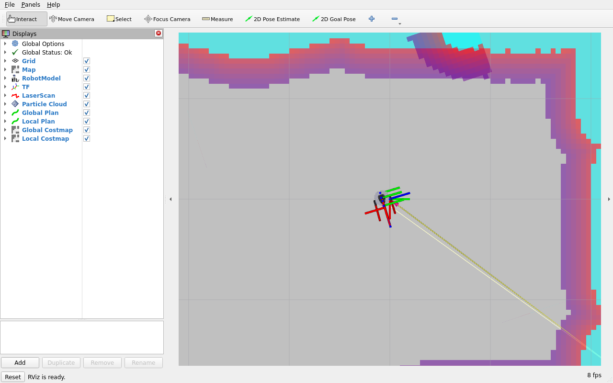

[120 秒动态代价地图原片](images/nav2_ch16_ch17/20261108T142740Z-packages/x86/costmap-rviz.mp4)、[0～90 秒原速 GIF](images/nav2_ch16_ch17/20261108T142740Z-packages/costmap-rviz.gif)与区域数值配合阅读。近景 RViz 仅调整观察视角，未修改原课程配置。

## 第 18 章 全局路径规划

[第 18 章教案](../teaching_docs_k3_com260_kit/ch18_全局路径规划.md)、[双端环境](ch00_common_setup.md#ch18)。配套实验见[实验 11 的六个练习](#lab11)。

### 栅格搜索与 Nav2 规划器

| 验收内容 | 实际结果 |
|---|---|
| 第 18 章教学示例 | Dijkstra/A* 等代价 65.9411，57 点；Hybrid-A* 18 点；平滑、修剪、重采样、代价优化已知输入通过 |
| 自编 A* 真实地图 | `(1,0)` 成功；原默认 `(3,2)` 位于代价 253 栅格，明确拒绝 |
| 官方全局规划器 | NavFn Dijkstra、NavFn A*、Smac 2D、Smac Hybrid-A* 到同一 `(2,-1)` 均完成规划、代价检查、实际导航及停车 |

简化 Hybrid-A* 未实现解析 Reeds–Shepp 连接。规划时间分别记录 ROS 时钟耗时与墙钟 Action 往返时间。

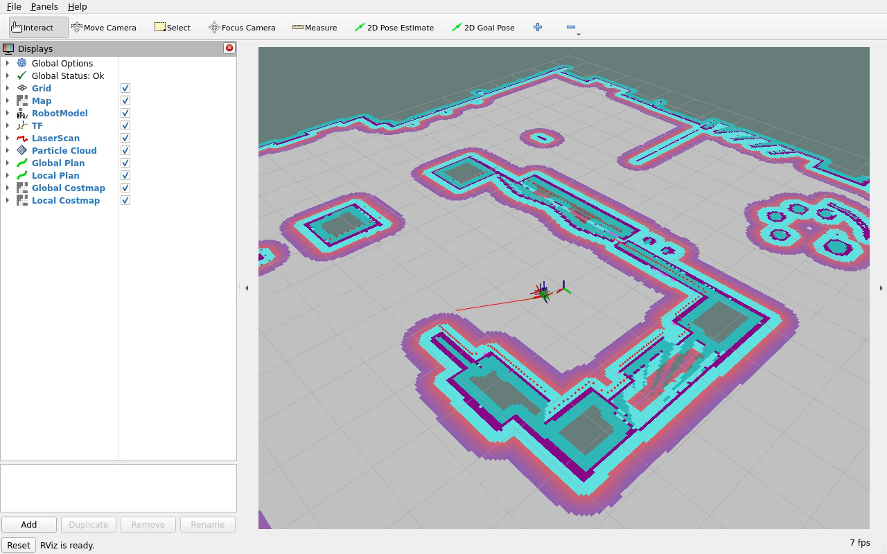

[65 秒 RViz 原速录像](images/nav2_ch18_ch19/navfn-free-rviz.mp4)展示同一目标的规划与执行。

### 双端构建与原始数据

批次 `20261111T042601Z-planning` 同时覆盖本章和[第 19 章局部控制](#ch19)。COM260 原生运行 RISC-V C++17，x86 运行 ROS 2 Humble、Gazebo、Nav2 和 RViz。RViz 镜像的[退出验证](#rviz-exit)单独记录。

| 验收内容 | 实际结果 |
|---|---|
| 构建与一致性 | [COM260 构建](images/nav2_ch18_ch19/board-build.cast)与 [x86 构建](images/nav2_ch18_ch19/x86-build.cast)分别通过 5 项已知输入测试；采集时 130 个源码和运行配置在本地、COM260、x86 以及运行前后逐项一致 |

[结构化验收结果](images/nav2_ch18_ch19/validation-results.json)、[源码指纹](images/nav2_ch18_ch19/source-sha256.json)、[媒体校验](images/nav2_ch18_ch19/media-validation.json)及[本次原始数据](images/nav2_ch18_ch19/runtime-data.tar.gz)可交叉复核。截图、原速 MP4、GIF 和 CAST 均来自对应实跑。

## 第 19 章 局部路径规划

[第 19 章教案](../teaching_docs_k3_com260_kit/ch19_局部路径规划.md)、[双端环境](ch00_common_setup.md#ch19)。两端构建、源码指纹、媒体校验与里程计原始数据见[同批次构建记录](#planning-build-checks)。配套实验见[实验 11 的六个练习](#lab11)。

### 控制器对比与停车

| 验收内容 | 实际结果 |
|---|---|
| 控制器对照 | DWB、RPP、MPPI 到同一 `(1,0)` 均成功；终点误差分别 0.0985 / 0.0957 / 0.0977 m |
| 箱体避让 | DWB（预测 3.0 s）、RPP、自编 DWA 均完成 `(1.5,0)`，最小净距 0.0796 / 0.2690 / 0.1344 m；DWB 默认 1.7 s 未完成该场景，不作为通过配置 |
| 0.8 m 走廊 | DWB 默认配置完成 `(2.2,0)`，最小墙体净距 0.0683 m，终点误差 0.0977 m，停止通过 |
| 负向与停止 | 无效速度、无输入超时、SIGINT、SIGTERM、扫描失联符合预期；以真实 `/odom` 停车判断，非零返回值不冒充导航成功 |

净距按已知仿真几何计算，跟踪误差参照当时的全局路径。RPP 数值示例与官方控制插件分别验证，自适应切换为设计题。RViz 有 GLSL 和粒子云 QoS 提示，粒子云显示未计入通过项。

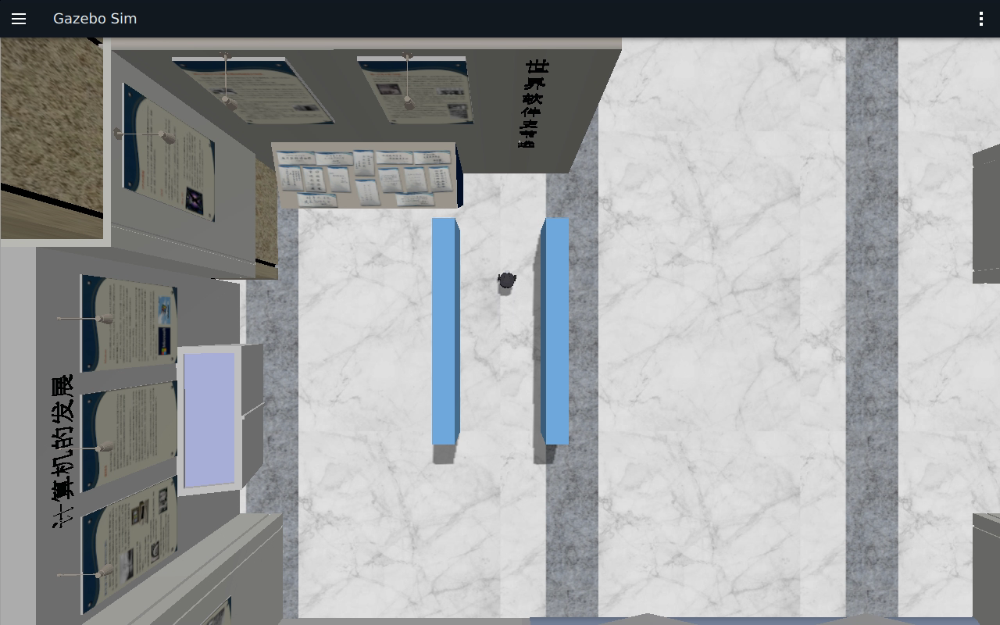

[65 秒 Gazebo 原速录像](images/nav2_ch18_ch19/corridor-gazebo.mp4)展示 DWB 通过走廊的过程。

## 第 20 章 行为树与恢复行为

[第 20 章教案](../teaching_docs_k3_com260_kit/ch20_行为树与恢复行为.md)、[双端环境](ch00_common_setup.md#ch20)。原六个练习见 [Nav2 实验手册](ch11_lab.md)，共用实验记录见[实验 11](#lab11)。

### 行为树与恢复动作

批次 `20261117-com260-behavior-running` 的 16 项实际动作检查通过。条件树以有状态节点保留 RUNNING，主循环每 0.1 s tick；停止树时取消当前 Action 并等待结果。

| 检查 | 实际结果 |
|---|---|
| Spin / BackUp | 原 1.57 rad 指令测得 1.6188 rad；原 0.15 m 后退指令测得 0.15485 m，均完成并停稳 |
| 恢复策略 | 原六步顺序，第一步 Spin 成功即结束，实测 1.6327 rad |
| 重复旋转 | 三次分别为 1.6170 / 1.6183 / 1.6195 rad，均满足 1.57±0.15 rad 且停稳 |
| 指定 XML | 到 `(1,0)` 返回 SUCCEEDED，末次 AMCL 位置误差 0.1075 m，515 条 odom 确认运动及停车 |
| 条件树 | 电量 0.1、0.2 和缺失输入均 FAILURE 且无运动；0.8 导航到 `(0,0)`，RUNNING→SUCCESS，位置误差 0.0495 m，606 条 odom |
| 取消与非法输入 | Spin 和条件树分别以 SIGINT / SIGTERM 请求取消，实际 CANCELED 并停稳；速度 0 被拒绝且不运动 |
| RViz | 正常退出，Nav2 的 bt_navigator 仍为 active；继承的退出修复有效 |

Gazebo 实时倍率设为 0.16 后，COM260 的两个客户端均按仿真时钟完成动作。实测批次为 `20261118T073829Z-slow-recovery`，x86 在独立显示会话中运行课程场景。墙钟和仿真耗时均从启动客户端计至返回。

| 动作 | 墙钟 / 仿真耗时 | 里程计运动量 | Action 结果 |
|---|---|---|---|
| Spin | 13.55 / 2.17 s | 1.5951 rad | SUCCEEDED |
| BackUp | 22.01 / 3.52 s | 0.1512 m | SUCCEEDED |
| 运动中取消 Spin | 7.13 / 1.14 s | 0.7200 rad | CANCELED |
| 运动中取消 BackUp | 9.69 / 1.55 s | 0.0584 m | CANCELED |

四项均在返回后继续采集 `/odom`。每项末尾 2 s 各收到 16 条反馈，线速度与角速度绝对值分别小于 0.02 m/s 和 0.03 rad/s。

共用六练习在本章独立工作区重新运行：四目标误差为 0.0976 / 0.0975 / 0.0971 / 0.0975 m；两种 `stop_on_failure` 配置均覆盖航点 0～3、无遗漏；自动 Spin、BackUp 后，按手册先加载原地图、再移除障碍，同一个 `(4,0)` 目标成功，误差 0.1021 m；2188 条 odom 确认运动及停车。监控节点记录 84 次路径首尾变化、1842 条局部路径和 1906 条速度，正常退出。普通与动态障碍巡逻均完成两圈并停稳；动态扫描 646 份，ROS 间隔中位数 0.1 s，其中 478 份在静态空闲区测到障碍代价，停止注入后观测位置代价恢复为 0。每次 RViz 均正常退出，Nav2 仍为 active。

练习 3 的公开命令在批次 `20261117T091049Z-recovery-public-repeat` 验证，恢复完成后等待 2 s 再执行，未使用预连接服务客户端。同一次练习的 [RViz 局部动图](images/ch20_ch21/recovery-rviz.gif)取自原片第 8～48 秒，包含 Spin、BackUp 和恢复导航。[Gazebo 原片](images/ch20_ch21/recovery-gazebo.mp4)与 [RViz 原片](images/ch20_ch21/recovery-rviz.mp4)均持续到机器人到达目标并停车。

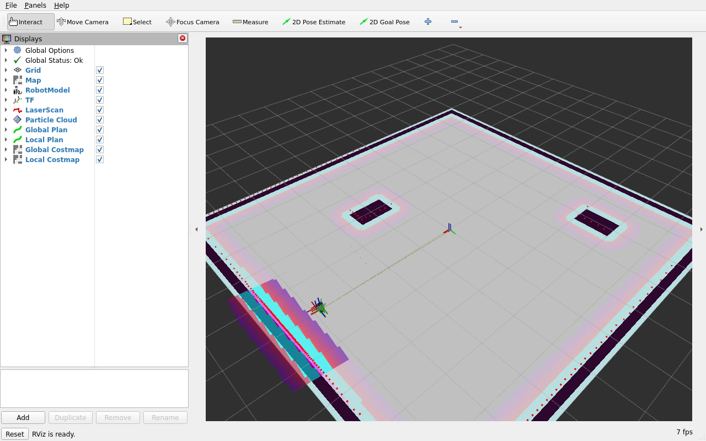

原始 Action / Service 已知输入另有两端各 11 项通过，覆盖发送字段、20% 边界、清图重试和持续失败。三机器人另用一个 Gazebo Harmonic 世界和三套 Nav2 完成两轮端到端导航。COM260 运行原 C++ 调度器，每轮向三个命名空间各发一个目标。两轮均收到三个 `SUCCEEDED`，并通过里程计核对停车。

| 仿真机器人 | 目标 (x, y)，单位 m | 实时测量录像中的到达误差 | Gazebo 窗口录像中的到达误差 |
|---|---|---|---|
| robot1 | (0.8, −1.0) | 0.111 m | 0.107 m |
| robot2 | (0.8, 0.0) | 0.150 m | 0.096 m |
| robot3 | (0.8, 1.0) | 0.072 m | 0.081 m |

误差取自 Gazebo 世界坐标。每台车从 x = −1.4 m 出发，两轮均独立核对了目标 UUID、实际移动和停车后的持续速度。[三车测量结果](images/ch20/fleet-validation.json) · [实时状态录像](images/ch20/fleet-arrival.mp4) · [Gazebo 窗口录像](images/ch20/fleet-gazebo.mp4)

使用公开的 `start-fleet`、`tasks.yaml` 和两份行为树 XML，在新 x86 工作区及新编译的 COM260 调度器上运行。三车最终状态均为 4，Gazebo 世界坐标误差分别为 0.147、0.130、0.104 m，随后连续 3 s 线速度与角速度为 0。按教案从新终端查询三个结果均返回 `status: 4`，`stop fleet` 退出码为 0。结果记入上述三车测量文件的 `public_workflow`。

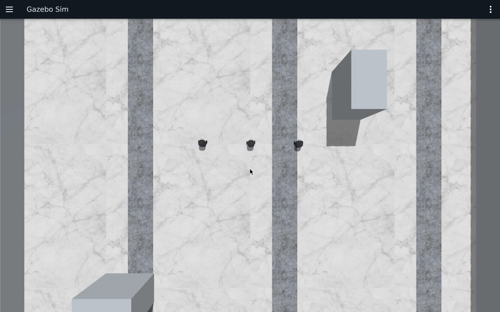

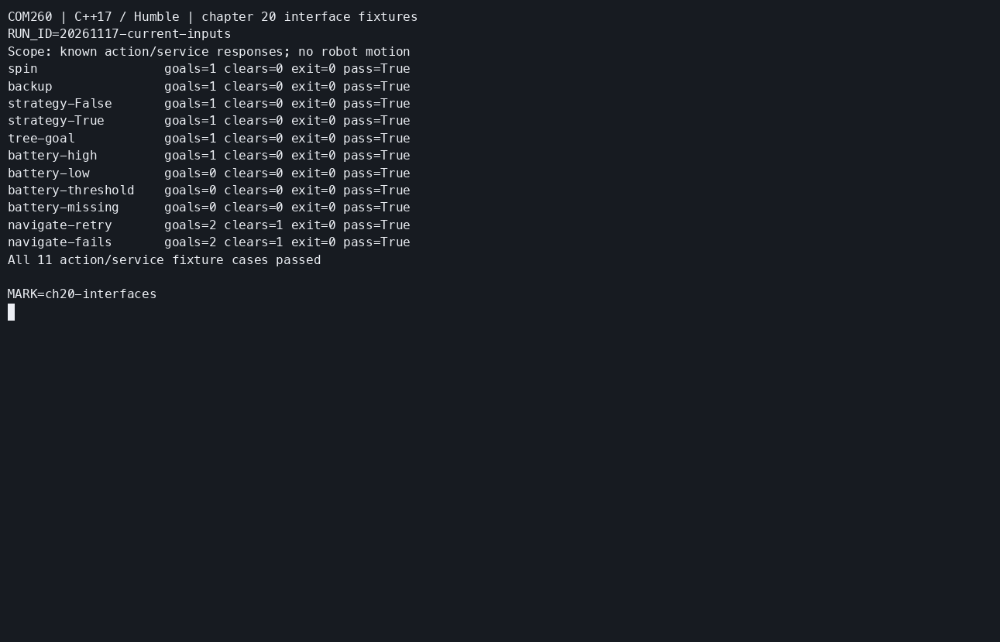

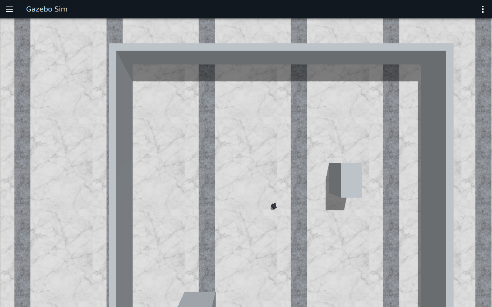

[Gazebo 连续原速录像](images/ch20_ch21/behavior-gazebo.mp4)、[RViz 连续原速录像](images/ch20_ch21/behavior-rviz.mp4)和[真实 SSH 终端记录](images/ch20_ch21/behavior.cast)对应同一批次。

行为树与恢复动作使用 COM260 有线 `.88`、x86 Wi-Fi `.4` 和 CycloneDDS 域 202。动作结果同时核对里程计的转角或位移及停车反馈。两章共用的源码指纹与采集文件见[双端构建记录](#behavior-vision-build)。

## 第 21 章 视觉 SLAM 导论

[第 21 章教案](../teaching_docs_k3_com260_kit/ch21_视觉SLAM导论.md)、[双端环境](ch00_common_setup.md#ch21)。COM260 运行 C++17 视觉节点，x86 提供仿真图像、RViz 显示及离线数据回放。

### 相机、ORB 与数学步骤

批次 `20261117T090610Z-camera-moving` 按 RGB 输入检查、相机处理、ORB 的顺序运行原独立示例。相机启动保留原版 `drive:=true` 及默认巡航参数；输入为 Gazebo RGB。

| 检查 | 实际结果 |
|---|---|
| RGB / CameraInfo / TF | 15 s 内 41 帧 RGB、45 份内参，41 张图像内容不同，320×180 / rgb8，时间戳递增；fx=fy=277.1273、cx=159.5、cy=89.5；base_link→camera_link 为 `(0.045,0,0.12)` |
| 相机 C++ 节点 | 持续处理图像与内参，记录 5 次 RGB 与 5 次内参输出，正常退出 0 |
| ORB C++ 节点 | 15 s 内 40 帧匹配图、45 份内参，40 张输出内容不同，640×180 / bgr8，时间戳递增；节流日志采样为 0～19 个特征、0～7 个匹配，正常退出 0 |
| 两端已知输入 | 各五项数学/算法测试通过；四点 RGB-D 坐标及颜色、无效深度、5 m 边界、相同图像 ORB 匹配四项接口检查通过 |
| 数学结果 | 投影 `(627.5,393.75)`、反投影误差 0、重投影误差 5 px；已知 RGB-D 的 8480 个 TSDF 点及 ICP；IMU 示例位置 0.5、速度 1 |

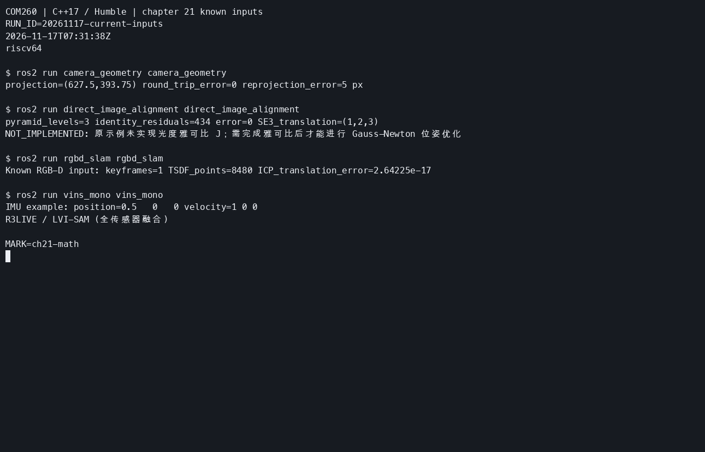

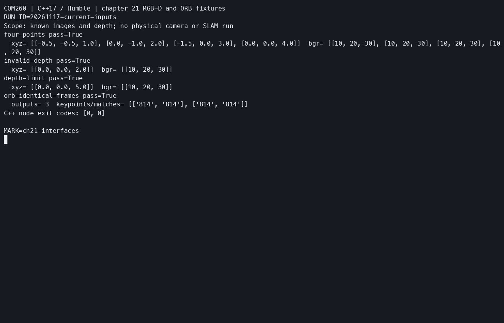

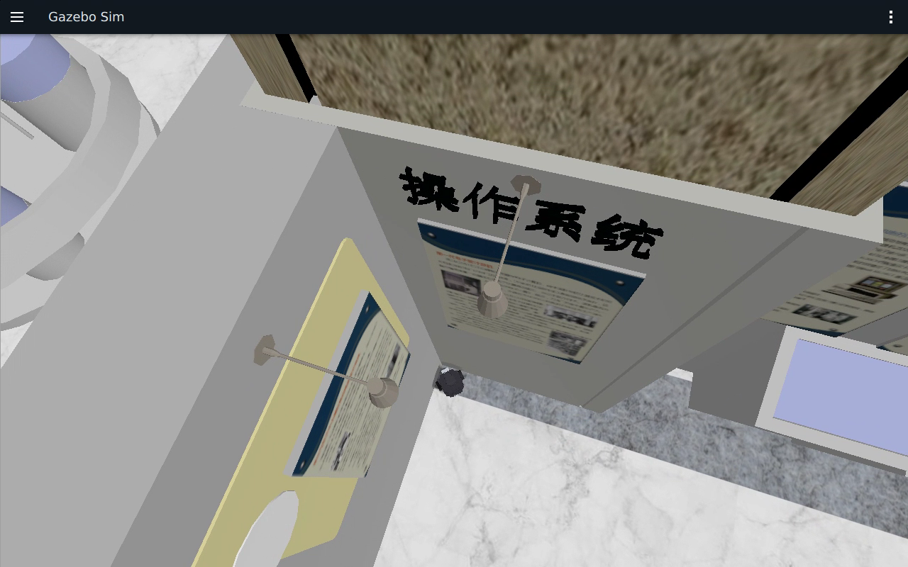

[30 秒原速 Gazebo 录像节选](images/ch20_ch21/camera-gazebo.mp4)来自同配置的独立观察批次 `20261117T093149Z-camera-motion`，镜头跟随机器人；与下方匹配录像分别录制。原固定巡航会遇到墙体，里程计增量不能直接作为真实位移；低纹理画面中 ORB 可以输出 0 个特征或匹配。

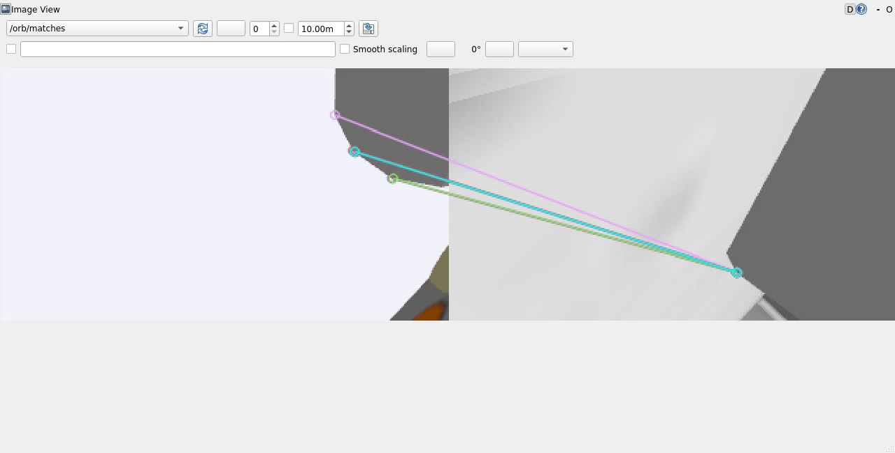

[20 秒原速匹配图录像节选](images/ch20_ch21/orb-matches.mp4)、[12 秒 GIF 节选](images/ch20_ch21/orb-matches.gif)、[真实相机示例终端记录](images/ch20_ch21/camera.cast)及[已知输入终端记录](images/ch20_ch21/known-inputs.cast)可交叉核对。

### 双端构建记录

两端各五项 CTest 与接口测试均有当前记录。第 20、21 章共核对 164 个源码、包说明及构建配置文件，采集时本地与 x86 的指纹逐项一致；其中 COM260 使用的 113 个文件同样一致，另 51 个为 x86 侧核对的仿真和镜像文件。详见[结构化结果](images/ch20_ch21/validation-results.json)、[源码指纹](images/ch20_ch21/source-sha256.json)、[媒体校验](images/ch20_ch21/media-validation.json)及[当前原始数据](images/ch20_ch21/runtime-data.tar.gz)。

### RGB-D 仿真建图

批次 `20261118T064757Z-rgbd-museum` 使用 x86 Gazebo 的 Museum / Burger RGB-D 相机，COM260 原生运行 C++17 `orbslam3/rgbd`。两端通过有线 IPv6、CycloneDDS / Domain 203 通信，彩色图采用 PNG，深度采用 `compressedDepth`。此结果验证第 21 章第 4 题的仿真软件链路，**D415 实机未验证**。

| 检查 | 实际结果 |
|---|---|
| 输入 | 配准的 640×480 RGB / 深度；fx=fy=615、cx=320、cy=240；深度为米制 `32FC1`，相机仿真更新率设置为 30 Hz |
| 跟踪 | 收到并处理 555 对图像，555 对均为 `state=2`，未发生地图重置；不表示 Gazebo 发布的每帧均已接收 |
| 处理速度 | 回调耗时中位数 67.259 ms、P95 81.742 ms、最大 87.982 ms；处理输出平均 4.766 帧/墙钟秒，仿真慢于实时 |
| 运动与停车 | 前进指令 0.05 m/s × 6 个仿真秒，转向 0.08 rad/s × 4 个仿真秒；804 条 odom 测得累计 0.30030 m、0.31944 rad，末段 101 条速度均为 0 |
| 轨迹与地图 | 保存 555 个轨迹位姿、17 个关键帧及 2443203 字节 Atlas；轨迹数值有限、时间递增、四元数为单位长度；显示的当前跟踪地图点为 300～783 个 |
| 退出 | C++ 节点退出 0；RViz 关闭窗口并在布局提示中选择 Discard 后退出 0；两路录制均退出 0，仿真容器正常停止 |
| 异常输入 | 缺少参数、已有输出、无输入均退出 1；尺寸不一致、错误深度编码和重复时间戳被拒绝，不生成有效轨迹 |
| 旧入口回归 | 原 `start-camera` 仍为 320×180 RGB / `drive:=true`，收到 50 帧图像、54 份内参和 622 条 odom，无新增 RGB-D 话题；两端各五项数学测试通过 |

单独的静止场景传输检查 `20261118-rgbd-v6-probe` 比较 x86 原始图像与 COM260 解码图像：RGB 像素完全一致，深度有效掩码一致，深度量化误差最大 0.956 mm、平均 0.191 mm。该检查与上方运动录像分开进行。

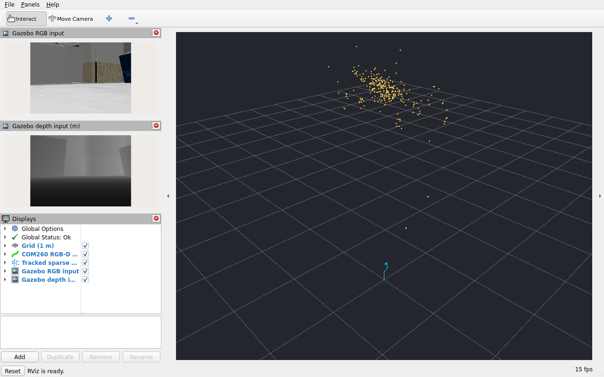

[约 108 秒 RViz 连续原速录像](images/ch20_ch21/rgbd-rviz.mp4)与 [12 秒原速 GIF 节选](images/ch20_ch21/rgbd-rviz.gif)显示图像变化、轨迹增长和地图点更新；GIF 对应录像第 58～70 秒。

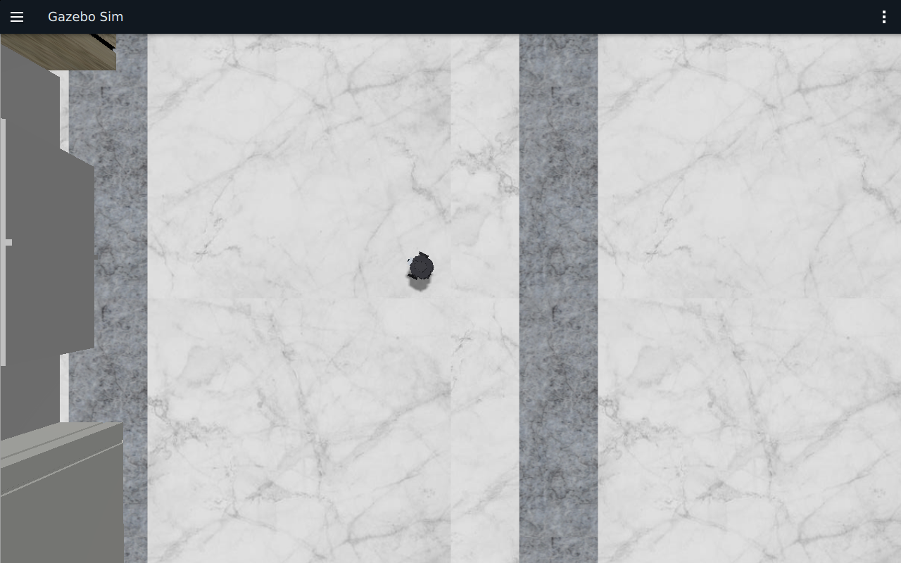

[约 108 秒 Gazebo 连续原速录像](images/ch20_ch21/rgbd-gazebo.mp4)与[真实 SSH 终端记录](images/ch20_ch21/rgbd.cast)对应同轮 COM260 运行。[结构化结果](images/ch20_ch21/rgbd-validation.json)与[当前原始数据](images/ch20_ch21/rgbd-runtime-data.tar.gz)包含运动反馈、轨迹、地图及退出状态。

里程计用于确认运动与停车，不作为视觉轨迹真值；此短程建图未评估定位精度、回环或 30 Hz 墙钟实时性能。D415 的驱动、USB、实际深度误差和真实场景性能仍需连接设备验证。

板端 `image_transport 3.1.12` / `compressed_depth_image_transport 2.5.4` 启动时记录了一次五参数 `subscribeImpl` 未覆盖提示。安装头文件的兼容实现随后调用四参数订阅；该运行实际完成深度解码和 555 对图像跟踪。此提示未被隐藏，保留在终端及原始日志中。

两端从新终端加载有线视觉配置后，Gazebo 彩色图与深度图到达 COM260，38 对输入全部跟踪。x86 收到 `map` 坐标系的轨迹及含 769 个点的一帧点云，RViz 已订阅地图点，板端正常退出。批次为 `20261118T074120Z-fresh-rgbd`。

### 录包与轨迹评估

批次 `20261118T033812Z-euroc-vio` 使用 EuRoC V1_01_easy 的真实单目图像、IMU 与机体参考轨迹。x86 执行 ROS 2 回放与录制，COM260 的 C++17 `visual_slam_eval/bag_vio` 读取实际录包并运行 ORB-SLAM3，x86 使用 EVO 1.38.1 评估保存后的机体轨迹。

| 检查 | 实际结果 |
|---|---|
| 回放与录制 | 2912 条图像、29120 条 IMU；录制前后两话题的序列化内容和数量一致 |
| COM260 原生运行 | 处理全部 2912 帧，正常退出 0，耗时 268.297 s；这是离线处理结果 |
| 保存轨迹 | 2555 个位姿，占输入图像数的 87.74%，覆盖 127.70 s；输入图像跨度 145.55 s，初始化期间发生 4 次活动地图重置 |
| 轨迹有效性 | 数值有限、时间戳递增、四元数为单位长度；EVO 关联 2536 个位姿，RPE 使用 2535 对相邻帧 |
| ATE / RPE | 平移 ATE RMSE 0.053972 m；平移 RPE RMSE 0.011175 m，间隔为连续 1 帧 |
| 评估条件 | SE(3) 刚体对齐，不拟合尺度；时间匹配容差 0.01 s，参考与估计均为 IMU 机体轨迹 |
| 输入检查 | 缺少参数、缺少 IMU、缺少图像均退出 1，不生成轨迹文件 |
| RViz | 实际显示输入图像与估计相机路径；正常关闭窗口退出 0，容器已结束 |

误差仅适用于成功关联的轨迹段，不能据此认为全部图像均连续跟踪成功。运行中统计的 2777 帧有效跟踪包含初始化阶段，与最终保存并优化的 2555 个位姿不是同一统计量。

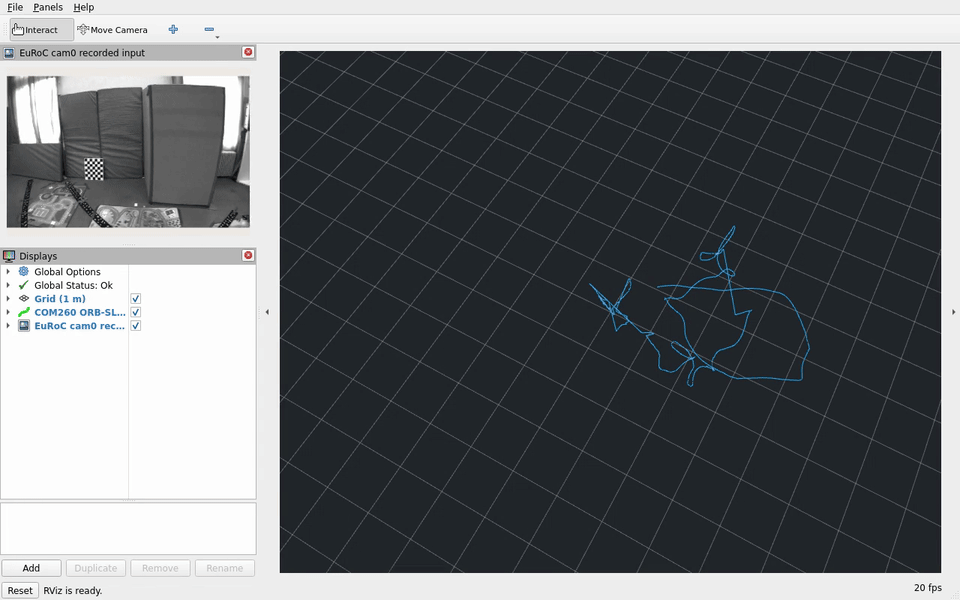

[60 秒连续原速录像](images/ch20_ch21/slam-rviz.mp4)、[RViz 截图](images/ch20_ch21/slam-rviz.png)与[真实 SSH 终端记录](images/ch20_ch21/slam.cast)来自同一次运行；GIF 为录像第 20～30 秒的原速节选。

两端从新终端加载有线 IPv6 / Domain 203 配置后，COM260 处理了 2912 帧图像和 29120 条 IMU 数据，保存 2718 个位姿。x86 RViz 显示输入图像和蓝色轨迹。关闭窗口后，RViz 容器与板端程序均以 0 退出。该次轨迹的平移 ATE RMSE 为 0.053939 m，RPE RMSE 为 0.016474 m。见[窗口截图](images/ch20_ch21/euroc-dds-rviz.png)和[12 秒原速录像](images/ch20_ch21/euroc-dds-rviz.mp4)，批次为 `20261118T150255Z-close-fix-euroc`。

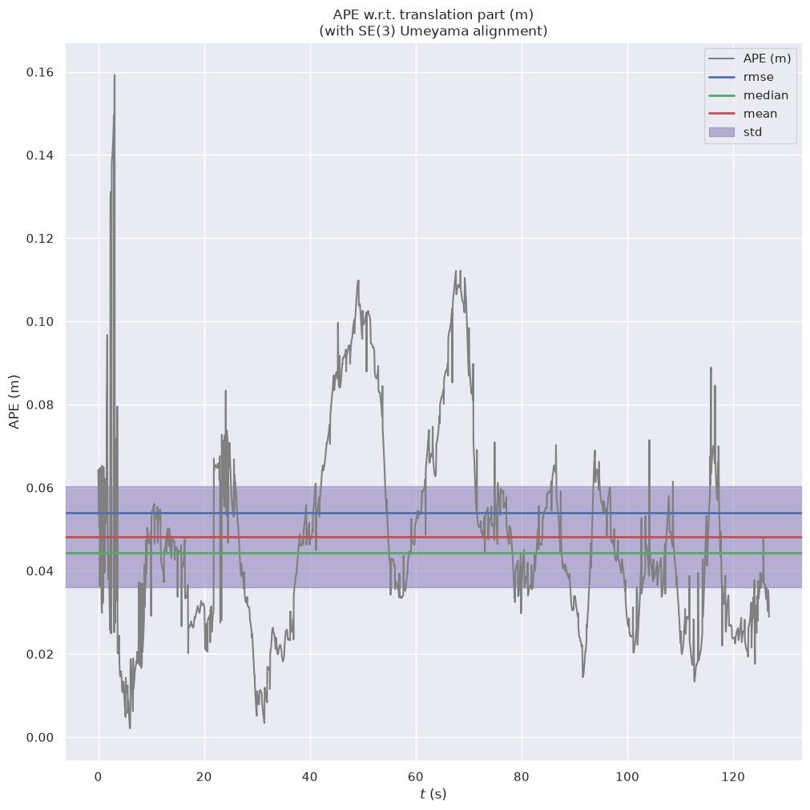

[平移 RPE 图](images/ch20_ch21/slam-rpe.png)与[对齐后的轨迹图](images/ch20_ch21/slam-trajectory.png)展示相同关联数据。输入来源、版本、二进制哈希和完整数值见[SLAM 结果](images/ch20_ch21/slam-validation.json)；录包检查、轨迹、EVO 结果与退出状态见[SLAM 原始数据](images/ch20_ch21/slam-runtime-data.tar.gz)。

### 手持录包的视觉、激光与 IMU 融合

COM260 原生构建 LVI-SAM，在有线 DDS 域 203 以 0.5 倍速回放 handheld 录包的前 60.078 秒。录包中有 596 帧激光、1,802 帧相机图像和 30,039 条原始 IMU 消息。课程 RViz 在 x86 已登录的 X11 桌面上运行，显示相机图像、配准点云和估计轨迹。

| 观察项 | 本次结果 |
|---|---|
| 配准点云 | `odom` 坐标系，收到 297 帧，末帧 5,411 个点 |
| 轨迹 | 末条路径含 71 个位姿，相对起点的最大位移 64.87 m |
| 视觉与激光融合 | 收到 1,177 条视觉里程计消息，1,162 帧中共 33,464 个视觉特征获得激光深度 |
| 退出 | 录包自然结束，关闭 RViz 并在布局保存提示中选择 Discard，Ctrl+C 后七个融合节点和 robot_state_publisher 全部正常退出 |

[窗口截图](images/ch21/lvi-fusion.png)、[32 秒连续录像](images/ch21/lvi-fusion.mp4)和[8 秒 GIF 节选](images/ch21/lvi-fusion.gif)来自同一次回放。录包消息数、订阅实收数及媒体验证见[结构化结果](images/ch21/lvi-validation.json)。本例使用公开手持录包，未评估定位精度。

### 验证范围

原 RGB 相机示例使用 COM260 有线 `.88`、x86 Wi-Fi `.4` 和 CycloneDDS 域 202。顺序运行通过，多路原始图像并发订阅仍会缺图。RGB-D 仿真使用有线 IPv6、域 203 和图像压缩。

第 21 章第 5 题已完成公开传感器数据的离线录包、COM260 原生 ORB-SLAM3 与 EVO 评估。第 4 题的 Gazebo RGB-D 软件链路通过，RealSense D415 实机未验证；仿真和离线数据均不能替代相机硬件验收。

#### 单目 DSO 与视觉惯性里程计

课程中的直接法和 IMU 小示例分别用于观察光度残差和状态传播。框架验证使用同一段 30 s 的无噪声仿真运动。单目相机以 20 Hz 拍摄不同深度的纹理平面，IMU 以 200 Hz 采样，两个传感器使用同一时钟。生成的世界坐标真值仅用于事后比较。[模拟输入生成程序](../course_support/k3_com260_kit/visual_slam/synthetic_sequence.py)

在 COM260 上运行原生 C++ DSO，输入 601 张图像，保存 64 个关键帧，首末时间相差 28.15 s。用相同时间的仿真真值做 Sim(3) 对齐后，位置均方根误差为 0.00018 m。该数值对应理想光照和无噪声仿真。两次原生运行输出的关键帧时间与位姿完全相同。[DSO 源码版本](https://github.com/JakobEngel/dso/tree/7b0c99f01d238f801c625beaff90240bcb007198) · [RISC-V 构建补丁](../course_support/k3_com260_kit/visual_slam/dso-riscv.patch) · [实际轨迹回放](images/ch21/dso-trajectory.mp4)

独立 VINS-Mono 在 COM260 的同一隔离环境原生运行特征跟踪、滑动窗口估计和位姿图三个 C++ 节点。输入全部 601 张图像及 6001 条 IMU，记录到 299 条特征消息、287 个优化位姿和 107 条位姿图路径消息，最后一条路径含 90 个位姿。估计轨迹覆盖 28.60 s，按 SE(3) 对齐、尺度固定为 1 后，位置均方根误差为 0.01855 m。三个节点退出码均为 0。[VINS-Mono 移植源码版本](https://github.com/dongbo19/VINS-MONO-ROS2/tree/4c3cf08fa5d9b57f3be9bd49241915e968ee2e1e) · [Humble 构建补丁](../course_support/k3_com260_kit/visual_slam/vins-humble.patch) · [特征与轨迹回放](images/ch21/vins-trajectory.mp4)

公开入口 `--build-ch21-frameworks` 在新的隔离工作区完成源码构建；随后按教案执行 DSO 和 VINS-Mono 的回放、轨迹导出及电脑端取回命令。DSO 导出 64 个关键帧，覆盖 28.15 s，Sim(3) 对齐 RMSE 为 0.00018 m；VINS-Mono 导出 287 个位姿，覆盖 28.60 s，SE(3) 对齐 RMSE 为 0.01845 m，三个节点正常退出。交互终端中按 Ctrl+C 返回 130，三个节点退出码均为 0，无残留节点。第 20、21 章公开构建入口也在新工作区通过，板端和 x86 各 5 项注册测试通过。具体数值与源码哈希见 [公开命令验收记录](images/ch21/synthetic-validation.json)中的 `public_workflow`。

[两种框架的测量结果](images/ch21/synthetic-validation.json)及[原始估计轨迹、仿真真值与标定](images/ch21/synthetic-trajectories.zip)可用于复核。两个视频均从本轮输入和板端测量回放生成。

## 第 22 章 多传感器融合 SLAM

教案：[多传感器融合 SLAM](../teaching_docs_k3_com260_kit/ch22_多传感器融合SLAM.md)；实验：[第12章 实验指导书](ch12_lab.md)。验证日期：2026-11-24～25。

COM260 运行 C++17 数据同步、预积分和融合节点，x86 运行 Gazebo RGB-D、Cartographer 与显示工具。相机数据来自仿真；D415/D435 驱动、标定和硬件同步未实测。

| 项目 | 实际结果 |
|---|---|
| RGB-D 与点云 | 640×480 彩色图、32FC1 深度图、相机内参与彩色点云可显示；[截图](images/ch22/ch12-rgbd.png)、[运动 GIF](images/ch22/ch12-rgbd-motion.gif)、[连续 RViz 录像](images/ch22/ch12-rgbd-motion.mp4) |
| RGB-D 数据集录制 | 按实验 12 命令录到 5.635 ROS 秒；彩色、深度和两路内参各 171 条，共 684 条，Ctrl+C 后 recorder 退出 0；原始录包保留在 x86 验证工作区 |
| 高分辨率档位 | 1280×720；图像时间戳约 15.15 Hz，本次墙钟接收频率约 14.64/14.64 Hz；关闭点云后没有点云发布，RViz 中只显示彩色与深度图；[高分辨率截图](images/ch22/ch12-highres.png) |
| 三传感器时间同步 | IMU、激光和 PNG 图像跨机匹配；正式记录中时间差 3–15 ms，低于 50 ms 上限；[终端记录](images/ch22/ch22-sensor-sync.cast)、[GIF](images/ch22/ch22-sensor-sync.gif)，进程正常退出 |
| 数值示例 | 两端构建通过；静止重力抵消、恒加速度、90° 旋转、GPS 更新、协方差、健康超时及恢复、曲率特征分类和空点云处理共 9 项检查通过；[COM260 记录](images/ch22/ch22-fusion-math.cast)、[GIF](images/ch22/ch22-fusion-math.gif) |
| 激光里程计与 IMU EKF | 前进、转弯与停车通过；轮式、激光、融合净位移分别为 1.396、1.398、1.398 m；融合终点相对轮式位置差约 0.010 m、航向差约 0.009 rad。310 条融合消息有限且时间戳递增；[截图](images/ch22/ch22-ekf-motion.png)、[GIF](images/ch22/ch22-ekf-motion.gif)、[连续录像](images/ch22/ch22-ekf-motion.mp4)。该比较不代表真值定位精度 |
| Cartographer 录包回放 | 含前进、转弯和停车的录包共 38.953 ROS 秒、12950 条消息；0.5 倍速回放、融合建图、轨迹结束、状态保存和 PGM/YAML 导出通过；[截图](images/ch22/ch22-fusion-replay.png)、[GIF](images/ch22/ch22-fusion-replay.gif)、[85 秒连续录像](images/ch22/ch22-fusion-replay.mp4)、[终端记录](images/ch22/ch22-replay.cast) |

FAST-LIO2、紧耦合视觉惯性和因子图示意代码用于说明算法结构；完整第三方框架性能不由上述数值示例证明。练习 5 的可执行算法入口为 Cartographer。

`rqt_image_view` 的彩色与深度窗口均显示实际图像，关闭窗口后退出码为 0。两端源码核对与当前结果见[结构化记录](images/ch22/validation.json)，素材信息见[媒体校验](images/ch22/media_validation.json)。

## 第 23 章 SLAM 与导航综合实训

教案：[SLAM 与导航综合实训](../teaching_docs_k3_com260_kit/ch23_SLAM与导航综合实训.md)；实验依次为[第13章 实验指导书](ch13_lab.md)、[第14章 实验指导书](ch14_lab.md)。验证日期：2026-11-24～25。

| 项目 | 实际结果 |
|---|---|
| 双端构建 | COM260 与 x86 的六个 C++ 功能包构建通过，目标区域占用与释放检查通过 |
| 建图实验 | 正式录像对应 4 次地图更新、已知栅格增加 2536、位移 0.205 m；达到原验收条件并停车；[截图](images/ch23/ch13-slam-motion.png)、[GIF](images/ch23/ch13-slam-motion.gif)、[连续录像](images/ch23/ch13-slam-motion.mp4) |
| Cartographer 实时建图 | 激光、IMU、轮式里程计融合，前进、转弯与停车期间收到 39 次地图更新，已知栅格从 10381 增至 15184；轨迹结束、状态保存及 PGM/YAML 导出成功；[截图](images/ch23/ch23-cartographer.png)、[GIF](images/ch23/ch23-cartographer.gif)、[30 秒连续录像](images/ch23/ch23-cartographer.mp4) |
| 四目标导航实验 | 起点 `(5,0,-2)`，原四目标全部返回 SUCCEEDED；耗时分别为 11.5、37.5、32.9、23.8 s；独立里程计末值为零；[截图](images/ch23/ch14-nav-rviz.png)、[GIF](images/ch23/ch14-nav-rviz.gif)、[连续录像](images/ch23/ch14-nav-rviz.mp4) |
| 导航取消与停车 | 第一目标完成后取消第二目标，返回 CANCELED，节点按用户中断退出 130；独立里程计最后 100 个样本线速度、角速度均为 0；[截图](images/ch23/ch14-cancel.png)、[GIF](images/ch23/ch14-cancel.gif)、[35 秒连续录像](images/ch23/ch14-cancel.mp4) |
| 地图处理与评估 | 关闭建图容器后通过 `offline` 处理本次实际地图；两端通过像素、原点、单栅格墙线保留、未知栅格阈值和自比较检查。扩大场景的处理图为 561×652、0.05 m/格，图像矩形内已知栅格比例 85.5339%；后处理前场内覆盖率 95.132%；无同坐标系真值图，accuracy 为 unmeasured。[处理前](images/ch23/ch23-map-before.png)、[处理后](images/ch23/ch23-map-after.png)、[终端记录](images/ch23/ch23-map-tools.cast)、[GIF](images/ch23/ch23-map-tools.gif)、[PGM/YAML](images/ch23/ch23-saved-map.zip) |
| 三车调度 | 三个任务均返回 SUCCEEDED；独立里程计路径长为 2.112、2.108、2.098 m，末值线速度与角速度均为 0；[截图](images/ch23/ch23-fleet.png)、[GIF](images/ch23/ch23-fleet.gif)、[连续录像](images/ch23/ch23-fleet.mp4)、[COM260 终端](images/ch23/ch23-fleet.cast) |
| 教案四航点两轮巡逻 | 使用本次保存并后处理的地图，`BaseObstacle.scale=0.02`，8 次目标均返回 SUCCEEDED；[结束截图](images/ch23/ch23-project-navigation.png)、[运动 GIF](images/ch23/ch23-project-navigation.gif)、[完整连续 RViz 录像](images/ch23/ch23-project-navigation.mp4)、[COM260 终端](images/ch23/ch23-project-navigation.cast) |
| 航点、任务文件与测试 | 同一地图上，FollowWaypoints 完成 4 点且无 missed_waypoints；YAML 任务完成 9 次导航；测试模式 4/4 成功、平均耗时 7.82 s。四条公开命令顺序运行并正常退出，合计轮式里程 30.272 m，最后 100 个里程计样本速度为零 |
| 自动探索 | 场地水平放大 1.5 倍，固定可探索面积 691.7325 m²；COM260 根据实时地图选择边界，114 个导航目标完成，达到 95.101% 后取消当前目标、停车并自动保存，节点退出 0。55,047 个里程计样本，累计轮式路径 125.711 m，最后 100 个样本速度为零。[全场截图](images/ch23/ch23-explorer.png)、[Gazebo 场景](images/ch23/ch23-project-scene.png)、[30 秒 GIF](images/ch23/ch23-explorer.gif)、[后半段连续 RViz 录像，494.67 秒](images/ch23/ch23-explorer.mp4)、[完整 COM260 终端记录](images/ch23/ch23-explorer.cast) |

无桌面检查在移除 `DISPLAY`、`XAUTHORITY` 后启动原尺寸建图入口；收到 4 次地图更新，已知栅格增加 1867，位移 0.202 m，节点退出 0。扩大场景探索末段另采集 1744 个 Gazebo 世界位姿，最后 20 个样本位置不变。导航成功率按 Nav2 Action 结果统计，不代表厘米级定位精度。

固定区域由场景碰撞几何、机器人安全边界和出生点连通性确定，不提供给边界选点或 Nav2。COM260 自动保存图独立核算为 263138/276693＝95.101%；停车后 x86 保存的最新图为 263223/276693＝95.132%，两者均通过至少 500 m²、覆盖率超过 95% 的检查。地图后处理、重新加载、定位和四种导航入口均通过；不将后处理填出的像素计入观测覆盖率。两端的六项边界选点检查、五项覆盖率边界检查通过，包括“恰好 95%”及“面积不足 500 m²”必须失败。 无桌面的扩大场景中，Ctrl+C 取消后节点退出 130，独立采样 1024 条里程计，最后 100 条速度为零；隔离的激光断流检查也确认取消 Action 并发送零速度。

按先结束建图 Launch、再停止仿真容器的顺序，Cartographer、RViz 和 Launch 均正常退出，退出码为 0；该退出检查为独立批次 `20261124-ch22-close-check`。

第 23 章各次运行与源码核对见[结构化记录](images/ch23/validation.json)，素材信息见[媒体校验](images/ch23/media_validation.json)。
