# 第2章 实验指导书：C++17 节点编程与工具链

连接、环境和 GUI 启动见[公共双端环境](ch00_common_setup.md)。以下 C++ 节点在 K3 运行，Gazebo、rqt 和 RViz 在 x86 课程容器运行。

## 当前仓库仿真验证：节点命名空间与工具链检查

### 实验目标

在移动机器人仿真运行时创建/检查 ROS 2 节点，练习 `ros2 node` 命令、节点重命名和 RViz 观察，验证 C++17 节点与仿真节点处于同一 DDS 域。

### 运行步骤

【x86 课程容器】

```bash
source /opt/ros/humble/setup.bash
source /workspace/install/setup.bash
ros2 launch robot_sim_demo gazebo2.launch.py \
  gui:=true rviz:=true drive:=false
```

【K3 板端，终端 1】加载课程环境，运行命名空间节点；节点保持运行，在另一 K3 终端执行查询：

```bash
source ~/.config/ros2-course-k3/env.bash
source ~/ros2_course_k3_ws/install/setup.bash
ros2 run name_demo_cpp name_demo_node \
  --ros-args -r __ns:=/student -p serial:=7
ros2 node list
ros2 node info /student/name_demo
```

### 观察与验收

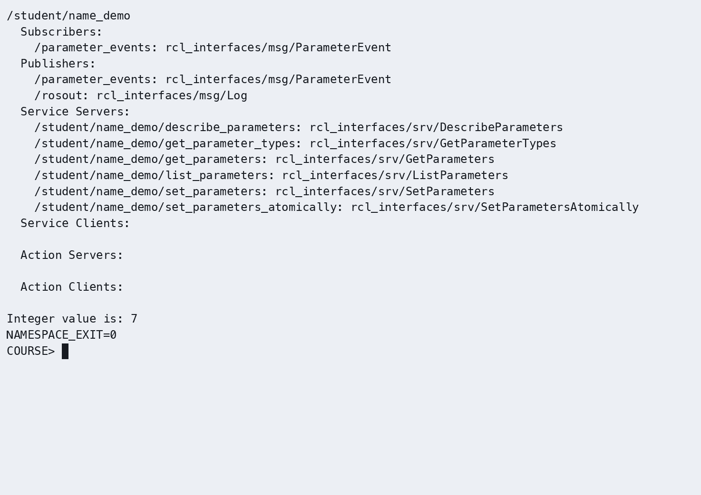

终端应显示 `/student/name_demo` 的完整名称；RViz 可显示仿真机器人和 TF。源码：`src_k3_pico_itx/name_demo_cpp/src/name_demo.cpp`，仿真入口：`src_k3_pico_itx/robot_sim_demo/launch/gazebo2.launch.py`。

> **实验课时**：2 课时（90 分钟）
> **实验平台**：K3 Pico-ITX / Bianbu >= 4.0.1 / ROS 2 Humble；x86 Humble/Harmonic 课程容器

---

## 实验目标

完成本实验后，学员应能够：
1. 独立创建 ROS 2 C++17 包和节点
2. 配置 CMakeLists.txt 中的构建与安装目标
3. 使用日志系统进行程序调试
4. 使用 ros2 命令行工具查看系统状态
5. 使用 rqt_graph 和 RViz2 可视化工具

---

## 练习 3.1：创建并运行 C++17 节点（约 30 分钟）

### 目标
创建一个完整的 C++17 节点，通过定时器周期输出日志。

### 步骤

**步骤1：创建 C++17 包**

【K3 板端】已有同名包时先核对并保留，首次创建演示使用独立空工作空间，不覆盖已有练习。
```bash
source ~/.config/ros2-course-k3/env.bash
mkdir -p ~/my_ros2_ws/src
cd ~/my_ros2_ws/src
ros2 pkg create hello_pkg_cpp --build-type ament_cmake \
  --dependencies rclcpp nav_msgs
```

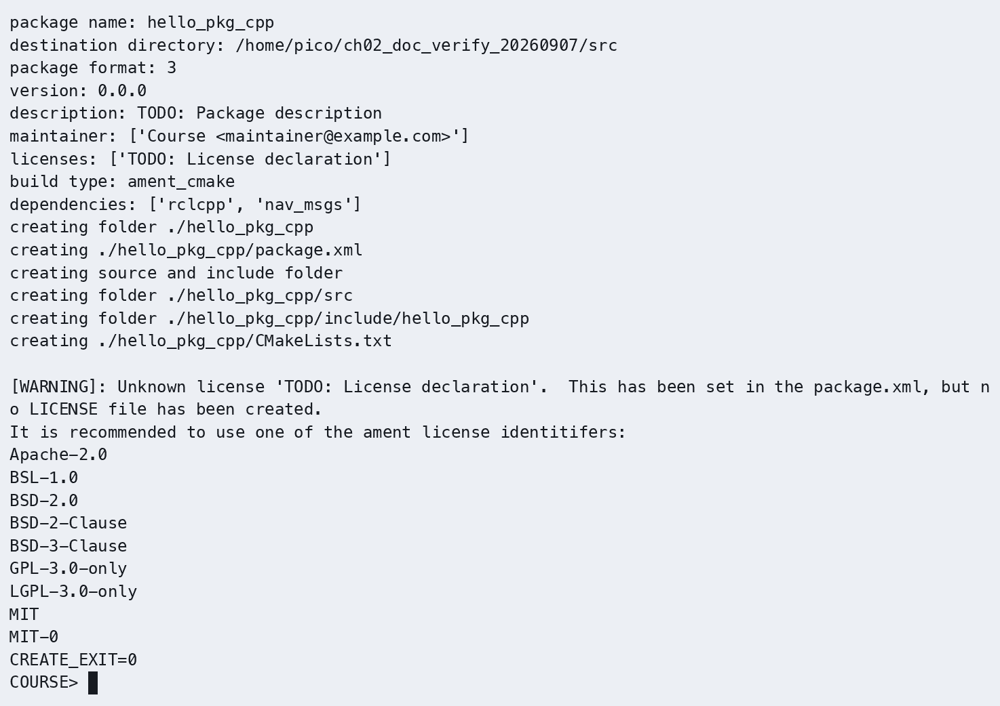

**步骤2：编写节点代码**

在 `~/my_ros2_ws/src/hello_pkg_cpp/src/` 目录下创建 `hello_node.cpp`：

```cpp
#include <chrono>
#include <functional>
#include <memory>

#include "rclcpp/rclcpp.hpp"

using namespace std::chrono_literals;

class HelloNode : public rclcpp::Node
{
public:
  HelloNode()
  : Node("hello_node"), count_(0)
  {
    timer_ = create_wall_timer(1s, std::bind(&HelloNode::tick, this));
    RCLCPP_INFO(get_logger(), "HELLO_CPP_OK HelloNode started");
  }

private:
  void tick()
  {
    ++count_;
    RCLCPP_INFO(get_logger(), "Hello ROS 2! count=%zu", count_);
  }

  rclcpp::TimerBase::SharedPtr timer_;
  std::size_t count_;
};

int main(int argc, char ** argv)
{
  rclcpp::init(argc, argv);
  rclcpp::spin(std::make_shared<HelloNode>());
  rclcpp::shutdown();
  return 0;
}
```

**步骤3：配置 CMakeLists.txt**

编辑 `~/my_ros2_ws/src/hello_pkg_cpp/CMakeLists.txt`，写入以下内容：

```cmake
cmake_minimum_required(VERSION 3.10)
project(hello_pkg_cpp)
find_package(ament_cmake REQUIRED)
find_package(rclcpp REQUIRED)
add_executable(hello_node src/hello_node.cpp)
target_compile_features(hello_node PUBLIC cxx_std_17)
ament_target_dependencies(hello_node rclcpp)
install(TARGETS hello_node DESTINATION lib/${PROJECT_NAME})
ament_package()
```

**步骤4：编译并运行**
```bash
cd ~/my_ros2_ws
colcon build --packages-select hello_pkg_cpp --symlink-install
source install/setup.bash
ros2 run hello_pkg_cpp hello_node
# 期望输出：[INFO] HELLO_CPP_OK HelloNode started
#          [INFO] Hello ROS 2! count= 1
#          [INFO] Hello ROS 2! count= 2
```

**步骤4：检查运行结果与图示一致**

- 截图1：colcon build 输出显示编译成功

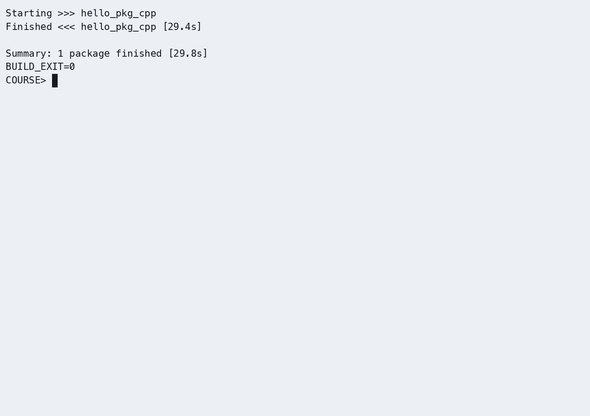

- 截图2：ros2 run 输出显示周期日志

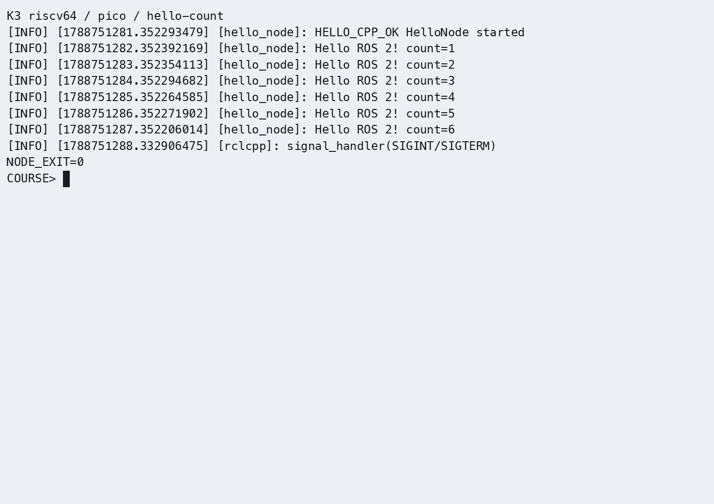

- 截图3：`ros2 node list` 显示 /hello_node

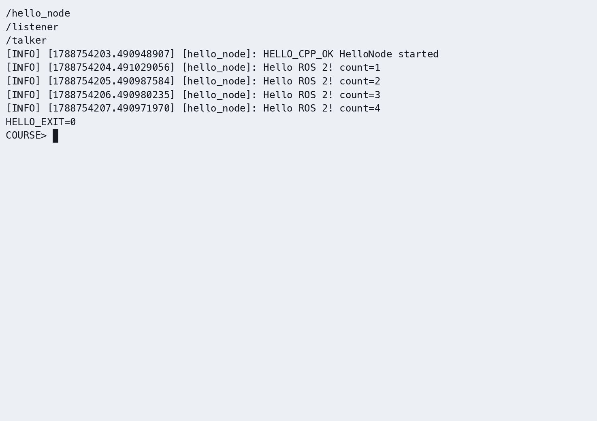

### 参考代码
> 完整参考代码位于 `src_k3_pico_itx/hello_pkg_cpp/`

---

## 练习 3.2：日志系统实验（约 30 分钟）

### 目标
掌握 ROS 2 日志系统，测试不同日志级别和节流功能。

### 步骤

**步骤1：创建带日志功能的节点**

在 `hello_pkg_cpp/src/` 下创建 `logger_demo.cpp`：

```cpp
#include <chrono>
#include <functional>
#include <memory>

#include "rclcpp/rclcpp.hpp"

using namespace std::chrono_literals;

class LoggerDemo : public rclcpp::Node
{
public:
  LoggerDemo()
  : Node("logger_demo"), count_(0)
  {
    timer_ = create_wall_timer(1s, std::bind(&LoggerDemo::tick, this));
    RCLCPP_INFO(get_logger(), "LOGGER_CPP_OK logger demo started");
  }

private:
  void tick()
  {
    ++count_;
    RCLCPP_DEBUG(get_logger(), "DEBUG message #%zu", count_);
    RCLCPP_INFO(get_logger(), "INFO message #%zu", count_);
    RCLCPP_WARN(get_logger(), "WARN message #%zu", count_);
    if (count_ == 3) {
      RCLCPP_ERROR(get_logger(), "ERROR: exception on message 3");
    }
    if (count_ >= 5) {
      RCLCPP_WARN_THROTTLE(get_logger(), *get_clock(), 2000, "high-frequency warning (throttled)");
    }
  }

  rclcpp::TimerBase::SharedPtr timer_;
  std::size_t count_;
};

int main(int argc, char ** argv)
{
  rclcpp::init(argc, argv);
  rclcpp::spin(std::make_shared<LoggerDemo>());
  rclcpp::shutdown();
  return 0;
}
```

**步骤2：配置构建目标并编译**

在 CMakeLists.txt 的 `ament_package()` 前添加：
```cmake
add_executable(logger_demo src/logger_demo.cpp)
target_compile_features(logger_demo PUBLIC cxx_std_17)
ament_target_dependencies(logger_demo rclcpp)
install(TARGETS logger_demo DESTINATION lib/${PROJECT_NAME})
```

**步骤3：运行并观察日志**
```bash
cd ~/my_ros2_ws
colcon build --packages-select hello_pkg_cpp --symlink-install
source install/setup.bash
ros2 run hello_pkg_cpp logger_demo --ros-args --log-level logger_demo:=DEBUG
# 观察各级别日志输出
# Ctrl+C 停止
```

**步骤4：使用命令行参数修改日志级别**（C++ 节点由 CLI 指定日志等级，不在源码中覆盖）
```bash
# 仅输出 ERROR 级日志
ros2 run hello_pkg_cpp logger_demo --ros-args --log-level ERROR
# 期望：仅看到 ERROR 输出

# 指定节点日志级别
ros2 run hello_pkg_cpp logger_demo --ros-args \
  --log-level logger_demo:=WARN
# 期望：仅看到 WARN 及以上输出
```

**步骤4：检查运行结果与图示一致**

- 截图1：默认日志输出（DEBUG ~ ERROR）

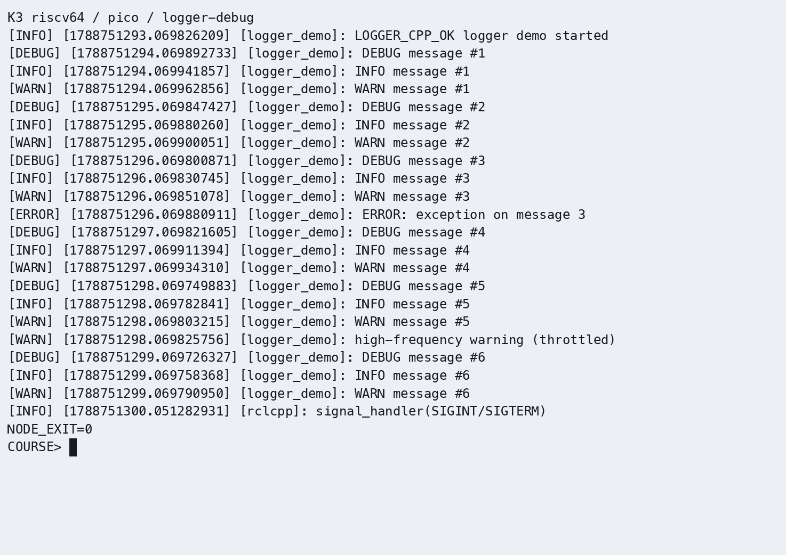

- 截图2：`--log-level ERROR` 仅显示错误日志

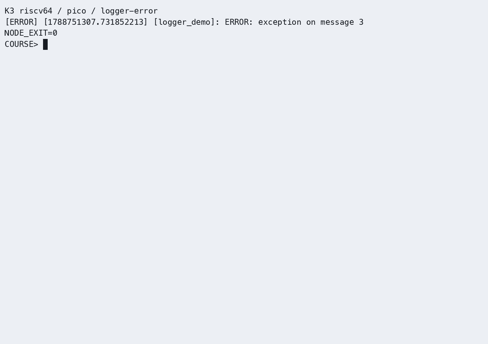

- 截图3：`rqt_console` 输出（`ros2 run rqt_console rqt_console`）

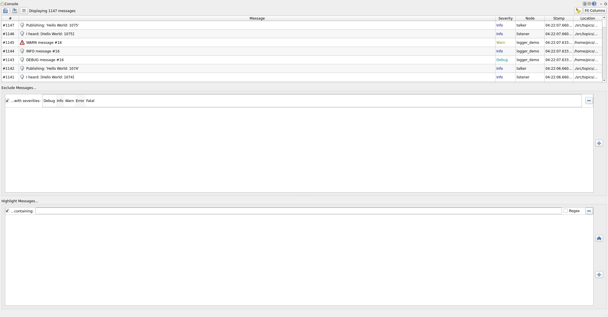

### 参考代码
> 完整参考代码位于 `src_k3_pico_itx/hello_pkg_cpp/src/logger_demo.cpp`

---

## 练习 3.3：可视化工具使用（约 30 分钟）

### 目标
使用 rqt_graph 和 RViz2 查看 ROS 2 系统状态。

### 步骤

**步骤1：启动 talker 和 listener 两个节点**
```bash
# 终端1
ros2 run demo_nodes_cpp talker

# 终端2
ros2 run demo_nodes_cpp listener
```

**步骤2：启动 rqt_graph**

【x86 课程容器终端】
```bash
# 终端3
rqt_graph
```
- 在 rqt_graph 界面中，观察节点（椭圆）与话题（矩形）的拓扑关系
- 勾选 "Nodes/Topics (all)" 查看完整图
- 截图保存拓扑图

**步骤3：查看节点信息**
```bash
# 终端3
ros2 node info /talker
# 期望输出：
# Subscribers: /parameter_events
# Publishers: /chatter: std_msgs/msg/String

ros2 node info /listener
# 期望输出：
# Subscribers: /chatter: std_msgs/msg/String
# Publishers: /parameter_events
```

**步骤4：启动 RViz2**

【x86 课程容器终端】查看已启动的课程 RViz 窗口；仅在没有 RViz 窗口时执行：
```bash
rviz2
```
- 左侧 "Displays" → Add → "By topic"，选择话题添加显示
- 理解 RViz2 的 Displays 面板和 Views 面板

**步骤4：检查运行结果与图示一致**

- 截图1：rqt_graph 中的节点-话题拓扑图

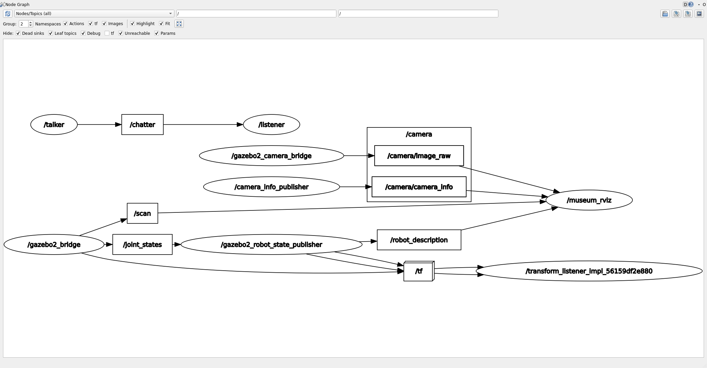

- 截图2：ros2 node info /talker 输出

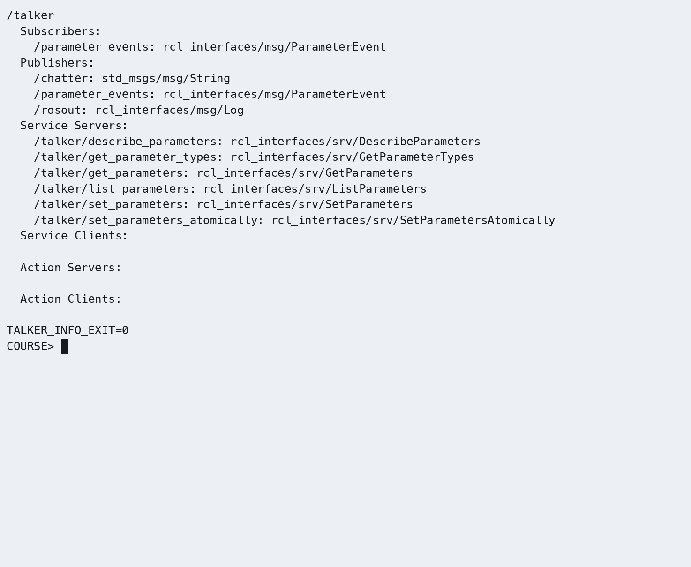

- 截图3：RViz2 启动界面

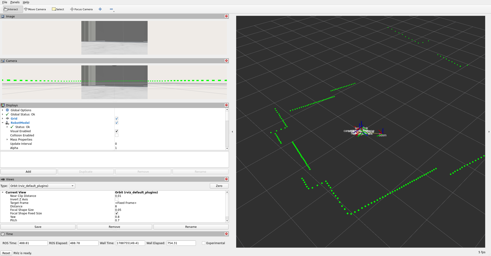

### 思考题

1. `rqt_graph` 中哪些是节点？哪些是话题？如何区分？椭圆表述节点，矩形表示话题，用箭头链接，	节点 → 话题表示发布，话题 → 节点表示订阅
2. `--log-level` 参数的默认值是多少？（练习3.1步骤1）默认参数是info，ROS2默认会输出 INFO、WARN、ERROR 和 FATAL 级别的日志，不会输出 DEBUG 日志
3. 如果 CMake 构建或安装目标未正确配置，运行时会出现什么错误？未构建或未安装可执行文件时，`ros2 run` 通常提示 `No executable found`；应检查目标、安装目录及工作空间环境。

---

## 练习 4：节点与仿真交互 — 订阅 /odom 查看机器人位置（约 15 分钟）

### 目标
编写一个订阅者节点，订阅 TurtleBot3 Burger 仿真的 `/odom` 话题，实时输出机器人位置和速度。

### 步骤

**步骤1：启动课程仿真**
```bash
source /opt/ros/humble/setup.bash
source /workspace/install/setup.bash
ros2 launch robot_sim_demo gazebo2.launch.py gui:=true rviz:=true drive:=false
```

**步骤2：创建 odom_monitor.cpp**
```cpp
#include <cmath>
#include <functional>
#include <memory>

#include "nav_msgs/msg/odometry.hpp"
#include "rclcpp/rclcpp.hpp"

class OdomMonitor : public rclcpp::Node
{
public:
  OdomMonitor()
  : Node("odom_monitor")
  {
    subscription_ = create_subscription<nav_msgs::msg::Odometry>(
      "/odom", 10, std::bind(&OdomMonitor::handle, this, std::placeholders::_1));
  }

private:
  void handle(const nav_msgs::msg::Odometry::SharedPtr message)
  {
    const auto & position = message->pose.pose.position;
    const auto & orientation = message->pose.pose.orientation;
    const double yaw = std::atan2(
      2.0 * (orientation.w * orientation.z + orientation.x * orientation.y),
      1.0 - 2.0 * (orientation.y * orientation.y + orientation.z * orientation.z));
    RCLCPP_INFO(
      get_logger(), "ODOM_RECEIVED x=%.2f y=%.2f yaw=%.2f", position.x, position.y, yaw);
  }

  rclcpp::Subscription<nav_msgs::msg::Odometry>::SharedPtr subscription_;
};

int main(int argc, char ** argv)
{
  rclcpp::init(argc, argv);
  rclcpp::spin(std::make_shared<OdomMonitor>());
  rclcpp::shutdown();
  return 0;
}
```

先在 `CMakeLists.txt` 的 `ament_package()` 前注册里程计节点（`package.xml` 已由建包命令声明 `nav_msgs`）：

```cmake
find_package(nav_msgs REQUIRED)
add_executable(odom_monitor src/odom_monitor.cpp)
target_compile_features(odom_monitor PUBLIC cxx_std_17)
ament_target_dependencies(odom_monitor rclcpp nav_msgs)
install(TARGETS odom_monitor DESTINATION lib/${PROJECT_NAME})
```

本实现按已确认的修正使用完整四元数公式 `atan2(2*(w*z+x*y), 1-2*(y*y+z*z))` 计算 yaw，替换原章 `2*z` 的简化近似，避免转角较大时产生明显误差。

**步骤3：运行测试**
```bash
# 终端1：仿真已启动
# 终端2：启动 odom_monitor
cd ~/my_ros2_ws
source /opt/ros/humble/setup.bash
colcon build --packages-select hello_pkg_cpp --symlink-install
source install/setup.bash
ros2 run hello_pkg_cpp odom_monitor

# 终端3：发送控制指令改变机器人位置
ros2 topic pub /cmd_vel geometry_msgs/msg/Twist \
  "{linear: {x: 0.2}, angular: {z: 0.5}}" -r 10
```

在速度发布终端按 Ctrl+C 后发送停止指令：

```bash
ros2 topic pub --once /cmd_vel geometry_msgs/msg/Twist "{linear: {x: 0.0}, angular: {z: 0.0}}"
```

**✓ 验证**：odom_monitor 终端实时输出机器人位置和航向变化。

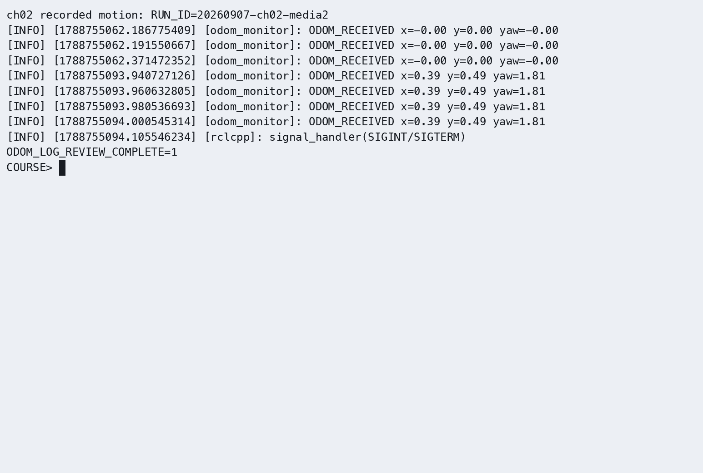

### 思考题
1. `/odom` 中的 `pose.pose.orientation` 使用四元数表示姿态，如何转换为欧拉角？使用 TF2转换为欧拉角 (Roll、Pitch、Yaw)，其中Yaw是航向角
2. 如何利用 `/odom` 数据计算机器人的行驶总距离？每次接收 /odom 消息时，读取当前位置 (x, y)，与上一时刻的位置计算两点间距离 并将每次位移累加，得到机器人的总行驶距离。

## 实际运行证据

**本章演示：运动与里程计反馈。** 左侧显示运动，右侧从同轮 odom_monitor 日志按时间回放 x、y、yaw，保留停止后数值稳定的画面。输入为 0.2 m/s 与 0.5 rad/s。

[播放演示（30 秒）](https://gitee.com/chuachuaa/ROS2_RISCV/releases/download/k3-ch01-04-media-20260908/ch02--chapter-demo.mp4)。左侧为同轮连续 Gazebo 原片的固定区域放大；右侧为实际按键/日志按 UTC 近似对齐的后期回放，不是原生终端画面。原始记录见统一证据页。


[K3 实际运行证据](runtime_evidence.md#ch02)登记本章运行结果和媒介交付状态。


原始录制：[ch02_nodes.cast](https://gitee.com/chuachuaa/ROS2_RISCV/releases/download/k3-ch01-04-media-20260908/ch02--delivery-logger.cast)。完整证据索引见[实际运行证据](runtime_evidence.md)。
