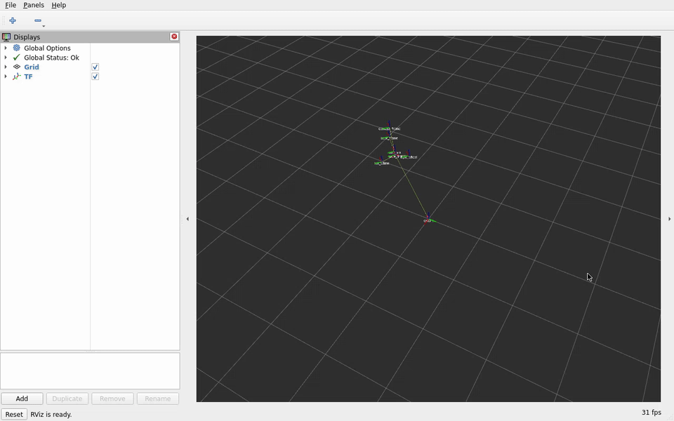

# 第7章：TF2 坐标变换系统

> **课程**：ROS2 C++17 编程（COM260）
> **章节**：第7章
> **课时**：2 课时（90 分钟）
> **教学方式**：讲授 + 演示

---

## 7.1 坐标系树 (Frame Tree) 设计原理

### 知识点 7.1.1：TF 坐标系树

```text
# TF2 将坐标系组织为树状结构，确保无环单向依赖
# 教学传感器坐标系树：
#   map → odom → base_footprint → base_link
#                                     ├── laser_frame
#                                     ├── camera_frame
#                                     └── imu_link
```

TF2 要求坐标系之间形成有向无环图（DAG），各坐标系只能有一个父系，保证变换查找唯一路径。

### 知识点 7.1.2：TF2 核心 API 模块

```cpp
#include "tf2_ros/buffer.h"
#include "tf2_ros/transform_listener.h"
#include "tf2_ros/transform_broadcaster.h"
#include "tf2_ros/static_transform_broadcaster.h"
```

### 知识点 7.1.3：官方要点——TF 树概念与坐标变换直觉

官方 Introduction to tf2 教程以小乌龟双机追踪为例，解释了 TF2 的两条核心思想：第一，每个链接（link）都拥有自己的坐标系，任意两个坐标系之间的变换（平移 + 四元数旋转）可随时查询；第二，帧与帧之间存在父子依附关系，整体构成一棵树（TF Tree），保证任意两帧间路径唯一、不会出现死锁。教程通过 `ros2 run tf2_ros tf2_echo world turtle2` 演示了查询命令，还给出了 `tf2_monitor` 查看频率的类型图。

Articulated Robotics 用「地图上的寻人」类比：每个坐标系是一张以自己为中心的地图，知道「世界→机器人」「机器人→机械臂」两张图的相对关系，就能推得世界下机械臂的位姿——这正是变换叠加的直觉。本节开头的 TF 树图示与此完全对应。

---

## 7.2 静态变换与动态变换

### 知识点 7.2.1：静态变换广播器

```cpp
#include <memory>
#include "rclcpp/rclcpp.hpp"
#include "geometry_msgs/msg/transform_stamped.hpp"
#include "tf2_ros/static_transform_broadcaster.h"
class StaticTFPublisher : public rclcpp::Node
{
public:
  StaticTFPublisher() : Node("static_tf_pub")
  {
    broadcaster_ = std::make_unique<tf2_ros::StaticTransformBroadcaster>(*this);
    geometry_msgs::msg::TransformStamped t;
    t.header.stamp = now(); t.header.frame_id = "base_link"; t.child_frame_id = "laser_frame";
    t.transform.translation.x = declare_parameter("x", 0.2);
    t.transform.translation.z = declare_parameter("z", 0.1);
    t.transform.rotation.w = 1.0;
    broadcaster_->sendTransform(t);
  }
private:
  std::unique_ptr<tf2_ros::StaticTransformBroadcaster> broadcaster_;
};
int main(int argc, char ** argv)
{
  rclcpp::init(argc, argv); rclcpp::spin(std::make_shared<StaticTFPublisher>());
  rclcpp::shutdown(); return 0;
}
```

程序 7-1：静态变换只发送一次，适用于固定不变的传感器安装位置。

### 知识点 7.2.2：动态变换广播器

```cpp
#include <chrono>
#include <cmath>
#include <memory>
#include "rclcpp/rclcpp.hpp"
#include "geometry_msgs/msg/transform_stamped.hpp"
#include "tf2_ros/transform_broadcaster.h"
using namespace std::chrono_literals;
class DynamicTFPublisher : public rclcpp::Node
{
public:
  DynamicTFPublisher() : Node("dynamic_tf_pub")
  {
    broadcaster_ = std::make_unique<tf2_ros::TransformBroadcaster>(*this);
    timer_ = create_wall_timer(100ms, [this]() {
      geometry_msgs::msg::TransformStamped t;
      t.header.stamp = now(); t.header.frame_id = "odom"; t.child_frame_id = "base_link";
      t.transform.translation.x = std::sin(count_ * 0.1);
      t.transform.translation.y = std::cos(count_ * 0.1);
      t.transform.rotation.w = 1.0;
      broadcaster_->sendTransform(t); ++count_;
    });
  }
private:
  int count_{0};
  std::unique_ptr<tf2_ros::TransformBroadcaster> broadcaster_;
  rclcpp::TimerBase::SharedPtr timer_;
};
int main(int argc, char ** argv)
{
  rclcpp::init(argc, argv); rclcpp::spin(std::make_shared<DynamicTFPublisher>());
  rclcpp::shutdown(); return 0;
}
```

程序 7-2：动态变换持续广播（如 odom→base_link）。主示例周期为 100 ms，即 10 Hz；扩展到 100 Hz 时将周期改为 10 ms。练习 7.2 使用 10 Hz，实验指导书练习 7.1 使用 20 Hz，分别观察其更新频率。计数器从 0 开始，每次广播后递增。

---

## 7.3 tf2_ros::Buffer 与 lookupTransform()

### 知识点 7.3.1：监听 TF 变换

```cpp
#include <chrono>
#include <memory>
#include "rclcpp/rclcpp.hpp"
#include "tf2_ros/buffer.h"
#include "tf2_ros/transform_listener.h"
using namespace std::chrono_literals;
class TFListener : public rclcpp::Node
{
public:
  TFListener() : Node("tf_listener"), buffer_(get_clock()), listener_(buffer_)
  {
    timer_ = create_wall_timer(1s, [this]() {
      try {
        const auto transform = buffer_.lookupTransform(
          "base_link", "laser_frame", tf2::TimePointZero, tf2::durationFromSec(1.0));
        const auto & t = transform.transform.translation;
        RCLCPP_INFO(get_logger(), "Laser→Base: x=%.3f, y=%.3f, z=%.3f", t.x, t.y, t.z);
      } catch (const tf2::TransformException & e) {
        RCLCPP_WARN(get_logger(), "TF 查询失败: %s", e.what());
      }
    });
  }
private:
  tf2_ros::Buffer buffer_;
  tf2_ros::TransformListener listener_;
  rclcpp::TimerBase::SharedPtr timer_;
};
int main(int argc, char ** argv)
{
  rclcpp::init(argc, argv); rclcpp::spin(std::make_shared<TFListener>());
  rclcpp::shutdown(); return 0;
}
```

程序 7-3：`lookupTransform(target, source, time)` 查询两个坐标系之间的变换关系。

### 知识点 7.3.2：TF 坐标点变换

```cpp
#include "tf2_geometry_msgs/tf2_geometry_msgs.hpp"
geometry_msgs::msg::PointStamped point_in_laser, point_in_base;
point_in_laser.header.frame_id = "laser_frame";
point_in_laser.point.x = 1.0;
const auto transform = buffer_.lookupTransform(
  "base_link", "laser_frame", tf2::TimePointZero);
tf2::doTransform(point_in_laser, point_in_base, transform);
```

### 知识点 7.3.3：官方要点——广播器与监听器的编写要点

官方 C++ 广播器教程（Writing a tf2 broadcaster）实现对乌龟位姿的发布：先订阅位姿话题，在回调中构造 `TransformStamped`（frame_id 为父帧 `world`，child_frame_id 为 `turtle1`），填入平移与四元数 `tf2::Quaternion::setRPY`，再用 `TransformBroadcaster::sendTransform()` 持续广播。监听器端则用 `Buffer::lookupTransform(target, source, time)` 一次性查询，常用 `TransformListener(buffer)` 使 Buffer 与 TF 话题同步。

一个关键设计：广播端发布直接父子帧间的相对变换，查询端可沿 TF 树组合出任意相连两帧间的相对变换——二者不可混用。官方教程还演示了在同一个节点里同时注册订阅与监听器，提醒读者 Buffer 的延迟约等于话题频率的倒数，查询最新时刻附近的数据容易报「Data not available」，工程上常查询过去 50–100 ms 的数据。

---

## 7.4 时间同步与插值

### 知识点 7.4.1：waitForTransform 与时间同步

```cpp
if (buffer_.canTransform("base_link", "laser_frame", tf2::TimePointZero,
    tf2::durationFromSec(2.0))) {
  const auto transform = buffer_.lookupTransform(
    "base_link", "laser_frame", tf2::TimePointZero);
  // 使用 transform 完成后续计算。
}
```

带超时查询需要 TF 订阅持续处理消息。本章 `TransformListener(buffer_)` 使用其独立线程，避免在同一单线程回调中等待尚未执行的订阅。

程序 7-4：`canTransform` 等待变换就绪，避免因时序问题导致查询失败。

### 知识点 7.4.2：TF 插值机制

TF2 自动在两帧变换之间线性插值。调用 `lookupTransform` 时指定 time=tf2::TimePointZero（最新）或指定历史时间戳获取该时刻的变换（需有足够缓存数据）。

```cpp
// 获取最新动态变换。
auto t = buffer_.lookupTransform("odom", "base_link", tf2::TimePointZero);
// 获取当前 ROS 时钟两秒前的动态变换，先等待缓存覆盖这一时刻。
const auto past = now() - rclcpp::Duration::from_seconds(2.0);
t = buffer_.lookupTransform("odom", "base_link", past);
```

构造绝对时间 2.0 s 不等于“两秒前”。历史示例使用动态 `odom→base_link`，静态传感器安装变换不会展示运动插值。

### 知识点 7.4.3：官方要点——时间、缓存与插值机制

Using time in tf2 教程揭示了 TF2 与硬件时钟协作的机制：变换带时间戳，Buffer 保存一段时间（默认为 10 秒）的变换历史；查询时若目标时刻没有精确命中，TF 会基于最近的两个变换做线性插值（绕旋转轴插值）。教程中的例子正是本章 7.2.2 节动态坐标变换的场景：随着乌龟游走，`lookupTransform` 的 `time` 参数传 `frame_stamped.header.stamp`，即传感器数据自身的时刻，确保「传感器数据到达时对应的机器人位姿」被查询。

插值的正确性依赖时间连续：若各帧时间戳大幅跳变（如 `use_sim_time` 未与仿真时间对齐，见第 9 章），TF 会退化为报错——帧名、时间戳是 TF2 排障的两大高频原因。

---

## 7.5 TF2 调试工具

### 知识点 7.5.1：命令行工具

```bash
# 实时查看两坐标系变换
ros2 run tf2_ros tf2_echo base_link laser_frame

# 监视所有 TF 变换
ros2 run tf2_ros tf2_monitor

# 生成坐标系树 PDF
ros2 run tf2_tools view_frames
# 查看命令实际输出的 frames*.pdf，Humble可能附带时间戳

# 静态变换发布
ros2 run tf2_ros static_transform_publisher \
  --x 0.2 --z 0.1 --yaw 0.0 \
  --frame-id base_link --child-frame-id laser_frame
```

### 知识点 7.5.2：官方要点——三大调试工具与高频报错

官方 Debugging tf2 教程系统整理了三大调试工具与典型症状：`tf2_echo` 显示两帧实时变换（帧名拼写错误时会提示根因）；`tf2_monitor` 统计各帧发布时间与延迟（模拟时间未同步时频率会异常）；`view_frames` 生成 PDF 查看完整 TF 树——分叉属于正常的多传感器结构；目标帧分别位于不连通的树、同一子帧被多个父帧争用或存在环路才需要诊断。本章练习 7.6 正是要求综合使用这三个工具排查完整机器人模型。

官方还总结了三种高频报错的信息：`Could not find a connection between X and Y`（两帧不在同一棵树，多为静态变换未加载）；`Lookup would result in an invalid transformation tree`（父子关系循环）；`Data unavailable`（时间戳过早或过晚，超过了 Buffer 的缓存窗口）。这些症状与「帧树断裂」「时间不同步」「广播频率过低」三类根因一一对应，建议读者把练习中复现的每种报错对应到根因上，形成直觉。

---

## 7.6 本章小结

TF2 坐标系统呈树状结构（DAG），每个子系只有一个父系；`StaticTransformBroadcaster` 发送固定变换，`TransformBroadcaster` 发送动态变换；使用 `Buffer::lookupTransform(target, source, time)` 查询变换关系，并用 `canTransform` 加 timeout 实现时间同步等待；TF2 自动插值支持历史时间戳查询；`tf2_echo`、`tf2_monitor`、`view_frames` 是三大调试工具。

---

## 7.7 练习题

**练习 7.1**：编写静态 TF 广播器，发布 base_link → laser_frame 的固定变换（x=0.3, z=0.15）。

**练习 7.2**：编写动态 TF 广播器，以 10Hz 频率发布 odom → base_link 的圆形运动轨迹变换。

**练习 7.3**：编写 TF 监听器，每秒查询 laser_frame 在 base_link 中的位姿并输出。

**练习 7.4**：在监听器中实现点坐标变换：将 laser_frame 下的 (1.0, 0.0, 0.0) 点转换到 base_link 系下。

**练习 7.5**：使用 `canTransform` 实现带超时的安全查询，超时后重试最多 3 次。

**练习 7.6**：使用 `tf2_echo`, `tf2_monitor`, `view_frames` 调试完整的 TF 树，导出 frames.pdf。

---

实践入口：实验手册中的 [C++ 建包与 TF 练习](../lab_manuals_k3_com260_kit/ch07_lab.md)；参考 `tf_demo_lab_cpp/static_tf_pub` 使用 x=0.3、z=0.15 对应练习 7.1；`tf_broadcaster --ros-args -p rate_hz:=10.0` 对应练习 7.2；`time_query` 默认最多三次、每次等待两秒，对应练习 7.4/7.5。

## 仿真结合实例（当前仓库）：查询 TurtleBot3 Burger 传感器坐标系

### 目标与知识点对应

本实例把 `robot_sim_demo` 发布的机器人状态和传感器 TF 接入 TF2 工具链，验证 `base_link`、`laser_link`、`camera_link` 之间的坐标树，以及 `lookupTransform`/`tf2_echo` 的查询方式。

### 运行步骤

```bash
# x86：启动仿真和 RViz，不自动巡航。
cd ~/ROS2_RISCV_COM260
RUN_ID=$(date -u +%Y%m%dT%H%M%SZ)-ch07
bash course_support/k3_com260_kit/scripts/x86-gazebo.bash start "$RUN_ID"
```

另开终端执行：

```bash
source ~/.config/ros2-course-com260/env.bash
ros2 topic info /tf
ros2 run tf2_ros tf2_echo base_link laser_link
ros2 run tf2_tools view_frames
```

### 观察结果

在 RViz 的 TF 显示中可以看到机器人底盘到激光雷达、相机的层级关系；`tf2_echo` 输出平移和旋转，持续查询最新变换，`view_frames` 则可生成当前 TF 树文件。将机器人移动后再次查询，可以区分固定的 `base_link → laser_link` 安装变换和随运动变化的底盘相关变换。

结束查询后停止本轮 x86 仿真：`bash course_support/k3_com260_kit/scripts/x86-gazebo.bash stop "$RUN_ID"`。

### 源码与边界

TF 与状态发布配置位于 `src_k3_pico_itx/robot_sim_demo/config/gazebo2_bridge.yaml`，机器人模型为 `src_k3_pico_itx/robot_sim_demo/models/turtlebot3_burger/model.sdf`，RViz 配置为 `src_k3_pico_itx/robot_sim_demo/rviz/museum.rviz`。具体 frame 名称以当前模型和 `ros2 topic echo /tf` 的输出为准；本实例不把实验示例中的 `laser_frame` 名称强行套用到 TurtleBot3 Burger 模型。



COM260 与 x86 分别通过 31 项 TF 检查，覆盖最新、历史、插值、未来拒绝和超时处理；教学 `teaching_dynamic` 以 100 ms 定时器运行，板端实测约 10.001 Hz。Burger 的双传感器查询与 TF 树见[第七章运行证据](../lab_manuals_k3_com260_kit/runtime_evidence.md#ch07)。

---

学习材料：
- ROS 2 Documentation (Humble) —— Introduction to tf2：https://docs.ros.org/en/humble/Tutorials/Intermediate/Tf2/Introduction-To-Tf2.html
- ROS 2 Documentation (Humble) —— Writing a tf2 broadcaster (C++)：https://docs.ros.org/en/humble/Tutorials/Intermediate/Tf2/Writing-A-Tf2-Broadcaster-Cpp.html
- ROS 2 Documentation (Humble) —— Using time in tf2：https://docs.ros.org/en/humble/Tutorials/Intermediate/Tf2/Using-Time-In-Tf2.html
- ROS 2 Documentation (Humble) —— Debugging tf2 (tf2_echo, tf2_monitor, view_frames)：https://docs.ros.org/en/humble/Tutorials/Intermediate/Tf2/Debugging-Tf2-With-Tf2-Echo.html
- ROS 2 Documentation (Humble) —— TF2 教程总览：https://docs.ros.org/en/humble/Tutorials/Intermediate/Tf2/Tf2-Main.html
- The Construct —— ROS 2 Basics in 5 Days：https://www.theconstructsim.com/
- Articulated Robotics —— ROS 2 Basics 系列视频：https://www.youtube.com/@ArticulatedRobotics
