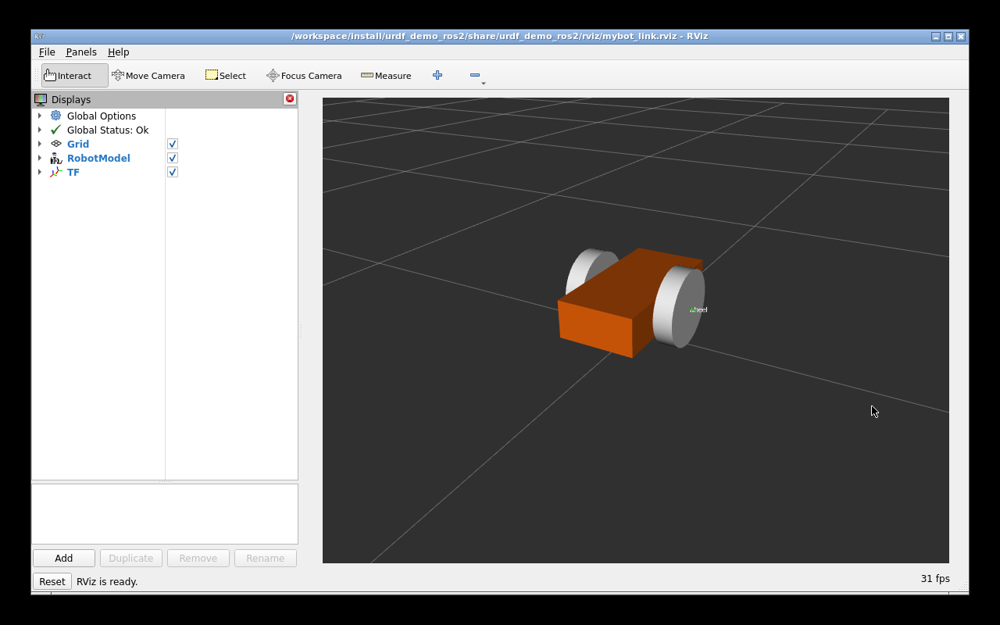
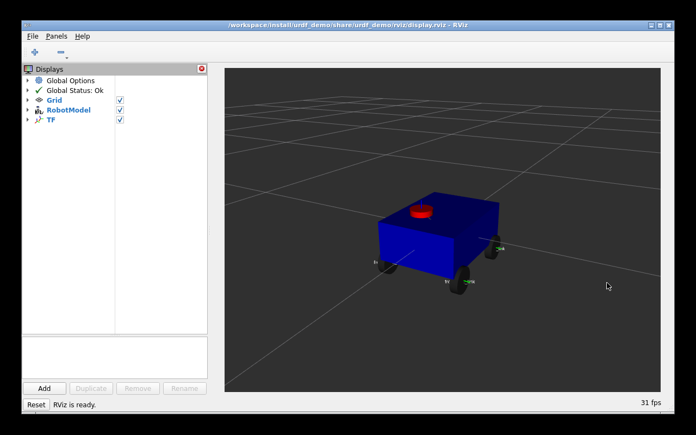

# 第8章：URDF/Xacro 机器人建模

> **课程**：ROS2 C++17 编程（COM260）
> **章节**：第8章
> **课时**：2 课时（90 分钟）
> **教学方式**：讲授 + 演示

本章保留原课程的几何建模示例与 10 kg 四轮模型，配套实验使用 5 kg 双轮模型；这些模型用于 URDF/Xacro、关节与 TF 教学，Gazebo 运动仿真使用 TurtleBot3 Burger。

---

## 8.1 URDF 语法基础

### 知识点 8.1.1：URDF 概述与文件结构

```xml
<?xml version="1.0"?>
<robot name="my_robot">
  <!-- 连杆定义 -->
  <link name="base_link">
    <visual> ... </visual>
    <collision> ... </collision>
    <inertial> ... </inertial>
  </link>

  <!-- 关节定义 -->
  <joint name="base_to_wheel" type="continuous">
    <parent link="base_link"/>
    <child link="wheel"/>
    <origin xyz="0 0 -0.1" rpy="0 0 0"/>
    <axis xyz="0 1 0"/>
  </joint>
</robot>
```

程序 8-1：URDF 文件最小结构。每个 `<link>` 描述刚体，每个 `<joint>` 描述连接关系。

### 知识点 8.1.2：link 元素详解

| 子元素 | 用途 | 示例 |
|--------|------|------|
| `<visual>` | 可视化几何体 (mesh/box/cylinder/sphere) | `<cylinder radius="0.1" length="0.2"/>` |
| `<collision>` | 碰撞检测几何体 (通常与 visual 一致) | `<box size="0.4 0.3 0.15"/>` |
| `<inertial>` | 惯性参数 (mass + inertia) | `<mass value="1.0"/>` |

```xml
<link name="base_link">
  <visual>
    <geometry><box size="0.4 0.3 0.15"/></geometry>
    <material name="blue"><color rgba="0 0 0.8 1"/></material>
  </visual>
  <collision>
    <geometry><box size="0.4 0.3 0.15"/></geometry>
  </collision>
  <inertial>
    <mass value="5.0"/>
    <inertia ixx="0.1" ixy="0" ixz="0" iyy="0.1" iyz="0" izz="0.1"/>
  </inertial>
</link>
```

### 知识点 8.1.3：joint 类型

| 类型 | 运动自由度 | 典型应用 |
|------|-----------|---------|
| `revolute` | 绕轴旋转 (有限范围) | 机械臂关节 |
| `continuous` | 无限旋转 | 轮子 |
| `prismatic` | 沿轴平移 | 升降机构 |
| `fixed` | 无自由度 | 传感器固定连接 |
| `planar` | 平面运动 | 地面移动 |

### 知识点 8.1.4：官方要点——URDF 可视化建模与 origin 语义

官方 Building a visual robot model with URDF from scratch 教程从零搭建一个两轮机器人 R2D2：从单个 `link`（含 `visual` 几何体与 `origin` 位姿）开始，逐步加入 `joint` 连接多个 link，最终在 RViz 中通过 `RobotModel` 显示。教程明确了一个初学者最容易踩的坑——`origin` 的语义随父元素而变：link 内 visual/collision/inertial 的 `origin` 分别描述相对 link 坐标系的视觉、碰撞或惯性坐标位姿，joint 的 `origin` 是「子 link 相对父 link」的变换，二者坐标语义完全不同。

与本节介绍的建模流程一致，官方推荐的开发循环是：编辑 URDF → `check_urdf` 语法检查 → RViz 中 `RobotModel` + `TF` 双显示验证（见本章 8.4 节）。教程中「把 R2D2 组装成完整机器人」一节还演示了网格模型（mesh）的引用方式与 `scale` 缩放，适合复杂外观建模。

### 知识点 8.1.5：官方要点——joint 类型、限位与物理属性建议

URDF 主页面（URDF-Main）与 Robot Model 描述页把模型拆解为四类描述：`link`（惯性、碰撞、视觉）、`joint`（六种类型：revolute、continuous、prismatic、fixed、floating、planar）、`gazebo` 扩展标签与传感器标签。其中 revolute/prismatic 需声明 `limit`（上下界、最大力矩、最大速度）；continuous 没有上下界，用于无限转动的轮子，这是后续 ros2_control 与 MoveIt 2 规划能正常工作的前提——本章 8.1.3 节的 joint 类型表即与此对应。

官方建议：惯性张量不可全为零（仿真会报 NaN），碰撞几何体应使用比视觉几何更简化的形状以提升碰撞检测性能；这些细节在 Gazebo 仿真（第 9 章）与本章练习 8.2 的碰撞与惯性实验中都会体现。

---

## 8.2 XACRO 宏与参数化

### 知识点 8.2.1：XACRO 基础宏

```xml
<?xml version="1.0"?>
<robot xmlns:xacro="http://www.ros.org/wiki/xacro" name="teaching_robot">

  <link name="base_link"/>
  <xacro:property name="wheel_base" value="0.3"/>
  <!-- 参数化属性 -->
  <xacro:property name="wheel_radius" value="0.05"/>
  <xacro:property name="wheel_width" value="0.03"/>

  <!-- 宏定义 -->
  <xacro:macro name="wheel" params="name prefix reflect">
    <joint name="${name}_joint" type="continuous">
      <parent link="base_link"/>
      <child link="${prefix}_wheel"/>
      <origin xyz="0 ${reflect*wheel_base/2} -0.1" rpy="0 0 0"/>
      <axis xyz="0 1 0"/>
    </joint>
    <link name="${prefix}_wheel">
      <visual>
        <origin rpy="1.5708 0 0"/>
        <geometry>
          <cylinder radius="${wheel_radius}" length="${wheel_width}"/>
        </geometry>
      </visual>
    </link>
  </xacro:macro>

  <!-- 宏实例化 -->
  <xacro:wheel name="left" prefix="left" reflect="1"/>
  <xacro:wheel name="right" prefix="right" reflect="-1"/>
</robot>
```

程序 8-2：XACRO 宏减少重复代码，参数化实现车轮批量生成。

### 知识点 8.2.2：mesh 文件引用

```xml
<link name="lidar_link">
  <visual>
    <geometry>
      <mesh filename="package://robot_description/meshes/lidar.stl"/>
    </geometry>
    <origin xyz="0 0 0.02" rpy="0 0 0"/>
  </visual>
</link>
```

Mesh 文件通常放在 `meshes/` 目录，使用 `package://<pkg_name>/` 路径前缀。

### 知识点 8.2.3：官方要点——XACRO 宏与模块化

Using Xacro to clean up a URDF file 教程演示了 XML 宏语言的三大武器：属性（`<xacro:property>` 常量，如 `wheel_radius`）、数学表达式（`${(wheel_radius * 2)/3}` 内联计算，消除魔法数字）、宏（`<xacro:macro name="wheel" params="side offset">` 消除重复的轮子定义，调用如 `<xacro:wheel side="left" offset="..."/>`）。本节 8.2.1 的宏封装与此完全一致。

Articulated Robotics 的建模系列把 XACRO 的价值总结为「一次定义、参数化复用」：机器人系列化产品（不同轮距、不同载荷）只需改属性即可生成多套 URDF；配合 `<xacro:if>`/`<xacro:unless>` 条件与 `<xacro:include>` 拆分文件，大型模型可按「底盘/机械臂/传感器」分文件维护。本章练习 8.6 的 `use_lidar` 条件开关正是官方教程推荐的配置化做法——传感器套件（相机、激光雷达、IMU）作为可选模块按需拼装。

---

## 8.3 robot_state_publisher + joint_state_publisher

### 知识点 8.3.1：TF 自动发布机器人状态

```python
# launch/display.launch.py
from launch import LaunchDescription
from launch_ros.actions import Node
from launch.substitutions import Command
from ament_index_python.packages import get_package_share_directory
import os

def generate_launch_description():
    urdf_path = os.path.join(
        get_package_share_directory('urdf_demo'),
        'urdf', 'simple_robot.xacro')

    return LaunchDescription([
        Node(
            package='robot_state_publisher',
            executable='robot_state_publisher',
            parameters=[{'robot_description': Command(['xacro ', urdf_path])}],
        ),
        Node(
            package='joint_state_publisher',
            executable='joint_state_publisher',
        ),
        Node(
            package='rviz2',
            executable='rviz2',
            arguments=['-d', os.path.join(
                get_package_share_directory('urdf_demo'),
                'rviz', 'display.rviz')],
        ),
    ])
```

程序 8-3：`robot_state_publisher` 解析 URDF 并发布 TF，`joint_state_publisher` 发布默认关节状态；需要滑块时使用 `joint_state_publisher_gui`。

---

## 8.4 RViz2 RobotModel 显示

### 知识点 8.4.1：RViz2 配置

在 RViz2 中添加 `RobotModel` 插件，并将 Description Topic 设置为 `/robot_description`；随后添加 `TF` 插件查看各坐标系，把 Fixed Frame 设为 `base_link` 或 `odom`，最后将配置保存为 `.rviz` 文件供 Launch 加载。

### 知识点 8.4.2：官方要点——可移动模型与物理仿真衔接

Building a movable robot model with URDF 教程在视觉模型基础上添加 continuous、revolute 与 prismatic 关节，通过关节滑块发布 JointState，并由 robot_state_publisher 更新 TF。物理仿真还需要单独补齐惯性、碰撞及驱动配置。这正与本节的 RViz 可视化定位相衔接——同一份模型文件，既被 RViz 用于可视化，也被 Gazebo 用于物理仿真，还被 MoveIt 2 用于运动规划。

官方给出的实践准则是：模型文件应当「物理属性优先于外观」，惯性参数可通过 CAD 导出或圆柱近似估算；调试顺序建议为「先 RViz 静态验证、再 Gazebo 动力学验证、最后接入 ros2_control」，每一步都可通过本章练习 8.5 的关节状态观测验证。

---

## 8.5 本章小结

URDF 由 link（刚体）与 joint（连接）构成，每个 link 包含 visual/collision/inertial 三类描述，joint 则分为 revolute、continuous、prismatic、fixed 等类型；XACRO 通过宏与参数变量消除重复并支持条件分支；`robot_state_publisher` 解析 URDF 并发布 TF，`joint_state_publisher` 发布关节值，`joint_state_publisher_gui` 提供 GUI 滑块，最终由 RViz2 的 RobotModel 插件可视化完整机器人模型。

---

## 8.6 练习题

**练习 8.1**：编写一个包含 base_link 和 lidar_link 的 URDF，通过 fixed joint 连接。

**练习 8.2**：为 base_link 添加 collision 和 inertial 元素（mass=10kg, box inertia）。

**练习 8.3**：使用 XACRO macro 参数化生成 4 个麦克纳姆轮（前左/前右/后左/后右）。

**练习 8.4**：编写 `display.launch.py`，启动 robot_state_publisher + joint_state_publisher + rviz2。

**练习 8.5**：在 RViz2 中调出 RobotModel 和 TF 显示，截图完整的机器人模型。

**练习 8.6**：使用 XACRO `<xacro:if>` 条件判断：当 `use_lidar=true` 时才加载 lidar_link。

---

本章 XML 与 Python Launch 保持其文件格式；业务节点由 ROS 的状态发布器提供。实验环境与完整模型见[第八章实验](../lab_manuals_k3_com260_kit/ch08_lab.md)。教案练习的 10 kg 和四轮宏示例位于 `src_k3_com260_kit/urdf_demo/urdf/teaching_robot.xacro`，与实验指导书的 5 kg 双轮模型分别验证。`use_lidar:=true` / `false` 分别保留／移除激光 link，四轮宏只演示几何组织，不包含麦克纳姆滚子动力学。

## 仿真结合实例（当前仓库）：从 Xacro 模型到 RViz RobotModel

### 目标与知识点对应

先用 `xacro` 展开课程提供的模型，再由 `robot_state_publisher` 发布 TF，并在 RViz 中显示 RobotModel，能够把本章的 link/joint、Xacro 参数化和状态发布串成一条可运行链路。

### 运行步骤

先完成[公共环境第 7～8 章](../lab_manuals_k3_com260_kit/ch00_common_setup.md#ch07-ch08)的镜像和资源包构建，在 x86 执行：

```bash
cd ~/ROS2_RISCV_COM260
CH08=course_support/k3_com260_kit/scripts/x86-ch07-ch08.bash
RUN_ID=$(date -u +%Y%m%dT%H%M%SZ)-ch08-model
bash "$CH08" start "$RUN_ID" urdf_demo_ros2 display_xacro.launch.py use_gui:=false
bash "$CH08" exec "$RUN_ID" bash -c 'xacro "$(ros2 pkg prefix urdf_demo_ros2)/share/urdf_demo_ros2/urdf/mybot.xacro" > /tmp/mybot.urdf; xmllint --noout /tmp/mybot.urdf; check_urdf /tmp/mybot.urdf'
```

结束当前模型展示后，另开一轮查看 Gazebo 的 Burger，避免两个状态发布器使用同名 frame：

```bash
bash "$CH08" stop "$RUN_ID"
RUN_ID=$(date -u +%Y%m%dT%H%M%SZ)-ch08-gazebo
bash course_support/k3_com260_kit/scripts/x86-gazebo.bash start "$RUN_ID"
# 观察结束后执行：
bash course_support/k3_com260_kit/scripts/x86-gazebo.bash stop "$RUN_ID"
```

### 观察结果

在 RViz 中，RobotModel 能显示 Xacro 展开的连杆和关节，TF 面板能看到模型的坐标树；`xmllint` 通过表示 Xacro 输出是合法 XML，Gazebo 侧则使用其 SDF TurtleBot3 Burger 模型和传感器配置。

### 源码与边界

Xacro 模型位于 `src_k3_com260_kit/urdf_demo_ros2/urdf/mybot.xacro`，Launch 文件为 `src_k3_com260_kit/urdf_demo_ros2/launch/display_xacro.launch.py`，Gazebo 模型为 `src_k3_pico_itx/robot_sim_demo/models/turtlebot3_burger/model.sdf`。这两个入口用于对比 URDF/Xacro 与 SDF 的建模路径；不要把 TurtleBot3 Burger 的 SDF 文件当作 `urdf_demo_ros2` 的 Xacro 源文件。






34 项模型检查、学生从空目录建包、marker 新文件安装和跨端关节 TF 查询见[第八章运行证据](../lab_manuals_k3_com260_kit/runtime_evidence.md#ch08)。四轮宏展示几何组合；本章未将其当作麦克纳姆动力学模型。

---

学习材料：
- ROS 2 Documentation (Humble) —— Building a visual robot model with URDF from scratch：https://docs.ros.org/en/humble/Tutorials/Intermediate/URDF/Building-A-Visual-Robot-Model-With-URDF-From-Scratch.html
- ROS 2 Documentation (Humble) —— URDF 主要元素（URDF-Main）：https://docs.ros.org/en/humble/Tutorials/Intermediate/URDF/URDF-Main.html
- ROS 2 Documentation (Humble) —— Using Xacro to clean up a URDF file：https://docs.ros.org/en/humble/Tutorials/Intermediate/URDF/Using-Xacro-To-Clean-Up-A-URDF-File.html
- ROS 2 Documentation (Humble) —— Building a movable robot model with URDF：https://docs.ros.org/en/humble/Tutorials/Intermediate/URDF/Building-A-Movable-Robot-Model-With-URDF.html
- The Construct —— ROS 2 Basics in 5 Days：https://www.theconstructsim.com/
- Articulated Robotics —— Robot Modelling 系列视频：https://www.youtube.com/@ArticulatedRobotics
