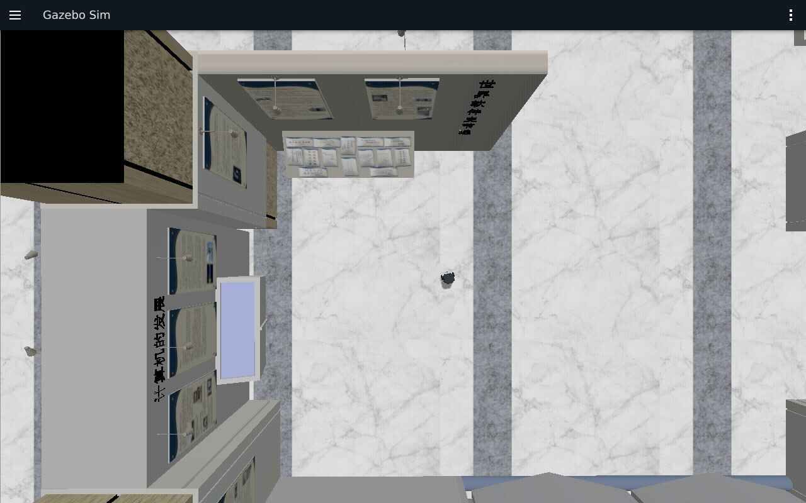
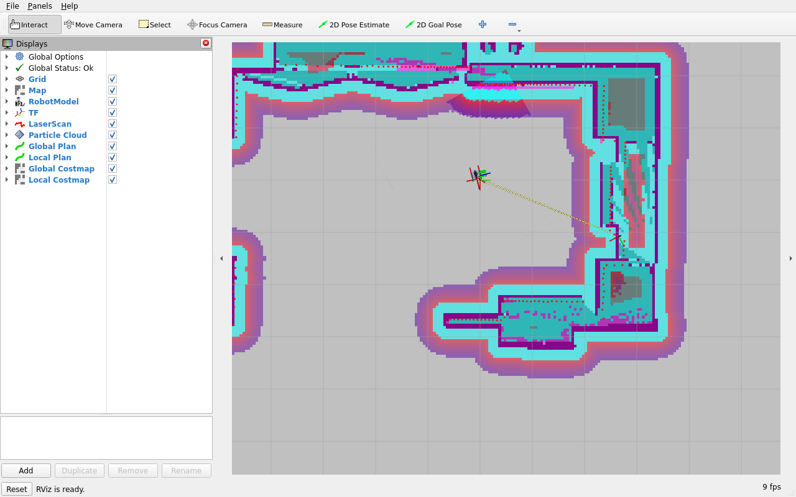

# 第16章 Nav2架构与核心组件

> **课程**：ROS 2 C++17 编程（COM260）  
> **章节**：第16章  
> **课时**：2 课时（90 分钟）  
> **教学方式**：讲授 + 演示

COM260 运行本章 C++17 教学节点；Nav2、Gazebo 和 RViz 在 x86 Humble 容器中运行。先阅读 [Nav2 公共环境](../lab_manuals_k3_com260_kit/nav2_common_setup.md)，再执行具体命令。

## 学习目标

本章学习目标包括：理解Navigation2整体架构和设计思想，掌握行为树驱动的导航决策框架，熟悉ROS2生命周期节点管理机制，了解Nav2核心组件及其功能，能够配置和启动Nav2导航系统。

## 16.1 机器人导航概述

### 16.1.1 导航的三大问题

机器人自主导航需要解决三个核心问题。**1. 我在哪里？ — 定位问题**：使用AMCL或SLAM确定机器人在地图中的位置，输入激光雷达、里程计、地图，输出机器人位姿估计。**2. 我要去哪里？ — 目标设定**：由用户或任务系统指定目标位姿，可通过RViz2可视化设定，或通过上层调度系统下发目标点。**3. 我要怎么去？ — 规划与控制**：全局规划计算从起点到终点的无碰撞路径，局部规划实时避障和路径跟踪，运动控制生成速度指令驱动机器人。

### 16.1.2 Nav2概述

Nav2 (Navigation2) 是ROS2的官方导航框架，替代ROS1中的move_base。它采用行为树驱动的插件化架构，支持高度可定制的导航行为。

**Nav2的设计目标：**核心功能以插件形式提供（模块化），支持自定义规划器、控制器、恢复行为（可扩展），以行为树驱动的容错机制保证鲁棒性，并通过生命周期管理实现资源高效利用。

## 16.2 Nav2整体架构

### 16.2.1 系统架构图

Nav2的架构可以分解为四个层次：

```
用户接口层:
┌──────────────────────────────────────┐
│ RViz2 │ Simple Commander │ 任务调度 │
└──────────────────────────────────────┘
         ↓ 导航目标 (NavigateToPose Action)
┌──────────────────────────────────────┐
│    行为树导航器 (BT Navigator)       │
│   - 行为树执行引擎                    │
│   - 恢复行为管理                      │
└──────────────────────────────────────┘
         ↓                  ↓
┌──────────────────┐ ┌──────────────────┐
│  Planner Server  │ │Controller Server │
│  全局路径规划     │ │ 局部路径跟踪     │
│  Dijkstra/A*     │ │ DWA/RPP/MPPI     │
└──────────────────┘ └──────────────────┘
         ↓                  ↓
┌──────────────────┐ ┌──────────────────┐
│ Global Costmap   │ │ Local Costmap    │
│ 静态层/障碍物层   │ │ 障碍物层/膨胀层  │
│ 膨胀层            │ │ 滚动窗口         │
└──────────────────┘ └──────────────────┘
         ↓                  ↓
┌──────────────────────────────────────┐
│      传感器/里程计/地图/定位          │
│   LaserScan, Odometry, Map, AMCL     │
└──────────────────────────────────────┘
```

### 16.2.2 核心组件

Nav2包含以下核心组件：

| 组件 | 功能 | 对应ROS1 |
|------|------|----------|
| `bt_navigator` | 行为树导航决策引擎 | move_base |
| `planner_server` | 全局路径规划 | global_planner |
| `controller_server` | 局部路径规划与控制 | local_planner |
| `costmap_2d` | 全局/局部代价地图 | costmap_2d |
| `behavior_server` | 恢复行为管理 | recovery_behaviors |
| `amcl` | 粒子滤波定位 | amcl |
| `map_server` | 地图加载与服务 | map_server |
| `waypoint_follower` | 航点跟随 | - |

### 16.2.3 Nav2 vs move_base

| 特性 | Nav2 (ROS2) | move_base (ROS1) |
|------|------------|-----------------|
| 架构 | 行为树驱动 | 有限状态机 |
| 可扩展性 | 插件化，高度可定制 | 有限的自定义 |
| 生命周期 | ROS2生命周期节点 | 标准节点 |
| 多机器人 | 原生支持 | 需额外配置 |
| 恢复行为 | 可配置行为树 | 固定恢复序列 |
| 语言 | C++/Python | C++ |

### 16.2.4 官方要点——Nav2 的模块化世界观

docs.nav2.org 的 Concepts 页面将 Nav2 描述为"一组松耦合、可独立替换的组件"，与本章 16.2.1 的分层图互为印证：`bt_navigator` 只做决策编排，实际能力全部由 Action 服务器（planner_server、controller_server、behavior_server、smoother_server、waypoint_follower）提供。官方强调这一设计使任何组件都可被自定义插件替换——例如把 planner_server 换成 SMAC（Hybrid-A* 支持阿克曼底盘）、把 controller 换成 MPPI 或 Regulated Pure Pursuit，而行为树无需改动。

文档同样指出 Nav2 与 move_base 的本质区别在于"从固定恢复流程到可编程决策"：恢复行为不再是一串写死的 fallback，而是行为树中一等公民节点，开发者可以按场景裁剪（低成本场景可只保留 ClearCostmap，避免 Spin/BackUp 带来的位姿扰动）。

## 16.3 行为树驱动导航

### 16.3.1 行为树基础

行为树 (Behavior Tree, BT) 是一种用于控制决策流程的树形结构，具有以下特点：

**核心节点类型：**

```
控制节点:
Sequence (→) : 顺序执行子节点，所有成功才成功
Fallback (?) : 尝试子节点，任一成功则成功
Parallel (⇉) : 并行执行子节点

装饰节点:
Repeater     : 重复执行子节点
Inverter     : 反转子节点结果
RateController: 控制执行频率

执行节点:
Action  : 执行具体任务（导航、旋转等）
Condition: 检查条件（是否到达目标等）
```

**行为树与传统FSM的对比：**

| 特性 | 行为树 | 有限状态机 |
|------|--------|-----------|
| 模块化 | 高，节点可重用 | 低，状态转换耦合 |
| 可读性 | 树形结构直观 | 状态图复杂 |
| 调试 | 可视化XML | 日志跟踪 |
| 容错 | 自然支持 | 需显式设计 |
| 复用 | 节点可跨树重用 | 状态难复用 |

### 16.3.2 Nav2默认行为树

下面是保留 1 Hz 重规划、10 Hz 跟踪节拍的教学树。Humble 实际默认树为 `nav2_bt_navigator/behavior_trees/navigate_to_pose_w_replanning_and_recovery.xml`；教学树另存为 `navigation_client_cpp/behavior_trees/teaching_navigation.xml`：

```xml
<!-- navigation_nav2/behavior_trees/navigate_to_pose.xml -->
<root main_tree_to_execute="MainTree">
  <BehaviorTree ID="MainTree">
    <PipelineSequence name="NavigateWithRecovery">
      <!-- 全局规划阶段 -->
      <RateController hz="1.0">
        <RecoveryNode number_of_retries="1" name="ComputePath">
          <ComputePathToPose
            goal="{goal}"
            path="{path}"
            planner_id="GridBased"/>
          <ClearEntireCostmap
            service_name="global_costmap/clear_entirely_global_costmap"/>
        </RecoveryNode>
      </RateController>

      <!-- 路径跟踪阶段 -->
      <RateController hz="10.0">
        <RecoveryNode number_of_retries="1" name="FollowPath">
          <FollowPath
            path="{path}"
            controller_id="FollowPath"/>
          <Sequence name="RecoveryActions">
            <Spin
              spin_dist="1.57"/>
            <Wait
              wait_duration="1.0"/>
            <BackUp
              backup_dist="0.15"/>
            <ClearEntireCostmap
              service_name="local_costmap/clear_entirely_local_costmap"/>
          </Sequence>
        </RecoveryNode>
      </RateController>
    </PipelineSequence>
  </BehaviorTree>
</root>
```

### 16.3.3 行为树的工作原理

```
行为树执行流程:
1. 接收到导航目标 {goal}
2. 进入 PipelineSequence
3. 第一阶段: RateController(1Hz)
   ├── ComputePathToPose: 计算全局路径
   │   ├── 成功 → 进入第二阶段
   │   └── 失败 → RecoveryNode
   │       ├── ClearEntireCostmap: 清除代价地图
   │       └── 重试 ComputePathToPose
   └── 继续第一阶段

4. 第二阶段: RateController(10Hz)
   ├── FollowPath: 执行路径跟踪
   │   ├── 成功 → 导航完成
   │   └── 失败 → RecoveryNode
   │       ├── Spin: 原地旋转
   │       ├── Wait: 等待
   │       ├── BackUp: 后退
   │       ├── ClearEntireCostmap: 清除代价地图
   │       └── 重试 FollowPath
   └── 继续第二阶段
```

### 16.3.4 自定义行为树

用户可以根据需求创建自定义行为树。本例使用 Humble 已提供的 `IsBatteryLow` 和本章已配置的 `FollowPath`（DWB）；原例的 `BatteryCheck` 不是内置节点，`MPPI` 也需要先配置相应控制器。电量来自 `sensor_msgs/msg/BatteryState.percentage`，运行前应确认已收到有效消息；未收到电池数据不代表电量充足：

```xml
<!-- custom_navigation.xml -->
<root main_tree_to_execute="MainTree">
  <BehaviorTree ID="MainTree">
    <Sequence name="CustomNavigate">
      <!-- 步骤1: 检查电池电量 -->
      <Inverter>
        <IsBatteryLow min_battery="0.2" battery_topic="/battery_status" is_voltage="false"/>
      </Inverter>

      <PipelineSequence>
        <!-- 步骤2: 跟踪期间每秒重新规划 -->
        <RateController hz="1.0">
          <ComputePathToPose goal="{goal}" path="{path}" planner_id="GridBased"/>
        </RateController>
        <!-- 步骤3: 使用本章配置的控制器跟踪路径 -->
        <FollowPath path="{path}" controller_id="FollowPath"/>
      </PipelineSequence>

      <!-- 步骤4: 到达后执行额外动作 -->
      <Sequence name="PostArrival">
        <Wait wait_duration="2.0"/>
        <Spin spin_dist="6.2832"/>
      </Sequence>
    </Sequence>
  </BehaviorTree>
</root>
```

### 16.3.5 官方要点——行为树进阶：PipelineSequence 与官方 XML 库

Nav2 官方文档的 Behavior Tree 页面详细说明了三个自定义控制节点：`PipelineSequence`（本章 16.3.2 的骨架，前序分支保持运行、后续分支并发推进）、`RecoveryNode`（包裹"业务节点 + 恢复节点"，业务失败触发恢复后重试）与 `RateController`（限制分支触发频率）。官方导航树把"规划"与"跟踪"放进同一个 PipelineSequence，是为了允许跟踪过程中以 1Hz 重规划——这是理解 16.3.3 执行流程的关键。

此自定义树用 `PipelineSequence` 配合 `RateController`，跟踪期间每秒重新规划，避免一直跟踪旧路径；到达后仍按顺序等待 2 秒并旋转一圈。它没有恢复分支，遇到无法规划或持续无法前进的情况仍会返回失败。电池分支用明确发布的测试消息验证，不代表物理电池检测。

此外，`nav2_bt_navigator` 的 XML 可用 BehaviorTree.CPP 的 Groot 工具可视化编辑；`nav2_behavior_tree` 包内置了约 50 个现成节点（`IsPathValid`、`GoalUpdated`、`ClearCostmapService` 等），编写练习第 5 题的充电桩行为树时，可组合 `IsBatteryLow`、`ComputePathToPose`、`FollowPath` 和 `Wait` 等节点；`NavigateToPose` 是导航器对外的 Action，不能假设它是本版已注册的同名 XML 节点。

## 16.4 生命周期节点管理

### 16.4.1 生命周期节点概念

Nav2使用ROS2的**生命周期节点 (Lifecycle Node)** 管理所有导航组件。生命周期节点具有明确的状态转换过程：

```
                    │
                    ↓
             ┌─────────────┐
             │ Unconfigured│
             └─────────────┘
                    │ configure()
                    ↓
             ┌─────────────┐
             │  Inactive   │ ←── 配置完成，未激活
             └─────────────┘
                    │ activate()
                    ↓
             ┌─────────────┐
             │   Active    │ ←── 正常运行
             └─────────────┘
                    │ deactivate()
                    ↓
             ┌─────────────┐
             │  Inactive   │
             └─────────────┘
                    │ cleanup()
                    ↓
             ┌─────────────┐
             │ Unconfigured│ ←── 回到初始状态
             └─────────────┘
                    │ shutdown()
                    ↓
             ┌─────────────┐
             │ Finalized   │ ←── 节点销毁
             └─────────────┘
```

**状态说明：**Unconfigured为初始状态，节点已创建但未初始化；Inactive 状态下已配置资源；生命周期发布器未激活，普通订阅回调需由程序显式限制处理；Active状态下正常运行，执行核心功能；Finalized 表示已结束工作，进程及状态查询接口可以仍然存在。

### 16.4.2 生命周期管理服务

```bash
# 查看当前生命周期状态
ros2 service call /bt_navigator/get_state \
  lifecycle_msgs/srv/GetState

# 配置节点 (Unconfigured → Inactive)
ros2 service call /bt_navigator/change_state \
  lifecycle_msgs/srv/ChangeState \
  "{transition: {id: 1}}"   # 1=TRANSITION_CONFIGURE

# 激活节点 (Inactive → Active)
ros2 service call /bt_navigator/change_state \
  lifecycle_msgs/srv/ChangeState \
  "{transition: {id: 3}}"   # 3=TRANSITION_ACTIVATE

# 停用节点 (Active → Inactive)
ros2 service call /bt_navigator/change_state \
  lifecycle_msgs/srv/ChangeState \
  "{transition: {id: 4}}"   # 4=TRANSITION_DEACTIVATE

# 清理节点 (Inactive → Unconfigured)
ros2 service call /bt_navigator/change_state \
  lifecycle_msgs/srv/ChangeState \
  "{transition: {id: 2}}"   # 2=TRANSITION_CLEANUP
```

### 16.4.3 生命周期管理器

Nav2使用 `nav2_lifecycle_manager` 统一管理所有导航组件的生命周期：

```yaml
# nav2_params.yaml
lifecycle_manager_localization:
  ros__parameters:
    autostart: true
    node_names: [map_server, amcl]
lifecycle_manager_navigation:
  ros__parameters:
    autostart: true
    node_names: [controller_server, smoother_server, planner_server,
                 behavior_server, bt_navigator, waypoint_follower, velocity_smoother]
```

下列为 x86 Humble 容器内的通用启动示意，需替换为实际地图路径；本章可复现入口见公共环境页。

```bash
# 使用生命周期管理器一键启动
ros2 launch nav2_bringup bringup_launch.py \
  map:=./maps/my_map.yaml \
  use_sim_time:=true

# 生命周期管理器自动执行:
# 1. Launch 创建节点；管理器连接已有节点
# 2. 配置所有节点 → Inactive
# 3. 激活所有节点 → Active
```

### 16.4.4 自定义生命周期节点

```cpp
#include <rclcpp_lifecycle/lifecycle_node.hpp>
#include <rclcpp/rclcpp.hpp>
#include <geometry_msgs/msg/pose_stamped.hpp>
#include <sensor_msgs/msg/laser_scan.hpp>

using CallbackReturn = rclcpp_lifecycle::node_interfaces::LifecycleNodeInterface::CallbackReturn;

class Nav2Component : public rclcpp_lifecycle::LifecycleNode {
public:
  Nav2Component() : LifecycleNode("custom_nav_component") {
    declare_parameter("param1", "default");
  }
  CallbackReturn on_configure(const rclcpp_lifecycle::State &) override {
    publisher_ = create_publisher<geometry_msgs::msg::PoseStamped>("/custom_pose", 10);
    subscriber_ = create_subscription<sensor_msgs::msg::LaserScan>(
      "/scan", rclcpp::SensorDataQoS(), [this](sensor_msgs::msg::LaserScan::ConstSharedPtr scan) {
        if (!publisher_->is_activated()) { return; }
        RCLCPP_INFO_THROTTLE(get_logger(), *get_clock(), 1000,
          "Active: scan=%zu frame=%s", scan->ranges.size(), scan->header.frame_id.c_str());
      });
    RCLCPP_INFO(get_logger(), "配置完成: param1=%s", get_parameter("param1").as_string().c_str());
    return CallbackReturn::SUCCESS;
  }
  CallbackReturn on_activate(const rclcpp_lifecycle::State &) override {
    publisher_->on_activate();
    RCLCPP_INFO(get_logger(), "已激活");
    return CallbackReturn::SUCCESS;
  }
  CallbackReturn on_deactivate(const rclcpp_lifecycle::State &) override {
    publisher_->on_deactivate();
    RCLCPP_INFO(get_logger(), "已停用");
    return CallbackReturn::SUCCESS;
  }
  CallbackReturn on_cleanup(const rclcpp_lifecycle::State &) override {
    subscriber_.reset();
    publisher_.reset();
    RCLCPP_INFO(get_logger(), "已清理");
    return CallbackReturn::SUCCESS;
  }
  CallbackReturn on_shutdown(const rclcpp_lifecycle::State & state) override {
    on_cleanup(state);
    RCLCPP_INFO(get_logger(), "已关闭");
    return CallbackReturn::SUCCESS;
  }
private:
  rclcpp_lifecycle::LifecyclePublisher<geometry_msgs::msg::PoseStamped>::SharedPtr publisher_;
  rclcpp::Subscription<sensor_msgs::msg::LaserScan>::SharedPtr subscriber_;
};

int main(int argc, char ** argv) {
  rclcpp::init(argc, argv);
  auto node = std::make_shared<Nav2Component>();
  rclcpp::spin(node->get_node_base_interface());
  rclcpp::shutdown();
}
```

### 16.4.5 官方要点——生命周期节点：ROS 2 管理节点设计

本章 16.4 的机制出自 ROS 2 官方 Managed Nodes 设计文档：生命周期节点把配置资源和启动处理分开。Nav2 在本章使用定位组与导航组两个管理器；节点由 Launch 创建，管理器按各自 `node_names` 顺序执行 configure/activate。两组可以并行启动，导航组件仍需等待地图、定位和 TF 就绪。

示例将 `param1` 放在构造函数声明，避免 cleanup 后再次 configure 时重复声明；激光订阅使用 SensorDataQoS，回调检查发布器激活状态。`/custom_pose` 保留为生命周期发布器示范，本例只记录激光样本，不凭空生成位姿。

用 `ros2 lifecycle get /bt_navigator` 查看状态；单独练习状态切换时运行 `custom_nav_component`，避免直接停用正在导航且受生命周期管理器监管的节点。

## 16.5 核心组件详解

### 16.5.1 BT Navigator

BT Navigator是Nav2的行为树执行引擎，负责加载和执行行为树XML，管理导航任务的生命周期，并提供 NavigateToPose 和 NavigateThroughPoses 的 Action 接口；FollowWaypoints 由独立的 Waypoint Follower 提供。

```cpp
#pragma once
#include <chrono>
#include <cmath>
#include <csignal>
#include <rclcpp/rclcpp.hpp>
#include <rclcpp_action/rclcpp_action.hpp>
#include <nav2_msgs/action/navigate_to_pose.hpp>

using namespace std::chrono_literals;
inline volatile std::sig_atomic_t navigation_stop = 0;

inline void init_navigation(int argc, char ** argv) {
  rclcpp::init(argc, argv, rclcpp::InitOptions(), rclcpp::SignalHandlerOptions::None);
  std::signal(SIGINT, [](int) { navigation_stop = 1; });
  std::signal(SIGTERM, [](int) { navigation_stop = 1; });
}

class BTNavigatorClient : public rclcpp::Node {
public:
  using Navigate = nav2_msgs::action::NavigateToPose;
  using Handle = rclcpp_action::ClientGoalHandle<Navigate>;
  BTNavigatorClient() : Node("bt_navigator_client") {
    client_ = rclcpp_action::create_client<Navigate>(this, "navigate_to_pose");
  }
  bool navigate(double x, double y, double yaw, const std::string & tree = "",
                double cancel_after = 0) {
    if (!std::isfinite(x) || !std::isfinite(y) || !std::isfinite(yaw) ||
        !std::isfinite(cancel_after) || cancel_after < 0) {
      RCLCPP_ERROR(get_logger(), "目标必须为有限数值，取消延时不能为负");
      return false;
    }
    if (!client_->wait_for_action_server(15s) || navigation_stop) {
      RCLCPP_ERROR(get_logger(), "navigate_to_pose 服务未就绪");
      return false;
    }
    Navigate::Goal goal;
    goal.pose.header.frame_id = "map";
    goal.pose.header.stamp = now();
    goal.pose.pose.position.x = x;
    goal.pose.pose.position.y = y;
    goal.pose.pose.orientation.z = std::sin(yaw / 2);
    goal.pose.pose.orientation.w = std::cos(yaw / 2);
    goal.behavior_tree = tree;
    rclcpp_action::Client<Navigate>::SendGoalOptions options;
    options.feedback_callback = [this](Handle::SharedPtr, const auto feedback) {
      RCLCPP_INFO_THROTTLE(get_logger(), *get_clock(), 1000, "剩余距离: %.2f m",
        feedback->distance_remaining);
    };
    auto sent = client_->async_send_goal(goal, options);
    if (rclcpp::spin_until_future_complete(shared_from_this(), sent, 10s) !=
        rclcpp::FutureReturnCode::SUCCESS || !sent.get()) {
      RCLCPP_ERROR(get_logger(), "目标未接受");
      return false;
    }
    auto handle = sent.get();
    RCLCPP_INFO(get_logger(), "目标已接受: x=%.2f y=%.2f yaw=%.2f", x, y, yaw);
    auto result = client_->async_get_result(handle);
    const auto start = std::chrono::steady_clock::now();
    bool canceled = false;
    double cancel_time = 0;
    while (rclcpp::ok() && result.wait_for(0s) != std::future_status::ready) {
      rclcpp::spin_some(shared_from_this());
      double elapsed = std::chrono::duration<double>(std::chrono::steady_clock::now() - start).count();
      if (!canceled && (navigation_stop || (cancel_after > 0 && elapsed >= cancel_after) || elapsed >= 180)) {
        client_->async_cancel_goal(handle);
        canceled = true;
        cancel_time = elapsed;
        RCLCPP_INFO(get_logger(), "已请求取消导航");
      }
      if (canceled && elapsed - cancel_time >= 10) {
        RCLCPP_ERROR(get_logger(), "取消后未收到结果");
        return false;
      }
      rclcpp::sleep_for(20ms);
    }
    if (!rclcpp::ok()) { return false; }
    auto code = result.get().code;
    RCLCPP_INFO(get_logger(), "导航结果: %s",
      code == rclcpp_action::ResultCode::SUCCEEDED ? "SUCCEEDED" :
      code == rclcpp_action::ResultCode::CANCELED ? "CANCELED" : "ABORTED");
    return code == rclcpp_action::ResultCode::SUCCEEDED;
  }
private:
  rclcpp_action::Client<Navigate>::SharedPtr client_;
};
```

### 16.5.2 Planner Server

全局规划器负责在代价地图上搜索从起点到终点的无碰撞路径：

```cpp
#include <cmath>
#include <rclcpp/rclcpp.hpp>
#include <rclcpp_action/rclcpp_action.hpp>
#include <nav2_msgs/action/compute_path_to_pose.hpp>
#include <nav_msgs/msg/path.hpp>

using namespace std::chrono_literals;

int main(int argc, char ** argv) {
  rclcpp::init(argc, argv);
  auto node = std::make_shared<rclcpp::Node>("global_planner_client");
  using Plan = nav2_msgs::action::ComputePathToPose;
  auto client = rclcpp_action::create_client<Plan>(node, "/compute_path_to_pose");
  auto publisher = node->create_publisher<nav_msgs::msg::Path>("/plan", rclcpp::QoS(1).transient_local());
  Plan::Goal goal;
  goal.start.header.frame_id = goal.goal.header.frame_id = "map";
  goal.start.header.stamp = goal.goal.header.stamp = node->now();
  goal.start.pose.position.x = node->declare_parameter("start_x", 0.0);
  goal.start.pose.position.y = node->declare_parameter("start_y", 0.0);
  goal.start.pose.orientation.w = goal.goal.pose.orientation.w = 1;
  goal.goal.pose.position.x = node->declare_parameter("goal_x", 3.0);
  goal.goal.pose.position.y = node->declare_parameter("goal_y", 2.0);
  goal.use_start = true;
  goal.planner_id = node->declare_parameter("planner_id", "GridBased");
  for (double value : {goal.start.pose.position.x, goal.start.pose.position.y,
      goal.goal.pose.position.x, goal.goal.pose.position.y}) {
    if (!std::isfinite(value)) {
      RCLCPP_ERROR(node->get_logger(), "规划坐标必须为有限数值");
      rclcpp::shutdown();
      return 2;
    }
  }
  bool success = false;
  if (client->wait_for_action_server(15s)) {
    auto sent = client->async_send_goal(goal);
    if (rclcpp::spin_until_future_complete(node, sent, 10s) == rclcpp::FutureReturnCode::SUCCESS && sent.get()) {
      auto result = client->async_get_result(sent.get());
      if (rclcpp::spin_until_future_complete(node, result, 20s) == rclcpp::FutureReturnCode::SUCCESS) {
        const auto reply = result.get();
        success = reply.code == rclcpp_action::ResultCode::SUCCEEDED && !reply.result->path.poses.empty();
        if (success) {
          publisher->publish(reply.result->path);
          RCLCPP_INFO(node->get_logger(), "路径规划成功: %zu 个路径点", reply.result->path.poses.size());
          rclcpp::sleep_for(1s);
        }
      }
    }
  }
  if (!success) { RCLCPP_ERROR(node->get_logger(), "路径规划失败或超时"); }
  rclcpp::shutdown();
  return success ? 0 : 1;
}
```

### 16.5.3 Controller Server

局部控制器负责跟踪全局路径并避开动态障碍物，支持多种控制器插件（DWB, MPPI, Regulated Pure Pursuit），实时处理激光传感器数据，并输出 `cmd_vel` 速度指令。

### 16.5.4 Behavior Server

行为服务器提供 Spin（原地旋转）、BackUp（后退）、DriveOnHeading（沿当前方向前进）和 Wait（等待）等 Action。Clear Costmap 由各代价地图节点提供服务，行为树按需要调用这些接口组织恢复流程。

### 16.5.5 Costmap Layers

代价地图层负责将环境建模为带代价值的栅格：

| 图层 | 插件 | 功能 |
|------|------|------|
| 静态层 | StaticLayer | 加载预建地图 |
| 障碍物层 | ObstacleLayer | 传感器实时障碍物 |
| 膨胀层 | InflationLayer | 障碍物膨胀 |
| 体素层 | VoxelLayer | 3D障碍物感知 |

## 16.6 Nav2启动与配置

### 16.6.1 启动文件

```bash
# 使用预建地图启动导航
ros2 launch nav2_bringup navigation_launch.py \
  map:=./maps/office_map.yaml \
  params_file:=./config/nav2_params.yaml \
  use_sim_time:=true

# 自动启动（包含定位）
ros2 launch nav2_bringup bringup_launch.py \
  map:=./maps/office_map.yaml \
  use_sim_time:=true

# 仅定位模式
ros2 launch nav2_bringup localization_launch.py \
  map:=./maps/office_map.yaml \
  use_sim_time:=true
```

### 16.6.2 参数文件结构

```yaml
# nav2_params.yaml 整体结构
bt_navigator:
  ros__parameters:
    ...  # 行为树配置

planner_server:
  ros__parameters:
    ...  # 规划器配置

controller_server:
  ros__parameters:
    ...  # 控制器配置

local_costmap:
  local_costmap:
    ros__parameters:
      ...  # 局部代价地图

global_costmap:
  global_costmap:
    ros__parameters:
      ...  # 全局代价地图

amcl:
  ros__parameters:
    ...  # AMCL定位配置

map_server:
  ros__parameters:
    ...  # 地图服务配置

behavior_server:
  ros__parameters:
    ...  # 恢复行为配置
```

### 16.6.3 Simple Commander API

Nav2 的 Simple Commander 是 Python API。本版保留其“发送目标—读取反馈—检查结果”的教学流程，使用前述 `BTNavigatorClient` 的 C++ Action 客户端完成等价操作；默认目标仍为 `(3.0, 2.0, 0.0)`：

```cpp
#include "navigation_client_cpp/navigator.hpp"

int main(int argc, char ** argv) {
  init_navigation(argc, argv);
  auto node = std::make_shared<BTNavigatorClient>();
  const double x = node->declare_parameter("x", 3.0);
  const double y = node->declare_parameter("y", 2.0);
  const double yaw = node->declare_parameter("yaw", 0.0);
  const auto tree = node->declare_parameter<std::string>("behavior_tree", "");
  const double cancel = node->declare_parameter("cancel_after", 0.0);
  const bool success = node->navigate(x, y, yaw, tree, cancel);
  rclcpp::shutdown();
  return success ? 0 : 1;
}
```

### 16.6.4 官方要点——Simple Commander 与多目标巡航

Simple Commander 的任务接口包括 `goToPose`、`goThroughPoses`（经过多个目标位姿）和 `followWaypoints`（航点跟随及任务执行器），并提供 `setInitialPose`、`waitUntilNav2Active`、`isTaskComplete` 和 `cancelTask`。本章用 C++ Action 保留目标、反馈、结果和取消流程，五点练习在每次成功后暂停 3 秒。仿真中客户端与导航栈应统一使用仿真时间，避免目标时间戳、TF 和传感器消息采用不同时间基准。

## 课后练习

1. **架构题:** 绘制Nav2的系统架构图，说明各组件之间的数据流和依赖关系。

2. **配置题:** 编写Nav2的nav2_params.yaml配置文件，包括行为树导航器、全局规划器、局部控制器和代价地图的完整配置。

3. **编程题:** 使用 C++ Action 客户端编写一个多点导航程序（对应 Simple Commander 的多点任务流程），机器人依次访问5个目标点，每到达一个点后暂停3秒钟。

4. **分析题:** 分析Nav2使用生命周期节点管理的优势，说明生命周期状态转换机制如何提高系统的鲁棒性和资源利用效率。

5. **设计题:** 设计一个自定义的导航行为树，包含以下功能：电池检查、前往充电桩、充电等待、继续任务。写出对应的XML行为树文件。

---

本章运行环境为 COM260／ROS 2 Humble／C++17；Gazebo、Nav2 和 RViz 在 x86 仿真端运行。先完成 [Nav2 公共环境](../lab_manuals_k3_com260_kit/nav2_common_setup.md)。本章与第 17 章对应原第 11 章导航实验的基础部分；完整实验还涉及后续规划与控制章节。

## 仿真结合实例（当前仓库）：查看 Nav2 组件生命周期

### 目标与知识点对应

使用 Burger／Museum 检查 Nav2 组件、规划、目标反馈和停止行为。COM260 运行 C++ 客户端，x86 运行 Nav2 与图形程序。

### 运行步骤

按 [Nav2 公共环境](../lab_manuals_k3_com260_kit/nav2_common_setup.md)启动仿真后，在 COM260 运行：

```bash
source ~/.config/ros2-course-com260-ch16-ch17/env.bash
ros2 lifecycle get /map_server
ros2 lifecycle get /amcl
ros2 lifecycle get /bt_navigator
ros2 run global_planner_client global_planner_client --ros-args -p use_sim_time:=true
ros2 run navigation_client_cpp bt_navigator_client --ros-args -p use_sim_time:=true
```

五点练习的参考实现保持每点暂停 3 秒，坐标从 Museum 的空闲区域选取：

```bash
source ~/.config/ros2-course-com260-ch16-ch17/env.bash
ros2 run navigation_client_cpp multi_goal_navigation --ros-args -p use_sim_time:=true
```

### 观察结果

分别观察 Action 接受、距离反馈、结束状态以及 `/odom` 停止反馈。原目标 `(3,2)` 位于本场景的内切代价区域；本章 NavFn 的 `tolerance=0.15` 允许搜索附近可达终点。`SUCCEEDED` 不等于精确到达原坐标，应同时核对实际终点、规划终点和控制器容差。实测数值见证据页。

客户端等待 Action 服务最多 15 秒、等待目标接受最多 10 秒；导航超过 180 秒会请求取消，取消后最多等待 10 秒。可用 `cancel_after` 参数提前取消；SIGINT／SIGTERM 也先请求取消并等待结果。退出码 0 表示成功到达规划终点，1 表示未完成到达（包括主动取消），不要只凭进程退出判断成功。

### 源码与证据

源码见 [实例与功能包清单](../lab_manuals_k3_com260_kit/nav2_common_setup.md#packages)，运行过程与实际误差见 [第 16～17 章实测记录](../lab_manuals_k3_com260_kit/runtime_evidence.md#ch16-ch17)。



GIF 为近景录像的 25～100 秒原速片段，展示原目标 `(0,-1,0)` 的导航、等待与旋转；[180 秒原片](../lab_manuals_k3_com260_kit/images/nav2_ch16_ch17/20261108T142740Z-packages/x86/original-tree-gazebo.mp4)。



[原目标规划与到达的 RViz 连续录像](../lab_manuals_k3_com260_kit/images/nav2_ch16_ch17/20261108T142740Z-packages/x86/planner-goal-rviz.mp4)记录同一批次的 C++ 规划与导航过程；[末段 GIF](../lab_manuals_k3_com260_kit/images/nav2_ch16_ch17/20261108T142740Z-packages/planner-goal-rviz.gif)展示到达过程。

学习材料：
- [Nav2 官方文档](https://docs.nav2.org/)
- [Humble Nav2 API](https://docs.ros.org/en/humble/p/nav2_bt_navigator/)
- [ROS 2 生命周期设计](https://design.ros2.org/articles/node_lifecycle.html)
