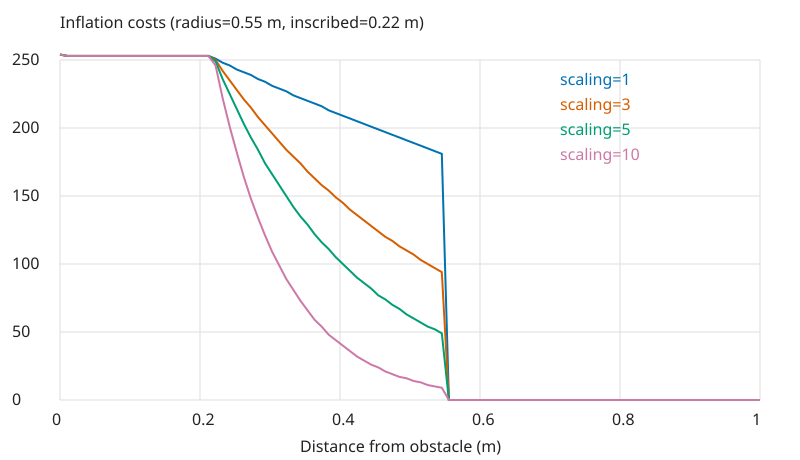
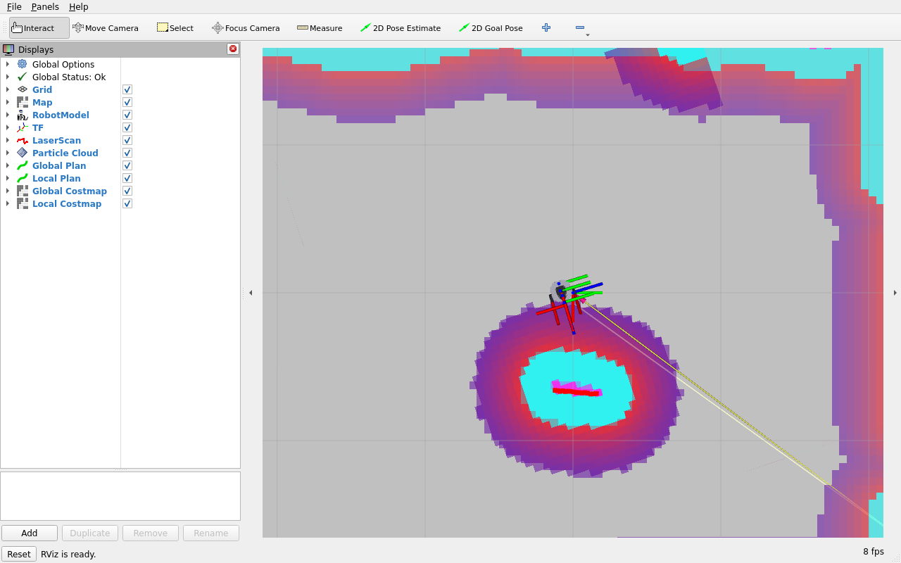
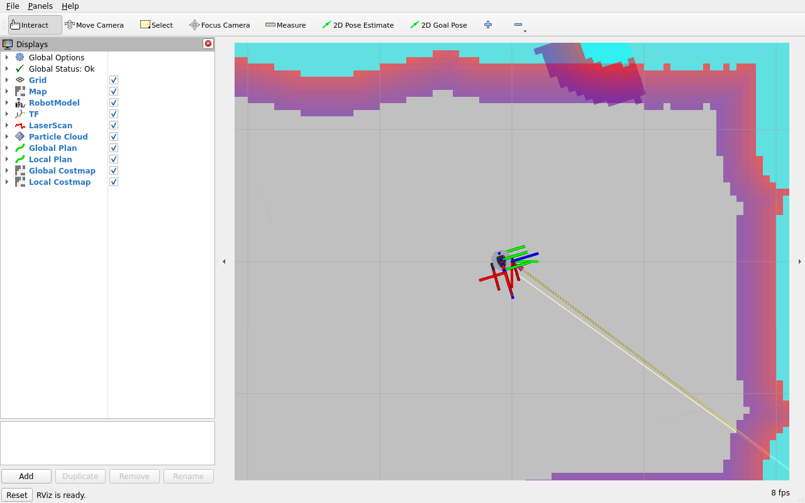

# 第17章 全局代价地图

> **课程**：ROS 2 C++17 编程（COM260）  
> **章节**：第17章  
> **课时**：2 课时（90 分钟）  
> **教学方式**：讲授 + 演示  

---

COM260 运行本章 C++17 算法与观察节点；Nav2 代价地图和 RViz 在 x86 Humble 容器中运行。操作前加载 [Nav2 公共环境](../lab_manuals_k3_com260_kit/nav2_common_setup.md)中的对应端环境。

## 学习目标

本章学习目标包括：理解代价地图(Costmap2D)的原理和工作机制，掌握静态层、障碍物层、膨胀层的配置方法，熟悉代价地图的分层架构和插件机制，能够根据应用场景调优代价地图参数，掌握全局与局部代价地图的区别和配合。

## 17.1 代价地图基本原理

### 17.1.1 什么是代价地图

代价地图 (Costmap) 是导航系统中将物理空间建模为带代价值栅格的核心数据结构。每个栅格（cell）包含一个代价值，表示该位置是否适合机器人通过。

**代价值的含义：**

| 值范围 | 标签 | 含义 |
|--------|------|------|
| 0 | Free (空闲) | 无障碍物，可自由通行 |
| 1–252 | Inflated（膨胀代价） | 离障碍越远，代价通常越低 |
| 253 | Inscribed（内切） | 机器人内切圆与障碍物相交的区域 |
| 254 | Lethal (致命) | 障碍物占据，不可通行 |
| 255 | Unknown (未知) | 未探索区域 |

**代价地图的作用：** 为路径规划提供环境模型，编码障碍物信息和安全距离，支持动态障碍物实时更新，并通过分层架构支持多种信息来源。

### 17.1.2 Costmap2D数据结构

```cpp
#pragma once
#include <algorithm>
#include <cmath>
#include <cstdint>
#include <stdexcept>
#include <string>
#include <vector>
#include <nav_msgs/msg/occupancy_grid.hpp>

inline std::int8_t occupancy(std::uint8_t cost) {
  if (cost == 255) { return -1; }
  if (cost == 254) { return 100; }
  if (cost == 253) { return 99; }
  return cost == 0 ? 0 : 1 + 97 * (cost - 1) / 251;
}

class Costmap2D {
public:
  Costmap2D(double width_m, double height_m, double cell_size = 0.05)
  : resolution(cell_size), width(static_cast<int>(width_m / cell_size)),
    height(static_cast<int>(height_m / cell_size)), origin_x(-width_m / 2), origin_y(-height_m / 2),
    data(width * height, 255) {}
  std::pair<int, int> world_to_grid(double x, double y) const {
    return {static_cast<int>(std::floor((x - origin_x) / resolution)),
      static_cast<int>(std::floor((y - origin_y) / resolution))};
  }
  std::pair<double, double> grid_to_world(int x, int y) const {
    return {origin_x + (x + 0.5) * resolution, origin_y + (y + 0.5) * resolution};
  }
  bool inside(int x, int y) const { return x >= 0 && y >= 0 && x < width && y < height; }
  void set_cost(double x, double y, int cost) {
    auto [gx, gy] = world_to_grid(x, y);
    if (inside(gx, gy)) { data[gy * width + gx] = static_cast<std::uint8_t>(std::clamp(cost, 0, 255)); }
  }
  std::uint8_t get_cost(double x, double y) const {
    auto [gx, gy] = world_to_grid(x, y);
    return inside(gx, gy) ? data[gy * width + gx] : 255;
  }
  nav_msgs::msg::OccupancyGrid to_occupancy_grid() const {
    nav_msgs::msg::OccupancyGrid message;
    message.header.frame_id = "map";
    message.info.resolution = resolution;
    message.info.width = width;
    message.info.height = height;
    message.info.origin.position.x = origin_x;
    message.info.origin.position.y = origin_y;
    message.info.origin.orientation.w = 1;
    for (auto cost : data) { message.data.push_back(occupancy(cost)); }
    return message;
  }
  void reset() { std::fill(data.begin(), data.end(), 255); }
  double resolution;
  int width, height;
  double origin_x, origin_y;
  std::vector<std::uint8_t> data;
};
```

### 17.1.3 官方要点——Costmap2D 的代价语义：Lethal、Inscribed 与 Unknown

Humble 的 `nav2_msgs/msg/Costmap` 原始值为 0、1～252、253、254、255；转换到 `nav_msgs/msg/OccupancyGrid` 后分别为 0、1～98、99、100、-1。未知值 255 并不表示最危险，不能将它当成致命障碍，也不能在转换中被后续 `>=254` 判断覆盖。

Humble 中障碍点的代价值为 254，内切半径内为 253，内切半径外为 `252 * exp(-cost_scaling_factor * (distance_m - inscribed_radius))`；`inflation_radius` 限定作用范围，不额外乘入指数。栅格转世界坐标取中心，世界坐标转栅格使用 floor，避免负边界被截断到零。

源码依据：[代价值](https://github.com/ros-navigation/navigation2/blob/a097086719c88f781aa59788eca29ac6ca5e56db/nav2_costmap_2d/include/nav2_costmap_2d/cost_values.hpp)、[膨胀公式](https://github.com/ros-navigation/navigation2/blob/a097086719c88f781aa59788eca29ac6ca5e56db/nav2_costmap_2d/include/nav2_costmap_2d/inflation_layer.hpp)。

## 17.2 分层代价地图架构

### 17.2.1 分层设计思想

Nav2将代价地图设计为分层架构，每一层负责维护不同的代价信息，最终融合为一张主代价地图：

```
          主代价地图 (Master Costmap)
          ┌────────────────────────┐
          │  融合各层代价信息       │
          │  cost = max(all_layers) │
          └──────────┬─────────────┘
                     │
     ┌───────────────┼───────────────┐
     │               │               │
┌────┴────┐   ┌────┴────┐   ┌─────┴─────┐
│Static   │   │Obstacle │   │ Inflation │
│Layer    │   │Layer    │   │ Layer     │
│静态地图  │   │动态障碍物│   │障碍物膨胀  │
└─────────┘   └─────────┘   └───────────┘
```

**各层功能：**

| 图层 | 插件名称 | 功能 | 更新方式 |
|------|----------|------|---------|
| 静态层 | StaticLayer | 加载预建栅格地图 | 静态加载 |
| 障碍物层 | ObstacleLayer | 传感器实时障碍物检测 | 实时更新 |
| 膨胀层 | InflationLayer | 障碍物膨胀/安全距离 | 计算生成 |
| 体素层 | VoxelLayer | 3D体素障碍物感知 | 实时更新 |
| 范围层 | RangeLayer | 距离传感器更新 | 实时更新 |
| 禁飞层 | KeepoutLayer | 禁止进入区域 | 配置加载 |

### 17.2.2 全局代价地图 vs 局部代价地图

| 特性 | 全局代价地图 (Global Costmap) | 局部代价地图 (Local Costmap) |
|------|------------------------------|------------------------------|
| 坐标系 | map | odom |
| 范围 | 整个已知地图 | 机器人周围滚动窗口 |
| 更新频率 | 低 (1-2 Hz) | 高 (5-10 Hz) |
| 分辨率 | 较高 (0.05m) | 较高 (0.05m) |
| 用途 | 全局路径规划 | 局部路径规划和避障 |
| 图层配置 | static+obstacle+inflation | obstacle+inflation (无static) |

### 17.2.3 代价地图YAML配置

```yaml
# global_costmap配置
global_costmap:
  global_costmap:
    ros__parameters:
      update_frequency: 1.0           # 更新频率 (Hz)
      publish_frequency: 1.0          # 发布频率 (Hz)
      global_frame: map               # 全局坐标系
      robot_base_frame: base_link     # 机器人基座坐标系
      robot_radius: 0.22              # 机器人半径 (用于足迹)
      resolution: 0.05                # 地图分辨率 (m/像素)
      track_unknown_space: true       # 跟踪未知区域
      plugins: ["static_layer", "obstacle_layer", "inflation_layer"]
      static_layer:
        plugin: "nav2_costmap_2d::StaticLayer"
        map_subscribe_transient_local: true  # 使用transient_local QoS
      obstacle_layer:
        plugin: "nav2_costmap_2d::ObstacleLayer"
        enabled: true
        observation_sources: "scan"
        scan:
          topic: /scan
          max_obstacle_height: 2.0
          clearing: true
          marking: true
          data_type: "LaserScan"
      inflation_layer:
        plugin: "nav2_costmap_2d::InflationLayer"
        cost_scaling_factor: 3.0      # 代价衰减因子
        inflation_radius: 0.55        # 膨胀半径 (m)

# local_costmap配置
local_costmap:
  local_costmap:
    ros__parameters:
      update_frequency: 5.0
      publish_frequency: 2.0
      global_frame: odom              # 使用里程计坐标系
      robot_base_frame: base_link
      robot_radius: 0.22
      resolution: 0.05
      rolling_window: true            # 滚动窗口模式
      width: 4                        # 窗口宽度 (m)
      height: 4                       # 窗口高度 (m)
      track_unknown_space: true
      plugins: ["voxel_layer", "inflation_layer"]
      voxel_layer:
        plugin: "nav2_costmap_2d::VoxelLayer"
        enabled: true
        publish_voxel_map: true
        origin_z: 0.0
        z_resolution: 0.05
        z_voxels: 16
        max_obstacle_height: 2.0
        observation_sources: "scan"
        scan:
          topic: /scan
          max_obstacle_height: 2.0
          clearing: true
          marking: true
          data_type: "LaserScan"
      inflation_layer:
        plugin: "nav2_costmap_2d::InflationLayer"
        cost_scaling_factor: 3.0
        inflation_radius: 0.55
```

### 17.2.4 官方要点——层插件体系与滚动窗口

nav2_costmap_2d 文档把地图组织为可插拔层：static_layer 加载 pgm/yaml 静态地图；obstacle_layer 消费 LaserScan/PointCloud，支持 Observation Buffer 观测缓存和 Raytracing（把观测到的空区标记为可通行）；voxel_layer 在 obstacle_layer 基础上维护 3D 体素，用于桌子下沿等悬空障碍（对应本章 17.6 的 3D 感知）；inflation_layer 必须放最后，对合成结果统一膨胀。官方明确建议：全局地图用"静态层 + 障碍层 + 膨胀层"，局部地图用"障碍层/体素层 + 膨胀层"且开启 `rolling_window: true`——与本章 17.3.2 的推荐组合一致。

滚动窗口参数中，`width`/`height`/`resolution` 决定局部窗口的物理尺寸（典型 3m×3m、0.05m 分辨率）；`update_frequency` 控制代价地图更新，`publish_frequency` 控制地图发布。实际频率受计算量影响，应结合传感器、控制器频率和日志检查地图是否及时更新。

## 17.3 静态层配置

### 17.3.1 静态层作用

静态层 (StaticLayer) 负责加载预先构建的栅格地图，将其代价信息传递给主代价地图。

**静态层的输入：** `map` 话题上的 OccupancyGrid 消息，或通过 `map_server` 加载的 YAML/PGM 地图文件。

**静态层的工作流程：**
```
1. 订阅 /map 话题
2. 将地图数据转换为costmap格式
3. 标记已知区域为对应代价
4. 标记未知区域为255
5. 持续监听地图更新
```

### 17.3.2 地图文件格式

```yaml
# office_map.yaml
image: office_map.pgm          # 地图图像文件
resolution: 0.050000           # 地图分辨率 (m/像素)
origin: [-10.0, -10.0, 0.0]   # 地图原点 (x, y, yaw)
negate: 0                      # 是否反转像素值
occupied_thresh: 0.65          # 占据阈值 (>0.65视为障碍物)
free_thresh: 0.196             # 空闲阈值 (<0.196视为空闲)
```

### 17.3.3 地图加载机制

本例读取 P2/P5 PGM 与 YAML，保留阈值、negate、原点位置与朝向。PGM 的黑色通常表示占据、白色表示空闲；图像行自上向下，栅格行自下向上。相对 image 路径以 YAML 所在目录解析。单独运行本例时使用隔离 Domain，或按公共环境中的重映射命令运行，避免与 Nav2 的 `/map` 和加载服务重名。

```cpp
#include <cmath>
#include <filesystem>
#include <fstream>
#include <limits>
#include <yaml-cpp/yaml.h>
#include <rclcpp/rclcpp.hpp>
#include <nav_msgs/msg/occupancy_grid.hpp>
#include <nav2_msgs/srv/load_map.hpp>

// PGM permits comments between header tokens and, in P2, between pixel values.
std::string token(std::istream & input) {
  std::string value;
  while (input >> std::ws && input.peek() == '#') {
    input.ignore(std::numeric_limits<std::streamsize>::max(), '\n');
  }
  if (!(input >> value)) { throw std::runtime_error("PGM 内容不完整"); }
  return value;
}

nav_msgs::msg::OccupancyGrid load_map(const std::string & path) {
  auto meta = YAML::LoadFile(path);
  auto image = std::filesystem::path(meta["image"].as<std::string>());
  if (image.is_relative()) { image = std::filesystem::path(path).parent_path() / image; }
  std::ifstream input(image, std::ios::binary);
  const auto format = token(input);
  const int width = std::stoi(token(input)), height = std::stoi(token(input));
  const int maximum = std::stoi(token(input));
  if ((format != "P2" && format != "P5") || width <= 0 || height <= 0 || maximum != 255) {
    throw std::runtime_error("示例支持最大灰度为 255 的 P2/P5 PGM");
  }
  if (format == "P5") {
    const char separator = input.get();
    if (separator == '\r' && input.peek() == '\n') { input.get(); }
  }
  nav_msgs::msg::OccupancyGrid map;
  map.header.frame_id = "map";
  map.info.width = width;
  map.info.height = height;
  map.info.resolution = meta["resolution"].as<double>();
  map.info.origin.position.x = meta["origin"][0].as<double>();
  map.info.origin.position.y = meta["origin"][1].as<double>();
  const double yaw = meta["origin"][2].as<double>();
  map.info.origin.orientation.z = std::sin(yaw / 2);
  map.info.origin.orientation.w = std::cos(yaw / 2);
  const double occupied = meta["occupied_thresh"].as<double>(0.65);
  const double free = meta["free_thresh"].as<double>(0.196);
  const bool negate = meta["negate"].as<int>(0) != 0;
  if (!std::isfinite(map.info.resolution) || map.info.resolution <= 0 ||
      !std::isfinite(free) || !std::isfinite(occupied) || free < 0 || free >= occupied || occupied > 1 ||
      !std::isfinite(map.info.origin.position.x) || !std::isfinite(map.info.origin.position.y) || !std::isfinite(yaw)) {
    throw std::runtime_error("地图分辨率或阈值无效");
  }
  map.data.resize(width * height);
  for (int row = 0; row < height; ++row) {
    for (int col = 0; col < width; ++col) {
      int pixel = format == "P2" ? std::stoi(token(input)) : input.get();
      if (pixel < 0 || pixel > 255) { throw std::runtime_error("PGM 像素无效或缺失"); }
      const double probability = (negate ? pixel : 255 - pixel) / 255.0;
      map.data[(height - row - 1) * width + col] = probability > occupied ? 100 : probability < free ? 0 : -1;
    }
  }
  return map;
}

int main(int argc, char ** argv) {
  rclcpp::init(argc, argv);
  auto node = std::make_shared<rclcpp::Node>("map_loader");
  auto publisher = node->create_publisher<nav_msgs::msg::OccupancyGrid>("/map", rclcpp::QoS(1).transient_local());
  using Load = nav2_msgs::srv::LoadMap;
  auto service = node->create_service<Load>("/map_server/load_map",
    [&](Load::Request::SharedPtr request, Load::Response::SharedPtr response) {
      try {
        response->map = load_map(request->map_url);
        response->map.header.stamp = node->now();
        response->map.info.map_load_time = response->map.header.stamp;
        response->result = Load::Response::RESULT_SUCCESS;
        publisher->publish(response->map);
        RCLCPP_INFO(node->get_logger(), "地图已加载: %s (%ux%u)", request->map_url.c_str(),
          response->map.info.width, response->map.info.height);
      } catch (const std::exception & error) {
        response->result = Load::Response::RESULT_UNDEFINED_FAILURE;
        RCLCPP_ERROR(node->get_logger(), "地图加载失败: %s", error.what());
      }
    });
  rclcpp::spin(node);
  rclcpp::shutdown();
}
```

## 17.4 障碍物层配置

### 17.4.1 障碍物层作用

障碍物层 (ObstacleLayer) 使用传感器数据实时检测动态障碍物并更新代价地图。

**障碍物层的工作流程：**
```
1. 订阅传感器话题 (LaserScan/PointCloud2)
2. 将传感器数据转换到地图坐标系
3. 标记传感器点到代价地图 (marking)
4. 清除传感器路径上的代价 (clearing)
5. 障碍物标记为254 (lethal)
```

### 17.4.2 多传感器源配置

```yaml
# LaserScan/PointCloud2 由 ObstacleLayer 处理；Range 使用独立 RangeSensorLayer。
# 此段置于 global_costmap/global_costmap/ros__parameters 下。
plugins: ["static_layer", "obstacle_layer", "range_layer", "inflation_layer"]
obstacle_layer:
  plugin: "nav2_costmap_2d::ObstacleLayer"
  enabled: true
  observation_sources: "scan"
  scan:
    topic: /scan
    sensor_frame: laser_link
    max_obstacle_height: 2.0
    min_obstacle_height: 0.0
    clearing: true
    marking: true
    data_type: "LaserScan"
    raytrace_max_range: 3.0
    raytrace_min_range: 0.1
range_layer:
  plugin: "nav2_costmap_2d::RangeSensorLayer"
  enabled: true
  topics: ["/sonar/front", "/sonar/rear"]
  input_sensor_type: "VARIABLE"
# 前声纳 Range 消息 min_range=0.1、max_range=2.0；后声纳为 0.1、1.5。
# 各消息 frame_id 分别为 front_sonar_link、rear_sonar_link，必须有对应 TF。
```

### 17.4.3 传感器数据处理

下面是 200×200、0.05 m 栅格的教学处理器，不替代 Nav2 插件。先用 TF 将传感器坐标变到 map，再清除观测射线并标记有效端点；点云仅标记 map 系中 -0.1～2.0 m 高度范围。输出 `/teaching_obstacles` 便于在 RViz 观察。Burger 的实际输入为激光；点云处理使用已知消息示例，仿真未提供声纳和深度相机数据。

```cpp
#include <rclcpp/rclcpp.hpp>
#include <sensor_msgs/msg/laser_scan.hpp>
#include <sensor_msgs/msg/point_cloud2.hpp>
#include <sensor_msgs/point_cloud2_iterator.hpp>
#include <geometry_msgs/msg/point_stamped.hpp>
#include <tf2_ros/buffer.h>
#include <tf2_ros/transform_listener.h>
#include <tf2_geometry_msgs/tf2_geometry_msgs.hpp>
#include "costmap_demo/costmap.hpp"

class ObstacleLayerProcessor : public rclcpp::Node {
public:
  ObstacleLayerProcessor() : Node("obstacle_layer_processor"), buffer_(get_clock()), listener_(buffer_) {
    std::fill(map_.data.begin(), map_.data.end(), 0);
    publisher_ = create_publisher<nav_msgs::msg::OccupancyGrid>("/teaching_obstacles", rclcpp::QoS(1).transient_local());
    scan_ = create_subscription<sensor_msgs::msg::LaserScan>("/scan", rclcpp::SensorDataQoS(),
      [this](sensor_msgs::msg::LaserScan::ConstSharedPtr scan) {
        try {
          const auto transform = buffer_.lookupTransform("map", scan->header.frame_id, scan->header.stamp);
          auto origin = point(0, 0, 0, transform);
          std::vector<geometry_msgs::msg::PointStamped> hits;
          for (std::size_t i = 0; i < scan->ranges.size(); ++i) {
            const double range = scan->ranges[i];
            if (!std::isfinite(range) || range <= scan->range_min || range >= scan->range_max) { continue; }
            const double angle = scan->angle_min + i * scan->angle_increment;
            auto hit = point(range * std::cos(angle), range * std::sin(angle), 0, transform);
            for (double distance = 0; distance < range - map_.resolution; distance += map_.resolution / 2) {
              const double fraction = distance / range;
              map_.set_cost(origin.point.x + fraction * (hit.point.x - origin.point.x),
                origin.point.y + fraction * (hit.point.y - origin.point.y), 0);
            }
            hits.push_back(hit);
          }
          // Clear all rays before marking endpoints so crossing rays cannot erase new hits.
          for (const auto & hit : hits) { map_.set_cost(hit.point.x, hit.point.y, 254); }
          publish();
        } catch (const tf2::TransformException & error) {
          RCLCPP_WARN_THROTTLE(get_logger(), *get_clock(), 2000, "%s", error.what());
        }
      });
    cloud_ = create_subscription<sensor_msgs::msg::PointCloud2>("/point_cloud", rclcpp::SensorDataQoS(),
      [this](sensor_msgs::msg::PointCloud2::ConstSharedPtr cloud) {
        try {
          const auto transform = buffer_.lookupTransform("map", cloud->header.frame_id, cloud->header.stamp);
          sensor_msgs::PointCloud2ConstIterator<float> x(*cloud, "x"), y(*cloud, "y"), z(*cloud, "z");
          for (; x != x.end(); ++x, ++y, ++z) {
            if (!std::isfinite(*x) || !std::isfinite(*y) || !std::isfinite(*z)) { continue; }
            auto hit = point(*x, *y, *z, transform);
            if (hit.point.z > -0.1 && hit.point.z < 2.0) { map_.set_cost(hit.point.x, hit.point.y, 254); }
          }
          publish();
        } catch (const std::runtime_error & error) {
          RCLCPP_WARN(get_logger(), "点云处理失败: %s", error.what());
        }
      });
  }
private:
  geometry_msgs::msg::PointStamped point(double x, double y, double z,
    const geometry_msgs::msg::TransformStamped & transform) {
    geometry_msgs::msg::PointStamped input, output;
    input.point.x = x; input.point.y = y; input.point.z = z;
    tf2::doTransform(input, output, transform);
    return output;
  }
  void publish() {
    auto message = map_.to_occupancy_grid();
    message.header.stamp = now();
    publisher_->publish(message);
  }
  Costmap2D map_{10, 10, 0.05};
  tf2_ros::Buffer buffer_;
  tf2_ros::TransformListener listener_;
  rclcpp::Publisher<nav_msgs::msg::OccupancyGrid>::SharedPtr publisher_;
  rclcpp::Subscription<sensor_msgs::msg::LaserScan>::SharedPtr scan_;
  rclcpp::Subscription<sensor_msgs::msg::PointCloud2>::SharedPtr cloud_;
};

int main(int argc, char ** argv) {
  rclcpp::init(argc, argv);
  rclcpp::spin(std::make_shared<ObstacleLayerProcessor>());
  rclcpp::shutdown();
}
```

## 17.5 膨胀层配置

### 17.5.1 膨胀层作用

膨胀层 (InflationLayer) 在障碍物周围生成代价值梯度，使规划器能够生成远离障碍物的安全路径。

**膨胀的数学公式：**
```
if distance == 0:
    cost = 254  # 障碍点
elif distance > inflation_radius:
    cost = 0
elif distance <= inscribed_radius:
    cost = 253  # 内切区域
else:
    cost = floor(252 * exp(-scaling_factor * (distance - inscribed_radius)))
```

### 17.5.2 膨胀参数详解

```yaml
inflation_layer:
  plugin: "nav2_costmap_2d::InflationLayer"
  inflation_radius: 0.55        # 膨胀半径 (m)
  cost_scaling_factor: 3.0      # 代价衰减因子
```

**参数说明：**

`inflation_radius`：膨胀半径，决定障碍物的影响范围。半径越大，路径越远离障碍物（安全但可能绕路）；半径越小，路径越贴近障碍物（高效但有碰撞风险）。

`cost_scaling_factor`：代价衰减速度。因子越高衰减越快，只有近距离有高代价；因子越低衰减越慢，影响范围越大。

```cpp
struct InflationLayer {
  double inflation_radius = 0.55;
  double cost_scaling_factor = 3.0;
  double inscribed_radius = 0.22;
  std::uint8_t compute_cost(double distance) const {
    if (distance == 0) { return 254; }
    if (distance > inflation_radius) { return 0; }
    if (distance <= inscribed_radius) { return 253; }
    return static_cast<std::uint8_t>(252 * std::exp(-cost_scaling_factor * (distance - inscribed_radius)));
  }
  Costmap2D inflate(const Costmap2D & input) const {
    auto output = input;
    const int radius = static_cast<int>(std::ceil(inflation_radius / input.resolution));
    for (int y = 0; y < input.height; ++y) {
      for (int x = 0; x < input.width; ++x) {
        if (input.data[y * input.width + x] != 254) { continue; }
        for (int dy = -radius; dy <= radius; ++dy) {
          for (int dx = -radius; dx <= radius; ++dx) {
            if (!input.inside(x + dx, y + dy)) { continue; }
            auto & cell = output.data[(y + dy) * input.width + x + dx];
            const auto cost = compute_cost(std::hypot(dx, dy) * input.resolution);
            // Preserve unknown cells except where an inscribed obstacle establishes collision.
            if (cell == 255) { if (cost >= 253) { cell = cost; } }
            else { cell = std::max(cell, cost); }
          }
        }
      }
    }
    return output;
  }
};
```

### 17.5.3 膨胀效果调优

下面的 C++ 程序使用 100 个距离样本和 1、3、5、10 四组系数生成 `inflation_curves.svg`，用浏览器打开即可查看。

膨胀参数对路径规划的影响：

```cpp
#include <fstream>
#include <iostream>
#include "costmap_demo/costmap.hpp"

int main() {
  std::ofstream svg("inflation_curves.svg");
  svg << "<svg xmlns='http://www.w3.org/2000/svg' width='800' height='460' viewBox='0 0 800 460'>"
      << "<rect width='800' height='460' fill='white'/>"
      << "<g font-family='sans-serif' font-size='16' fill='#222'>"
      << "<text x='60' y='28'>Inflation costs (radius=0.55 m, inscribed=0.22 m)</text>";
  for (int i = 0; i <= 5; ++i) {
    const int x = 60 + 140 * i, y = 400 - 68 * i;
    svg << "<path d='M" << x << " 60V400 M60 " << y << "H760' stroke='#ddd'/>"
        << "<text x='" << x - 8 << "' y='425'>" << i / 5.0 << "</text>"
        << "<text x='12' y='" << y + 5 << "'>" << 50 * i << "</text>";
  }
  const double factors[] = {1, 3, 5, 10};
  const char * colors[] = {"#0072b2", "#d55e00", "#009e73", "#cc79a7"};
  for (int line = 0; line < 4; ++line) {
    InflationLayer inflation{0.55, factors[line], 0.22};
    svg << "<polyline fill='none' stroke='" << colors[line] << "' stroke-width='2' points='";
    for (int i = 0; i < 100; ++i) {
      const double distance = i / 99.0;
      svg << 60 + 700 * distance << ',' << 400 - 1.36 * inflation.compute_cost(distance) << ' ';
    }
    svg << "'/><text x='560' y='" << 85 + 25 * line << "' fill='" << colors[line]
        << "'>scaling=" << factors[line] << "</text>";
  }
  svg << "<text x='300' y='452'>Distance from obstacle (m)</text></g></svg>\n";
  if (!svg) { std::cerr << "无法写入 inflation_curves.svg\n"; return 1; }
  std::cout << "inflation_curves.svg: 4 curves, 100 samples each\n";
}
```

## 17.6 代价地图参数调优

### 17.6.1 分辨率选择

```yaml
# 不同场景的推荐分辨率
# 室内小场景 (50-500m²)
resolution: 0.05  # 精细

# 中型环境 (500-2000m²)
resolution: 0.05  # 平衡精度和计算量

# 大型环境 (>2000m²)
resolution: 0.1   # 降低计算负担
```

### 17.6.2 更新频率调优

```yaml
# 全局代价地图（低频）
global_costmap:
  update_frequency: 1.0     # 1Hz更新
  publish_frequency: 1.0    # 1Hz发布

# 局部代价地图（高频）
local_costmap:
  update_frequency: 5.0     # 5Hz更新
  publish_frequency: 2.0    # 2Hz发布
```

### 17.6.3 膨胀半径选择

```cpp
inline double recommend_inflation_radius(double radius, const std::string & environment) {
  if (environment == "narrow_corridor") { return radius * 1.5; }
  if (environment == "open_space") { return radius * 3.0; }
  if (environment == "office") { return radius * 2.5; }
  return radius * 2.0;
}
```

### 17.6.4 滚动窗口配置

局部代价地图的滚动窗口大小影响导航性能：

```yaml
# 差速机器人
local_costmap:
  width: 3.0    # 窗口宽度
  height: 3.0   # 窗口高度

# 阿克曼转向机器人（需要更大的前瞻距离）
local_costmap:
  width: 5.0
  height: 5.0

# 高速机器人
local_costmap:
  width: 8.0
  height: 8.0
```

### 17.6.5 多图层融合策略

本例采用“忽略输入层未知值、已知值取最大”的融合策略；所有层的尺寸、分辨率和原点必须一致。直接数值取最大会让 255 覆盖已知障碍，这不等于 Nav2 的 `updateWithMax`。圆形足迹检查是教学近似，实际 Nav2 仍使用各层配置与完整足迹模型。

```cpp
inline Costmap2D merge_layers(const std::vector<Costmap2D> & layers) {
  if (layers.empty()) { throw std::invalid_argument("至少需要一个图层"); }
  auto output = layers.front();
  for (const auto & layer : layers) {
    if (layer.width != output.width || layer.height != output.height ||
        layer.resolution != output.resolution || layer.origin_x != output.origin_x ||
        layer.origin_y != output.origin_y) { throw std::invalid_argument("图层几何必须一致"); }
    for (std::size_t i = 0; i < output.data.size(); ++i) {
      if (layer.data[i] == 255) { continue; }
      output.data[i] = output.data[i] == 255 ? layer.data[i] : std::max(output.data[i], layer.data[i]);
    }
  }
  return output;
}

inline std::uint8_t footprint_cost(const Costmap2D & map, double x, double y, double radius) {
  const int cells = static_cast<int>(std::ceil(radius / map.resolution));
  std::uint8_t maximum = 0;
  for (int dy = -cells; dy <= cells; ++dy) {
    for (int dx = -cells; dx <= cells; ++dx) {
      if (std::hypot(dx, dy) * map.resolution <= radius) {
        maximum = std::max(maximum, map.get_cost(x + dx * map.resolution, y + dy * map.resolution));
      }
    }
  }
  return maximum;
}
```

### 17.6.6 官方要点——调参纪律与性能预算

调参前先检查 TF 的 `global_frame`、`robot_base_frame` 和消息时间戳，关注等待变换或观测超时的日志。随后在 RViz 的 Map 显示项选择 Costmap 配色，比较各层开关、足迹和代价梯度。CPU 预算不足时，应测量地图更新耗时，再选择减小地图窗口、降低采样密度、缩短观测缓存或调整更新频率；`expected_update_rate` 用来判断观测是否过期，不是缓存大小。Humble 的诊断接口包括 `/global_costmap/costmap`、`/global_costmap/costmap_raw`、`/global_costmap/published_footprint` 和 `/global_costmap/get_costmap`，以实际话题和服务列表为准。

## 17.7 实战与调试

### 17.7.1 代价地图监控

COM260 查询命令如下；最后的 `rviz2` 仅在 x86 图形环境运行，公共入口已经启动 RViz 时直接使用现有窗口。

```bash
# 查看代价地图话题
ros2 topic echo /global_costmap/costmap --once
ros2 topic echo /local_costmap/costmap --once

# 查看代价地图更新频率
ros2 topic hz /global_costmap/costmap
ros2 topic hz /local_costmap/costmap

# 在RViz2中可视化代价地图
rviz2
# 添加 → Map → Topic: /global_costmap/costmap
# 添加 → Map → Topic: /local_costmap/costmap
```

### 17.7.2 代价地图调试工具

```cpp
#include <array>
#include <rclcpp/rclcpp.hpp>
#include <nav_msgs/msg/occupancy_grid.hpp>

class CostmapDebugger : public rclcpp::Node {
public:
  CostmapDebugger() : Node("costmap_debugger") {
    const std::array<std::string, 2> topics{"/global_costmap/costmap", "/local_costmap/costmap"};
    for (std::size_t i = 0; i < topics.size(); ++i) {
      subscriptions_[i] = create_subscription<nav_msgs::msg::OccupancyGrid>(
        topics[i], rclcpp::QoS(1).transient_local().reliable(),
        [this, topic = topics[i]](nav_msgs::msg::OccupancyGrid::ConstSharedPtr map) {
          if (map->data.empty()) { return; }
          std::array<std::size_t, 5> bins{};
          for (int value : map->data) {
            if (value == -1) { ++bins[0]; }
            else if (value == 0) { ++bins[1]; }
            else if (value == 99) { ++bins[3]; }
            else if (value == 100) { ++bins[4]; }
            else { ++bins[2]; }
          }
          const double percent = 100.0 / map->data.size();
          RCLCPP_INFO(get_logger(), "%s %ux%u resolution=%.3f 未知=%.1f%% 空闲=%.1f%% 膨胀=%.1f%% 内切=%.1f%% 致命=%.1f%%",
            topic.c_str(), map->info.width, map->info.height, map->info.resolution,
            bins[0] * percent, bins[1] * percent, bins[2] * percent, bins[3] * percent, bins[4] * percent);
        });
    }
  }
private:
  std::array<rclcpp::Subscription<nav_msgs::msg::OccupancyGrid>::SharedPtr, 2> subscriptions_;
};

int main(int argc, char ** argv) {
  rclcpp::init(argc, argv);
  rclcpp::spin(std::make_shared<CostmapDebugger>());
  rclcpp::shutdown();
}
```

### 17.7.3 手动清除代价地图

```bash
# 清除全局代价地图
ros2 service call /global_costmap/clear_entirely_global_costmap \
  nav2_msgs/srv/ClearEntireCostmap "{}"

# 清除局部代价地图
ros2 service call /local_costmap/clear_entirely_local_costmap \
  nav2_msgs/srv/ClearEntireCostmap "{}"

# 清除指定区域
ros2 service call /global_costmap/clear_around_global_costmap \
  nav2_msgs/srv/ClearCostmapAroundRobot "{reset_distance: 1.0}"
```

### 17.7.4 常见问题与解决方案

**问题1：代价地图未更新**，应检查传感器话题是否发布、TF变换是否正确以及生命周期节点状态。

**问题2：路径穿过障碍物**，常见原因包括膨胀半径过小、cost_scaling_factor过大（衰减太快）以及障碍物层未正确标记。

**问题3：计算性能下降**，可通过减小代价地图尺寸、降低更新频率或增大分辨率（如从0.05改为0.1）来改善。

### 17.7.5 官方要点——足迹、内切半径与"玻璃墙"类问题

针对练习第 6 题的玻璃墙场景，官方文档给出的原则是：costmap 只相信传感器观测与静态地图，传感器看不见的东西必须在静态层或通过其他传感器补齐。Robotics Back-End 的教程演示了同样的思路——把激光扫不到的玻璃墙用超声/毫米波雷达作为第二个 observation source 加入 obstacle_layer（`observation_sources` 使用空格分隔 LaserScan/PointCloud2 源；Humble 使用 `obstacle_max_range`、`raytrace_max_range` 与 `marking`/`clearing`，Range 消息交给 RangeSensorLayer）；若传感器方案无法解决，则在静态地图里把玻璃墙标注为 lethal 障碍（编辑 pgm 或用 map_server 叠加图层）。另外，`footprint` 参数的顶点多边形与 `robot_radius` 圆形足迹二选一，膨胀层用内切半径/外接半径区分"必然碰撞"与"可能碰撞"两档，这是机器人外形不规则时精细调参的依据。

## 课后练习

1. **原理题:** 解释代价地图中各原始代价值（0、1～252、253、254、255）的含义，并区别 OccupancyGrid 显示编码，说明膨胀层的代价计算公式。

2. **配置题:** 为一个半径0.3m的差速机器人配置全局和局部代价地图，要求：全局地图分辨率0.05m，膨胀半径0.6m；局部地图为3m滚动窗口，更新频率5Hz。

3. **编程题:** 实现一个简单的代价地图膨胀层，给定障碍物位置和膨胀半径，计算每个栅格的代价值。

4. **分析题:** 比较全局代价地图和局部代价地图在坐标系、更新频率、大小和插件配置上的差异，分析两者配合工作的机制。

5. **操作题:** 通过ROS2命令行工具查看当前代价地图的状态，分析代价分布情况，识别潜在导航问题。

6. **设计题:** 某机器人需要在包含玻璃墙的展览馆导航。玻璃墙对激光雷达透明但物理存在。设计代价地图方案，包括如何标记玻璃墙位置、配置传感器融合和膨胀参数以保证导航安全。

---

## 仿真结合实例（当前仓库）：观察静态层与障碍物层输入

### 目标与知识点对应

在 Burger／Museum 中检查地图、激光、静态层、障碍层和膨胀层，并分别观察动态障碍加入、移除与清除代价地图后的变化。

### 运行步骤

按 [Nav2 公共环境](../lab_manuals_k3_com260_kit/nav2_common_setup.md)启动仿真后，在 COM260 运行：

```bash
source ~/.config/ros2-course-com260-ch16-ch17/env.bash
ros2 run costmap_demo costmap_demo
ros2 run costmap_demo inflation_plot
ros2 topic info /map
ros2 topic info /scan
ros2 param dump /global_costmap/global_costmap
ros2 run costmap_debugger costmap_debugger --ros-args -p use_sim_time:=true
```

在 RViz 查看 `/global_costmap/costmap` 与 `/local_costmap/costmap`；原始 0～255 数据另见 `costmap_raw`。停止导航后再进行障碍物与参数实验，避免把不同输入造成的变化混为一谈。

### 源码与边界

实现见 [实例与功能包清单](../lab_manuals_k3_com260_kit/nav2_common_setup.md#packages)，仿真复用 `param_demo_cpp` 中的 Nav2 参数、Museum 地图和 RViz 配置。教学处理器不能替代 Nav2 的生产代价地图；启动日志也不能替代实际图层显示和变化验证。

数值、截图与连续录像见 [第 16～17 章实测记录](../lab_manuals_k3_com260_kit/runtime_evidence.md#ch16-ch17)。

学习材料：
- [Nav2 Costmap 2D](https://docs.nav2.org/configuration/packages/configuring-costmaps.html)
- [Humble nav2_costmap_2d](https://docs.ros.org/en/humble/p/nav2_costmap_2d/)



四条曲线由 `inflation_plot` 生成，每条 100 个距离样本；原始值与 OccupancyGrid 显示值的转换见正文。





[动态代价地图 GIF](../lab_manuals_k3_com260_kit/images/nav2_ch16_ch17/20261108T142740Z-packages/costmap-rviz.gif)取自连续录像的 0～90 秒；[120 秒原片](../lab_manuals_k3_com260_kit/images/nav2_ch16_ch17/20261108T142740Z-packages/x86/costmap-rviz.mp4)与[结构化实测结果](../lab_manuals_k3_com260_kit/runtime_evidence.md#ch16-ch17)配合阅读。
