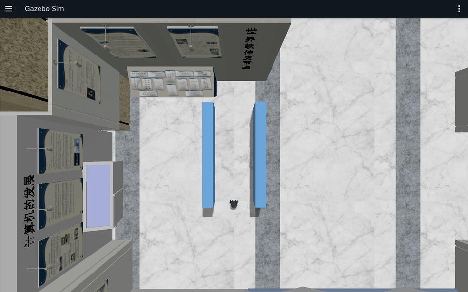
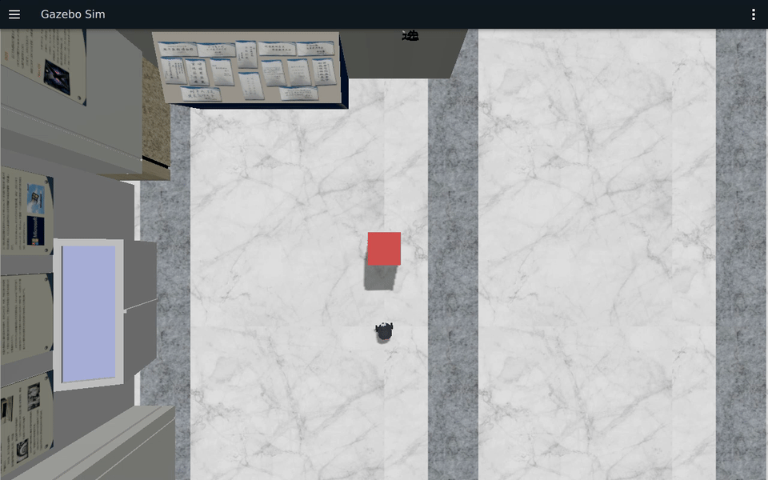
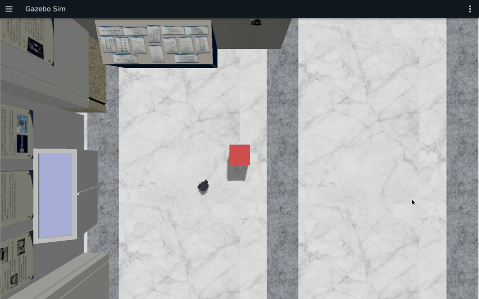

# 第19章 局部路径规划

> **课程**：ROS 2 C++17 编程（COM260 Kit / Humble）  
> **章节**：第19章  
> **课时**：2 课时（90 分钟）  
> **教学方式**：讲授 + 演示  

先完成[第 19 章环境配置](../lab_manuals_k3_com260_kit/ch00_common_setup.md#ch19)。COM260 运行 C++17 节点，x86 运行 Gazebo、Nav2 和 RViz。

---

## 学习目标

本章学习目标包括：理解DWA(动态窗口法)算法的原理和实现，掌握Regulated Pure Pursuit控制器的工作机制，熟悉局部路径规划的轨迹评价方法，能够在Nav2中配置DWB和RPP控制器，掌握局部规划参数调优方法。

## 19.1 局部路径规划概述

### 19.1.1 问题定义

局部路径规划是在全局路径的引导下，根据传感器实时信息生成安全的速度指令，实现动态避障和路径跟踪。

**与全局规划的区别：**

| 特性 | 全局路径规划 | 局部路径规划 |
|------|-------------|-------------|
| 规划范围 | 整个地图 | 机器人周围（数米） |
| 信息源 | 已知地图 | 实时传感器 |
| 更新频率 | 低 (1-2 Hz) | 高 (10-50 Hz) |
| 规划目标 | 最短路径 | 路径跟踪+避障 |
| 输出 | 路径点序列 | 速度指令 (v, ω) |

**局部规划的核心挑战：**包括实时性（需要在毫秒级生成控制指令）、安全性（必须避开动态障碍物）、平滑性（速度变化不能太剧烈）和可达性（满足机器人运动学约束）。

### 19.1.2 Nav2局部控制器

Nav2支持多种局部控制器插件：

| 控制器 | 算法 | 特点 | 适用场景 |
|--------|------|------|---------|
| DWB | 动态窗口法 + 评分 | 功能最全，可定制 | 通用场景 |
| Regulated Pure Pursuit | 调节纯追踪 | 简单可靠 | 差速/阿克曼 |
| MPPI | 模型预测路径积分 | 采样+并行优化 | 高端动态场景 |
| TEB | 时间弹性带 | 考虑时间最优 | 复杂环境 |

### 19.1.3 官方要点——controller_server 官方文档的插件化局部控制框架

docs.nav2.org 将 controller_server 描述为一个 FollowPath Action 服务器：全局规划器只负责给出路径，实际的速度指令由通过插件加载的控制器以 `controller_frequency`（默认 20 Hz）频率在最新代价地图上计算。官方强调这一解耦的价值——全局规划可以低频运行以节省算力，而局部控制必须高频响应动态障碍，两者互不阻塞。文档还指出控制器在计算前会检查新目标位姿与 TF 是否就绪，未就绪时直接返回失败并由行为树接管恢复，这解释了本章 19.2 中"控制器报错先查上游"的排障顺序。

## 19.2 DWA动态窗口法

### 19.2.1 DWA算法原理

DWA (Dynamic Window Approach) 在速度空间中采样，预测每条轨迹的未来状态，通过评分选择最优速度指令。

**算法流程：**
```
1. 生成速度采样窗口
   - 考虑最大/最小速度限制
   - 考虑加速度限制（动态窗口）
   - 考虑安全停止距离

2. 对每组速度 (v, ω) 模拟轨迹
   - 使用运动模型前向模拟
   - 预测未来N步的位姿

3. 评估每条轨迹
   - 方向评分（与目标对齐）
   - 障碍物评分（最小距离）
   - 速度评分（鼓励高速）
   - 路径评分（与全局路径对齐）

4. 选择最优速度
   - 加权求和各评分
   - 选择综合得分最高的速度
```

### 19.2.2 C++ 实现

```cpp
#pragma once
#include <array>
#include <grid_path_planner/search.hpp>

struct Motion { double x, y, yaw, v, w; };
struct Velocity { double v = 0, w = 0; };
struct DWAConfig {
  double max_speed = 0.5, min_speed = 0, max_yaw_rate = 1;
  double max_accel = 2, max_yaw_accel = 3;
  double dt = 0.1, predict_time = 2, v_step = 0.05, w_step = 0.1;
  double radius = 0.22;
};
struct TrajectoryScore { double heading = 0, obstacle = 0, velocity = 0, path = 0; };
struct DWAResult {
  Velocity command;
  std::vector<Motion> trajectory;
  double score = -std::numeric_limits<double>::infinity();
};

inline std::array<double, 4> dynamic_window(Motion state, const DWAConfig & c) {
  return {std::max(c.min_speed, state.v - c.max_accel * c.dt),
    std::min(c.max_speed, state.v + c.max_accel * c.dt),
    std::max(-c.max_yaw_rate, state.w - c.max_yaw_accel * c.dt),
    std::min(c.max_yaw_rate, state.w + c.max_yaw_accel * c.dt)};
}

inline std::vector<Motion> predict_trajectory(Motion state, Velocity command, const DWAConfig & c) {
  std::vector<Motion> trajectory{state};
  for (int step = 0; step < static_cast<int>(std::ceil(c.predict_time / c.dt)); ++step) {
    state.x += command.v * std::cos(state.yaw) * c.dt;
    state.y += command.v * std::sin(state.yaw) * c.dt;
    state.yaw += command.w * c.dt;
    state.v = command.v; state.w = command.w;
    trajectory.push_back(state);
  }
  return trajectory;
}

inline double point_path_distance(Point point, const Path & path) {
  double nearest = std::hypot(point.first - path.front().first, point.second - path.front().second);
  for (std::size_t i = 1; i < path.size(); ++i) {
    const auto [ax, ay] = path[i - 1];
    const double dx = path[i].first - ax, dy = path[i].second - ay;
    const double squared = dx * dx + dy * dy;
    const double t = squared == 0 ? 0 : std::clamp(
      ((point.first - ax) * dx + (point.second - ay) * dy) / squared, 0.0, 1.0);
    nearest = std::min(nearest, std::hypot(point.first - ax - t * dx, point.second - ay - t * dy));
  }
  return nearest;
}

inline double score_trajectory(const std::vector<Motion> & trajectory, Point goal,
                              const Path & obstacles, const Path & path,
                              const DWAConfig & c, TrajectoryScore & scores) {
  const auto end = trajectory.back();
  const double angle = end.yaw - std::atan2(goal.second - end.y, goal.first - end.x);
  scores.heading = 1 - std::abs(std::atan2(std::sin(angle), std::cos(angle))) / std::acos(-1);
  double clearance = std::numeric_limits<double>::infinity();
  scores.path = 0;
  for (auto state : trajectory) {
    for (auto [x, y] : obstacles) { clearance = std::min(clearance, std::hypot(state.x - x, state.y - y) - c.radius); }
    if (!path.empty()) {
      scores.path += 1 / (1 + point_path_distance({state.x, state.y}, path));
    }
  }
  const double braking = end.v * end.v / (2 * c.max_accel);
  if (clearance <= braking) { return -std::numeric_limits<double>::infinity(); }
  scores.obstacle = std::min(1.0, clearance / 0.5);
  scores.velocity = end.v / c.max_speed;
  scores.path /= trajectory.size();
  return scores.heading + 0.5 * scores.obstacle + 0.3 * scores.velocity + 2 * scores.path;
}

inline DWAResult dwa_plan(Motion state, Point goal, const Path & obstacles,
                          const Path & path = {}, const DWAConfig & c = {}) {
  DWAResult best;
  for (double value : {state.x, state.y, state.yaw, state.v, state.w, goal.first, goal.second,
      c.max_speed, c.min_speed, c.max_yaw_rate, c.max_accel, c.max_yaw_accel,
      c.dt, c.predict_time, c.v_step, c.w_step, c.radius}) {
    if (!std::isfinite(value)) { return best; }
  }
  for (const auto * points : {&obstacles, &path}) {
    for (auto [x, y] : *points) { if (!std::isfinite(x) || !std::isfinite(y)) { return best; } }
  }
  if (c.max_speed <= 0 || c.max_accel <= 0 || c.dt <= 0 || c.predict_time <= 0 ||
      c.v_step <= 0 || c.w_step <= 0 || c.radius <= 0 || c.max_yaw_rate <= 0 ||
      c.max_yaw_accel <= 0 || c.min_speed < 0 || c.min_speed > c.max_speed) { return best; }
  const double remaining = std::hypot(state.x - goal.first, state.y - goal.second);
  if (remaining <= 0.1) { return best; }
  if (!path.empty()) {
    auto nearest = std::min_element(path.begin(), path.end(), [&](Point a, Point b) {
      return std::hypot(a.first - state.x, a.second - state.y) <
        std::hypot(b.first - state.x, b.second - state.y);
    });
    double ahead = 0;
    goal = *nearest;
    for (auto next = nearest + 1; next != path.end() && ahead < 0.6; ++next) {
      ahead += std::hypot(next->first - goal.first, next->second - goal.second);
      goal = *next;
    }
  }
  auto window = dynamic_window(state, c);
  window[1] = std::min(window[1], remaining / (2 * c.predict_time));
  if (window[1] < window[0] || window[3] < window[2]) { return best; }
  const int nv = std::max(1, static_cast<int>(std::ceil((window[1] - window[0]) / c.v_step)));
  const int nw = std::max(1, static_cast<int>(std::ceil((window[3] - window[2]) / c.w_step)));
  for (int i = 0; i <= nv; ++i) {
    for (int j = -1; j <= nw; ++j) {
      const double yaw_rate = j < 0 ? 0 : window[2] + (window[3] - window[2]) * j / nw;
      if (yaw_rate < window[2] || yaw_rate > window[3]) { continue; }
      Velocity command{window[0] + (window[1] - window[0]) * i / nv,
        yaw_rate};
      const auto trajectory = predict_trajectory(state, command, c);
      TrajectoryScore scores;
      const double score = score_trajectory(trajectory, goal, obstacles, path, c, scores);
      if (score > best.score) { best = {command, trajectory, score}; }
    }
  }
  return best;
}
```

[完整源码与构建说明](../src_k3_com260_kit/dwa_planner/README.md)。算法默认速度上限为 0.5 m/s、加速度为 2 m/s²、角加速度为 3 rad/s²、步长为 0.1 s、预测时长为 2 s；Gazebo 闭环节点限速 0.15 m/s。无有效轨迹、无效输入或到达目标时输出零速度。方向评分使用全局路径上前方约 0.6 m 的局部目标，避免被障碍后方的最终目标吸引而停滞；到达判断仍使用最终目标。接近终点时将预测位移限制在剩余距离的一半内，避免候选轨迹越过终点而导致静止候选长期占优。

在 COM260 上先运行动态窗口数值示例：

```bash
source ~/.config/ros2-course-com260-ch18-ch19/env.bash
ros2 run dwa_planner dwa_planner
```

在已按[第 19 章环境配置](../lab_manuals_k3_com260_kit/ch00_common_setup.md#ch19)设置好 DDS 的 x86 终端运行以下命令。COM260 的每个新终端先加载本章的 `env.bash`。

```bash
cd ~/ROS2_RISCV_COM260_CH18_CH19
export RUN_ID="$(date -u +%Y%m%dT%H%M%SZ)-planning"
bash course_support/k3_com260_kit/scripts/x86-ch18-ch19.bash start "$RUN_ID" navfn dwb
```

COM260 查询就绪状态，等待以下节点均为 `active [3]`：

```bash
source ~/.config/ros2-course-com260-ch18-ch19/env.bash
ros2 lifecycle get /planner_server
ros2 lifecycle get /controller_server
ros2 lifecycle get /bt_navigator
ros2 param get /planner_server GridBased.plugin
ros2 param get /controller_server FollowPath.plugin
```

Gazebo 刚启动时可能暂缺 map/odom TF。必须等地图、机器人、扫描和 TF 就绪后再发送目标。

使用全新仿真。COM260 终端一：

```bash
source ~/.config/ros2-course-com260-ch18-ch19/env.bash
ros2 run dwa_planner dwa_controller --ros-args -p use_sim_time:=true
```

终端二加载相同环境，待节点已订阅后发送路径：

```bash
source ~/.config/ros2-course-com260-ch18-ch19/env.bash
ros2 run global_planner_client global_planner_client --ros-args \
  -p use_sim_time:=true -p goal_x:=1.0 -p goal_y:=0.0
```

DWA 节点按真实 odom/scan 运行，默认限速 0.15 m/s。到达路径终点 0.1 m 内后发送停止并退出；按 Ctrl+C 也会发送停止。odom 或 scan 的接收间隔超过 0.5 s 时停止发送运动速度。不要同时运行 NavigateToPose 或其他 `/cmd_vel` 控制源。

测试 DWA 的 SIGINT、SIGTERM 和扫描输入失联时，先确认机器人实际运动，再检查 `/odom` 连续尾段停车；输入失联后，应在发出清理信号前确认机器人已停止。SIGINT 返回 1；SIGTERM 的 `ros2 run` 外层进程返回 -15，需通过实际里程计确认停车。无效限速返回 2，隔离域无输入超时返回 1。

[SIGINT 记录](../lab_manuals_k3_com260_kit/images/nav2_ch18_ch19/dwa-cancel.cast)、[SIGTERM 记录](../lab_manuals_k3_com260_kit/images/nav2_ch18_ch19/dwa-term.cast)、[输入失联记录](../lab_manuals_k3_com260_kit/images/nav2_ch18_ch19/dwa-stale.cast)、[失联停车 30 秒原速视频](../lab_manuals_k3_com260_kit/images/nav2_ch18_ch19/dwa-stale-gazebo.mp4)。

### 19.2.3 DWA评分机制详解

```cpp
inline double score_trajectory(const std::vector<Motion> & trajectory, Point goal,
                              const Path & obstacles, const Path & path,
                              const DWAConfig & c, TrajectoryScore & scores) {
  const auto end = trajectory.back();
  const double angle = end.yaw - std::atan2(goal.second - end.y, goal.first - end.x);
  scores.heading = 1 - std::abs(std::atan2(std::sin(angle), std::cos(angle))) / std::acos(-1);
  double clearance = std::numeric_limits<double>::infinity();
  scores.path = 0;
  for (auto state : trajectory) {
    for (auto [x, y] : obstacles) { clearance = std::min(clearance, std::hypot(state.x - x, state.y - y) - c.radius); }
    if (!path.empty()) {
      scores.path += 1 / (1 + point_path_distance({state.x, state.y}, path));
    }
  }
  const double braking = end.v * end.v / (2 * c.max_accel);
  if (clearance <= braking) { return -std::numeric_limits<double>::infinity(); }
  scores.obstacle = std::min(1.0, clearance / 0.5);
  scores.velocity = end.v / c.max_speed;
  scores.path /= trajectory.size();
  return scores.heading + 0.5 * scores.obstacle + 0.3 * scores.velocity + 2 * scores.path;
}
```

评分权重为方向 1.0、障碍 0.5、速度 0.3、路径 2.0。净距小于等于 `v²/(2a)` 的候选轨迹直接拒绝；角差先归一化，路径项取每个预测点到全局路径线段的最近距离，避免稀疏路径点让静止状态获得不合理优势。这个点障碍教学模型不包含传感器误差、网络延迟和障碍运动预测，仿真结论不等于实车安全保证。

## 19.3 DWB控制器

### 19.3.1 DWB与DWA的关系

DWB (Dynamic Window Based) 是Nav2中DWA的升级实现，增加了更多可配置的评分器（Critic）：

**DWB的核心组件：**Critics（评分器）负责评估轨迹的各项指标，Goal Checker（目标检查器）判断是否到达目标，Oscillation Handler（振荡处理器）防止前进-后退振荡。

### 19.3.2 DWB参数配置

```yaml
controller_server:
  ros__parameters:
    use_sim_time: true
    controller_frequency: 20.0
    min_x_velocity_threshold: 0.001
    min_y_velocity_threshold: 0.5
    min_theta_velocity_threshold: 0.001
    failure_tolerance: 0.3
    progress_checker_plugin: progress_checker
    goal_checker_plugins:
    - general_goal_checker
    controller_plugins:
    - FollowPath
    progress_checker:
      plugin: nav2_controller::SimpleProgressChecker
      required_movement_radius: 0.1
      movement_time_allowance: 10.0
    general_goal_checker:
      stateful: true
      plugin: nav2_controller::SimpleGoalChecker
      xy_goal_tolerance: 0.1
      yaw_goal_tolerance: 0.25
    FollowPath:
      plugin: dwb_core::DWBLocalPlanner
      debug_trajectory_details: true
      min_vel_x: 0.0
      min_vel_y: 0.0
      max_vel_x: 0.26
      max_vel_y: 0.0
      max_vel_theta: 1.0
      min_speed_xy: 0.0
      max_speed_xy: 0.26
      min_speed_theta: 0.0
      acc_lim_x: 2.5
      acc_lim_y: 0.0
      acc_lim_theta: 3.2
      decel_lim_x: -2.5
      decel_lim_y: 0.0
      decel_lim_theta: -3.2
      vx_samples: 20
      vy_samples: 5
      vtheta_samples: 20
      sim_time: 1.7
      linear_granularity: 0.05
      angular_granularity: 0.025
      transform_tolerance: 0.2
      xy_goal_tolerance: 0.1
      trans_stopped_velocity: 0.25
      short_circuit_trajectory_evaluation: true
      stateful: true
      critics:
      - RotateToGoal
      - Oscillation
      - BaseObstacle
      - GoalAlign
      - PathAlign
      - PathDist
      - GoalDist
      BaseObstacle.scale: 0.02
      PathAlign.scale: 32.0
      PathAlign.forward_point_distance: 0.1
      GoalAlign.scale: 24.0
      GoalAlign.forward_point_distance: 0.1
      PathDist.scale: 32.0
      GoalDist.scale: 24.0
      RotateToGoal.scale: 32.0
      RotateToGoal.slowing_factor: 5.0
      RotateToGoal.lookahead_time: -1.0
```

配置与本章实际仿真一致。Burger 的线速度上限为 0.26 m/s；原理示例中的 0.5 m/s 不直接写入机器人参数。Humble 的目标检查器位于 controller_server 的 `general_goal_checker` 命名空间，插件名为 `nav2_controller::SimpleGoalChecker`。`BaseObstacle.scale=0.02` 与路径类权重分别作用于不同量纲，不应只比较数值大小。

使用 `navfn dwb` 的全新仿真，添加两堵静态墙：

```bash
bash course_support/k3_com260_kit/scripts/x86-ch18-ch19.bash exec "$RUN_ID" \
  env GZ_PARTITION="$RUN_ID" ros2 run ros_gz_sim create \
  -world default -file /course-config/corridor.sdf -name course_corridor
```

墙体覆盖 x=0～2 m，中心 y=±0.5 m、厚度 0.2 m，因此内侧净宽为 **0.8 m**。在 COM260 向 `(2.2, 0)` 发送导航目标，检查通过时的横向偏差、墙体净距、终点误差与停止状态。

DWB 使用默认配置通过净宽 **0.8 m** 的走廊：目标 `(2.2,0)`，行驶 2.0547 m，最大横向偏差 0.1117 m，按 0.22 m 半径计算的最小墙体净距 **0.0683 m**，终点误差 **0.0977 m**，停车通过。



GIF 为第 10～45 秒。[65 秒原速视频](../lab_manuals_k3_com260_kit/images/nav2_ch18_ch19/corridor-gazebo.mp4)、[截图](../lab_manuals_k3_com260_kit/images/nav2_ch18_ch19/corridor-gazebo.png)。

### 19.3.3 评分器详解

```cpp
#pragma once
#include "dwa_planner/dwa.hpp"

// Small scoring examples; Nav2 DWB loads its own critic plugins.
inline double obstacle_cost(const std::vector<Motion> & trajectory, const Costmap2D & map) {
  double total = 0;
  if (trajectory.empty()) { return std::numeric_limits<double>::infinity(); }
  for (auto state : trajectory) {
    if (!inside_map(map, {state.x, state.y}) || map.get_cost(state.x, state.y) >= 253) {
      return std::numeric_limits<double>::infinity();
    }
    total += map.get_cost(state.x, state.y);
  }
  return total / trajectory.size();
}

inline double path_distance(const std::vector<Motion> & trajectory, const Path & path) {
  if (trajectory.empty() || path.empty()) { return std::numeric_limits<double>::infinity(); }
  double total = 0;
  for (auto state : trajectory) {
    total += point_path_distance({state.x, state.y}, path);
  }
  return total / trajectory.size();
}

inline double oscillation_cost(const std::vector<Velocity> & history) {
  if (history.size() < 5) { return 0; }
  double cost = 0;
  for (std::size_t i = history.size() - 4; i < history.size(); ++i) {
    if (history[i - 1].v * history[i].v < 0) { cost += 100; }
  }
  return cost;
}
```

这里是评分含义的数值演示，分数越小越好。GoalDist 可直接用 `std::hypot(end.x-goal.first, end.y-goal.second)`；朝向误差用 `atan2(sin(error), cos(error))` 归一化。Nav2 实际加载自己的 critic 插件，RotateToGoal 还包含终点减速/转向阶段，不能与这个简化角度公式视为完全相同。

每个场景使用全新仿真，避免上一个任务的位姿、障碍或代价地图影响对比。

x86 在已启动的仿真中添加有真实碰撞几何的 0.3 × 0.3 × 0.5 m 箱体，中心为 `(0.8, 0)`：

```bash
bash course_support/k3_com260_kit/scripts/x86-ch18-ch19.bash exec "$RUN_ID" \
  env GZ_PARTITION="$RUN_ID" ros2 run ros_gz_sim create \
  -world default -file /course-config/planning-obstacle.sdf -name course_obstacle \
  -x 0.8 -y 0.0 -z 0.25
```

等待激光与代价地图更新，再向 `(1.5, 0)` 规划/导航。分别记录自编 DWA 和 Nav2 DWB/RPP 的路径、实际轨迹、最近障碍距离与停止情况。RPP 依赖全局规划器提供绕障路径，不将碰撞前停止等同于已完成避障通行。

本箱体场景的 DWB 使用 **3.0 s 预测时域**；默认 1.7 s 在此场景未完成导航。保持 `planning.yaml` 中其余权重、足迹和目标容差，在发送目标前于 COM260 执行：

```bash
ros2 service call /lifecycle_manager_navigation/manage_nodes \
  nav2_msgs/srv/ManageLifecycleNodes '{command: 3}'
ros2 param set /controller_server FollowPath.sim_time 3.0
ros2 service call /lifecycle_manager_navigation/manage_nodes \
  nav2_msgs/srv/ManageLifecycleNodes '{command: 0}'
ros2 param get /controller_server FollowPath.sim_time
ros2 lifecycle get /controller_server
```

两次服务响应须为 `success=True`，参数为 `3.0`，节点重新进入 `active [3]` 后再导航。这里先 RESET 再 STARTUP，使控制器按新参数重新配置；不能仅看到参数设置成功就推断内部轨迹生成器已更新。该设置用于 DWB 箱体场景；启动全新仿真会重新加载默认配置。

### 19.3.4 官方要点——DWB 评分体系与 critics 插件的组合调优

DWB 在每个周期对速度空间采样，沿候选轨迹组合 critic 代价；采样数和预测时长影响计算量。当前配置使用 BaseObstacle、PathAlign、PathDist、GoalAlign、GoalDist、RotateToGoal 和 Oscillation。碰撞拒绝、路径跟踪、目标减速与振荡处理需要一起观察，调权重时记录实际轨迹，避免只提高某一项而破坏其他行为。

## 19.4 Regulated Pure Pursuit

### 19.4.1 Pure Pursuit基本原理

Pure Pursuit是一种基于几何追踪的路径跟踪算法，通过追踪前方的一个目标点来引导机器人。

**算法原理：**
```
1. 在全局路径上找到一个前瞻点 (lookahead point)
   - 距离机器人当前位置为 lookahead_distance

2. 计算机器人到前瞻点的转角
   - 使用圆弧拟合，圆弧经过机器人和前瞻点

3. 输出速度指令
   - 线速度：根据曲率自适应调节
   - 角速度：圆弧曲率
```

**曲率计算公式：**
```
γ = 2 * sin(α) / L

其中:
- α: 机器人朝向与前向量之间的夹角
- L: 前瞻距离
- γ: 曲率

控制量:
- ω = v * γ (角速度 = 线速度 × 曲率)
```

### 19.4.2 Regulated Pure Pursuit实现

```cpp
#pragma once
#include <array>
#include <grid_path_planner/search.hpp>

struct RPPConfig {
  double desired_speed = 0.3, max_speed = 0.5, min_speed = 0.05, max_yaw_rate = 1;
  double lookahead = 1, min_lookahead = 0.3, max_lookahead = 2;
  double max_curvature = 0.5, curvature_weight = 0.3, cost_gain = 1;
};
struct RPPCommand { double v = 0, w = 0, curvature = 0; Point target{}; };

inline RPPCommand pure_pursuit(std::array<double, 3> pose, const Path & path,
                               const Costmap2D * map = nullptr,
                               double current_speed = 0.3, const RPPConfig & c = {}) {
  RPPCommand command;
  for (double value : {pose[0], pose[1], pose[2], current_speed, c.desired_speed, c.max_speed,
      c.min_speed, c.max_yaw_rate, c.lookahead, c.min_lookahead, c.max_lookahead,
      c.max_curvature, c.curvature_weight, c.cost_gain}) {
    if (!std::isfinite(value)) { return command; }
  }
  for (auto [x, y] : path) { if (!std::isfinite(x) || !std::isfinite(y)) { return command; } }
  if (path.size() < 2 || c.desired_speed <= 0 || c.max_speed <= 0 || c.max_yaw_rate <= 0 ||
      c.min_speed < 0 || c.min_speed > c.max_speed || c.min_lookahead <= 0 ||
      c.max_lookahead < c.min_lookahead || c.max_curvature <= 0) { return command; }
  if (map && !inside_map(*map, {pose[0], pose[1]})) { return command; }
  const auto goal = path.back();
  if (std::hypot(goal.first - pose[0], goal.second - pose[1]) <= 0.1) { return command; }
  if (map && map->get_cost(pose[0], pose[1]) >= 253) { return command; }
  std::size_t nearest = 0;
  double best = std::numeric_limits<double>::infinity();
  for (std::size_t i = 0; i < path.size(); ++i) {
    double distance = std::hypot(path[i].first - pose[0], path[i].second - pose[1]);
    if (distance < best) { best = distance; nearest = i; }
  }
  const double lookahead = std::clamp(c.lookahead + std::abs(current_speed) * 0.5,
    c.min_lookahead, c.max_lookahead);
  command.target = goal;
  for (std::size_t i = nearest; i < path.size(); ++i) {
    if (std::hypot(path[i].first - pose[0], path[i].second - pose[1]) >= lookahead) {
      command.target = path[i]; break;
    }
  }
  const double dx = command.target.first - pose[0], dy = command.target.second - pose[1];
  const double angle = std::atan2(std::sin(std::atan2(dy, dx) - pose[2]),
    std::cos(std::atan2(dy, dx) - pose[2]));
  if (std::abs(angle) > std::acos(-1) / 4) {
    command.w = std::clamp(angle, -c.max_yaw_rate, c.max_yaw_rate);
    return command;
  }
  command.curvature = std::clamp(2 * std::sin(angle) / std::hypot(dx, dy),
    -c.max_curvature, c.max_curvature);
  double speed = c.desired_speed * std::max(0.3, 1 - std::abs(command.curvature) * c.curvature_weight);
  if (map) { speed *= std::max(0.1, 1 - map->get_cost(pose[0], pose[1]) / 254.0 * c.cost_gain); }
  command.v = std::clamp(speed, c.min_speed, c.max_speed);
  if (command.curvature != 0) { command.v = std::min(command.v, c.max_yaw_rate / std::abs(command.curvature)); }
  command.w = command.v * command.curvature;
  if (map) {
    auto predicted = pose;
    Point previous{pose[0], pose[1]};
    for (int i = 0; i < 10; ++i) {
      predicted[0] += command.v * std::cos(predicted[2]) * 0.1;
      predicted[1] += command.v * std::sin(predicted[2]) * 0.1;
      predicted[2] += command.w * 0.1;
      Point next{predicted[0], predicted[1]};
      if (!clear_segment(*map, previous, next)) { return {}; }
      previous = next;
    }
  }
  return command;
}
```

[完整源码](../src_k3_com260_kit/rpp_controller/README.md)从最近路径进度向前选择目标，保留曲率、代价和速度调节，并在到达目标或预测碰撞时停止。这是原理示例；下面的 Nav2 RPP 插件使用其自身实现与参数，不会执行这个函数。

在 COM260 上比较速度与前瞻距离：

```bash
source ~/.config/ros2-course-com260-ch18-ch19/env.bash
ros2 run rpp_controller rpp_controller
```

### 19.4.3 RPP配置

```yaml
controller_server:
  ros__parameters:
    controller_plugins:
    - FollowPath
    FollowPath:
      plugin: nav2_regulated_pure_pursuit_controller::RegulatedPurePursuitController
      desired_linear_vel: 0.26
      lookahead_dist: 1.0
      min_lookahead_dist: 0.3
      max_lookahead_dist: 2.0
      lookahead_time: 1.5
      use_velocity_scaled_lookahead_dist: true
      use_regulated_linear_velocity_scaling: true
      use_cost_regulated_linear_velocity_scaling: true
      regulated_linear_scaling_min_radius: 0.9
      regulated_linear_scaling_min_speed: 0.05
      cost_scaling_dist: 0.3
      cost_scaling_gain: 1.0
      inflation_cost_scaling_factor: 3.0
      use_collision_detection: true
      max_allowed_time_to_collision_up_to_carrot: 1.0
      use_rotate_to_heading: true
      rotate_to_heading_angular_vel: 1.0
      max_angular_accel: 3.2
      transform_tolerance: 0.2
```

本节列出 Humble 支持的参数。max_linear_vel、max_allowed_curvature 等是教学函数参数，不是此 Nav2 RPP 插件的参数；前瞻与调速开关使用完整的 `_dist` / `_scaling` 名称。

### 19.4.4 DWB vs RPP对比

| 特性 | DWB | RPP |
|---|---|---|
| 算法基础 | 动态窗口采样 + 多评分器 | 几何追踪 + 速度调节 |
| 计算量 | 随候选轨迹、预测步数与评分器增长 | 主要为路径检索与前向碰撞检查 |
| 参数 | 较多，需协调 critic 权重 | 重点是速度、前瞻和 regulation |
| 狭窄通道 | 受足迹、采样和权重影响 | 受前瞻距离和路径曲率影响 |
| 障碍物 | 在候选轨迹中选可行速度 | 碰撞检查后减速或停止，依赖上游绕障路径 |
| 平滑性与精度 | 需实测 | 需实测 |

按相同地图、初始位姿、目标和障碍设置比较，记录轨迹和停止反馈；不能由算法名称直接推断穿越成功率。

箱体场景目标均为 `(1.5,0)`。DWB 按 19.3.3 节将预测时域设为 3.0 s，其余设置不变；RPP 使用默认配置，自编 DWA 限速 0.15 m/s。

| 控制器 | 记录时长 s | 行驶距离 m | 终点误差 m | 跟踪 RMS m | 最小箱体净距 m | 原速视频 |
|---|---:|---:|---:|---:|---:|---|
| DWB（3.0 s） | 124.900 | 1.9787 | 0.0968 | 0.0227 | 0.0796 | [140 秒](../lab_manuals_k3_com260_kit/images/nav2_ch18_ch19/dwb-box-lookahead-gazebo.mp4) |
| RPP | 59.933 | 2.3573 | 0.1063 | 0.0192 | 0.2690 | [140 秒](../lab_manuals_k3_com260_kit/images/nav2_ch18_ch19/rpp-box-full-gazebo.mp4) |
| 自编 DWA | 62.799 | 1.9930 | 0.1410 | 0.0653 | 0.1344 | [110 秒](../lab_manuals_k3_com260_kit/images/nav2_ch18_ch19/dwa-box-gazebo.mp4) |

三组均到点并停稳。时长从启动客户端计至尾段采样结束，包含启动、恢复行为和结束采样；跟踪 RMS 相对于每次更新的全局路径，不是同一条固定参考曲线。净距由仿真 odom、箱体几何和 0.22 m 验收半径计算。以上是单次场景结果，不作为普遍性能排名。DWA 的到达阈值针对转换后的路径终点，表中误差针对请求的地图目标，两者不是同一数值。



GIF 为原片第 12～47 秒。[DWA 截图](../lab_manuals_k3_com260_kit/images/nav2_ch18_ch19/dwa-box-gazebo.png)、[DWB 截图](../lab_manuals_k3_com260_kit/images/nav2_ch18_ch19/dwb-box-lookahead-gazebo.png)。



GIF 为原片第 25～60 秒。[RPP 截图](../lab_manuals_k3_com260_kit/images/nav2_ch18_ch19/rpp-box-full-gazebo.png)。

### 19.4.5 官方要点——Regulated Pure Pursuit 的曲率与障碍双调节

Humble RPP 使用 `use_regulated_linear_velocity_scaling` 与 `use_cost_regulated_linear_velocity_scaling` 开启曲率和障碍调速，距离参数为 `cost_scaling_dist`；`use_velocity_scaled_lookahead_dist` 配合 `lookahead_time` 决定前瞻距离。前向碰撞检查由 `use_collision_detection` 与 `max_allowed_time_to_collision_up_to_carrot` 控制。RPP 不做 DWA 式速度采样，绕障路径由上游规划器提供；这些行为需与练习 5 的实际轨迹对照。

## 19.5 MPPI控制器

### 19.5.1 MPPI原理

MPPI (Model Predictive Path Integral) 是一种基于采样的模型预测控制方法：

**核心思想：**对控制序列进行多次采样（加入噪声），前向模拟每条采样序列的未来状态，根据代价函数计算每条序列的权重，加权平均生成最优控制序列，然后执行第一个控制指令并重复。

### 19.5.2 MPPI优势

MPPI可以处理非线性模型，通过多条候选控制序列的代价加权选择控制量。它适合研究复杂场景中的控制优化，但计算成本随采样数和预测时域增加；实时性和模型误差影响需实测。

```yaml
controller_server:
  ros__parameters:
    controller_plugins:
    - FollowPath
    FollowPath:
      plugin: nav2_mppi_controller::MPPIController
      batch_size: 1000
      time_steps: 56
      model_dt: 0.1
      vx_std: 0.2
      vy_std: 0.0
      wz_std: 0.4
      vx_max: 0.26
      vx_min: 0.0
      vy_max: 0.0
      wz_max: 1.0
      motion_model: DiffDrive
      critics:
      - ConstraintCritic
      - ObstaclesCritic
      - GoalCritic
      - GoalAngleCritic
      - PathAlignCritic
      - PathFollowCritic
      - PathAngleCritic
      - PreferForwardCritic
      PathFollowCritic.cost_weight: 5.0
      GoalCritic.cost_weight: 5.0
      ObstaclesCritic.repulsion_weight: 10.0
    controller_frequency: 10.0
```

本节列出当前 Humble 实际支持的参数。采样数与步长分别使用 `batch_size`、`model_dt`，代价权重设置到对应 critic。控制频率 10 Hz 与 0.1 s 模型步长匹配；Humble 实现使用 CPU 数值运算，本配置没有启用 GPU。

允许的规划器为 `navfn`、`astar`、`smac2d`、`hybrid`；控制器为 `dwb`、`rpp`、`mppi`。参数见 [planning.yaml](../course_support/k3_com260_kit/config/planning.yaml)。切换时先停止当前仿真，再生成新 RUN_ID 启动，使 Nav2 加载所选插件。

```bash
bash course_support/k3_com260_kit/scripts/x86-ch18-ch19.bash stop "$RUN_ID"
export RUN_ID="$(date -u +%Y%m%dT%H%M%SZ)-rpp"
bash course_support/k3_com260_kit/scripts/x86-ch18-ch19.bash start "$RUN_ID" navfn rpp
```

保持规划器为 `navfn`。依次以 `dwb`、`rpp`、`mppi` 启动全新仿真，等待节点激活，然后从 COM260 发送相同目标：

```bash
ros2 run navigation_client_cpp bt_navigator_client --ros-args \
  -p use_sim_time:=true -p x:=1.0 -p y:=0.0
ros2 topic echo /odom --once
```

验收目标被接受、终态 SUCCEEDED、实际机器人发生位移，并在结束后归零。目标误差从 `map → base_link` TF 计算；停止从 `/odom.twist.twist` 的连续尾段采样判断，不能只检查 `/cmd_vel`。

三种官方控制器使用相同初始位姿、NavFn 规划器和空闲目标 `(1,0)`。

| 控制器 | 记录时长 s | 终点误差 m | 跟踪 RMS m | 停车 | 原速视频 |
|---|---:|---:|---:|---|---|
| DWB | 14.319 | 0.0985 | 0.0076 | 通过 | [55 秒](../lab_manuals_k3_com260_kit/images/nav2_ch18_ch19/dwb-free-gazebo.mp4) |
| RPP | 16.351 | 0.0957 | 0.0063 | 通过 | [55 秒](../lab_manuals_k3_com260_kit/images/nav2_ch18_ch19/rpp-free-gazebo.mp4) |
| MPPI | 19.285 | 0.0977 | 0.0111 | 通过 | [50 秒](../lab_manuals_k3_com260_kit/images/nav2_ch18_ch19/mppi-free-gazebo.mp4) |

### 19.5.3 官方要点——控制器选型与插件生态

本课程固定 Humble / Nav2 1.1.20，实际镜像含 DWB、RPP 和 MPPI；默认选择由参数文件决定。Rotation Shim 可在进入路径追踪前先调整朝向，TEB 属于另外集成的插件，不能假定当前镜像已安装。选型时应同时考虑足迹、运动学、地图、CPU 预算和停止行为；本章用同一地图和目标比较 DWB 与 RPP，并单独检查 MPPI 入口。

## 19.6 局部规划参数调优

### 19.6.1 速度参数调优

```cpp
#pragma once
#include <algorithm>
#include <string>
#include <stdexcept>

struct SpeedParameters { double linear, angular, acceleration; };

inline SpeedParameters recommend_speed(const std::string & robot, const std::string & environment) {
  SpeedParameters speed;
  if (robot == "differential") { speed = {0.5, 1.0, 2.5}; }
  else if (robot == "ackermann") { speed = {0.8, 0.5, 1.5}; }
  else { throw std::invalid_argument("unknown robot type"); }
  if (environment == "narrow") { speed.linear *= 0.6; speed.acceleration *= 0.7; }
  else if (environment == "open") { speed.linear *= 1.2; }
  return speed;
}
```

这些函数用于调参练习，不直接控制 Burger；最终速度还必须受模型和实际配置上限约束。

### 19.6.2 前瞻距离调优

前瞻距离是RPP最关键参数：

```cpp
inline double recommend_lookahead(double speed, double frequency, double length) {
  if (frequency <= 0) { throw std::invalid_argument("frequency must be positive"); }
  return std::clamp((speed * 3 * 10 / frequency + length * 2) / 2, 0.3, 3.0);
}
```

这是启发式建议，不是优化器给出的全局最优值。Humble RPP 的速度缩放前瞻使用 `lookahead_time`、`min_lookahead_dist` 和 `max_lookahead_dist`，与此练习公式分开。

### 19.6.3 评分权重调优指南

下列数值用于权重比较练习。不同量纲的评分项需分别解释，控制器参数见 [planning.yaml](../course_support/k3_com260_kit/config/planning.yaml)。

```yaml
# 不同场景的DWB权重推荐

# 狭窄走廊场景
critics: ["BaseObstacle", "PathAlign", "GoalDist"]
BaseObstacle.scale: 50.0    # 相对同一配置提高障碍代价权重
PathAlign.scale: 50.0       # 强化路径跟踪
GoalDist.scale: 20.0

# 开阔大厅场景
critics: ["BaseObstacle", "GoalAlign", "PathDist", "GoalDist"]
BaseObstacle.scale: 30.0    # 弱化避障
GoalAlign.scale: 40.0       # 强化目标方向
PathDist.scale: 20.0
GoalDist.scale: 30.0

# 动态障碍物场景
critics: ["BaseObstacle", "PathAlign", "GoalAlign", "Oscillation"]
BaseObstacle.scale: 60.0    # 强化避障
PathAlign.scale: 20.0
GoalAlign.scale: 20.0
Oscillation.scale: 15.0
```

### 19.6.4 调试命令

先加载本章 COM260 环境，再按当前控制器查询：

```bash
ros2 param get /controller_server FollowPath.plugin
ros2 param get /controller_server FollowPath.max_vel_x
ros2 param set /controller_server FollowPath.max_vel_x 0.2
ros2 topic echo /cmd_vel --once
ros2 topic echo /odom --once
```

上述速度参数用于 DWB；RPP 使用 `FollowPath.desired_linear_vel`。DWB 开启 `debug_trajectory_details` 后，先用 `ros2 topic list` 确认实际发布的 evaluation/local_plan 话题，再在 RViz 添加对应显示。ROS 参数按具体名称查询，`FollowPath` 只是命名空间。

## 课后练习

1. **原理题:** 说明DWA算法中动态窗口的定义，阐述为什么需要结合速度极限、加速度极限和安全停止距离来生成动态窗口。

2. **编程题:** 实现DWA局部路径规划器，包含速度空间采样、轨迹预测和评分函数，并在仿真环境中测试避障效果。

3. **分析题:** 比较DWB和Regulated Pure Pursuit的异同，分析两种控制器在不同场景下的适用性。

4. **配置题:** 为差速机器人在走廊环境配置DWB控制器参数，要求能够顺利通过0.8m宽的走廊并保持稳定的导航行为。

5. **操作题:** 在仿真环境中分别使用DWB和RPP控制器进行导航，对比两种控制器在路径跟踪精度和安全避障方面的表现。

6. **设计题:** 设计一个自适应控制器切换策略：在宽阔区域使用RPP提高效率，在狭窄通道切换到DWB提高通过能力，并给出切换条件和参数过渡方案。

---

## 仿真结合实例（当前仓库）：控制器跟踪路径并输出速度

### 目标与知识点对应

在 Nav2 仿真中观察 DWB 控制器、局部代价地图和 `/cmd_vel` 的关系，理解局部规划器如何将全局路径和实时激光障碍转换为速度指令。

### 运行步骤

按 19.2.2 节启动仿真。比较 DWB 与 RPP 时，每次从相同起点出发，在 COM260 执行：

```bash
source ~/.config/ros2-course-com260-ch18-ch19/env.bash
ros2 run navigation_client_cpp bt_navigator_client --ros-args \
  -p use_sim_time:=true -p x:=1.0 -p y:=0.0
ros2 topic echo /odom --once
ros2 topic info /scan
```

### 观察结果

发送导航目标后，控制器应根据路径输出速度；RViz 可同时显示 Local Costmap 和路径。若没有 `odom → base_link` TF，控制器会等待变换，需先检查 Gazebo 桥和 TF。

目标验收为地图坐标误差 ≤ 0.25 m；停车要求最后 2 秒满足 `|vx| < 0.02 m/s`、`|wz| < 0.03 rad/s`。RViz 可能出现 GLSL 或粒子云 QoS 提示，应结合地图、路径、机器人运动和数值记录判断导航状态。

停止仿真：

```bash
bash course_support/k3_com260_kit/scripts/x86-ch18-ch19.bash stop "$RUN_ID"
```

### 源码与边界

教学算法与闭环节点位于 [dwa_planner](../src_k3_com260_kit/dwa_planner/README.md)、[rpp_controller](../src_k3_com260_kit/rpp_controller/README.md)。Nav2 DWB/RPP/MPPI 由固定 Humble 镜像提供，配置见 [planning.yaml](../course_support/k3_com260_kit/config/planning.yaml)。

各组导航轨迹和里程计停车反馈见[运行证据](../lab_manuals_k3_com260_kit/runtime_evidence.md#ch19)。

学习材料：
- Nav2 官方文档 —— Controllers、DWB Controller 与 Regulated Pure Pursuit：https://docs.nav2.org/
- docs.ros.org —— nav2_dwb_controller 与 nav2_regulated_pure_pursuit_controller 包文档：https://docs.ros.org/
- navigation2 仓库 —— 控制器插件列表与选型说明：https://github.com/ros-navigation/navigation2
- The Construct —— Nav2 局部规划控制器课程：https://www.theconstructsim.com/
- Robotics Back-End —— Nav2 控制器对比实战教程：https://roboticsbackend.com/
