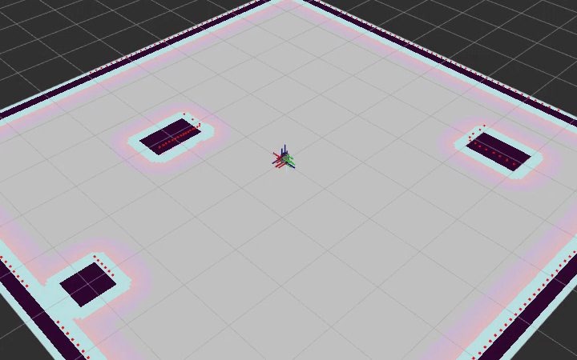
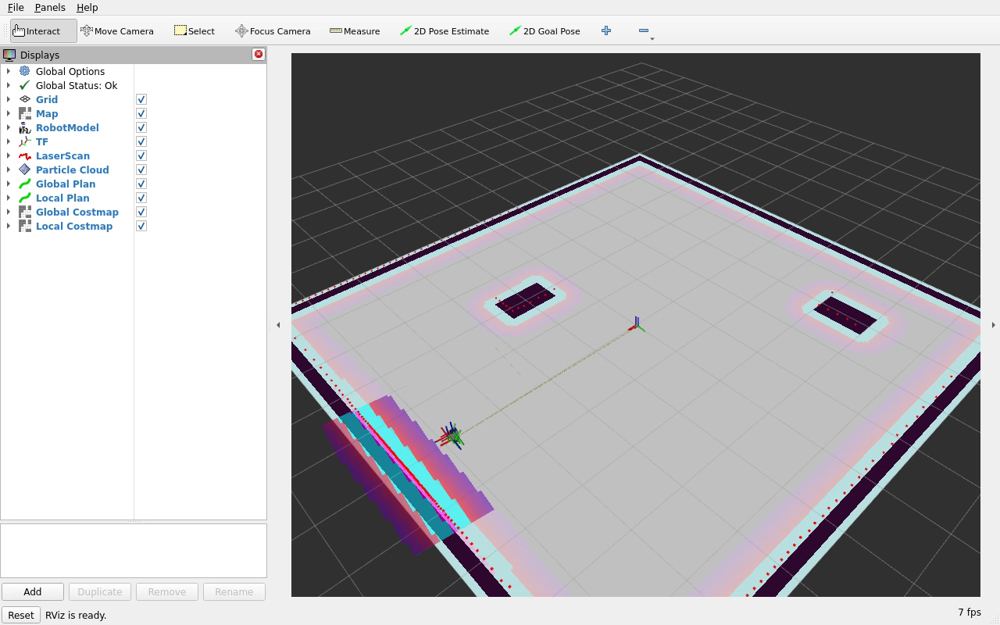
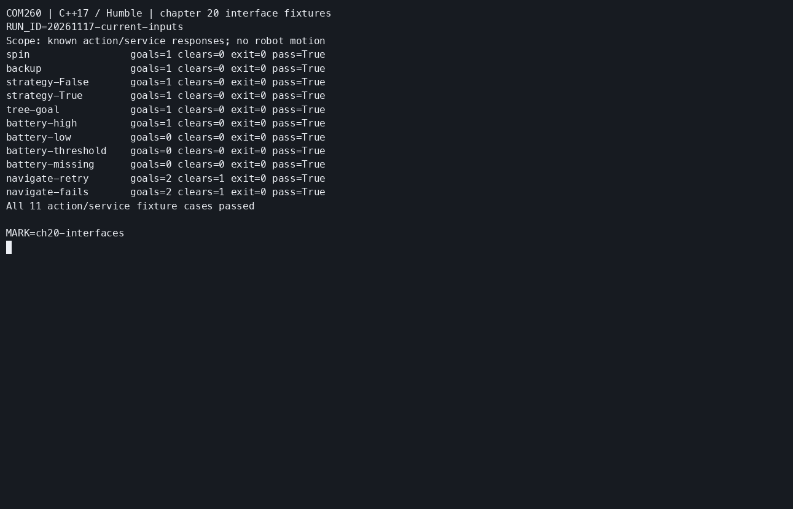
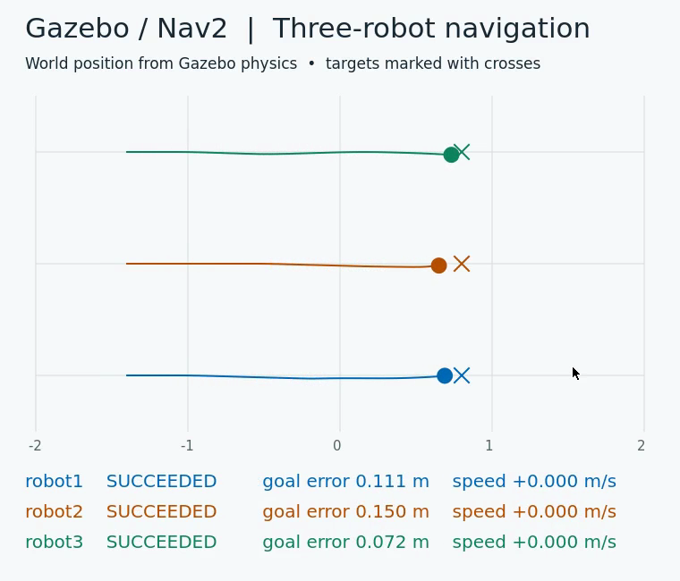
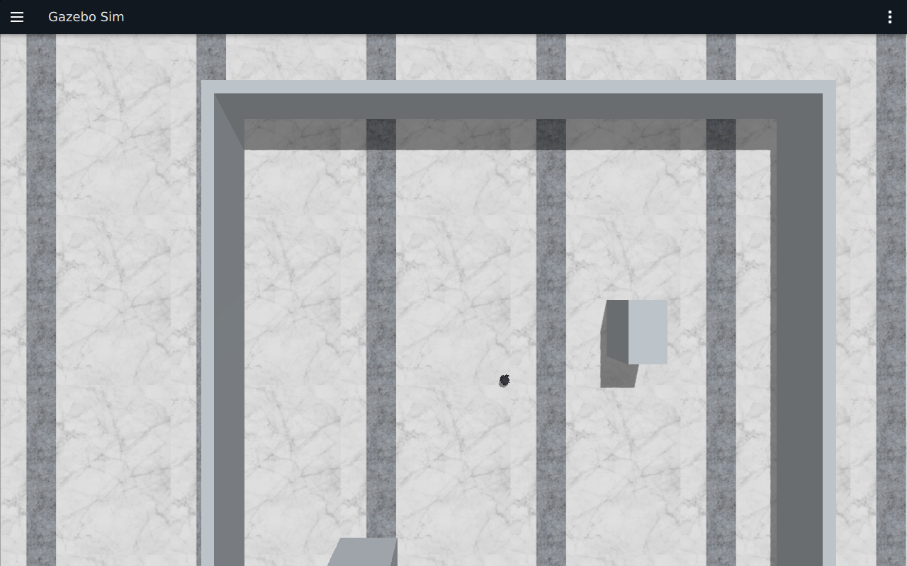
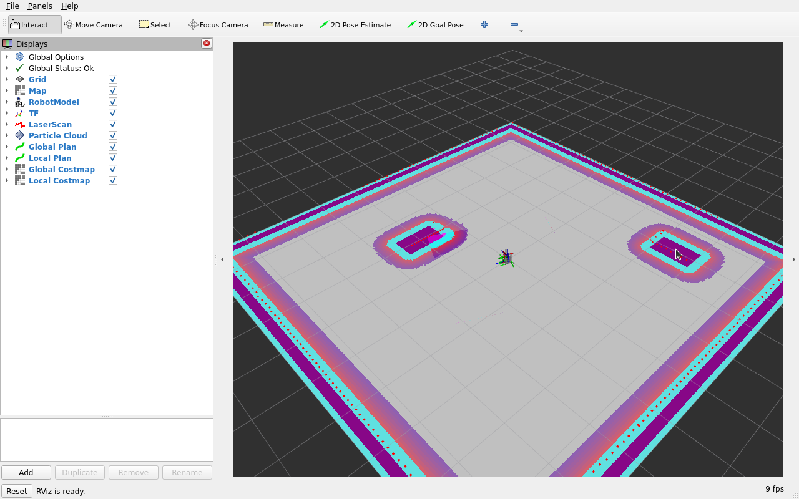

# 第20章 行为树与恢复行为

> **课程**：ROS 2 C++17 编程（COM260 Kit）  
> **章节**：第20章  
> **课时**：2 课时（90 分钟）  
> **教学方式**：讲授 + 演示  

---

先完成[第 20 章环境配置](../lab_manuals_k3_com260_kit/ch00_common_setup.md#ch20)。COM260 运行 C++17 节点，x86 运行 Gazebo、Nav2 和 RViz。

## 学习目标

本章学习目标包括：理解行为树(Behavior Tree)的基本原理和节点类型，掌握Nav2中NavigateToPose行为树的结构，熟悉各种恢复行为(Spin/Backup/Wait)的配置和使用，能够自定义行为树和恢复行为，掌握行为树的调试和优化方法。

## 20.1 行为树基础

### 20.1.1 行为树概述

行为树 (Behavior Tree, BT) 是一种用于控制智能体决策流程的树形结构模型。相比传统的有限状态机 (FSM)，行为树具有更好的模块化、可读性和可扩展性。

**行为树的起源：**最初用于游戏AI（Halo 2, 2005），后被引入机器人领域（Nav2, 2019），现已成为机器人任务编排的标准工具。

**行为树 vs 有限状态机：**

| 特性 | 行为树 (BT) | 有限状态机 (FSM) |
|------|------------|-----------------|
| 状态表示 | 树形节点 | 状态图 |
| 控制流 | 显式（树结构） | 隐式（转换条件） |
| 模块化 | 高（节点可独立） | 低（转换耦合） |
| 可重用性 | 节点可跨树重用 | 状态难重用 |
| 调试 | 可视化XML | 日志跟踪 |
| 扩展性 | 添加新节点即可 | 需修改所有转换 |
| 容错 | 自然支持（Fallback） | 需显式设计 |

### 20.1.2 节点类型

行为树包含四种核心节点类型：

**控制节点：**

```
Sequence (→): 
  顺序执行子节点
  - 全部返回SUCCESS → 返回SUCCESS
  - 任一返回FAILURE → 停止并返回FAILURE
  - 常用于"必须全部完成的步骤序列"

Fallback (?):
  尝试子节点（优先选择）
  - 任一返回SUCCESS → 返回SUCCESS
  - 全部返回FAILURE → 返回FAILURE
  - 常用于"尝试多种方法的备选方案"

Parallel (⇉):
  并行执行所有子节点
  - 达到成功阈值 → 返回SUCCESS
  - 达到失败阈值 → 返回FAILURE
  - 常用于"同时执行多项任务"

Decorator (装饰节点):
  修改子节点的行为
  - Inverter: 反转结果
  - Repeater: 重复执行
  - RateController: 控制执行频率
  - Timeout: 超时控制
```

**执行节点：**

```
Action (动作节点):
  执行具体任务
  - 导航、旋转、后退、等待
  - 返回 SUCCESS / FAILURE / RUNNING

Condition (条件节点):
  检查条件
  - 电池电量、障碍物检测、是否到达
  - 返回 SUCCESS / FAILURE（不会返回RUNNING）
```

### 20.1.3 节点状态

行为树节点执行后返回三种状态：

| 状态 | 含义 | 后续处理 |
|------|------|---------|
| SUCCESS | 节点执行成功 | 继续执行下一个节点 |
| FAILURE | 节点执行失败 | 触发Fallback或终止 |
| RUNNING | 节点正在执行 | 下次tick继续执行 |

```
执行示例:
Sequence → Step1(SUCCESS) → Step2(RUNNING) → ...
         → Step1(SUCCESS) → Step2(SUCCESS) → 返回SUCCESS

Fallback → Option1(FAILURE) → Option2(SUCCESS) → 返回SUCCESS
         → Option1(FAILURE) → Option2(FAILURE) → Option3(FAILURE) → 返回FAILURE
```

### 20.1.4 官方要点——BehaviorTree.CPP 官方文档：控制流节点与黑板机制

> 本节内容综合翻译自 BehaviorTree.CPP 官方文档（behaviortree.dev 的 Tutorials 与 Principal Concepts 页面）、Nav2 官方文档的 Behavior Tree 页面与 nav2_behavior_tree 包源码，另参考 The Construct 的行为树课程与 Robotics Back-End 的恢复行为教程。原文均为英文，此处为中文编译，供课后巩固与进阶阅读。

behaviortree.dev 的教程将节点分为两种：执行实际工作的叶节点（Action、Condition）与组合逻辑的控制节点。官方强调树不是"目标导向"的自动机，而是每个 tick（默认 10 Hz，由 bt_navigator 的 `bt_loop_duration` 决定）从根节点按序执行的决策结构：Sequence 从左到右全部成功才算成功（对应"先检查电量再导航"的练习 2 题），Fallback 逐个尝试直到一个成功（恢复行为的主干），Decorator 则包装单节点添加重试、超时、反转等语义。子树间通过黑板（Blackboard）传递数据——目标位姿、路径、失败次数等都是黑板上带类型的键值。

## 20.2 Nav2行为树架构

### 20.2.1 NavigateToPose行为树

Nav2默认的导航到目标行为树 `navigate_to_pose.xml`：

```xml
<!-- navigate_to_pose.xml (完整版) -->
<root main_tree_to_execute="MainTree">
  <BehaviorTree ID="MainTree">
    <PipelineSequence name="NavigateWithRecovery">
      
      <!-- 全局规划阶段 -->
      <RateController hz="1.0">
        <RecoveryNode number_of_retries="1" name="ComputePathToPose">
          <ComputePathToPose 
            goal="{goal}" 
            path="{path}" 
            planner_id="GridBased"
            error_code="{error_code}"/>
          <ClearEntireCostmap 
            service_name="global_costmap/clear_entirely_global_costmap"/>
        </RecoveryNode>
      </RateController>
      
      <!-- 路径跟踪阶段 -->
      <RateController hz="10.0">
        <RecoveryNode number_of_retries="1" name="FollowPath">
          <FollowPath 
            path="{path}" 
            controller_id="FollowPath"
            error_code="{error_code}"/>
          <Sequence name="RecoveryActions">
            <Spin spin_dist="1.57"/>
            <Wait wait_duration="1.0"/>
            <BackUp backup_dist="0.15" 
                    backup_speed="0.05"/>
            <ClearEntireCostmap 
              service_name="local_costmap/clear_entirely_local_costmap"/>
          </Sequence>
        </RecoveryNode>
      </RateController>
      
      <!-- 全局重规划阶段 -->
      <RateController hz="1.0">
        <RecoveryNode number_of_retries="1" name="GlobalReplan">
          <ComputePathToPose 
            goal="{goal}" 
            path="{replan_path}" 
            planner_id="GridBased"
            error_code="{error_code}"/>
          <Sequence name="GlobalRecoveryActions">
            <ClearEntireCostmap 
              service_name="global_costmap/clear_entirely_global_costmap"/>
            <ClearEntireCostmap 
              service_name="local_costmap/clear_entirely_local_costmap"/>
          </Sequence>
        </RecoveryNode>
      </RateController>
      
    </PipelineSequence>
  </BehaviorTree>
</root>
```

在已按[第 20 章环境配置](../lab_manuals_k3_com260_kit/ch00_common_setup.md#ch20)设置好 DDS 的 x86 终端运行以下命令。COM260 的每个新终端先加载本章的 `env.bash`。

```bash
cd ~/ROS2_RISCV_COM260_CH20_CH21
export RUN_ID="$(date -u +%Y%m%dT%H%M%SZ)-behavior"
bash course_support/k3_com260_kit/scripts/x86-ch20-ch21.bash start-lab "$RUN_ID"
```

等待地图、激光和 TF 就绪，在 RViz 使用 **2D Pose Estimate** 设置起点 `(0,0,0)`。COM260 检查组件及接口：

```bash
ros2 lifecycle get /bt_navigator
ros2 lifecycle get /behavior_server
ros2 action list -t
ros2 service list | grep clear
```

等待两个生命周期节点都进入 `active [3]`。

### 20.2.2 行为树执行流程

默认行为树由 x86 端 Nav2 的启动参数 `default_nav_to_pose_bt_xml` 指定。例如，使用 Humble 自带的导航与恢复树：

```yaml
bt_navigator:
  ros__parameters:
    default_nav_to_pose_bt_xml: "/opt/ros/humble/share/nav2_bt_navigator/behavior_trees/navigate_to_pose_w_replanning_and_recovery.xml"
    default_server_timeout: 20                        # Action超时(s)
    plugin_lib_names:                                 # 行为树插件库
      - nav2_compute_path_to_pose_action_bt_node
      - nav2_follow_path_action_bt_node
      - nav2_spin_action_bt_node
      - nav2_back_up_action_bt_node
      - nav2_wait_action_bt_node
      - nav2_clear_costmap_service_bt_node
      - nav2_recovery_node_bt_node
      - nav2_pipeline_sequence_bt_node
      - nav2_rate_controller_bt_node
```

上方 `start-lab` 入口已使用这棵默认树，无需修改文件。自定义配置时，只修改 x86 端的默认树参数，保留课程配置的完整插件列表，再重启 Nav2。COM260 终端可查询当前配置：

```bash
source ~/.config/ros2-course-com260-ch20-ch21/env.bash
ros2 param get /bt_navigator default_nav_to_pose_bt_xml
```

若只为下一次导航选择另一棵树，在 COM260 终端运行：

```bash
# 指定 x86 Nav2 进程可读取的行为树文件
ros2 run behavior_tree_demo_cpp bt_client --ros-args \
  -p use_sim_time:=true -p x:=1.0 -p y:=0.0 \
  -p behavior_tree:=/workspace/install/navigation_client_cpp/share/navigation_client_cpp/behavior_trees/teaching_navigation.xml
```

Humble 通过 `NavigateToPose` 的 `behavior_tree` 字段选择 XML；空字符串使用默认树。文件路径属于运行 Nav2 的 x86 容器。

### 20.2.3 行为树节点连接

```cpp
#include <cmath>
#include <nav2_msgs/action/navigate_to_pose.hpp>
#include "recovery_demo_cpp/action_client.hpp"
int main(int argc, char ** argv) {
  init_actions(argc, argv);
  auto node = std::make_shared<rclcpp::Node>("bt_client");
  nav2_msgs::action::NavigateToPose::Goal goal;
  goal.pose.header.frame_id = "map";
  goal.pose.header.stamp = node->now();
  goal.pose.pose.position.x = node->declare_parameter("x", 0.0);
  goal.pose.pose.position.y = node->declare_parameter("y", 0.0);
  const double yaw = node->declare_parameter("yaw", 0.0);
  goal.pose.pose.orientation.z = std::sin(yaw / 2);
  goal.pose.pose.orientation.w = std::cos(yaw / 2);
  goal.behavior_tree = node->declare_parameter<std::string>("behavior_tree", "");
  const bool ok = run_action<nav2_msgs::action::NavigateToPose>(node, "navigate_to_pose", goal, 180);
  rclcpp::shutdown();
  return ok ? 0 : 1;
}
```

## 20.3 恢复行为详解

### 20.3.1 恢复行为概述

当导航过程出现异常时，Nav2会触发恢复行为尝试解决问题：

**恢复行为的触发条件：**一是路径规划失败（无可行路径）；二是路径跟踪失败（被障碍物卡住）；三是目标不可达（被障碍物包围）；四是代价地图异常（动态障碍物快速变化）。

**默认恢复行为序列：**
```
RecoveryNode（最多重试次数）
├── 主行为（ComputePathToPose / FollowPath）
└── 恢复序列（当主行为失败时）
    ├── Spin（原地旋转）
    ├── Wait（等待）
    ├── BackUp（后退）
    └── ClearEntireCostmap（清除代价地图）
```

### 20.3.2 Spin恢复行为

Spin让机器人原地旋转一定角度，重新感知周围环境：

```cpp
inline bool spin(const rclcpp::Node::SharedPtr & node, double yaw = 1.57, double seconds = 5) {
  if (!std::isfinite(yaw) || !std::isfinite(seconds) || seconds <= 0) {
    RCLCPP_ERROR(node->get_logger(), "旋转角度必须有限，允许时间必须为正数");
    return false;
  }
  nav2_msgs::action::Spin::Goal goal;
  goal.target_yaw = yaw;
  goal.time_allowance = rclcpp::Duration::from_seconds(seconds);
  return run_action<nav2_msgs::action::Spin>(node, "/spin", goal);
}
```

**Spin配置：**
```yaml
behavior_server:
  ros__parameters:
    behavior_plugins: ["spin", "backup", "drive_on_heading", "wait"]
    
    spin:
      plugin: "nav2_behaviors/Spin"
      simulate_ahead_time: 2.0        # 前向模拟时间(s)
      max_rotational_vel: 1.0         # 最大旋转速度(rad/s)
      min_rotational_vel: 0.1         # 最小旋转速度(rad/s)
      rotational_acc_lim: 3.0         # 旋转加速度(rad/s²)
      ctrl_rad_step: 0.01             # 控制步长(rad)
```

### 20.3.3 BackUp恢复行为

BackUp让机器人沿直线后退一段距离：

```cpp
inline bool backup(const rclcpp::Node::SharedPtr & node, double distance = 0.15, double speed = 0.05) {
  if (!std::isfinite(distance) || !std::isfinite(speed) || distance <= 0 || speed <= 0) {
    RCLCPP_ERROR(node->get_logger(), "后退距离和速度必须为有限正数");
    return false;
  }
  nav2_msgs::action::BackUp::Goal goal;
  goal.target.x = -distance;
  goal.speed = speed;
  goal.time_allowance = rclcpp::Duration::from_seconds(distance / speed + 1);
  return run_action<nav2_msgs::action::BackUp>(node, "/backup", goal);
}
```

**BackUp配置：**
```yaml
backup:
  plugin: "nav2_behaviors/BackUp"
  simulate_ahead_time: 2.0
  max_linear_vel: 0.1           # 最大后退速度(m/s)
  min_linear_vel: 0.05          # 最小后退速度(m/s)
  linear_acc_lim: 0.5           # 加速度(m/s²)
  ctrl_rad_step: 0.01
```

### 20.3.4 Wait和Drive on Heading

**Wait（等待）：**
```yaml
wait:
  plugin: "nav2_behaviors/Wait"
  simulate_ahead_time: 2.0
  max_linear_vel: 0.0
  max_rotational_vel: 0.0
```

**Drive on Heading（沿当前方向前进）：**
```yaml
drive_on_heading:
  plugin: "nav2_behaviors/DriveOnHeading"
  simulate_ahead_time: 2.0
  max_linear_vel: 0.1
  min_linear_vel: 0.05
  linear_acc_lim: 0.5
```

### 20.3.5 手动触发恢复行为

```bash
# 触发Spin (旋转1.57 rad)
ros2 action send_goal /spin nav2_msgs/action/Spin \
  "{target_yaw: 1.57, time_allowance: {sec: 5}}"

# 触发Backup (后退0.3m)
ros2 action send_goal /backup nav2_msgs/action/BackUp \
  "{target: {x: -0.3}, speed: 0.05}"

# 清除全局代价地图
ros2 service call /global_costmap/clear_entirely_global_costmap \
  nav2_msgs/srv/ClearEntireCostmap

# 清除局部代价地图
ros2 service call /local_costmap/clear_entirely_local_costmap \
  nav2_msgs/srv/ClearEntireCostmap
```

两个生命周期节点应为 `active [3]`。先逐个执行恢复动作，等待上一条返回后再运行下一条：

```bash
ros2 run recovery_demo_cpp spin_recovery --ros-args -p use_sim_time:=true
ros2 run recovery_demo_cpp backup_recovery --ros-args -p use_sim_time:=true
ros2 run recovery_demo_cpp recovery_strategy --ros-args -p use_sim_time:=true
```

`spin_recovery` 使用 1.57 rad、5 s；`backup_recovery` 使用 0.15 m、0.05 m/s。恢复策略依次尝试 Spin、Wait、BackUp 等六项，第一项成功即结束。使用 `use_sim_time:=true` 时，Nav2 按 `/clock` 计算动作允许时间。仿真变慢时，等待终端显示 `SUCCEEDED`。要提前停车，在动作进行时按 Ctrl+C，等待 `CANCELED`。在另一终端用 `ros2 topic echo /odom --field twist.twist` 观察运动，并确认动作结束后线速度和角速度回到零附近。

要观察慢仿真，在启动 Nav2 的 x86 终端调整当前场景的实时倍率：

```bash
bash course_support/k3_com260_kit/scripts/x86-ch20-ch21.bash exec "$RUN_ID" \
  env GZ_PARTITION="$RUN_ID" gz service -s /world/default/set_physics \
  --reqtype gz.msgs.Physics --reptype gz.msgs.Boolean --timeout 6000 \
  --req 'real_time_factor: 0.16 max_step_size: 0.001'
```

收到 `data: true` 后，在 COM260 依次运行 Spin 和 BackUp，比较墙钟耗时与动作允许的仿真时间。再分别运行动作，在里程计显示运动时按 Ctrl+C，观察结果和停车反馈。完成后将上面命令中的 `real_time_factor` 改为 `1.0` 再执行一次，恢复正常速度。

在 [Nav2 综合实验](../lab_manuals_k3_com260_kit/ch11_lab.md)练习 3 中，目标被方盒阻挡时，观察机器人先原地旋转（Spin），再后退（BackUp）。加载原地图并移除方盒后，机器人继续向同一个目标 `(4,0)` 行驶。



动图取自 [RViz 原片](../lab_manuals_k3_com260_kit/images/ch20_ch21/recovery-rviz.mp4)第 8～48 秒，按原速播放。[Gazebo 录像](../lab_manuals_k3_com260_kit/images/ch20_ch21/recovery-gazebo.mp4)可对照观察方盒移除和机器人到达目标的过程。



### 20.3.6 官方要点——Nav2 默认恢复树：官方 XML 的恢复顺序逻辑

"为什么先 Spin 再 BackUp 最后清除代价地图"（练习第 4 题）的答案就在官方默认树文件 `nav2_navigate_to_pose_behavior_tree.xml` 中：导航失败后进入一个以 Fallback 为根、包裹 `RecoveryNode` 的恢复分支——`ClearCostmap` 作为最便宜且无位姿扰动的操作优先执行（避免自损）；`Spin` 用于小范围环境感知，代价是原地旋转可能碰上动态障碍；`BackUp` 通过后退创造新视野，但依赖可用空间。三者通常被安排为"ClearCostmap → Spin/BackUp → 重规划"的循环，且每次失败计数通过黑板 `RetryCount` 累计，超过上限后直接上报失败给人形干预——这与练习第 6 题的分层故障设计完全同构。

## 20.4 自定义行为树

### 20.4.1 创建自定义XML行为树

```xml
<!-- custom_navigation.xml -->
<root main_tree_to_execute="MainTree">
  <BehaviorTree ID="MainTree">
    <Sequence name="CompleteNavigation">
      
      <!-- 步骤1: 检查电池电量 -->
      <BatteryCheck 
        min_battery_level="0.2"
        battery_topic="/battery_status"/>
      
      <!-- 步骤2: 计算全局路径 -->
      <ComputePathToPose 
        goal="{goal}" 
        path="{path}"/>
      
      <!-- 步骤3: 执行路径跟踪（带恢复） -->
      <RecoveryNode number_of_retries="2">
        <FollowPath path="{path}"/>
        <Sequence>
          <!-- 恢复策略1: 后退清除 -->
          <BackUp backup_dist="0.2"/>
          <ClearEntireCostmap 
            service_name="local_costmap/clear_entirely_local_costmap"/>
          <!-- 恢复策略2: 旋转扫描 -->
          <Spin spin_dist="3.14"/>
          <ClearEntireCostmap 
            service_name="local_costmap/clear_entirely_local_costmap"/>
          <!-- 恢复策略3: 重规划 -->
          <ClearEntireCostmap 
            service_name="global_costmap/clear_entirely_global_costmap"/>
          <ComputePathToPose 
            goal="{goal}" 
            path="{path}"/>
        </Sequence>
      </RecoveryNode>
      
      <!-- 步骤4: 到达后执行任务 -->
      <Sequence name="PostArrival">
        <Wait wait_duration="2.0"/>
        <!-- 到达后发通知 -->
        <PublishTopic topic="/arrival_signal" message="arrived"/>
      </Sequence>
      
    </Sequence>
  </BehaviorTree>
</root>
```

上面的 XML 是组合结构示例，`BatteryCheck` 与 `PublishTopic` 需要相应的 Nav2 插件。下面使用 BehaviorTree.CPP 在 COM260 运行条件树，并调用 x86 的导航与清图接口。

### 20.4.2 C++自定义行为树

```cpp
#include <cmath>
#include <limits>
#include <behaviortree_cpp_v3/bt_factory.h>
#include <nav2_msgs/action/navigate_to_pose.hpp>
#include <nav2_msgs/srv/clear_entire_costmap.hpp>
#include <std_msgs/msg/float32.hpp>
#include "recovery_demo_cpp/action_client.hpp"
#include "navigate.hpp"  // 同包 src/navigate.hpp 中的有状态导航节点

int main(int argc, char ** argv) {
  init_actions(argc, argv);
  auto node = std::make_shared<rclcpp::Node>("custom_behavior_tree");
  const double x = node->declare_parameter("x", 0.0);
  const double y = node->declare_parameter("y", 0.0);
  float battery = std::numeric_limits<float>::quiet_NaN();
  auto sub = node->create_subscription<std_msgs::msg::Float32>("/battery_status", 10,
    [&](const std_msgs::msg::Float32 & msg) { battery = msg.data; });
  const auto deadline = std::chrono::steady_clock::now() + 5s;
  while (!std::isfinite(battery) && !stop_requested && std::chrono::steady_clock::now() < deadline) {
    rclcpp::spin_some(node);
    rclcpp::sleep_for(20ms);
  }
  BT::BehaviorTreeFactory factory;
  factory.registerSimpleCondition("BatteryCheck", [&](BT::TreeNode &) {
    RCLCPP_INFO(node->get_logger(), "电池电量: %.1f%%", battery * 100);
    return battery > 0.2f ? BT::NodeStatus::SUCCESS : BT::NodeStatus::FAILURE;
  });
  factory.registerBuilder<Navigate>("Navigate", [&](const std::string & name, const BT::NodeConfiguration & config) {
    return std::make_unique<Navigate>(name, config, node, x, y);
  });
  factory.registerSimpleAction("ClearCostmap", [&](BT::TreeNode &) {
    using Clear = nav2_msgs::srv::ClearEntireCostmap;
    if (stop_requested) { return BT::NodeStatus::FAILURE; }
    auto client = node->create_client<Clear>("/global_costmap/clear_entirely_global_costmap");
    if (!client->wait_for_service(5s)) { return BT::NodeStatus::FAILURE; }
    auto future = client->async_send_request(std::make_shared<Clear::Request>());
    return rclcpp::spin_until_future_complete(node, future, 5s) == rclcpp::FutureReturnCode::SUCCESS
      ? BT::NodeStatus::SUCCESS : BT::NodeStatus::FAILURE;
  });
  auto tree = factory.createTreeFromText(R"(
    <root main_tree_to_execute="MainTree"><BehaviorTree ID="MainTree">
      <Sequence name="MainSequence"><BatteryCheck/>
        <Fallback name="Navigation"><Navigate/>
          <Sequence name="RecoveryNav"><ClearCostmap/><Navigate/></Sequence>
        </Fallback>
      </Sequence>
    </BehaviorTree></root>)");
  auto previous = BT::NodeStatus::IDLE;
  while (rclcpp::ok() && !stop_requested) {
    rclcpp::spin_some(node);
    const auto status = tree.tickRoot();
    if (status != previous) {
      RCLCPP_INFO(node->get_logger(), "行为树结果: %s", BT::toStr(status).c_str());
      previous = status;
    }
    rclcpp::sleep_for(100ms);
  }
  tree.haltTree();
  rclcpp::shutdown();
  return 0;
}
```

`Navigate` 的实现见 [navigate.hpp](../src_k3_com260_kit/behavior_tree_demo_cpp/src/navigate.hpp)。首次 tick 发送目标并返回 `RUNNING`；后续 tick 检查 Action 结果，完成后返回 `SUCCESS` 或 `FAILURE`。树停止时取消未完成的目标并等待结果，主循环按 0.1 s 周期运行。

电池条件树使用 `/battery_status` 的 `std_msgs/Float32`，范围 0～1。另开 COM260 终端发布电量：

```bash
ros2 topic pub /battery_status std_msgs/msg/Float32 '{data: 0.8}' -r 2
```

原终端运行条件树：

```bash
ros2 run behavior_tree_demo_cpp custom_behavior_tree --ros-args \
  -p use_sim_time:=true -p x:=1.0 -p y:=0.0
```

电量大于 0.2 时执行导航；否则返回 FAILURE。把发布值改为 0.1 再运行，应不发送导航请求。停止电池发布后重新运行，等待 5 s 后应显示 FAILURE。导航失败时条件树清除全局代价地图并重试一次。导航进行时节点返回 RUNNING，主循环每 0.1 s 再次 tick；完成后返回 SUCCESS 或 FAILURE，再开始下一轮。观察完成后按 Ctrl+C 取消当前动作并退出。



### 20.4.3 装饰节点使用

```xml
<!-- 装饰节点应用示例 -->
<BehaviorTree>
  <Sequence>
    <!-- 带超时控制的导航 -->
    <Timeout msec="30000">
      <ComputePathToPose goal="{goal}" path="{path}"/>
    </Timeout>
    
    <!-- 带频率控制的路径跟踪 -->
    <RateController hz="10.0">
      <FollowPath path="{path}"/>
    </RateController>
    
    <!-- 重复检查直到成功 -->
    <RepeatUntilSuccess num_attempts="5">
      <Condition condition="is_goal_reached"/>
    </RepeatUntilSuccess>
    
    <!-- 反转条件 -->
    <Inverter>
      <Condition condition="obstacle_detected"/>
    </Inverter>
  </Sequence>
</BehaviorTree>
```

### 20.4.4 官方要点——自定义节点：nav2_behavior_tree 的 50 个内置节点与插件注册

Nav2 官方文档指出，nav2_behavior_tree 内置约 50 个 ROS 感知节点（`IsPathValid`、`GoalUpdated`、`NavigateToPose`、`Wait`、`RateController` 等），绝大多数业务无需自研。若要写练习第 3 题的 `SpiralSearch`，官方开发指南给出三步：继承 `BT::ActionNodeBase`（或 Nav2 的 `RosActionNode` 模板复用 Action 接口），实现 `tick()` 返回 SUCCESS/FAILURE/RUNNING 三态；在 CMake 里用 `BT_PLUGIN_EXPORT` 导出为动态库插件；在 XML 头部声明 `<root main_tree_to_execute="...">` 并指定插件名（`BT-Navigator` 的 `plugin_lib_names` 参数），即可被 bt_navigator 热加载。

## 20.5 恢复行为配置与优化

### 20.5.1 恢复行为配置完整示例

```yaml
behavior_server:
  ros__parameters:
    behavior_plugins: [
      "spin", "backup", "drive_on_heading", 
      "wait", "assisted_teleop"
    ]
    local_costmap_topic: "/local_costmap/costmap"
    global_costmap_topic: "/global_costmap/costmap"
    cycle_frequency: 10.0
    
    spin:
      plugin: "nav2_behaviors/Spin"
      simulate_ahead_time: 2.0
      max_rotational_vel: 1.0
      min_rotational_vel: 0.1
      rotational_acc_lim: 3.0
    
    backup:
      plugin: "nav2_behaviors/BackUp"
      simulate_ahead_time: 2.0
      max_linear_vel: 0.1
      min_linear_vel: 0.05
      linear_acc_lim: 0.5
    
    drive_on_heading:
      plugin: "nav2_behaviors/DriveOnHeading"
      simulate_ahead_time: 2.0
      max_linear_vel: 0.1
      min_linear_vel: 0.05
    
    wait:
      plugin: "nav2_behaviors/Wait"
      simulate_ahead_time: 2.0
    
    assisted_teleop:
      plugin: "nav2_behaviors/AssistedTeleop"
      simulate_ahead_time: 2.0
      max_linear_vel: 0.1
```

### 20.5.2 恢复行为策略

```cpp
#include <array>
#include <functional>
#include "recovery_demo_cpp/recovery.hpp"
int main(int argc, char ** argv) {
  init_actions(argc, argv);
  auto node = std::make_shared<rclcpp::Node>("recovery_strategy");
  const std::array<std::function<bool()>, 6> steps = {{
    [&] { return spin(node, 1.57); }, [&] { return wait(node, 1); },
    [&] { return backup(node, 0.15); }, [&] { return spin(node, 3.14); },
    [&] { return backup(node, 0.3); }, [&] { return wait(node, 2); }
  }};
  bool ok = false;
  for (size_t i = 0; i < steps.size() && !stop_requested; ++i) {
    RCLCPP_INFO(node->get_logger(), "执行恢复步骤 %zu", i + 1);
    if (steps[i]()) { ok = true; break; }
  }
  RCLCPP_INFO(node->get_logger(), "%s", ok ? "恢复成功" : "恢复未成功");
  rclcpp::shutdown();
  return ok ? 0 : 1;
}
```

### 20.5.3 恢复行为触发条件优化

```yaml
# 代价地图清除配置
global_costmap:
  global_costmap:
    ros__parameters:
      # 当机器人位置与已知地图的代价超过阈值时触发清除
      footprint_padding: 0.01
      always_send_full_costmap: true
      
local_costmap:
  local_costmap:
    ros__parameters:
      # 滚动窗口的清除策略
      rolling_window: true
      width: 4
      height: 4
```

### 20.5.4 行为树调试

```bash
# 查看当前行为树状态
ros2 topic echo /bt_navigator/bt_status

# 查看导航状态（包括恢复行为执行情况）
ros2 topic echo /navigate_to_pose/_action/status

# 查看行为树节点执行日志
ros2 run rqt_bt_monitor rqt_bt_monitor
```

为下一次导航选择行为树时，在 COM260 新终端加载环境并发送目标。XML 路径必须是 x86 Nav2 容器内可读取的文件；此命令不会更换正在执行的导航任务的行为树，应等待当前任务结束后再运行。

```bash
source ~/.config/ros2-course-com260-ch20-ch21/env.bash
ros2 run behavior_tree_demo_cpp bt_client --ros-args \
  -p use_sim_time:=true -p x:=1.0 -p y:=0.0 \
  -p behavior_tree:=/workspace/install/navigation_client_cpp/share/navigation_client_cpp/behavior_trees/teaching_navigation.xml
```

### 20.5.5 官方要点——Groot 可视化：编辑与在线调试

BehaviorTree.CPP 官方配套的 Groot（现 Groot2）是一款可视化编辑器：左侧拖拽节点搭树、右侧实时显示每个节点的状态颜色（运行中绿色、成功/失败红蓝），还能通过 zmq 与运行中的 bt_navigator 连接，把练习第 5 题"卡住观察"变成直观的树状态录像。The Construct 的课程演示了"先 Groot 建模 → 再导出 XML → 放入 Nav2 启动"的工业流程；Robotics Back-End 则展示了在树里插入日志节点定位卡死节点的排障方法——行为树调试不再是打印语句，而是树内状态审计。

`bt_status`、`rqt_bt_monitor` 和在线切树接口并非本课程 Humble 环境的默认入口；使用 Action 状态、节点日志及下一次目标的 `behavior_tree` 字段观察与选择行为树。

## 20.6 实战案例

### 20.6.1 机器人巡逻行为树

```xml
<!-- patrol_bt.xml -->
<root main_tree_to_execute="MainTree">
  <BehaviorTree ID="MainTree">
    <Sequence>
      <!-- 全局重定位 -->
      <GlobalLocalization/>
      
      <!-- 巡逻循环 -->
      <Repeat num_cycles="-1">  <!-- 无限循环 -->
        <Sequence>
          <!-- 前往航点1 -->
          <ComputePathToPose goal="{waypoint1}" path="{path}"/>
          <FollowPath path="{path}"/>
          
          <!-- 到达后停留 -->
          <Wait wait_duration="5.0"/>
          
          <!-- 前往航点2 -->
          <ComputePathToPose goal="{waypoint2}" path="{path}"/>
          <FollowPath path="{path}"/>
          
          <Wait wait_duration="5.0"/>
          
          <!-- 返回航点1 -->
          <ComputePathToPose goal="{waypoint1}" path="{path}"/>
          <FollowPath path="{path}"/>
        </Sequence>
      </Repeat>
    </Sequence>
  </BehaviorTree>
</root>
```

### 20.6.2 多机器人调度集成

```cpp
#include <map>
#include <yaml-cpp/yaml.h>
#include <nav2_msgs/action/navigate_to_pose.hpp>
#include "recovery_demo_cpp/action_client.hpp"

int main(int argc, char ** argv) {
  init_actions(argc, argv);
  auto node = std::make_shared<rclcpp::Node>("multi_robot_scheduler");
  using Navigate = nav2_msgs::action::NavigateToPose;
  using Client = rclcpp_action::Client<Navigate>;
  std::map<std::string, Client::SharedPtr> robots;
  for (const auto & name : {"robot1", "robot2", "robot3"}) {
    robots[name] = rclcpp_action::create_client<Navigate>(node, std::string("/") + name + "/navigate_to_pose");
  }
  int pending = 0;
  bool failed = false;
  try {
    const auto tasks = YAML::LoadFile(node->declare_parameter<std::string>("task_file", "tasks.yaml"))["tasks"];
    for (const auto & task : tasks) {
      const auto name = task["robot"].as<std::string>();
      if (!robots.count(name)) { continue; }
      auto client = robots.at(name);
      if (!client->wait_for_action_server(10s)) { failed = true; break; }
      Navigate::Goal goal;
      goal.pose.header.frame_id = "map";
      goal.pose.header.stamp = node->now();
      goal.pose.pose.position.x = task["x"].as<double>();
      goal.pose.pose.position.y = task["y"].as<double>();
      goal.pose.pose.orientation.w = 1;
      goal.behavior_tree = task["recovery_strategy"].as<std::string>("") == "aggressive"
        ? "aggressive_recovery.xml" : "default_navigation.xml";
      Client::SendGoalOptions options;
      options.goal_response_callback = [&, name](auto handle) {
        RCLCPP_INFO(node->get_logger(), "%s: %s", name.c_str(), handle ? "ACCEPTED" : "REJECTED");
        failed |= !handle;
        --pending;
      };
      ++pending;
      client->async_send_goal(goal, options);
      RCLCPP_INFO(node->get_logger(), "派发任务给 %s: (%.2f, %.2f)", name.c_str(),
        goal.pose.pose.position.x, goal.pose.pose.position.y);
    }
    const auto deadline = std::chrono::steady_clock::now() + 10s;
    while (pending && !stop_requested && std::chrono::steady_clock::now() < deadline) {
      rclcpp::spin_some(node);
      rclcpp::sleep_for(20ms);
    }
    failed |= pending != 0 || stop_requested;
  } catch (const YAML::Exception & error) {
    RCLCPP_ERROR(node->get_logger(), "%s", error.what());
    failed = true;
  }
  rclcpp::shutdown();
  return failed ? 1 : 0;
}
```

`multi_robot_scheduler` 向 `robot1`、`robot2`、`robot3` 命名空间下的导航服务器派发任务。运行前，分别启动三台机器人的导航服务器并准备行为树 XML 文件。使用 `task_file` 参数指定 YAML，任务字段为 `robot`、`x`、`y`、`recovery_strategy`；`aggressive` 选择 `aggressive_recovery.xml`，其他值选择 `default_navigation.xml`。请求被接受后，还需根据 Action 的最终结果判断机器人是否到达目标。

先完成[第 20 章公共环境](../lab_manuals_k3_com260_kit/ch00_common_setup.md#ch20)和[双端有线 DDS 配置](../lab_manuals_k3_com260_kit/ch00_common_setup.md#wired-dds)。三个小车从 `(-1.4, -1)`、`(-1.4, 0)`、`(-1.4, 1)` 出发，任务文件为 [tasks.yaml](../course_support/k3_com260_kit/config/fleet/tasks.yaml)，三个目标分别为 `(0.8, -1)`、`(0.8, 0)`、`(0.8, 1)`。

**终端一 · x86**　加载通信环境，再启动三辆小车和各自的 Nav2。等待日志中 robot1、robot2、robot3 的 `Managed nodes are active`。

```bash
cd ~/ROS2_RISCV_COM260_CH20_CH21
source ~/.config/ros2-course-com260-ch20-ch21/vision-dds.bash
bash course_support/k3_com260_kit/scripts/x86-ch20-ch21.bash start-fleet fleet
podman logs -f ros2-com260-fleet
```

此入口加载两份行为树。[aggressive_recovery.xml](../course_support/k3_com260_kit/config/fleet/aggressive_recovery.xml)包含清图、旋转、等待及后退恢复；[default_navigation.xml](../course_support/k3_com260_kit/config/fleet/default_navigation.xml)每秒重规划并跟踪路径。Nav2 的工作目录设为这两份 XML 所在目录。

**终端二 · COM260**　发送任务，终端输出三次 `ACCEPTED` 后结束。导航服务器继续执行已接收的任务。

```bash
cd ~/ROS2_RISCV_COM260_CH20_CH21
source ~/.config/ros2-course-com260-ch20-ch21/env.bash
source ~/.config/ros2-course-com260-ch20-ch21/vision-dds.bash
ros2 run multi_robot_scheduler multi_robot_scheduler --ros-args \
  -p use_sim_time:=true \
  -p task_file:="$PWD/course_support/k3_com260_kit/config/fleet/tasks.yaml"
```

**终端三 · x86**　查询三个任务的最终状态。日志出现三次 `Goal succeeded` 后执行下列命令，三个输出都应含 `status: 4`。

```bash
cd ~/ROS2_RISCV_COM260_CH20_CH21
for robot in robot1 robot2 robot3; do
  bash course_support/k3_com260_kit/scripts/x86-ch20-ch21.bash exec fleet \
    ros2 topic echo "/$robot/navigate_to_pose/_action/status" \
    --once --qos-durability transient_local --qos-reliability reliable --qos-depth 1
done
```

检查完毕，在终端一按 Ctrl+C 停止查看日志，然后执行以下命令关闭本次仿真。

```bash
bash course_support/k3_com260_kit/scripts/x86-ch20-ch21.bash stop fleet
```

观察三辆车各自的 `/robotN/navigate_to_pose/_action/status`。目标完成时状态为 `SUCCEEDED`（4）。在 Gazebo 中观察小车停下，再对照目标坐标与模型的世界坐标。



[Gazebo 三车行驶录像](../lab_manuals_k3_com260_kit/images/ch20/fleet-gazebo.mp4) · [三车状态录像](../lab_manuals_k3_com260_kit/images/ch20/fleet-arrival.mp4) · [轨迹动图](../lab_manuals_k3_com260_kit/images/ch20/fleet-arrival.gif)

## 课后练习

1. **原理题:** 说明行为树中Sequence和Fallback节点的区别，列举在实际导航中哪些场景适合用Sequence、哪些适合用Fallback。

2. **配置题:** 编写一个自定义的行为树XML，实现以下功能：先检查电池电量，若电量充足则直接导航，若电量不足则先前往充电桩充电再导航。

3. **编程题:** 实现一个C++自定义恢复行为"SpiralSearch"：当导航失败时，机器人以螺旋轨迹搜索周围环境，尝试找到可行路径。

4. **分析题:** 分析Nav2默认行为树的恢复策略设计，说明为什么先Spin再BackUp最后清除代价地图，解释这种恢复顺序的合理性。

5. **操作题:** 在仿真环境中制造导航卡住场景（如障碍物包围），观察恢复行为的执行过程，记录每种恢复行为的执行效果和耗时。

6. **设计题:** 设计一个分层的恢复行为策略：轻度故障（一次规划失败）→ 快速Spin重试，中度故障（连续失败）→ BackUp+重规划，重度故障（多次失败）→ 完全停止+请求人工干预。

---

## 仿真结合实例（当前仓库）：Nav2 行为树组件与恢复服务

### 目标与知识点对应

在真实 Nav2 组件上观察 `bt_navigator`、规划器、控制器和 `behavior_server` 的启动关系，并通过服务列表确认恢复行为接口。

### 运行步骤

在 20.2.1 节启动的 Nav2 仿真中，从 COM260 检查节点、动作和服务：

```bash
source ~/.config/ros2-course-com260-ch20-ch21/env.bash
ros2 node info /bt_navigator
ros2 node info /behavior_server
ros2 action list -t | grep -E 'spin|backup|wait'
ros2 service list | grep clear
```

### 观察结果

启动日志能显示行为树导航器和恢复行为服务器被加载；在 RViz 中发送目标后，可结合节点日志观察规划失败或控制器恢复路径。



[Gazebo 运行录像](../lab_manuals_k3_com260_kit/images/ch20_ch21/behavior-gazebo.mp4)与 [RViz 运行录像](../lab_manuals_k3_com260_kit/images/ch20_ch21/behavior-rviz.mp4)展示恢复动作和条件树导航。动作是否完成，结合里程计、Action 结果和停车反馈判断；数值见[运行证据](../lab_manuals_k3_com260_kit/runtime_evidence.md#ch20)。



先在 COM260 依次 Ctrl+C 停止处理节点和发布器，再在 x86 执行：

```bash
bash course_support/k3_com260_kit/scripts/x86-ch20-ch21.bash stop "$RUN_ID"
```

导航过程中先等待取消结果和停车反馈，再停止仿真。

### 源码与边界

导航与恢复操作见 [Nav2 综合实验](../lab_manuals_k3_com260_kit/ch11_lab.md)。行为树和恢复客户端位于 `src_k3_com260_kit/behavior_tree_demo_cpp/`、`recovery_demo_cpp/`；多机器人任务派发位于 `multi_robot_scheduler/`。多机器人示例只负责派发任务，需各命名空间下已有导航服务器以及相应 XML 文件。

恢复行为是否成功，要结合 Action 结果、实际运动和停止反馈判断；接口存在本身不代表恢复分支已执行。

学习材料：
- BehaviorTree.CPP 官方文档与教程：https://www.behaviortree.dev/
- Nav2 官方文档 —— Behavior Tree 页面与默认树文件：https://docs.nav2.org/
- navigation2 仓库 —— nav2_behavior_tree 包与默认恢复树 XML：https://github.com/ros-navigation/navigation2
- Groot 可视化工具官方仓库：https://github.com/BehaviorTree/Groot
- The Construct —— ROS 2 行为树课程：https://www.theconstructsim.com/
- Robotics Back-End —— 行为树与恢复行为教程：https://roboticsbackend.com/
