# 第21章 视觉SLAM导论

> **课程**：ROS 2 C++17 编程（COM260 Kit）  
> **章节**：第21章  
> **课时**：2 课时（90 分钟）  
> **教学方式**：讲授 + 演示

---

先完成[第 21 章环境配置](../lab_manuals_k3_com260_kit/ch00_common_setup.md#ch21)。COM260 运行 C++17 节点，x86 提供相机仿真与图像显示。

## 学习目标

本章学习目标包括：理解视觉SLAM的基本原理和经典框架；掌握ORB-SLAM2/3的特征提取与跟踪方法；了解DSO直接法和RGB-D SLAM的原理；熟悉视觉特征提取与匹配技术；掌握视觉与激光融合SLAM的策略。

## 21.1 视觉SLAM概述

### 21.1.1 视觉SLAM vs 激光SLAM

| 特性 | 视觉SLAM | 激光SLAM |
|------|----------|----------|
| 传感器成本 | 低（百元级相机） | 高（千元-万元级） |
| 信息丰富度 | 高（纹理、颜色、语义） | 低（距离信息） |
| 定位精度 | 亚米级 | 毫米级 |
| 计算量 | 大（图像处理） | 小 |
| 低纹理环境 | 容易丢失 | 可正常工作 |
| 长走廊场景 | 可正常工作 | 容易漂移 |
| 地图用途 | 主要用于定位 | 可直接用于导航 |
| 光照变化 | 敏感 | 不敏感 |
| 动态物体 | 需要处理 | 相对容易过滤 |

### 21.1.2 相机类型

**单目相机 (Monocular)：** 成本最低，结构简单，存在尺度不确定性（无法直接获取深度），需要运动初始化，适合小规模AR/VR场景。

**双目相机 (Stereo)：** 基线提供尺度信息，但计算量大（视差匹配），深度范围受基线限制，代表型号有ZED、MYNT EYE。

**RGB-D相机：** 直接获取深度信息，室内场景效果好，室外受环境光影响，代表型号有Intel RealSense D415/D435、Microsoft Kinect。

### 21.1.3 经典视觉SLAM框架

```
传感器 (相机图像)
    ↓
┌──────────────────┐
│ 前端视觉里程计    │ ← 帧间位姿估计
│ (Visual Odometry) │
└────────┬─────────┘
         ↓
┌──────────────────┐
│ 后端非线性优化    │ ← 局部/全局BA
│ (Optimization)    │
└────────┬─────────┘
         ↓
┌──────────────────┐
│ 建图             │ ← 稀疏/稠密地图
│ (Mapping)        │
└────────┬─────────┘
         ↓
┌──────────────────┐
│ 闭环检测          │ ← 消除累积误差
│ (Loop Closing)    │
└──────────────────┘
```

**ORB-SLAM的三个并行线程：** Tracking（跟踪线程）负责实时跟踪当前帧位姿；Local Mapping（局部建图线程）负责局部BA优化和地图点管理；Loop Closing（闭环检测线程）负责回环检测和全局优化。

## 21.2 相机模型与ROS2视觉接口

### 21.2.1 针孔相机模型

**投影方程：**
```
z · [u, v, 1]^T = K · [R|t] · [X, Y, Z, 1]^T
```

**内参矩阵K：**
```
K = [fx   0   cx]
    [0   fy   cy]
    [0    0    1]
```

其中：fx、fy为焦距（像素单位），cx、cy为光心坐标。

```cpp
#pragma once
#include <opencv2/calib3d.hpp>

class PinholeCamera {
public:
  cv::Matx33d K;
  int width, height;
  PinholeCamera(double fx, double fy, double cx, double cy, int w = 640, int h = 480)
  : K(fx, 0, cx, 0, fy, cy, 0, 0, 1), width(w), height(h) {}
  cv::Point2d project(const cv::Vec3d & point) const {
    const auto pixel = K * point;
    return {pixel[0] / pixel[2], pixel[1] / pixel[2]};
  }
  cv::Vec3d back_project(const cv::Point2d & pixel, double depth) const {
    return {(pixel.x - K(0, 2)) * depth / K(0, 0),
      (pixel.y - K(1, 2)) * depth / K(1, 1), depth};
  }
};
```

在 COM260 检查针孔投影与重投影误差：

```bash
source ~/.config/ros2-course-com260-ch20-ch21/env.bash
ros2 run camera_geometry camera_geometry
```

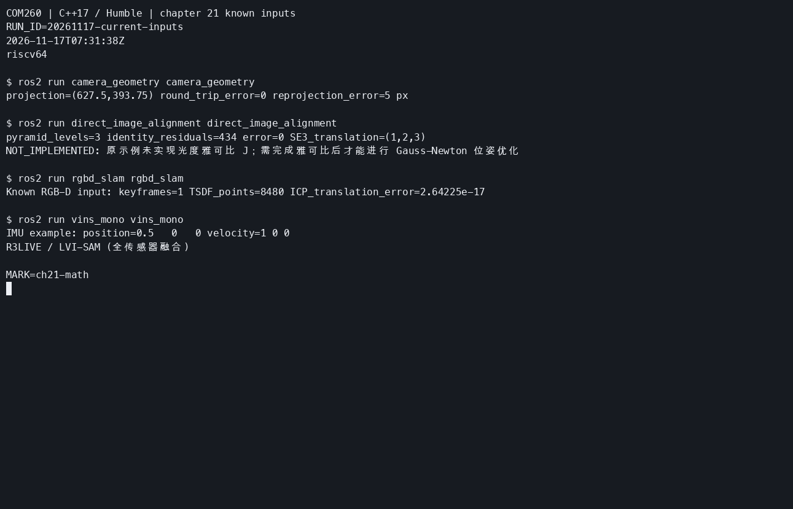

### 21.2.2 相机畸变

**径向畸变（Radial Distortion）：**
```
x_corrected = x * (1 + k1*r² + k2*r⁴ + k3*r⁶)
y_corrected = y * (1 + k1*r² + k2*r⁴ + k3*r⁶)
```

**切向畸变（Tangential Distortion）：**
```
x_corrected = x + (2*p1*x*y + p2*(r² + 2*x²))
y_corrected = y + (p1*(r² + 2*y²) + 2*p2*x*y)
```

### 21.2.3 ROS2相机接口

先看相机接口。使用 Gazebo 时，先按本节下方的步骤在 x86 启动相机，再在已加载本章环境的 COM260 终端逐条查询。带 `--once` 的命令收到一条消息后自行退出，连续输出的命令按 Ctrl+C 结束。

```bash
# 查看相机内参
ros2 topic echo /camera/camera_info --once

# 查看原始图像
ros2 topic echo /camera/image_raw

# 仅在相机发布该深度话题时执行
ros2 topic echo /camera/depth/image_raw
```

查看图像时，回到启动 Gazebo 的 x86 终端，任选一条命令。窗口打开后观察图像，关闭窗口即可返回终端。

```bash
bash course_support/k3_com260_kit/scripts/x86-ch20-ch21.bash exec "$RUN_ID" \
  ros2 run image_view image_view image:=/camera/image_raw
bash course_support/k3_com260_kit/scripts/x86-ch20-ch21.bash exec "$RUN_ID" \
  ros2 run rqt_image_view rqt_image_view
```

```cpp
#include <cmath>
#include <cv_bridge/cv_bridge.h>
#include <rclcpp/rclcpp.hpp>
#include <sensor_msgs/msg/camera_info.hpp>
#include <sensor_msgs/msg/image.hpp>
#include <sensor_msgs/msg/point_cloud2.hpp>
#include <sensor_msgs/point_cloud2_iterator.hpp>

class CameraProcessor : public rclcpp::Node {
public:
  CameraProcessor() : Node("camera_processor") {
    image_sub = create_subscription<sensor_msgs::msg::Image>("/camera/color/image_raw", rclcpp::QoS(10),
      [this](sensor_msgs::msg::Image::ConstSharedPtr msg) {
        latest_image = cv_bridge::toCvCopy(msg, "bgr8")->image;
        RCLCPP_INFO_THROTTLE(get_logger(), *get_clock(), 2000, "RGB: %dx%d frame=%s",
          latest_image.cols, latest_image.rows, msg->header.frame_id.c_str());
      });
    depth_sub = create_subscription<sensor_msgs::msg::Image>("/camera/depth/image_raw", rclcpp::QoS(10),
      [this](sensor_msgs::msg::Image::ConstSharedPtr msg) {
        latest_depth = cv_bridge::toCvCopy(msg, "32FC1")->image;
        get_rgbd_pointcloud(msg->header);
      });
    info_sub = create_subscription<sensor_msgs::msg::CameraInfo>("/camera/color/camera_info", rclcpp::QoS(10),
      [this](const sensor_msgs::msg::CameraInfo & msg) {
        K = msg.k;
        RCLCPP_INFO_THROTTLE(get_logger(), *get_clock(), 2000, "相机内参: fx=%.3f fy=%.3f cx=%.3f cy=%.3f",
          K[0], K[4], K[2], K[5]);
      });
    cloud_pub = create_publisher<sensor_msgs::msg::PointCloud2>("/camera/points_sampled", 1);
  }
  void get_rgbd_pointcloud(const std_msgs::msg::Header & header) {
    if (latest_image.empty() || latest_depth.empty() || K[0] <= 0 || K[4] <= 0 ||
        latest_image.size() != latest_depth.size()) { return; }
    std::vector<cv::Vec3f> points;
    std::vector<cv::Vec3b> colors;
    for (int v = 0; v < latest_depth.rows; v += 5) {
      for (int u = 0; u < latest_depth.cols; u += 5) {
        float z = latest_depth.at<float>(v, u);
        if (!std::isfinite(z) || z <= 0 || z > 5) { continue; }
        points.push_back({float((u - K[2]) * z / K[0]), float((v - K[5]) * z / K[4]), z});
        colors.push_back(latest_image.at<cv::Vec3b>(v, u));
      }
    }
    sensor_msgs::msg::PointCloud2 cloud;
    cloud.header = header;
    sensor_msgs::PointCloud2Modifier modifier(cloud);
    modifier.setPointCloud2FieldsByString(2, "xyz", "rgb");
    modifier.resize(points.size());
    sensor_msgs::PointCloud2Iterator<float> x(cloud, "x"), y(cloud, "y"), z(cloud, "z");
    sensor_msgs::PointCloud2Iterator<uint8_t> r(cloud, "r"), g(cloud, "g"), b(cloud, "b");
    for (size_t i = 0; i < points.size(); ++i, ++x, ++y, ++z, ++r, ++g, ++b) {
      *x = points[i][0]; *y = points[i][1]; *z = points[i][2];
      *b = colors[i][0]; *g = colors[i][1]; *r = colors[i][2];
    }
    cloud_pub->publish(cloud);
    RCLCPP_INFO_THROTTLE(get_logger(), *get_clock(), 1000, "RGB-D sampled_points=%zu", points.size());
  }
private:
  cv::Mat latest_image, latest_depth;
  std::array<double, 9> K{};
  rclcpp::Subscription<sensor_msgs::msg::Image>::SharedPtr image_sub, depth_sub;
  rclcpp::Subscription<sensor_msgs::msg::CameraInfo>::SharedPtr info_sub;
  rclcpp::Publisher<sensor_msgs::msg::PointCloud2>::SharedPtr cloud_pub;
};
int main(int argc, char ** argv) {
  rclcpp::init(argc, argv);
  rclcpp::spin(std::make_shared<CameraProcessor>());
  rclcpp::shutdown();
}
```

在 x86 主机终端按[第 21 章环境配置](../lab_manuals_k3_com260_kit/ch00_common_setup.md#ch21)设置 DDS，然后启动 Gazebo。保留这个终端，稍后用其中的 `RUN_ID` 打开图像窗口和停止仿真。

若仍有课程仿真在运行，先在启动它的 x86 终端执行 `bash course_support/k3_com260_kit/scripts/x86-ch20-ch21.bash stop "$RUN_ID"`。

```bash
cd ~/ROS2_RISCV_COM260_CH20_CH21
export RUN_ID="$(date -u +%Y%m%dT%H%M%SZ)-camera"
bash course_support/k3_com260_kit/scripts/x86-ch20-ch21.bash start-camera "$RUN_ID"
```

相机示例启用 `drive:=true`，机器人自动运动；观察图像中的场景变化和相邻帧匹配。

Gazebo 标题栏出现但场景区域透明时，拖动窗口边框调整一次大小，触发重绘；确认能看到场景后继续。

Burger 相机提供 320×180 RGB 图像。节点使用 RealSense 风格的输入名，连接 Gazebo 时显式重映射。图像订阅使用可靠 QoS、队列深度 10，与本节 Gazebo 图像桥一致。另开 COM260 终端，加载工作区并启动相机处理节点：

```bash
source ~/.config/ros2-course-com260-ch20-ch21/env.bash
ros2 run camera_processor camera_processor --ros-args \
  -p use_sim_time:=true \
  -r /camera/color/image_raw:=/camera/image_raw \
  -r /camera/color/camera_info:=/camera/camera_info
```

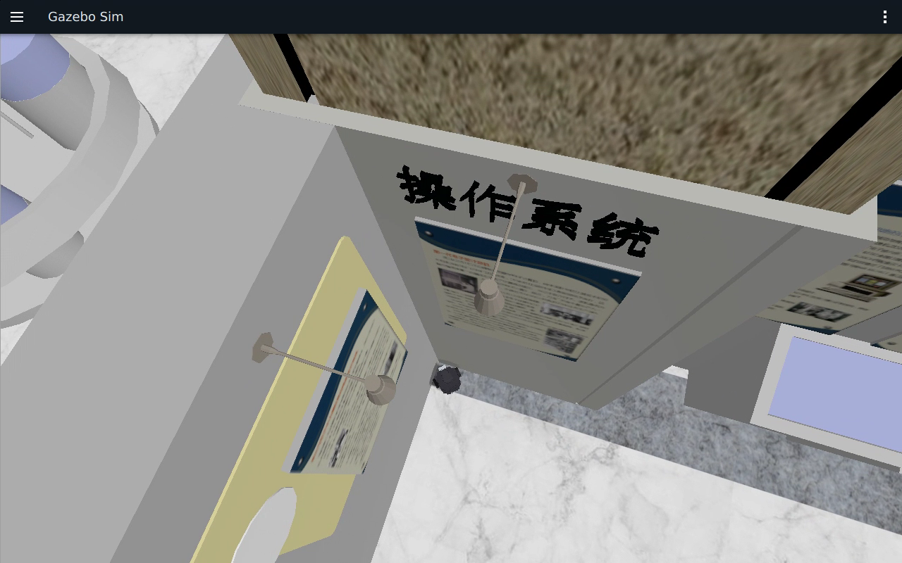

[30 秒 Gazebo 录像](../lab_manuals_k3_com260_kit/images/ch20_ch21/camera-gazebo.mp4)展示相机示例使用的 Burger 场景。

### 21.2.4 image_transport图像传输

另开一个加载了本章环境的 COM260 终端。以下是三种传输格式的命令示例，选择已安装相应插件的格式运行，按 Ctrl+C 结束转发。

```bash
# Raw格式（无损但带宽大）
ros2 run image_transport republish raw in:=/camera/image_raw raw out:=/image_raw

# Compressed格式（JPEG压缩）
ros2 run image_transport republish compressed in:=/camera/image_raw raw out:=/image_compressed

# Theora格式（视频流编码）
ros2 run image_transport republish theora in:=/camera/image_raw raw out:=/image_theora
```

## 21.3 ORB-SLAM

### 21.3.1 ORB特征

ORB (Oriented FAST and Rotated BRIEF) 是视觉SLAM中最常用的特征：

**FAST关键点检测：** 比较像素与其周围16个像素的亮度，若有连续N个像素亮度超过阈值，则认为是角点；计算速度快，适合实时SLAM。

**BRIEF描述子：** 在关键点周围随机选取点对比较亮度，生成二进制字符串描述子，并使用Hamming距离快速匹配。

**ORB改进：** 方向计算使用灰度质心法（旋转不变性）；尺度不变性使用图像金字塔；旋转BRIEF则根据关键点方向旋转描述子。

```cpp
#pragma once
#include <opencv2/features2d.hpp>

class ORBFeatureExtractor {
public:
  ORBFeatureExtractor(int features = 1000, float scale = 1.2f, int levels = 8)
  : orb(cv::ORB::create(features, scale, levels)) {}
  void extract(const cv::Mat & image, std::vector<cv::KeyPoint> & keypoints, cv::Mat & descriptors) {
    orb->detectAndCompute(image, cv::noArray(), keypoints, descriptors);
  }
  std::vector<cv::DMatch> match_features(const cv::Mat & first, const cv::Mat & second, float ratio = 0.75f) {
    std::vector<cv::DMatch> good;
    if (first.empty() || second.rows < 2) { return good; }
    std::vector<std::vector<cv::DMatch>> pairs;
    cv::BFMatcher(cv::NORM_HAMMING).knnMatch(first, second, pairs, 2);
    for (const auto & pair : pairs) {
      if (pair.size() == 2 && pair[0].distance < ratio * pair[1].distance) { good.push_back(pair[0]); }
    }
    return good;
  }
  cv::Mat visualize_matches(const cv::Mat & first, const cv::Mat & second,
      const std::vector<cv::KeyPoint> & kp1, const std::vector<cv::KeyPoint> & kp2,
      const std::vector<cv::DMatch> & matches) {
    cv::Mat result;
    cv::drawMatches(first, kp1, second, kp2, matches, result, cv::Scalar::all(-1),
      cv::Scalar::all(-1), {}, cv::DrawMatchesFlags::NOT_DRAW_SINGLE_POINTS);
    return result;
  }
private:
  cv::Ptr<cv::ORB> orb;
};
```

在运行 `camera_processor` 的 COM260 终端观察 RGB 和内参输出，然后按 Ctrl+C。保留 x86 上的 Gazebo，在同一 COM260 终端启动 ORB 节点：

```bash
ros2 run orb_feature_extractor orb_feature_extractor --ros-args -p use_sim_time:=true
```

切回启动 RGB 相机的 x86 终端，打开匹配图窗口：

```bash
bash course_support/k3_com260_kit/scripts/x86-ch20-ch21.bash exec "$RUN_ID" \
  ros2 run rqt_image_view rqt_image_view /orb/matches
```

匹配图并排显示相邻两帧及匹配连线。提取器使用 1000 个特征上限、1.2 金字塔尺度、8 层和 0.75 Lowe 比率。它只做特征提取与匹配，不输出 SLAM 位姿或地图。观察完毕，先关闭 x86 的匹配图窗口，再在 COM260 的 ORB 终端按 Ctrl+C。结束这一组示例时，在启动 RGB 相机的 x86 终端运行 `bash course_support/k3_com260_kit/scripts/x86-ch20-ch21.bash stop "$RUN_ID"`。

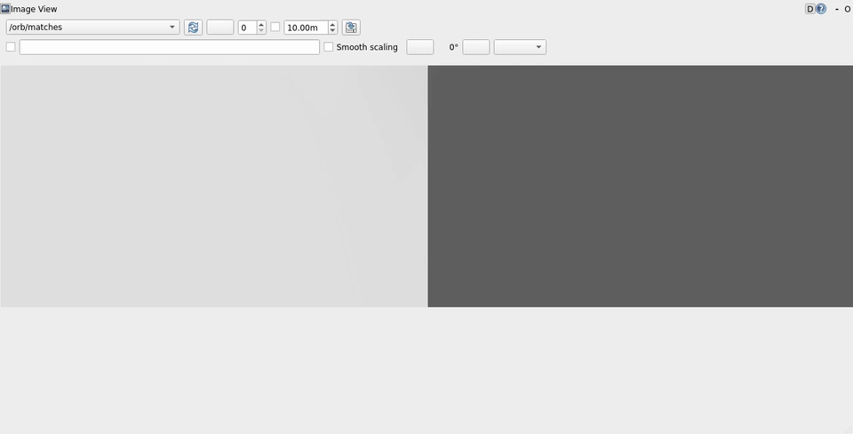

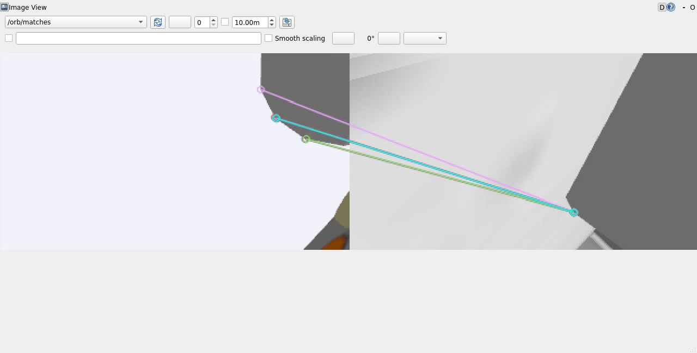

[匹配图录像](../lab_manuals_k3_com260_kit/images/ch20_ch21/orb-matches.mp4)为 COM260 处理、x86 显示的原速节选。图像尺寸、时间戳、内参和数学示例结果见[运行证据](../lab_manuals_k3_com260_kit/runtime_evidence.md#ch21)。

### 21.3.2 ORB-SLAM算法流程

**跟踪线程 (Tracking Thread)：**
```
1. 预处理输入
   - 提取ORB特征
   - 如果是RGB-D，获取对应深度

2. 位姿预测 / 重定位
   - 匀速模型预测
   - 特征匹配 + EPnP求解位姿

3. 局部地图跟踪
   - 匹配更多地图点
   - 优化当前帧位姿

4. 关键帧决策
   - 判断是否插入新关键帧
   - 条件：跟踪质量、时间间隔、距离间隔
```

**建图线程 (Local Mapping Thread)：**
```
1. 插入关键帧
   - 更新共视图(Covisibility Graph)

2. 地图点管理
   - 剔除质量差的地图点
   - 三角化新的地图点

3. 局部BA优化
   - 优化当前关键帧及其邻居

4. 冗余关键帧剔除
   - 删除观测冗余的关键帧
```

**闭环检测线程 (Loop Closing Thread)：**
```
1. DBoW词袋检测
   - 使用视觉词汇进行闭环候选搜索

2. 闭环验证
   - 计算闭环帧间SE3变换

3. 闭环融合
   - 合并闭环处的地图点和关键帧

4. 本质图优化
   - 全局位姿图优化消除累积误差
```

### 21.3.3 重投影误差

视觉SLAM的核心是最小化重投影误差：

```
E = Σ || z_ij - h(T_i, P_j) ||²_Σ
```

其中：z_ij为第j个地图点在第i帧图像上的观测像素坐标；T_i为第i帧相机位姿；P_j为第j个地图点的3D位置；h(T_i, P_j)为重投影函数（3D→2D投影）。

```cpp
class BundleAdjustment {
public:
  explicit BundleAdjustment(const cv::Matx33d & camera) : K(camera) {}
  double compute_reprojection_error(const cv::Vec<double, 6> & pose,
      const cv::Vec3d & point, const cv::Point2d & observation) const {
    cv::Matx33d rotation;
    cv::Rodrigues(cv::Vec3d(pose[0], pose[1], pose[2]), rotation);
    const auto camera_point = rotation * point + cv::Vec3d(pose[3], pose[4], pose[5]);
    const auto pixel = K * camera_point;
    return cv::norm(cv::Point2d(pixel[0] / pixel[2], pixel[1] / pixel[2]) - observation);
  }
private:
  cv::Matx33d K;
};
```

上例只计算重投影误差，没有执行完整 BA 优化。

### 21.3.4 ORB-SLAM3 ROS2配置

```yaml
# RGB-D相机配置 (D415.yaml)
Camera.type: "PinHole"
Camera.fx: 615.0
Camera.fy: 615.0
Camera.cx: 320.0
Camera.cy: 240.0
Camera.k1: 0.0
Camera.k2: 0.0
Camera.p1: 0.0
Camera.p2: 0.0
Camera.width: 640
Camera.height: 480
Camera.fps: 30

# RGB-D参数
RGBD.ThDepth: 5.0           # 深度阈值(m)
Depth.map_factor: 1000.0    # 深度缩放因子

# ORB特征参数
ORBextractor.nFeatures: 1200
ORBextractor.scaleFactor: 1.2
ORBextractor.nLevels: 8

# 跟踪参数
Tracker.nFeaturesPerLevel: 200
Tracker.nonFeaturesPerLevel: 300

# 查看器参数
Viewer.keyFrameSize: 0.05
Viewer.keyFrameLineWidth: 1.0
Viewer.graphLineWidth: 0.9
Viewer.pointSize: 2.0
```

```bash
# COM260：连接 D415、准备词袋和相机配置后启动节点
ros2 run orbslam3 rgbd \
  /path/to/Vocabulary/ORBvoc.txt \
  /path/to/config/D415.yaml
```

另开一个加载相同 ROS 环境的 COM260 终端，逐条查看输出，每条用 Ctrl+C 结束。观察完毕再回到运行 RGB-D 节点的终端，按 Ctrl+C 结束建图。

```bash
ros2 topic echo /orb_slam3/camera_pose
ros2 topic echo /orb_slam3/trajectory
ros2 topic echo /orb_slam3/map_points
```

D415 的内参与深度缩放应从所用设备获取。

**使用 Gazebo RGB-D 相机**

Gazebo 的 RGB-D 相机提供配准后的彩色图、深度图和内参，COM260 运行 C++ ORB-SLAM3。此入口用于第 21 章第 4 题的软件链路练习；D415 驱动、USB 连接和真实深度测量仍需连接相机另行检查。

先完成[公共环境中的视觉 SLAM 配置](../lab_manuals_k3_com260_kit/ch00_common_setup.md#ch21-vision)。启动前先停止其他课程仿真实例。

在 x86 新终端启动 RGB-D 仿真：

```bash
cd ~/ROS2_RISCV_COM260_CH20_CH21
source ~/.config/ros2-course-com260-ch20-ch21/vision-dds.bash
export RUN_ID="$(date -u +%Y%m%dT%H%M%SZ)-rgbd"
bash course_support/k3_com260_kit/scripts/x86-ch20-ch21.bash start-rgbd "$RUN_ID"
```

机器人位于 Museum 原点、朝向 45°，相机面向已有展板；等待 Gazebo 和 RViz 中的彩色图、深度图更新。空白墙面可能无法提供足够特征，不能只凭收到图像判断初始化完成。

**检查输入并运行**

相机为 640×480，仿真更新率设置为 30 Hz；实际墙钟频率随仿真负载变化。内参为 `fx=fy=615`、`cx=320`、`cy=240`，深度单位为米、编码为 `32FC1`，范围为 0.1～5 m。彩色图采用 PNG 传输，深度使用 `compressedDepth`；解码后再送入算法，保留图像尺寸和时间戳。浮点深度压缩有量化误差。

在 COM260 新终端加载视觉 SLAM 环境，检查相机内参：

```bash
source ~/.config/ros2-course-com260-ch20-ch21/env.bash
source ~/.config/ros2-course-com260-ch20-ch21/vision-dds.bash
ros2 topic echo /camera/color/camera_info --once
```

在同一终端新建输出目录，运行 RGB-D 节点：

```bash
export RUN_ID="$(date -u +%Y%m%dT%H%M%SZ)-rgbd"
mkdir -p ~/ros2_course_com260_ch21_slam/rgbd-runs/"$RUN_ID"
cd ~/ros2_course_com260_ch21_slam/rgbd-runs/"$RUN_ID"
export OMP_NUM_THREADS=2
ros2 run orbslam3 rgbd "$ORB_SLAM3_ROOT/Vocabulary/ORBvoc.txt" \
  ~/ros2_course_com260_ch20_ch21_ws/install/orbslam3/share/orbslam3/config/gazebo-rgbd.yaml \
  --ros-args -p use_sim_time:=true \
  -p rgb_transport:=compressed -p depth_transport:=compressedDepth
```

等待词袋加载完成。日志中的 `state=2` 表示当前图像跟踪正常；`frames`、`tracked` 分别是处理数量和有效跟踪数量。RViz 显示蓝色相机轨迹与黄色稀疏地图点，地图点是当前帧跟踪到的点，不是稠密点云。`/orb_slam3/camera_pose` 发布估计位姿，TF 的 `map→slam_camera` 使用同一估计结果。

当前 Humble 图像插件启动时可能输出一次 `SubscriberPlugin::subscribeImpl with five arguments has not been overridden`。兼容路径随后使用旧接口订阅；仍应确认图像持续更新、`frames` 增长且出现 `state=2`，不能仅凭进程存在判断输入正常。

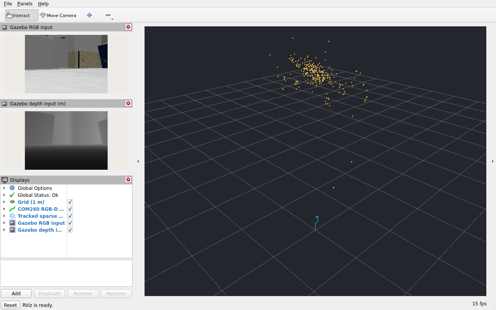

**移动、观察与停止**

在 x86 原终端控制机器人缓慢前进：

```bash
bash course_support/k3_com260_kit/scripts/x86-ch20-ch21.bash exec "$RUN_ID" \
  ros2 topic pub /cmd_vel geometry_msgs/msg/Twist \
  '{linear: {x: 0.05}, angular: {z: 0.0}}' -r 10
```

观察图像变化与轨迹增长，按 Ctrl+C 停止发布，然后立即发送零速度：

```bash
bash course_support/k3_com260_kit/scripts/x86-ch20-ch21.bash exec "$RUN_ID" \
  ros2 topic pub /cmd_vel geometry_msgs/msg/Twist \
  '{linear: {x: 0.0}, angular: {z: 0.0}}' --once
```

需要转向时，将前进命令改为 `linear.x=0.0`、`angular.z=0.08`；停止后同样发送零速度。通过 `/odom` 确认运动和停车，不能把 SLAM 位姿或速度命令当作停车反馈。

停车后，在运行 `orbslam3 rgbd` 的 COM260 终端按 Ctrl+C。程序等待建图线程退出，再保存 `trajectory.tum`、`keyframes.tum` 和 `rgbd-map.osa`。重复运行时使用新目录。等程序返回终端提示符后，在 x86 关闭 RViz，若提示保存布局则选择 **Discard**。最后在启动 `start-rgbd` 的 x86 终端执行：

```bash
bash course_support/k3_com260_kit/scripts/x86-ch20-ch21.bash stop "$RUN_ID"
```

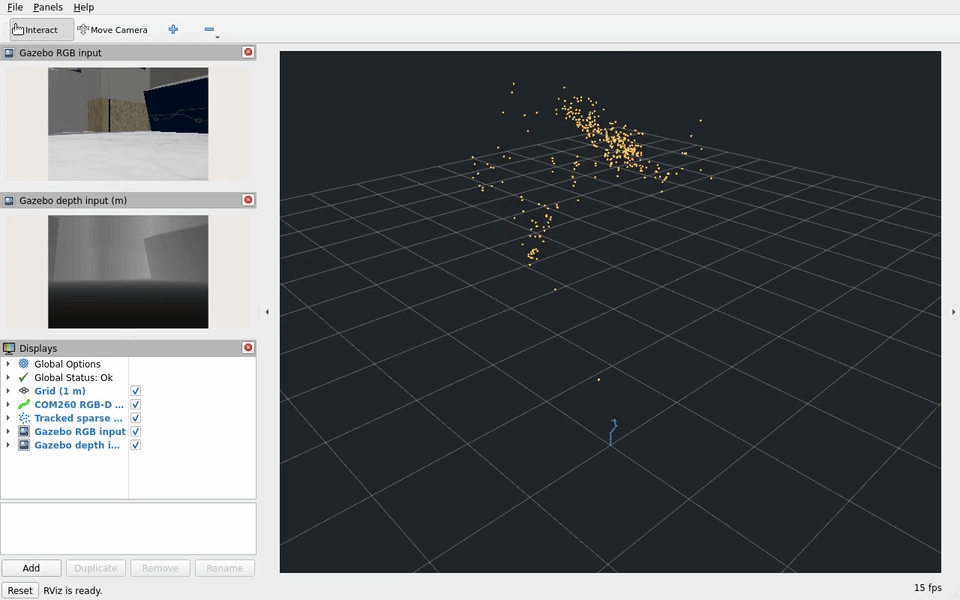

[RViz 连续原速录像](../lab_manuals_k3_com260_kit/images/ch20_ch21/rgbd-rviz.mp4)和 [Gazebo 连续原速录像](../lab_manuals_k3_com260_kit/images/ch20_ch21/rgbd-gazebo.mp4)展示前进、转向与停车过程。仿真运行结果及 D415 实机未验证的范围见[运行证据](../lab_manuals_k3_com260_kit/runtime_evidence.md#rgb-d-仿真建图)。

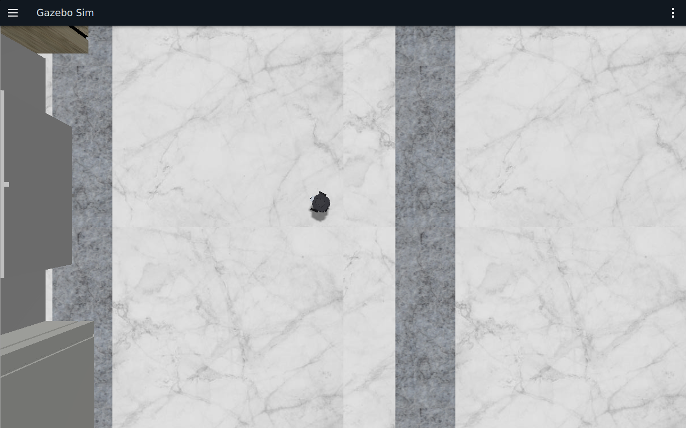

### 21.3.5 官方要点——OpenCV 官方文档：ORB 特征的提取与匹配

本节内容综合翻译自 OpenCV 官方文档、ORB-SLAM3 官方 GitHub 仓库（UZ-SLAMLab）与 EVO 评估工具官方文档，另参考 The Construct 的视觉 SLAM 课程与 Robotics Back-End 的 ORB-SLAM 实战教程。原文均为英文，此处为中文编译，供课后巩固与进阶阅读。

OpenCV 官方教程将 ORB 定位为"免费版 SIFT"：`cv::ORB::create()` 可调节特征点数量、金字塔层数与 Fast 阈值，`detectAndCompute()` 一步完成关键点检测与描述子计算。匹配阶段官方推荐 `BFMatcher` 配 `NORM_HAMMING`（ORB 是二进制描述子，不用 L2 距离），并用 Lowe 比率测试（`knnMatch` 取 k=2，距离比小于 0.75~0.8 才接受）剔除误匹配——这正是练习第 2 题的实现路径。文档还建议用 `cv::drawMatches` 可视化匹配线，肉眼核查是否集中于重复纹理区域，这是判断数据集质量的快速手段。

### 21.3.6 官方要点——ORB-SLAM3 官方仓库：三线程协作与视觉惯性扩展

ORB-SLAM3 的官方 README 与 ICRA 论文说明了其多线程架构：Tracking 线程用恒速运动模型预测位姿后做特征级匹配优化（每帧）；Local Mapping 线程将关键帧插入共视图、剔除冗余地图点（局部束调整）；Loop Closing 线程用 DBoW2 词袋做回环检测，通过位姿图优化与全局 BA 消除累积漂移。第四个 Atlas 线程管理多地图——跟踪丢失时自动建新地图，回环时合并。官方实现还内置视觉惯性模式（VI-ORB），在单目/立体/RGB-D 基础上紧耦合 IMU 预积分，这正是练习第 4 题 RealSense D415（自带 IMU）能跑 RGB-D+IMU 模式的官方依据；ROS 2 wrapper 的接口约定（/camera、/imu 话题与 TF 时钟同步）也在仓库 wiki 中说明。

### 21.3.7 官方要点——EVO 官方文档：轨迹评估的标准工作流

EVO（MichaelGrupp/evo）官方文档是练习第 5 题的标准参考：先用 `evo_traj tum` 将算法输出与真值对齐并可视化，再用 `evo_ape tum` 计算绝对位姿误差（ATE，衡量全局漂移）、`evo_rpe` 计算相对位姿误差（RPE，衡量局部一致性），常用指标为 RMSE。文档强调评估前必须做轨迹对齐（`-a` Umeyama 刚体对齐或 `-as` 带尺度对齐，单目 SLAM 必须用后者），并支持 TUM/KITTI/EuRoC 三种格式互转（`evo_traj` 的 `--save_as_tum` 等）。录制 rosbag 时文档建议图像与 IMU 话题都带上时间戳日志，避免评估时插值误差被放大。

本节使用 EuRoC V1_01_easy 的单目图像、IMU 和参考轨迹练习录包与精度评估。数据来自真实传感器记录，操作方式为离线回放；RealSense D415 的实时 RGB-D 建图仍需连接深度相机。

使用[公共环境中的视觉 SLAM 配置](../lab_manuals_k3_com260_kit/ch00_common_setup.md#ch21-vision)中的 ORB-SLAM3 工作区与 DDS 域 203。

**准备图像与 IMU 数据**

在 x86 下载 [EuRoC 数据集](https://projects.asl.ethz.ch/datasets/euroc-mav/)的 V1_01_easy。以下使用[公开下载镜像](https://huggingface.co/datasets/pepijn223/euroc-mirror)，下载后核对 SHA-256：

```bash
mkdir -p ~/ros2_course_com260_ch21_data
cd ~/ros2_course_com260_ch21_data
curl -fL --retry 3 -o V1_01_easy.zip \
  https://huggingface.co/datasets/pepijn223/euroc-mirror/resolve/main/V1_01_easy.zip
echo 'a920fe5b5e69a6ad19b32f1cfaf90ac2f59d45dfd1ca18cc9722e07684ba45fa  V1_01_easy.zip' | sha256sum -c -
podman run --rm --network none --cap-drop all --security-opt no-new-privileges \
  -v "$HOME/ros2_course_com260_ch21_data:/data:rw" \
  -v "$HOME/ROS2_RISCV_COM260_CH20_CH21/course_support/k3_com260_kit/visual_slam:/tools:ro" \
  localhost/ros2-course-com260:ch20-ch21 bash -c \
  'source /opt/ros/humble/setup.bash; python3 /tools/euroc_to_bag.py /data/V1_01_easy.zip /data/euroc_source'
```

转换程序保留图像和 IMU 的原始时间戳，生成 `/camera/image_raw`、`/imu` 两个话题及 `reference.tum` 参考轨迹。图像为 752×480 的 `mono8`；标定文件使用 ORB-SLAM3 自带的 `EuRoC.yaml`，不能换成 RealSense 标定。

**回放并录制**

在 x86 的独立容器中启动录制，再播放数据：

```bash
podman run --rm --network none --cap-drop all --security-opt no-new-privileges \
  -v "$HOME/ros2_course_com260_ch21_data:/data:rw" \
  -v "$HOME/ROS2_RISCV_COM260_CH20_CH21/course_support/k3_com260_kit/visual_slam:/tools:ro" \
  localhost/ros2-course-com260:ch20-ch21 bash /tools/record-euroc.bash
```

脚本使用 `ros2 bag record --use-sim-time` 录制两个话题，并以 `ros2 bag play --clock` 提供时钟。等待约 150 s，查看 `ros2 bag info`：应包含 2912 条图像和 29120 条 IMU。若消息缺失，检查录制日志并重新录制；重试时先为已有目录改名，避免覆盖数据。

将录得的 `euroc_recorded` 目录复制到 COM260 的 `~/ros2_course_com260_ch21_slam/data/`。算法读取这份实际录包，不读取转换生成的 `euroc_source`。

**计算轨迹**

若相机实例仍在运行，先在启动它的终端执行停止命令。完成[公共环境中的视觉 SLAM 配置](../lab_manuals_k3_com260_kit/ch00_common_setup.md#ch21-vision)后，在 x86 新终端打开轨迹窗口：

```bash
cd ~/ROS2_RISCV_COM260_CH20_CH21
source ~/.config/ros2-course-com260-ch20-ch21/vision-dds.bash
export SLAM_VIEW_ID="$(date -u +%Y%m%dT%H%M%SZ)-slam-view"
bash course_support/k3_com260_kit/scripts/x86-ch20-ch21.bash start-slam "$SLAM_VIEW_ID"
```

在 COM260 新终端加载环境并运行：

```bash
source ~/.config/ros2-course-com260-ch20-ch21/env.bash
source ~/.config/ros2-course-com260-ch20-ch21/vision-dds.bash
export OMP_NUM_THREADS=2
export RUN_ID="$(date -u +%Y%m%dT%H%M%SZ)-euroc"
mkdir -p ~/ros2_course_com260_ch21_slam/data/runs/"$RUN_ID"
ros2 run visual_slam_eval bag_vio \
  ~/ros2_course_com260_ch21_slam/data/euroc_recorded \
  "$ORB_SLAM3_ROOT/Vocabulary/ORBvoc.txt" \
  "$ORB_SLAM3_ROOT/Examples/Monocular-Inertial/EuRoC.yaml" \
  ~/ros2_course_com260_ch21_slam/data/runs/"$RUN_ID"/trajectory-ns.txt
```

程序按时间顺序处理全部图像，每 50 帧输出处理数量与有效跟踪数量，结束时保存 IMU 机体轨迹。处理速度取决于板端算力，不能把离线完成时间当作实时建图性能。`/orb_slam3/trajectory` 发布运行中的相机轨迹，`/orb_slam3/image` 发布对应输入图像，并发布 `map` 到 `camera` 的估计变换；x86 的 RViz 可使用 `course_support/k3_com260_kit/rviz/visual_slam.rviz` 观察。在 RViz 中观察左侧图像和网格中的蓝色路径，见[窗口截图](../lab_manuals_k3_com260_kit/images/ch20_ch21/euroc-dds-rviz.png)和[双端运行录像](../lab_manuals_k3_com260_kit/images/ch20_ch21/euroc-dds-rviz.mp4)。

**使用 EVO 评估**

将 COM260 的 `runs/$RUN_ID` 目录复制到 x86 的 `~/ros2_course_com260_ch21_data/runs/`，保留同一个目录名。在 x86 执行：

```bash
python3 -m venv ~/ros2_course_com260_ch21_evo
~/ros2_course_com260_ch21_evo/bin/pip install evo==1.38.1
cd ~/ros2_course_com260_ch21_data
export RUN_ID=上一步的目录名
bash ~/ROS2_RISCV_COM260_CH20_CH21/course_support/k3_com260_kit/visual_slam/evaluate.bash "runs/$RUN_ID"
```

评估脚本将 ORB-SLAM3 输出的纳秒时间戳转换为 TUM 格式的秒，保留位置和四元数。使用 `evo_ape tum -a` 与 `evo_rpe tum -a` 做刚体对齐，不拟合尺度；时间匹配容差为 0.01 s，RPE 使用相邻一帧的位姿。比较对象均为 IMU 机体轨迹，不要把 RViz 中的相机轨迹直接与机体真值比较。

查看 ATE、RPE 的 RMSE、有效关联位姿数和轨迹覆盖范围。跟踪丢失后，ORB-SLAM3 可能只保存关键帧最多的一张地图；因此低误差不能单独证明整段数据都完成了跟踪。

等 COM260 上的 `bag_vio` 读完录包、保存轨迹并自行退出。观察结束后，关闭 x86 的 RViz 窗口，在启动 `start-slam` 的 x86 终端执行 `bash ~/ROS2_RISCV_COM260_CH20_CH21/course_support/k3_com260_kit/scripts/x86-ch20-ch21.bash stop "$SLAM_VIEW_ID"`。

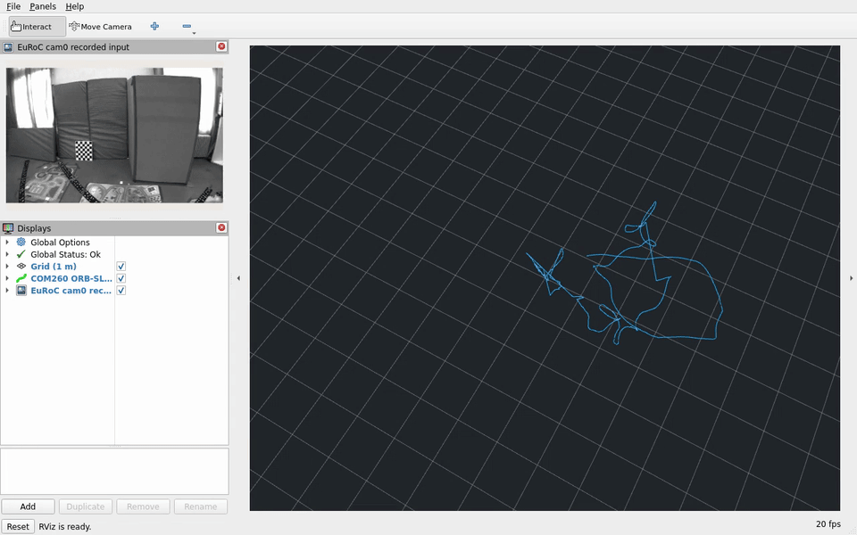

观察[RViz 轨迹截图](../lab_manuals_k3_com260_kit/images/ch20_ch21/slam-rviz.png)中的输入图像与蓝色路径；[60 秒原速录像](../lab_manuals_k3_com260_kit/images/ch20_ch21/slam-rviz.mp4)包含连续处理过程，GIF 为其中第 20～30 秒的节选。

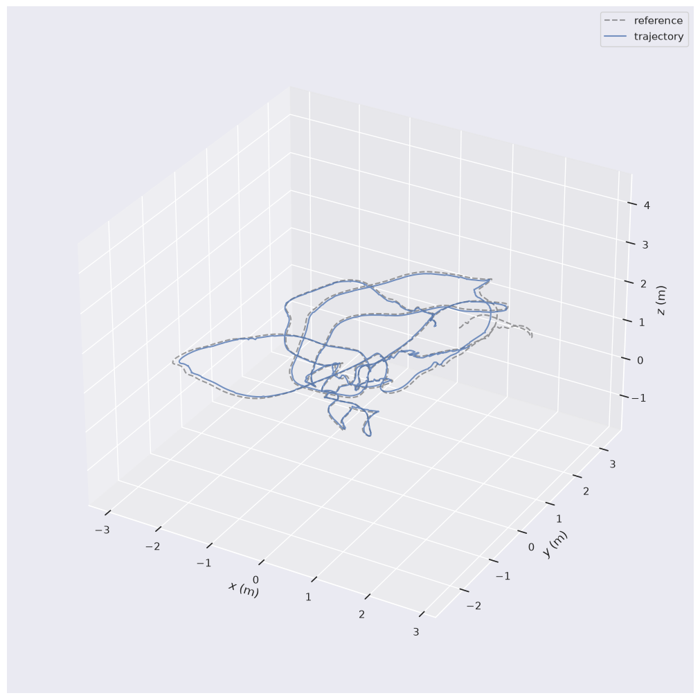

结合 [ATE 曲线](../lab_manuals_k3_com260_kit/images/ch20_ch21/slam-ate.png)、[RPE 曲线](../lab_manuals_k3_com260_kit/images/ch20_ch21/slam-rpe.png)和位姿数量分析误差。保存轨迹可能不覆盖全部输入，应同时记录跟踪丢失或地图重置；参考数值及运行条件见[录包与轨迹评估结果](../lab_manuals_k3_com260_kit/runtime_evidence.md#录包与轨迹评估)。

## 21.4 DSO直接法

### 21.4.1 直接法 vs 特征法

| 特征法 (ORB-SLAM) | 直接法 (DSO) |
|--------------------|--------------|
| 提取特征点 | 使用原始像素亮度 |
| 构建描述子 | 直接使用光度误差 |
| 适合弱纹理 | 不适合 | 不适合 |
| 适合模糊图像 | 不适合 | 不适合 |
| 计算量 | 特征提取+匹配 | 像素采样+优化 |
| 信息利用 | 稀疏（仅特征点） | 半稠密（梯度像素） |

### 21.4.2 DSO算法原理

**核心思想：** 最小化光度误差 (Photometric Error)

```
E_photo = Σ || I_i(p') - I_j(p) ||²
```

其中 I_i(p') 是前一帧图像在 p' 处的亮度，I_j(p) 是当前帧图像在 p 处的亮度。

**关键模块：** 光度标定，校正曝光时间、伽马校正、渐晕；直接图像对齐，使用像素亮度差异优化位姿；滑窗优化，维护最近关键帧窗口进行BA。

```cpp
#pragma once
#include <algorithm>
#include <cmath>
#include <random>
#include <Eigen/Dense>
#include <opencv2/imgproc.hpp>
#include <stdexcept>
#include <vector>

class DirectImageAlignment {
public:
  explicit DirectImageAlignment(int levels = 3) : num_levels(levels) {}
  std::vector<cv::Mat> build_pyramid(const cv::Mat & image) const {
    std::vector<cv::Mat> pyramid{image};
    for (int i = 1; i < num_levels; ++i) {
      cv::Mat smaller;
      cv::resize(pyramid.back(), smaller, {}, 0.5, 0.5, cv::INTER_LINEAR);
      pyramid.push_back(smaller);
    }
    return pyramid;
  }
  std::vector<double> photometric_error(const cv::Mat & ref, const cv::Mat & cur,
      const Eigen::Matrix4d & pose, double inv_depth) const {
    std::vector<cv::Point> pixels;
    for (int y = 0; y < ref.rows; ++y) {
      for (int x = 0; x < ref.cols; ++x) {
        int left = std::max(0, x - 1), right = std::min(ref.cols - 1, x + 1);
        int top = std::max(0, y - 1), bottom = std::min(ref.rows - 1, y + 1);
        double dx = (ref.at<double>(y, right) - ref.at<double>(y, left)) / (right - left);
        double dy = (ref.at<double>(bottom, x) - ref.at<double>(top, x)) / (bottom - top);
        if (std::hypot(dx, dy) > 10) { pixels.emplace_back(x, y); }
      }
    }
    if (pixels.size() > 1000) {
      std::mt19937 random(std::random_device{}());
      std::shuffle(pixels.begin(), pixels.end(), random);
      pixels.resize(1000);
    }
    std::vector<double> residuals;
    for (const auto & pixel : pixels) {
      double z = 1 / inv_depth;
      Eigen::Vector4d point((pixel.x - ref.cols / 2.0) * z / 500, (pixel.y - ref.rows / 2.0) * z / 500, z, 1);
      const Eigen::Vector4d p = pose * point;
      const double u = p.x() / p.z() * 500 + ref.cols / 2.0;
      const double v = p.y() / p.z() * 500 + ref.rows / 2.0;
      if (u >= 0 && u < ref.cols - 1 && v >= 0 && v < ref.rows - 1) {
        residuals.push_back(ref.at<double>(pixel.y, pixel.x) - cur.at<double>(int(v), int(u)));
      }
    }
    return residuals;
  }
  Eigen::Matrix4d align(const cv::Mat & ref, const cv::Mat & cur,
                       const Eigen::Matrix4d & initial_pose, double inv_depth) const {
    Eigen::Matrix4d pose = initial_pose;
    const auto reference = build_pyramid(ref), current = build_pyramid(cur);
    for (int level = num_levels - 1; level >= 0; --level) {
      for (int iteration = 0; iteration < 10; ++iteration) {
        const auto errors = photometric_error(reference[level], current[level], pose, inv_depth / (1 << level));
        Eigen::Map<const Eigen::VectorXd> residuals(errors.data(), errors.size());
        Eigen::MatrixXd J(0, 6);  // The lesson leaves the photometric Jacobian unimplemented.
        if (J.rows() != residuals.size()) {
          throw std::logic_error("原示例未实现光度雅可比 J；需完成雅可比后才能进行 Gauss-Newton 位姿优化");
        }
        const Eigen::Matrix<double, 6, 6> H = J.transpose() * J + Eigen::Matrix<double, 6, 6>::Identity() * 0.001;
        const Eigen::Matrix<double, 6, 1> delta = H.ldlt().solve(-J.transpose() * residuals);
        pose = se3_exp(delta) * pose;
        if (delta.norm() < 0.001) { break; }
      }
    }
    return pose;
  }
  Eigen::Matrix4d se3_exp(const Eigen::Matrix<double, 6, 1> & xi) const {
    const Eigen::Vector3d w = xi.head<3>(), v = xi.tail<3>();
    double theta = w.norm();
    Eigen::Matrix3d R = Eigen::Matrix3d::Identity(), A = R, wx;
    wx << 0, -w.z(), w.y(), w.z(), 0, -w.x(), -w.y(), w.x(), 0;
    if (theta >= 1e-6) {
      R += std::sin(theta) / theta * wx + (1 - std::cos(theta)) / (theta * theta) * wx * wx;
      A += (1 - std::cos(theta)) / (theta * theta) * wx +
        (theta - std::sin(theta)) / (theta * theta * theta) * wx * wx;
    }
    Eigen::Matrix4d T = Eigen::Matrix4d::Identity();
    T.block<3, 3>(0, 0) = R;
    T.block<3, 1>(0, 3) = A * v;
    return T;
  }
private:
  int num_levels;
};
```

直接法示例中的光度雅可比尚待实现；可以练习图像金字塔、残差和 SE(3) 运算，不能直接用 `align()` 获取优化位姿。

在 COM260 观察图像金字塔与光度残差：

```bash
source ~/.config/ros2-course-com260-ch20-ch21/env.bash
ros2 run direct_image_alignment direct_image_alignment
```

要运行完整 DSO，先按[公共环境](../lab_manuals_k3_com260_kit/ch00_common_setup.md#ch21-frameworks)准备依赖和模拟输入。在 **COM260 终端**构建并运行，等待 `EXIT NOW!` 后返回提示符。运行时输入 601 张图像，输出文件记录关键帧位姿。

```bash
cd ~/ROS2_RISCV_COM260_CH20_CH21
bash setup_course_k3_com260_kit.sh --build-ch21-frameworks
cd ~/ros2_course_com260_ch21_frameworks
mkdir -p out/dso
./run bash -ec 'cd out/dso
  ../../dso-build/bin/dso_dataset files=../../sequence/images \
    calib=../../sequence/camera.txt mode=2 preset=0 speed=0 nogui=1 nomt=1'
cp out/dso/result.txt out/dso/poses.txt
./run python3 tools/evaluate-synthetic.py dso
```

`out/dso/poses.txt` 是 TUM 格式轨迹，每行依次为秒制时间戳、x/y/z 和四元数 qx/qy/qz/qw。`evaluation.json` 保存位姿数量、覆盖时间和相似变换对齐后的误差。正常完成会退出，提前停止可按 Ctrl+C，待本次进程退出后再重新运行。

观察完整 DSO 处理同一场景中连续单目图像时的轨迹。图中蓝线连接 DSO 在 COM260 上输出的关键帧，灰线为模拟相机真值。单目轨迹的尺度未知，比较前需做相似变换对齐。

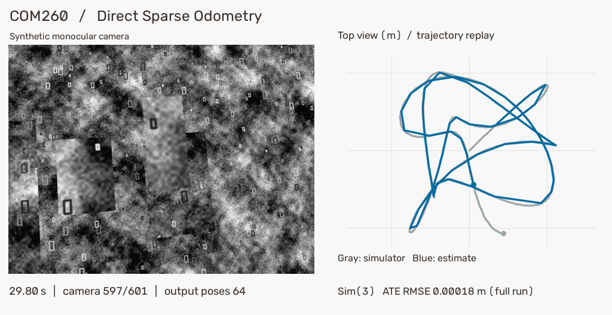

[DSO 轨迹回放](../lab_manuals_k3_com260_kit/images/ch21/dso-trajectory.mp4) · [动图](../lab_manuals_k3_com260_kit/images/ch21/dso-trajectory.gif)

## 21.5 RGB-D SLAM

### 21.5.1 RGB-D SLAM特点

RGB-D相机直接提供深度信息，简化了SLAM问题：

**优势：** 直接获取3D信息，无需三角化；尺度已知，无尺度漂移；可构建稠密地图；初始化简单。

**挑战：** 深度范围有限（通常0.3-5m）；受环境光影响大；存在多路径干扰和运动模糊。

```cpp
#pragma once
#include <algorithm>
#include <open3d/Open3D.h>

class RGBDSLAM {
public:
  using Image = open3d::geometry::Image;
  using Cloud = open3d::geometry::PointCloud;
  struct Keyframe { Eigen::Matrix4d pose; std::shared_ptr<Cloud> cloud; Image rgb, depth; };
  explicit RGBDSLAM(const open3d::camera::PinholeCameraIntrinsic & camera) : K(camera) {}
  Eigen::Matrix4d process_frame(const Image & rgb, const Image & depth,
                               const Eigen::Matrix4d & initial = Eigen::Matrix4d::Identity()) {
    auto cloud = rgbd_to_pointcloud(rgb, depth);
    Eigen::Matrix4d pose = keyframes.empty() ? initial : register_pointcloud(*cloud, *keyframes.back().cloud, initial);
    poses.push_back(pose);
    if (is_keyframe(pose)) {
      keyframes.push_back({pose, cloud, rgb, depth});
      fusion_map();
    }
    return pose;
  }
  std::shared_ptr<Cloud> rgbd_to_pointcloud(const Image & rgb, const Image & depth) const {
    auto rgbd = open3d::geometry::RGBDImage::CreateFromColorAndDepth(rgb, depth, 1000, 5, false);
    return Cloud::CreateFromRGBDImage(*rgbd, K)->VoxelDownSample(0.01);
  }
  Eigen::Matrix4d register_pointcloud(const Cloud & source, const Cloud & target,
      const Eigen::Matrix4d & initial = Eigen::Matrix4d::Identity()) const {
    using namespace open3d::pipelines::registration;
    return RegistrationICP(source, target, 0.1, initial, TransformationEstimationPointToPoint(),
      ICPConvergenceCriteria(1e-6, 1e-6, 50)).transformation_;
  }
  bool is_keyframe(const Eigen::Matrix4d & pose) const {
    if (poses.size() < 2) { return true; }
    const Eigen::Matrix4d delta = keyframes.back().pose.inverse() * pose;
    const double cosine = std::clamp((delta.block<3, 3>(0, 0).trace() - 1) / 2, -1.0, 1.0);
    return delta.block<3, 1>(0, 3).norm() > 0.1 || std::abs(std::acos(cosine)) > 0.3;
  }
  void fusion_map() {
    using namespace open3d::pipelines::integration;
    ScalableTSDFVolume volume(0.01, 0.03, TSDFVolumeColorType::RGB8);
    for (const auto & frame : keyframes) {
      auto rgbd = open3d::geometry::RGBDImage::CreateFromColorAndDepth(frame.rgb, frame.depth, 1000, 4, false);
      volume.Integrate(*rgbd, K, frame.pose.inverse());
    }
    point_cloud = volume.ExtractPointCloud();
  }
  std::vector<Keyframe> keyframes;
  std::vector<Eigen::Matrix4d> poses;
  std::shared_ptr<Cloud> point_cloud;
private:
  open3d::camera::PinholeCameraIntrinsic K;
};
```

在 COM260 上以已知 RGB-D 输入检查 ICP 配准与 TSDF：

```bash
source ~/.config/ros2-course-com260-ch20-ch21/env.bash
ros2 run rgbd_slam rgbd_slam
```

RGB-D 节点需要与彩色图对齐、以米为单位的 `32FC1` 深度图；点云按步长 5 采样，保留 0～5 m 内有效点。当前 Burger RGB 相机不提供这一深度输入。

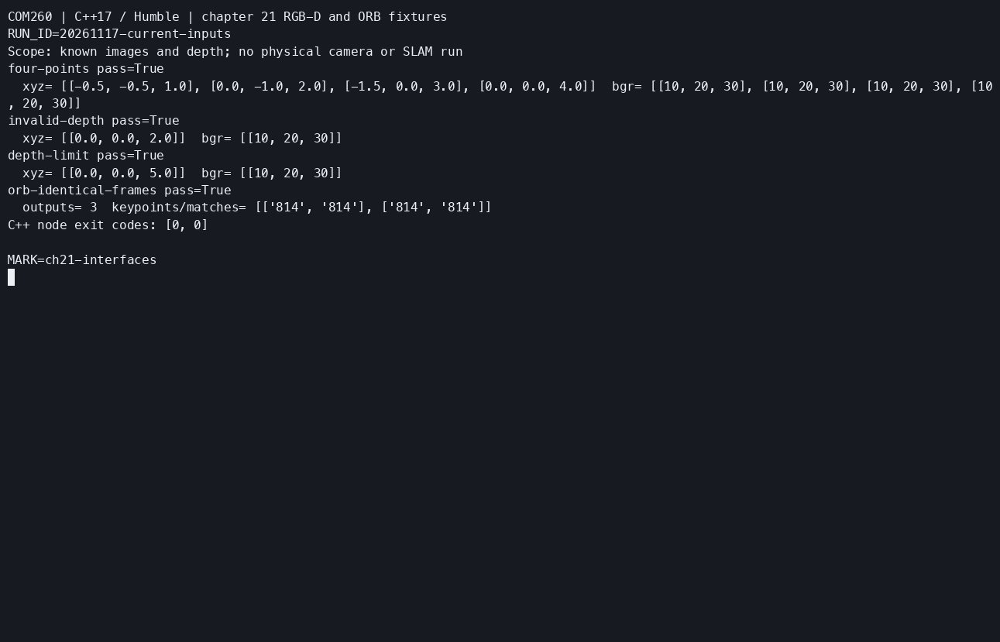

## 21.6 视觉与激光融合SLAM

### 21.6.1 融合策略

视觉与激光SLAM各有优势，融合可以取长补短：

| 融合方式 | 描述 | 代表系统 |
|---------|------|---------|
| 松耦合 | 独立运行后融合结果 | LIC-Fusion |
| 紧耦合 | 统一优化视觉+激光因子 | LVI-SAM, R3LIVE |
| 视觉辅助激光 | 视觉提供回环检测 | Cartographer+视觉 |
| 激光辅助视觉 | 激光提供深度 | RGB-D+激光扩展 |

**融合框架示意：**
```
┌────────────────────────────────────────────┐
│              因子图优化                      │
│  ┌──────────┐  ┌──────────┐  ┌──────────┐ │
│  │ 预积分IMU │  │ 激光因子  │  │ 视觉因子  │ │
│  │ 约束      │  │ 扫描匹配  │  │ 重投影    │ │
│  └──────────┘  └──────────┘  └──────────┘ │
└────────────────────────────────────────────┘
```

### 21.6.2 视觉-惯性融合 (VIO)

VINS-Mono是经典的视觉惯性融合算法：

```cpp
#pragma once
#include <Eigen/Core>
#include <string>
#include <vector>

class VINSMono {
public:
  struct State {
    Eigen::Vector3d position = Eigen::Vector3d::Zero(), velocity = Eigen::Vector3d::Zero();
    Eigen::Vector3d gyro_bias = Eigen::Vector3d::Zero(), acc_bias = Eigen::Vector3d::Zero();
    Eigen::Matrix3d orientation = Eigen::Matrix3d::Identity();
  } state;
  struct Sample { Eigen::Vector3d acc, gyro; double dt; State state; };
  std::vector<Sample> imu_buffer;
  double gyro_noise = 0.01, acc_noise = 0.01, gyro_bias_noise = 0.0001, acc_bias_noise = 0.0001;
  void process_imu(const Eigen::Vector3d & acc, const Eigen::Vector3d & gyro, double dt) {
    const Eigen::Vector3d a = acc - state.acc_bias, w = gyro - state.gyro_bias;
    state.position += state.velocity * dt + 0.5 * a * dt * dt;
    state.velocity += a * dt;
    Eigen::Matrix3d omega;
    omega << 0, -w.z(), w.y(), w.z(), 0, -w.x(), -w.y(), w.x(), 0;
    state.orientation *= Eigen::Matrix3d::Identity() + omega * dt;
    imu_buffer.push_back({acc, gyro, dt, state});
  }
  // The original lesson leaves visual matching, alignment and sliding-window optimization as exercises.
};
```

上述示例使用简化的 IMU 状态传播模型，未包含重力补偿、视觉对齐及滑窗优化。

在 COM260 检查 IMU 状态传播：

```bash
source ~/.config/ros2-course-com260-ch20-ch21/env.bash
ros2 run vins_mono vins_mono
```

要运行完整 VINS-Mono，先按[公共环境](../lab_manuals_k3_com260_kit/ch00_common_setup.md#ch21-frameworks)准备依赖和模拟输入。在 **COM260 终端**构建并运行。已完成 DSO 构建时会复用同一工作区的编译结果。脚本启动特征跟踪、滑动窗口估计与位姿图节点，按原时间戳以 0.4 倍速回放数据，并订阅估计位姿导出轨迹。

```bash
cd ~/ROS2_RISCV_COM260_CH20_CH21
bash setup_course_k3_com260_kit.sh --build-ch21-frameworks
cd ~/ros2_course_com260_ch21_frameworks
./run bash tools/run-vins.bash
cat out/vins/counts.json
cat out/vins/exits.txt
./run python3 tools/evaluate-synthetic.py vins
```

`out/vins/poses.txt` 保存 TUM 格式的优化轨迹，`evaluation.json` 保存固定尺度对齐后的误差。播放完成后脚本自动关闭三个节点，`exits.txt` 的三条退出码均应为 0。提前结束时按 Ctrl+C，脚本会关闭本轮节点。重复运行前可将 `out/vins` 重命名保存，再执行上面的命令。

在 **电脑端终端**取回两份轨迹及各自的评估结果。

```bash
mkdir -p ~/com260-trajectories
rsync -av com260:ros2_course_com260_ch21_frameworks/out/dso/ ~/com260-trajectories/dso/
rsync -av com260:ros2_course_com260_ch21_frameworks/out/vins/ ~/com260-trajectories/vins/
```

观察独立 VINS-Mono 如何结合连续图像和 IMU 数据估计运动。回放左侧的绿点取自板端跟踪器输出，右侧蓝线为滑动窗口估计器发布的轨迹。将蓝线与仿真真值对齐时保留原始尺度，可检查米制位置误差。

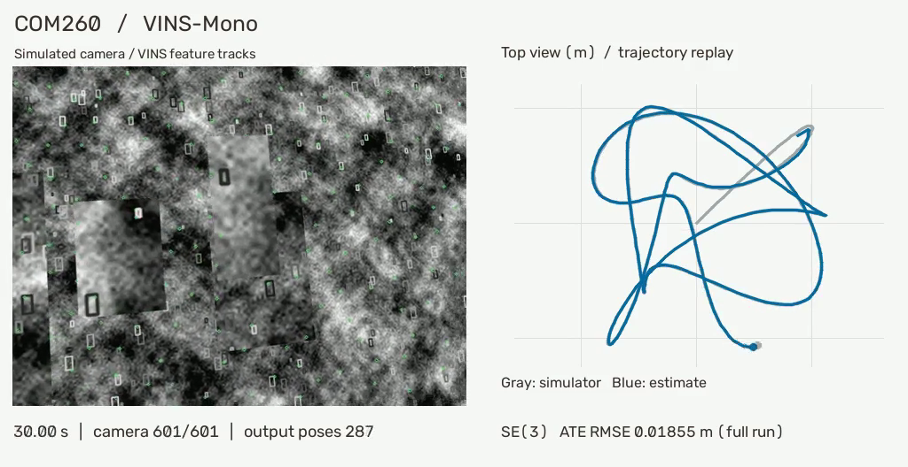

[VINS-Mono 轨迹回放](../lab_manuals_k3_com260_kit/images/ch21/vins-trajectory.mp4) · [动图](../lab_manuals_k3_com260_kit/images/ch21/vins-trajectory.gif)

### 21.6.3 视觉-激光融合实践

先按[公共环境](../lab_manuals_k3_com260_kit/ch00_common_setup.md#ch21-lvi)构建 LVI-SAM，准备 handheld 录包。在三个终端依次操作。

**终端一 · COM260**　启动融合节点，等待日志显示 `Lidar Map Optimization Started`。保持终端运行。

```bash
~/ros2_course_com260_ch21_lvi/run ros2 launch lvi_sam run.launch.py
```

**终端二 · x86**　打开 RViz。窗口已配置 PointCloud2（`/lvi_sam/mapping/registered_cloud`）、Path（`/lvi_sam/odometry/odometry`）和 Image（`/camera/image_raw`），固定坐标系为 `odom`。

```bash
cd ~/ROS2_RISCV_COM260_CH20_CH21
source ~/.config/ros2-course-com260-ch20-ch21/vision-dds.bash
bash course_support/k3_com260_kit/scripts/x86-ch20-ch21.bash start-lvi ch21-lvi
```

**终端三 · COM260**　以半速回放数据。约两分钟后回放自动结束。

```bash
~/ros2_course_com260_ch21_lvi/run ros2 bag play ~/ros2_course_data/handheld --rate 0.5 --disable-keyboard-controls
```

观察左侧的相机画面。设备沿小路前进时，黄色点云依次勾出路边树木和地面，蓝色轨迹随运动延伸。回放结束后关闭 RViz 窗口。如果出现保存布局的提示，选择 **Discard**。再到终端一按 Ctrl+C。

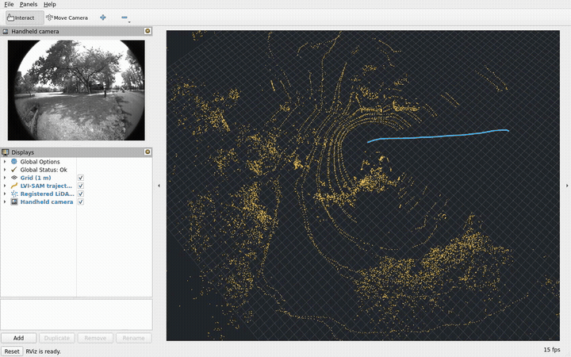

[窗口截图](../lab_manuals_k3_com260_kit/images/ch21/lvi-fusion.png) · [RViz 录像](../lab_manuals_k3_com260_kit/images/ch21/lvi-fusion.mp4) · [运行证据](../lab_manuals_k3_com260_kit/runtime_evidence.md#ch21-lvi)

### 21.6.4 工程建议

```cpp
inline std::string suggest_fusion_strategy(const std::string &, bool lidar, bool camera, bool imu,
                                         const std::string & budget) {
  if (budget == "low") { return camera && imu ? "VINS-Mono (仅视觉+IMU)" : "ORB-SLAM2 (仅视觉)"; }
  if (budget == "medium") { return lidar && camera ? "LVI-SAM / Cartographer+视觉回环" : "Cartographer (激光+IMU)"; }
  if (budget == "high") { return lidar && camera && imu ? "R3LIVE / LVI-SAM (全传感器融合)" : "FAST-LIO2 (激光+IMU)"; }
  return "推荐使用激光SLAM建图 + 视觉SLAM提供语义信息";
}
```

### 21.6.5 官方要点——视觉退化场景的融合选型：官方工具的组合

针对练习第 6 题停车场场景，官方工具链给出明确分工：光照剧烈变化与重复纹理会使视觉特征匹配退化（ORB-SLAM 论文承认的失效场景），此时激光雷达的几何测量不受光照影响，成为主定位源；IMU 提供高频短时运动约束填补两帧间隙。可参考的官方实现包括：VINS-Fusion（HKUST 官方仓库，视觉-惯性-激光紧耦合优化）、FAST-LIO2（激光-惯性里程计）与 Cartographer 的 3D 模式。地图表示上，点云地图适用于停车场这类特征稀疏场景，配合替代位姿图（pose graph）+ 关键帧图像库可实现"重定位兜底"。The Construct 的多传感器融合课程将这些工具串成了完整的实验流水线。

## 课后练习

1. **原理题:** 比较特征法视觉SLAM和直接法视觉SLAM的异同，分析各自优缺点和适用场景。

2. **编程题:** 使用OpenCV提取ORB特征并实现特征匹配，要求包含Lowe比率测试剔除误匹配。

3. **分析题:** 分析ORB-SLAM三个并行线程（跟踪、建图、闭环）的协作机制，说明各自的作用和交互方式。

4. **配置题:** 配置ORB-SLAM3的ROS2接口，使用RealSense D415相机进行实时RGB-D SLAM建图。

   使用 Gazebo 时按 21.3.4 节完成软件链路，再用 D415 检查真实输入。

5. **操作题:** 录制视觉SLAM的rosbag数据（包含图像和IMU话题），使用EVO工具评估SLAM轨迹精度。

   按 21.3.7 节回放并录制图像与 IMU，计算轨迹后对照参考轨迹评估误差。

6. **设计题:** 设计一个视觉+激光+IMU多传感器融合SLAM方案，用于大型室内停车场（存在光照变化和重复纹理），包括传感器配置、融合策略和地图表示方法。

---

## 仿真结合实例（当前仓库）：用 Gazebo 相机检查视觉 SLAM 输入

### 目标与知识点对应

视觉 SLAM 需要连续图像、相机内参和坐标变换。本示例使用 `robot_sim_demo` 检查 RGB 图像、`CameraInfo` 和 TF 输入的格式与时间戳。

### 运行步骤

在 x86 主机终端按 21.2.3 节启动 Gazebo RGB 相机，保留该终端及其 `RUN_ID`。本示例直接查询相机话题和 TF，另开 COM260 终端执行：

```bash
source ~/.config/ros2-course-com260-ch20-ch21/env.bash
ros2 topic echo /camera/image_raw --once --no-arr
ros2 topic echo /camera/camera_info --once
ros2 run tf2_ros tf2_echo base_link camera_link
```

### 观察结果

前两条命令各收到一条消息便退出。检查图像和 `CameraInfo` 中的宽、高是否均为 320×180，再用持续输出的 TF 查看相机相对于底盘的位置和朝向。

取得变换后，在运行 `tf2_echo` 的 COM260 终端按 Ctrl+C 结束查询。切回启动 RGB 相机的 x86 终端，用该终端的 `RUN_ID` 停止 Gazebo：

```bash
bash course_support/k3_com260_kit/scripts/x86-ch20-ch21.bash stop "$RUN_ID"
```

### 源码与边界

相机桥、内参与模型 TF 位于 `src_k3_pico_itx/robot_sim_demo/`；COM260 的图像与 ORB 处理节点分别位于 `src_k3_com260_kit/camera_processor/`、`orb_feature_extractor/`。Gazebo Burger 提供 RGB 输入；深度点云与 RGB-D SLAM 示例需要另行提供对齐的深度数据，不能把 RGB 图像当成深度输入。

学习材料：
- OpenCV 官方文档 —— ORB 特征与特征匹配教程：https://docs.opencv.org/
- ORB-SLAM3 官方仓库（UZ-SLAMLab）与论文：https://github.com/UZ-SLAMLab/ORB_SLAM3
- EVO 官方文档 —— 轨迹评估工具：https://github.com/MichaelGrupp/evo
- VINS-Fusion 官方仓库（HKUST）：https://github.com/HKUST-Aerial-Robotics/VINS-Fusion
- The Construct —— 视觉 SLAM 课程：https://www.theconstructsim.com/
- Robotics Back-End —— ORB-SLAM3 与 ROS 2 实战教程：https://roboticsbackend.com/
