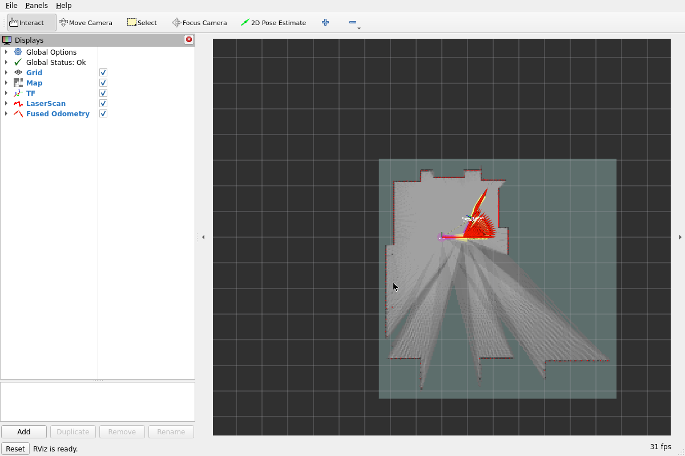
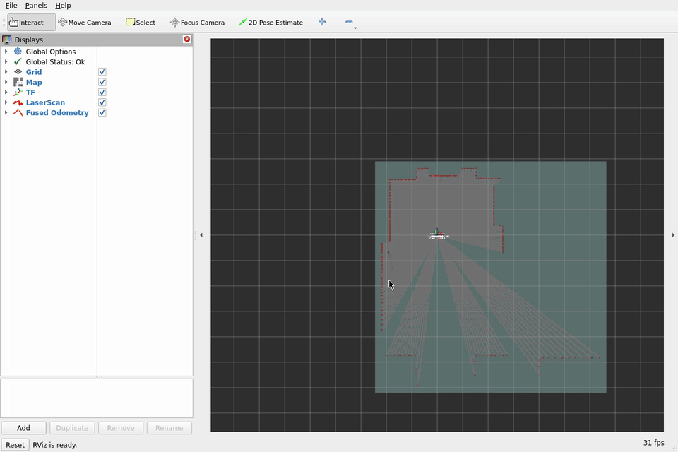
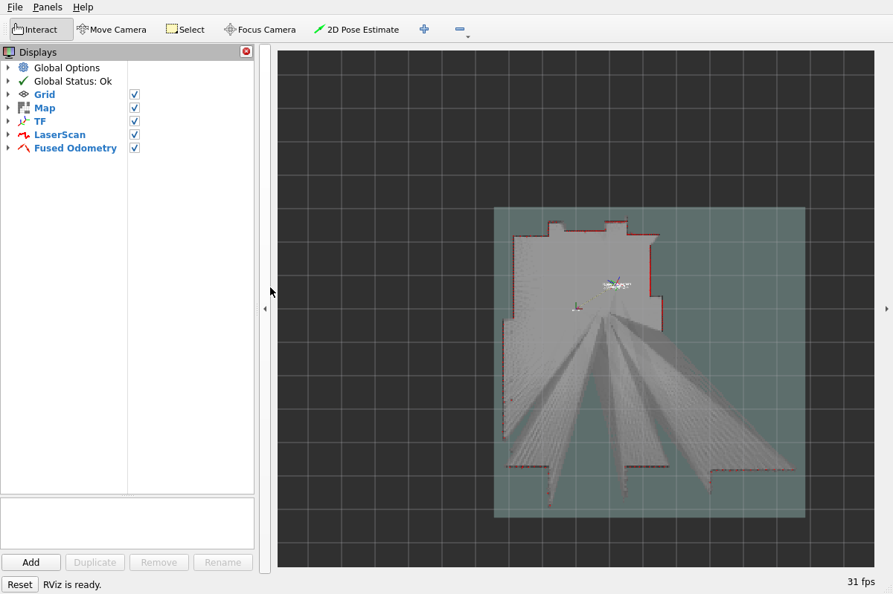
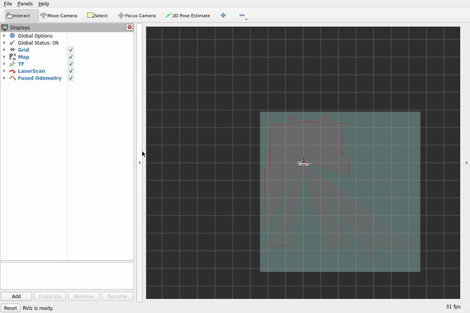

# 第22章 多传感器融合SLAM

> **课程**：ROS 2 C++17 编程（COM260 Kit / Humble）\
> **章节**：第22章\
> **课时**：2 课时（90 分钟）\
> **教学方式**：讲授 + 演示

先完成[公共环境](../lab_manuals_k3_com260_kit/ch00_common_setup.md#ch22)。传感器与 RViz 在 x86 运行，C++ 同步、积分和融合节点在 COM260 运行。

---

## 学习目标

本章学习目标包括：理解多传感器融合SLAM的必要性和基本框架，掌握IMU+LiDAR融合原理与方法，掌握视觉+IMU融合（VIO）原理，熟悉Kalman滤波和图优化融合框架，了解实际工程中的多传感器融合案例。

## 22.1 多传感器融合概述

### 22.1.1 为什么需要多传感器融合

单一传感器在SLAM中存在固有的局限性：

| 传感器 | 优势 | 局限性 |
|--------|------|--------|
| 激光雷达 | 精度高、不受光照影响 | 稀疏、无纹理、无语义 |
| 相机 | 信息丰富、低成本 | 受光照、弱纹理、模糊 |
| IMU | 高频、短期精度高 | 漂移大、无绝对参考 |
| 里程计 | 局部精度高 | 累积误差、打滑 |
| GPS | 全局无漂移 | 室内不可用、精度低 |

**多传感器融合的核心优势：** 互补性使不同传感器的优势互补，冗余性保证某传感器失效时仍有其他传感器可用，鲁棒性使融合后可应对更广泛的环境条件，多源信息约束则能提高估计精度。

### 22.1.2 融合框架分类

**松耦合 (Loosely Coupled)：**
```
传感器各自独立处理 → 融合结果
- 各传感器运行各自的SLAM/里程计
- 在状态估计层面融合（EKF）
- 实现简单，模块化
- 精度相对较低
```

**紧耦合 (Tightly Coupled)：**
```
传感器原始数据 → 统一优化
- 在因子图/优化中统一处理各传感器约束
- 使用传感器原始测量（非处理后的位姿）
- 精度高，复杂度高
- 代表：LVI-SAM, MSCKF
```

## 22.2 IMU+LiDAR融合

### 22.2.1 IMU的作用

IMU在LiDAR SLAM中的关键作用包括：运动畸变校正——激光扫描过程中若机器人运动，导致点云畸变，IMU可校正；位姿预测——提供高频位姿预测，作为扫描匹配的初值；状态约束——重力方向约束，使地图水平；快速运动恢复——激光匹配失败时，IMU可短暂维持定位。

```cpp
#pragma once
#include <Eigen/Dense>
#include <Eigen/Geometry>

struct IMUState {
  Eigen::Vector3d position=Eigen::Vector3d::Zero(), velocity=Eigen::Vector3d::Zero();
  Eigen::Matrix3d rotation=Eigen::Matrix3d::Identity();
};

class IMUPreintegrator {
public:
  void integrate(const Eigen::Vector3d & acc, const Eigen::Vector3d & gyro) {
    const Eigen::Vector3d acceleration=delta.rotation*(acc-acc_bias);
    delta.position+=delta.velocity*dt+0.5*acceleration*dt*dt;
    delta.velocity+=acceleration*dt;
    const Eigen::Vector3d angle=(gyro-gyro_bias)*dt;
    if (angle.norm()>1e-12) {
      delta.rotation*=Eigen::AngleAxisd(angle.norm(),angle.normalized()).toRotationMatrix();
    }
    total_time+=dt;
  }
  IMUState predict(const IMUState & initial) const {
    const Eigen::Vector3d gravity(0,0,-9.81);
    return {initial.position+initial.velocity*total_time+initial.rotation*delta.position
              +0.5*gravity*total_time*total_time,
            initial.velocity+initial.rotation*delta.velocity+gravity*total_time,
            initial.rotation*delta.rotation};
  }
  double dt=0.01, total_time=0;
  Eigen::Vector3d gyro_bias=Eigen::Vector3d::Zero(), acc_bias=Eigen::Vector3d::Zero();
  IMUState delta;
};
```

COM260 终端运行 `ros2 run sensor_fusion_cpp fusion_math_demo`，检查静止重力抵消、1 秒恒加速度、90° 旋转以及 EKF 和健康状态测试。积分器按累计采样时长预测状态，在积分前扣除偏置；旋转使用 SO(3) 指数映射。


### 22.2.2 LiDAR-IMU标定

LiDAR和IMU之间的外参标定是融合的前提。下列代码展示约束组织，未实现标定求解器，返回初始外参不代表完成标定：

```cpp
// 外参标定框架：旋转最小二乘与平移估计需要实现。
struct LidarIMUCalibration {
  Eigen::Matrix3d R_lidar_imu=Eigen::Matrix3d::Identity();
  Eigen::Vector3d t_lidar_imu=Eigen::Vector3d::Zero();
  double time_offset=0;

  Eigen::Matrix3d calibrate_rotation(
      const std::vector<Eigen::Matrix4d> & lidar_poses,
      const std::vector<Eigen::Matrix3d> & imu_rotations) {
    for(size_t i=1;i<lidar_poses.size();++i) {
      Eigen::Matrix3d lidar_relative=lidar_poses[i].topLeftCorner<3,3>()
        *lidar_poses[i-1].topLeftCorner<3,3>().transpose();
      Eigen::Matrix3d imu_relative=imu_rotations[i]*imu_rotations[i-1].transpose();
      // 约束：imu_relative = R_lidar_imu * lidar_relative * R_lidar_imu.transpose()
      // 线性化、构造最小二乘并用 SVD 求解旋转外参。
    }
    return R_lidar_imu;
  }
  Eigen::Vector3d calibrate_translation() {
    // 杠杆臂：a_imu = R^T * (a_lidar + w×(w×t) + w_dot×t)
    // 根据同步后的加速度与角速度序列求平移外参。
    return t_lidar_imu;
  }
};
```

### 22.2.3 FAST-LIO2框架

FAST-LIO2是经典的LiDAR-IMU紧耦合SLAM系统。下面先实现曲率特征提取，再展示融合数据流；扫描匹配、去畸变和 ikd-Tree 等接口尚需完整算法实现，因此数据流示意不能作为 FAST-LIO2 节点运行。

邻域曲率使用当前点与相邻点均值的距离，取 80% 和 30% 分位数作为边缘点和平面点阈值：

```cpp
#pragma once
#include <algorithm>
#include <vector>
#include <Eigen/Dense>

using PointCloud = std::vector<Eigen::Vector3d>;
struct LidarFeatures { PointCloud edge, flat; };

inline LidarFeatures extract_features(const PointCloud & points) {
  if (points.empty()) { return {}; }
  const int count = points.size();
  std::vector<double> curvature(count);
  for (int i = 0; i < count; ++i) {
    const int begin = std::max(0, i - 5), end = std::min(count, i + 5);
    Eigen::Vector3d mean = Eigen::Vector3d::Zero();
    for (int j = begin; j < end; ++j) { mean += points[j]; }
    curvature[i] = (points[i] - mean / (end - begin)).norm();
  }
  auto sorted = curvature;
  std::sort(sorted.begin(), sorted.end());
  const auto percentile = [&](double fraction) {
    const double index = fraction * (count - 1);
    const int lower = index;
    return sorted[lower] + (index - lower) *
      (sorted[std::min(lower + 1, count - 1)] - sorted[lower]);
  };
  const double edge_threshold = percentile(0.8), flat_threshold = percentile(0.3);
  LidarFeatures features;
  for (int i = 0; i < count; ++i) {
    if (curvature[i] > edge_threshold) { features.edge.push_back(points[i]); }
    if (curvature[i] < flat_threshold) { features.flat.push_back(points[i]); }
  }
  return features;
}
```

在 COM260 运行 `ros2 run sensor_fusion_cpp fusion_math_demo`，检查已知点列的特征分类和空点云处理。完整数据流如下：

```cpp
// FAST-LIO2 的数据流示意；扫描匹配、去畸变和地图索引未展开。
struct FASTLIO2 {
  Eigen::Vector3d position=Eigen::Vector3d::Zero(), velocity=Eigen::Vector3d::Zero();
  Eigen::Vector3d gyro_bias=Eigen::Vector3d::Zero(), acc_bias=Eigen::Vector3d::Zero();
  Eigen::Matrix3d rotation=Eigen::Matrix3d::Identity();
  Eigen::Matrix<double,15,15> covariance=Eigen::Matrix<double,15,15>::Identity()*0.01;
  double lidar_frequency=10.0, imu_frequency=200.0;

  void imu_callback(const Eigen::Vector3d & acc,const Eigen::Vector3d & gyro) {
    const double dt=1.0/imu_frequency;
    position+=velocity*dt;
    velocity+=(rotation*(acc-acc_bias)+Eigen::Vector3d(0,0,-9.81))*dt;
    const Eigen::Vector3d angle=(gyro-gyro_bias)*dt;
    if(angle.norm()>1e-6) {
      rotation*=Eigen::AngleAxisd(angle.norm(),angle.normalized()).toRotationMatrix();
    }
    covariance+=Eigen::Matrix<double,15,15>::Identity()*0.001;
  }
  void lidar_callback(const PointCloud & points) {
    auto corrected=undistort_points(points);      // 逐点运动补偿
    auto features=extract_features(corrected);    // 邻域曲率：80% 边缘、30% 平面分位数
    auto [H,residual]=scan_to_map_matching(features);
    const Eigen::MatrixXd R=Eigen::MatrixXd::Identity(residual.size(),residual.size())*0.1;
    const Eigen::MatrixXd K=covariance*H.transpose()*(H*covariance*H.transpose()+R).inverse();
    const Eigen::VectorXd dx=K*residual;
    position+=dx.segment<3>(0); velocity+=dx.segment<3>(3);
    const Eigen::Vector3d angle=dx.segment<3>(6);
    if(angle.norm()>1e-6) {
      rotation*=Eigen::AngleAxisd(angle.norm(),angle.normalized()).toRotationMatrix();
    }
    gyro_bias+=dx.segment<3>(9); acc_bias+=dx.segment<3>(12);
    const Eigen::MatrixXd A=Eigen::MatrixXd::Identity(15,15)-K*H;
    covariance=A*covariance*A.transpose()+K*R*K.transpose();
    update_map(corrected);                        // 更新 ikd-Tree
  }
};
```

### 22.2.4 官方要点——Cartographer 官方文档：IMU 在激光 SLAM 中的三个角色

> 本节内容综合翻译自 Robot Localization 官方 Wiki、Cartographer 官方文档（cartographer.readthedocs.io 的 Configuration 与 Sensor Data 页面）以及 FAST-LIO2 官方 GitHub 仓库（HKU-MARS），另参考 The Construct 的多传感器融合课程与 Robotics Back-End 的 IMU 预处理教程。原文均为英文，此处为中文编译，供课后巩固与进阶阅读。

Cartographer 官方配置文档指出，IMU 数据在 2D/3D SLAM 中承担三个互补任务，与练习第 3 题逐一对应：一是运动畸变校正——单线雷达一帧数据在扫描期间底盘已移动，官方用 IMU 提供的角速度对每个激光点按采集时刻插值位姿去畸变；二是位姿预测——后端优化需要的前端初值由 IMU 预积分给出，`pose_grapher` 用 `quaternion-based` 重力对齐；三是重力约束——加速度计长期均值确定水平面，约束 z 轴与俯仰/横滚，防止漂移。配置上对应 `use_imu_data = true`、`imu_gravity_time_constant = 10` 等 LUA 选项，练习第 4 题只需在官方 `backpack_2d.lua` 基础上调整前三项传感器轨迹配置。

### 22.2.5 官方要点——FAST-LIO2 官方仓库：流形上的迭代 EKF 与 ikd-Tree

FAST-LIO2 的官方 README 与 IEEE TRO 论文展示了当前主流的激光-惯性紧耦合范式：采用基于流形（SO(3)）的迭代扩展卡尔曼滤波，在每帧内迭代更新状态与协方差；核心创新是 ikd-Tree（增量 KD-Tree）把"增量点云建图 + k 近邻查找"的复杂度降到对时间不敏感的水平，因而不需要额外提取特征——任何一帧原始点都能用于残差。官方提供 ROS 1（及社区 ROS 2）package，直接用 `rosbag` 即可运行练习第 5 题；仓库中还给出 FAST-LIO、LIO-SAM 的对比结论：当环境几何退化（长走廊、玻璃幕墙）时，紧耦合系统明显优于松耦合。

## 22.3 视觉+IMU融合(VIO)

### 22.3.1 VIO算法分类

| 算法 | 方法 | 特点 |
|------|------|------|
| MSCKF | 多状态约束KF | 计算量小，不优化地图点 |
| VINS-Mono | 滑窗优化+IMU预积分 | 精度高，单目VIO |
| OKVIS | 滑窗BA+IMU | 关键帧滑窗优化 |
| ROVIO | 扩展卡尔曼滤波 | 直接法+IMU |
| ORB-SLAM3 | 视觉SLAM+IMU | 支持视觉惯性模式 |

### 22.3.2 VINS-Mono框架

下面展示滑窗数据流。完整框架的构建与数据回放见[第21章 VINS-Mono 示例](ch21_视觉SLAM导论.md)。

```cpp
// VINS-Mono 滑窗处理流程示意，特征跟踪和非线性优化需由完整框架实现。
struct VINSMono {
  size_t window_size=10;
  std::deque<Frame> frames;
  IMUPreintegrator preintegrator;
  Eigen::Vector3d velocity=Eigen::Vector3d::Zero(), gravity{0,0,-9.81};
  Eigen::Vector3d gyro_bias=Eigen::Vector3d::Zero(), acc_bias=Eigen::Vector3d::Zero();

  void process_image(const cv::Mat & image,double timestamp) {
    auto features=track_features(image);          // KLT：calcOpticalFlowPyrLK
    frames.push_back({timestamp,features,preintegrator});
    if(frames.size()>=window_size) {
      sliding_window_optimization();             // IMU、视觉、先验因子，Ceres/g2o
    }
    if(frames.size()>window_size) {
      marginalize_oldest_frame();                // 舒尔补保留边缘化信息
      frames.pop_front();
    }
  }
};
```

### 22.3.3 视觉-惯性BA

```cpp
// 视觉-惯性 BA 的因子组织示意。
FactorGraph build_factor_graph(const std::vector<Frame> & frames,
                               const std::map<int,Landmark> & landmarks) {
  FactorGraph factors;                           // IMU、visual、prior 三组约束
  for(size_t i=0;i+1<frames.size();++i) {
    if(frames[i+1].preintegration) {
      factors.imu.push_back({i,i+1,*frames[i+1].preintegration});
    }
  }
  for(const auto & [landmark_id,landmark]:landmarks) {
    for(const auto & [frame_id,observation]:landmark.observations) {
      factors.visual.push_back({frame_id,landmark_id,observation});
    }
  }
  return factors;
}
// 优化时同时最小化 IMU 预积分、视觉重投影和先验残差。
// 需要补充残差函数、雅可比及 Ceres/g2o/GTSAM 求解器，不能把初值当作优化结果。
```

## 22.4 Kalman滤波与图优化融合框架

### 22.4.1 多传感器EKF融合

扩展卡尔曼滤波是多传感器融合的基础框架：

```cpp
#pragma once
#include <Eigen/Dense>

class MultiSensorEKF {
public:
  using Vector=Eigen::Matrix<double,15,1>;
  using Matrix=Eigen::Matrix<double,15,15>;
  Vector x=Vector::Zero();
  Matrix P=Matrix::Identity()*0.1, Q=Matrix::Identity()*0.01;
  void predict(double dt) {
    Matrix F=Matrix::Identity();
    F.block<3,3>(0,3)=Eigen::Matrix3d::Identity()*dt;
    x=F*x; P=F*P*F.transpose()+Q;
  }
  void update(const Eigen::VectorXd & z, const Eigen::MatrixXd & H, double variance) {
    const Eigen::MatrixXd R=Eigen::MatrixXd::Identity(z.size(),z.size())*variance;
    const Eigen::MatrixXd K=P*H.transpose()*(H*P*H.transpose()+R).inverse();
    x+=K*(z-H*x);
    const Matrix A=Matrix::Identity()-K*H;
    P=A*P*A.transpose()+K*R*K.transpose();
  }
  void update_lidar_odom(const Eigen::Matrix<double,6,1> & z) {
    update(z,Eigen::Matrix<double,6,15>::Identity(),0.05);
  }
  void update_visual_odom(const Eigen::Matrix<double,6,1> & z) {
    update(z,Eigen::Matrix<double,6,15>::Identity(),0.2);
  }
  void update_gps(const Eigen::Vector3d & position) {
    update(position,Eigen::Matrix<double,3,15>::Identity(),1.0);
  }
  void update_imu(const Eigen::Matrix<double,6,1> & z,
                  const Eigen::Matrix<double,6,15> & measurement_jacobian) {
    update(z,measurement_jacobian,0.1);
  }
};
```

该类展示 15 维常速度模型及通用观测更新。IMU 雅可比需要结合具体状态定义传入；全零雅可比不会产生状态校正。激光、视觉与 GPS 的观测噪声分别为 0.05、0.2 和 1.0。

练习 2 的可运行平面示例为 `imu_odom_fusion`：使用激光匹配里程计 `/lidar/odom` 与 `/imu` 的角速度，按时间戳同步后更新 `[x,y,yaw,vx,vy,wz]`，发布 `/odometry/filtered`。

### 22.4.2 因子图优化(GTSAM)

现代SLAM系统广泛使用因子图进行多传感器融合：

```cpp
// GTSAM 因子图伪代码：Pose2 约束用于展示先验、里程计及回环结构。
#include <gtsam/geometry/Pose2.h>
#include <gtsam/nonlinear/LevenbergMarquardtOptimizer.h>
#include <gtsam/slam/PriorFactor.h>
#include <gtsam/slam/BetweenFactor.h>

struct FactorGraphFusion {
  gtsam::NonlinearFactorGraph graph;
  gtsam::Values initial;
  void add_prior(gtsam::Key key,const gtsam::Pose2 & pose,const gtsam::Vector3 & noise) {
    graph.emplace_shared<gtsam::PriorFactor<gtsam::Pose2>>(
      key,pose,gtsam::noiseModel::Diagonal::Sigmas(noise));
  }
  void add_odometry(gtsam::Key i,gtsam::Key j,const gtsam::Pose2 & delta,
                    const gtsam::Vector3 & noise) {
    graph.emplace_shared<gtsam::BetweenFactor<gtsam::Pose2>>(
      i,j,delta,gtsam::noiseModel::Diagonal::Sigmas(noise));
  }
  void add_loop_closure(gtsam::Key i,gtsam::Key j,const gtsam::Pose2 & delta,
                       const gtsam::Vector3 & noise) {
    add_odometry(i,j,delta,noise);
  }
  gtsam::Values optimize() {
    // 先用 initial.insert(key, pose) 填入每个位姿的初值。
    return gtsam::LevenbergMarquardtOptimizer(graph,initial).optimize();
  }
  // IMU 因子需另用 Pose3、速度、偏置与 PreintegratedImuMeasurements 构造 ImuFactor。
};
```

### 22.4.3 官方要点——Robot Localization 官方：EKF 融合的工程约定

练习第 2 题的工业级参照是 ROS 2 的 robot_localization 包：其 `ekf_localization_node` 用扩展卡尔曼滤波把任意数量的话题（里程计、IMU、GPS 等）融合为单一位姿估计，官方向导强调三个约定——所有输入话题的协方差必须真实可信（官方称之为 "covariance is king"，虚假大协方差会让滤波器过信错误测量）；IMU 话题的参考系应按 REP-105 约定与车身系对齐；`use_control` 建议保持默认 false，因为轮式里程计在打滑时不能当控制输入。练习第 2 题的"简化 EKF"本质就是该节点的 6 自由度版本：仅融合车轮里程计位姿与 IMU 角速度。

## 22.5 实际工程案例

### 22.5.1 仓库AGV融合SLAM案例

```cpp
struct WarehouseAGVFusion {
  MultiSensorEKF fusion;
  const char * lidar="2D激光雷达 × 2（前后）";
  const char * imu="6轴IMU";
  const char * encoder="轮式编码器";
  const char * rfid="RFID标签（辅助定位）";
  const char * fusion_pipeline=R"(
        ┌─────────────────────────────────────────────┐
        │  传感器输入                                   │
        ├────────────┬────────────┬────────────────────┤
        │ 激光雷达    │    IMU     │  轮式编码器         │
        │ 10Hz       │  200Hz     │  100Hz             │
        ├────────────┴────────────┴────────────────────┤
        │  传感器预处理                                  │
        │  - 激光：体素滤波、特征提取                      │
        │  - IMU：预积分、偏置估计                        │
        │  - 编码器：速度积分                            │
        ├──────────────────────────────────────────────┤
        │  多传感器EKF融合                               │
        │  - 高频IMU传播 (200Hz)                        │
        │  - 激光匹配更新 (10Hz)                         │
        │  - 编码器约束更新 (100Hz)                      │
        │  - RFID绝对修正 (1Hz)                         │
        ├──────────────────────────────────────────────┤
        │  输出                                         │
        │  - 位姿估计: 100Hz                            │
        │  - 占据栅格地图: /map                         │
        │  - 里程计: /odom                              │
        └──────────────────────────────────────────────┘
        )";
  std::map<std::string,double> parameters{
    {"laser_noise",0.02}, {"imu_acc_noise",0.01}, {"imu_gyro_noise",0.001},
    {"encoder_noise",0.05}, {"rfid_noise",0.3},
    {"fusion_frequency",100}, {"map_resolution",0.05}};
};
```

### 22.5.2 自动驾驶融合定位案例

```cpp
struct AutonomousVehicleLocalization {
  struct Sensor {std::string accuracy,frequency;};
  std::map<std::string,Sensor> sensors{
    {"gps",{"3m (单点) / 0.1m (RTK)","10Hz"}},
    {"imu",{"0.01°/s (光纤陀螺)","200Hz"}},
    {"lidar_3d",{"0.03m","10Hz"}},
    {"camera",{"像素级","30Hz"}},
    {"wheel_encoder",{"0.001m (脉冲)","100Hz"}}};
  const char * strategy=R"(
    1. 城区道路：GPS RTK + IMU + 轮式里程计，RTK 可用时 cm 级精度。
    2. 隧道/地下：LiDAR SLAM + IMU + 轮式里程计，无 GPS 时纯 SLAM。
    3. 高速路段：GPS + IMU 松耦合，高动态下 SLAM 可靠性下降。
    4. 多楼层停车：LiDAR SLAM + 视觉回环，楼层间地图切换。
  )";
};
```

### 22.5.3 传感器时间同步

多传感器融合的时间同步是关键工程问题：

```cpp
#include <algorithm>
#include <message_filters/subscriber.h>
#include <image_transport/subscriber_filter.hpp>
#include <message_filters/synchronizer.h>
#include <message_filters/sync_policies/approximate_time.h>
#include <rclcpp/rclcpp.hpp>
#include <sensor_msgs/msg/image.hpp>
#include <sensor_msgs/msg/imu.hpp>
#include <sensor_msgs/msg/laser_scan.hpp>

class SensorSync : public rclcpp::Node {
  using Imu = sensor_msgs::msg::Imu;
  using Scan = sensor_msgs::msg::LaserScan;
  using Image = sensor_msgs::msg::Image;
  using Policy = message_filters::sync_policies::ApproximateTime<Imu, Scan, Image>;
public:
  SensorSync() : Node("sensor_sync"),
      imu(this, "/imu", rmw_qos_profile_sensor_data),
      scan(this, "/scan", rmw_qos_profile_sensor_data),
      sync(Policy(declare_parameter("sync_queue_size", 10)), imu, scan, image) {
    image.subscribe(this, "/camera/image_raw", declare_parameter<std::string>("image_transport", "compressed"), rmw_qos_profile_sensor_data);
    sync.setMaxIntervalDuration(rclcpp::Duration::from_seconds(0.05));
    sync.registerCallback(&SensorSync::synchronized, this);
  }
private:
  void synchronized(const Imu::ConstSharedPtr & a, const Scan::ConstSharedPtr & b,
                    const Image::ConstSharedPtr & c) {
    const double ti = rclcpp::Time(a->header.stamp).seconds();
    const double tl = rclcpp::Time(b->header.stamp).seconds();
    const double tc = rclcpp::Time(c->header.stamp).seconds();
    const double spread = std::max({ti, tl, tc}) - std::min({ti, tl, tc});
    RCLCPP_INFO_THROTTLE(get_logger(), *get_clock(), 1000,
      "传感器同步: IMU=%.3f LiDAR=%.3f Camera=%.3f spread=%.3fms", ti, tl, tc, spread*1000);
  }
  message_filters::Subscriber<Imu> imu;
  message_filters::Subscriber<Scan> scan;
  image_transport::SubscriberFilter image;
  message_filters::Synchronizer<Policy> sync;
};

int main(int argc, char ** argv) {
  rclcpp::init(argc, argv);
  rclcpp::spin(std::make_shared<SensorSync>());
  rclcpp::shutdown();
}
```

x86 的相机图像用 PNG 无损压缩传到 COM260。`sync_queue_size` 默认 10；双端运行使用 100，容纳传输延迟，匹配时间差仍限制为 50 ms。软件时间戳匹配不等同于 GPIO 硬件触发。

### 22.5.4 故障检测与切换

```cpp
#pragma once
#include <map>
#include <string>
#include <iostream>

class SensorHealthMonitor {
  struct Sensor { double timeout, last=0; bool healthy=true; std::string fallback; };
  std::map<std::string,Sensor> sensors{
    {"lidar",{0.5,0,true,"切换到视觉+IMU紧耦合模式"}},
    {"camera",{1.0,0,true,"切换到激光+IMU模式，禁用视觉回环"}},
    {"imu",{0.2,0,true,"切换到轮式里程计+激光模式，降低动态性能"}},
    {"gps",{2.0,0,true,"切换到纯SLAM定位模式"}}};
public:
  void received(const std::string & name,double stamp) {
    auto & s=sensors.at(name);
    if(!s.healthy) {std::cout<<"恢复: "<<name<<" 已恢复\n";}
    s.last=stamp; s.healthy=true;
  }
  bool check_health(const std::string & name,double stamp) {
    auto & s=sensors.at(name);
    if(stamp-s.last>s.timeout && s.healthy) {
      s.healthy=false;
      std::cout<<"警告: "<<name<<" 故障 (超时"<<stamp-s.last<<"s)\n"
               <<"故障处理: "<<s.fallback<<'\n';
    }
    return s.healthy;
  }
};
```

在接收数据时调用 `received()`，定时调用 `check_health()`；本示例输出切换策略，不会自动启动另一套 SLAM 系统。

### 22.5.5 官方要点——玻璃幕墙机场场景：退化感知的工程选型

综合官方资料分析练习第 6 题：玻璃幕墙让 2D 激光发生穿透与镜面反射——官方实测中这类点云呈"空洞+离群噪点"状，对点云配准是灾难级退化，所以主传感器应变选 RGB-D（视觉纹理在玻璃上只剩镜面倒影）或毫米波雷达，或改用 3D 激光（海量点云让离群点影响可控）；高挑空间语义稀疏，应同时保留多类特征源；金属结构会弯曲磁场，故 IMU 应只用地磁-无关的陀螺+加速度计（官方 REP-145 模拟约定同样建议磁力计单独成话题）。融合策略上先用 FAST-LIO 类紧耦合保证鲁棒性，再以位姿图挂历史回环；应急方案则依赖回环检测与"重定位失败→调头回扫"的兜底行为树。The Construct 的课程把上述选型整理成一张"退化度×传感器"决策表，可直接用于本设计题的论证。

## 课后练习

1. **原理题:** 比较松耦合和紧耦合多传感器融合的异同，分析为什么紧耦合通常能获得更高的精度。

2. **编程题:** 实现一个简化的EKF多传感器融合系统，融合激光里程计和IMU数据，输出融合后的位姿估计。

3. **分析题:** 分析IMU在LiDAR SLAM中的三个重要作用：运动畸变校正、位姿预测、重力约束，说明各自的原理和实现方式。

4. **配置题:** 在Cartographer中配置激光+IMU+里程计的多传感器融合建图，写出对应的LUA配置文件。

5. **操作题:** 录制包含激光、IMU和里程计数据的rosbag，使用FAST-LIO2或同类算法进行多传感器融合SLAM建图，评估结果。

6. **设计题:** 设计一个面向机场候机楼的清洁机器人SLAM方案，环境特征包括：大面积玻璃幕墙（激光穿透）、高挑空间（视觉特征少）、金属结构（IMU干扰）。给出传感器选型、融合策略和应急处理方案。

---

练习 2、4、5 使用下面的双端入口。每次切换建图算法前先停止上一组进程，避免重复发布 `map→odom`。

x86 终端 1 启动传感器；终端 2 进入容器启动激光匹配：

```bash
cd ~/ROS2_RISCV_COM260_CH22_CH23
source ~/.config/ros2-course-com260-ch22-ch23/dds.bash
bash course_support/k3_com260_kit/scripts/x86-ch22-ch23.bash start-camera ch22-fusion use_rviz:=false
bash course_support/k3_com260_kit/scripts/x86-ch22-ch23.bash exec ch22-fusion \
  ros2 launch sensor_fusion_cpp fusion_mapping.launch.py configuration:=lidar_2d.lua use_rviz:=true
```

COM260 两个新终端均加载公共环境，再分别运行：

```bash
source ~/.config/ros2-course-com260-ch22-ch23/env.bash
source ~/.config/ros2-course-com260-ch22-ch23/dds.bash
# COM260 终端 1：激光匹配位姿转里程计
ros2 run sensor_fusion_cpp lidar_pose_to_odom --ros-args -p use_sim_time:=true
```

```bash
source ~/.config/ros2-course-com260-ch22-ch23/env.bash
source ~/.config/ros2-course-com260-ch22-ch23/dds.bash
# COM260 终端 2：激光里程计与 IMU 融合
ros2 run sensor_fusion_cpp imu_odom_fusion --ros-args -p use_sim_time:=true
```

在 x86 新终端执行 `bash course_support/k3_com260_kit/scripts/x86-ch22-ch23.bash exec ch22-fusion ros2 run teleop_twist_keyboard teleop_twist_keyboard`，先按 `z` 降低速度，再用 `i` 前进、`j` 转弯，按空格停车，再按 Ctrl+C 退出。观察地图、原始里程计与 `/odometry/filtered` 的运动趋势，不能仅凭曲线平滑认定精度提高。停止两个 COM260 节点与 x86 的建图 Launch 后，停止容器。





[融合过程的连续 RViz 录像](../lab_manuals_k3_com260_kit/images/ch22/ch22-ekf-motion.mp4)。

练习 4：使用同一传感器启动流程，把建图配置换成 `fusion_2d.lua`。该配置启用 `use_imu_data=true` 与 `use_odometry=true`，输入 `/scan`、`/imu`、`/odom`，由 Cartographer 进行融合建图。

练习 5：在运动前，于 x86 新容器终端录制下列话题，运动并停车后按 Ctrl+C 正常结束录制。

```bash
ros2 bag record --use-sim-time /scan /imu /odom /tf /tf_static -o /workspace/fusion_dataset
ros2 bag info /workspace/fusion_dataset
```

停止实时仿真后，在 x86 主机终端独立回放：

```bash
bash course_support/k3_com260_kit/scripts/x86-ch22-ch23.bash stop ch22-fusion
bash course_support/k3_com260_kit/scripts/x86-ch22-ch23.bash start-replay ch22-replay /workspace/fusion_dataset
```

回放以 0.5 倍速提供仿真时钟，Cartographer 同时接收激光、IMU 和里程计；RViz 应生成占据栅格地图。播放完毕后使用 `stop ch22-replay` 关闭容器。采集内容和地图质量分析应区分仿真数据与真实传感器数据。





[融合建图回放录像](../lab_manuals_k3_com260_kit/images/ch22/ch22-fusion-replay.mp4) · [录包信息与地图导出](../lab_manuals_k3_com260_kit/images/ch22/ch22-replay.cast)。

## 仿真结合实例：同步 LiDAR、相机与里程计数据

### 目标与知识点对应

使用 `realsense_lab` 同时输出 `/scan`、`/imu`、`/camera/color/image_raw`、`/camera/color/camera_info`、`/odom` 和 `/tf`，检查多传感器融合前的时间戳、frame_id 和话题频率。

### 运行步骤

```bash
# x86 终端 1
cd ~/ROS2_RISCV_COM260_CH22_CH23
source ~/.config/ros2-course-com260-ch22-ch23/dds.bash
bash course_support/k3_com260_kit/scripts/x86-ch22-ch23.bash start-camera ch22
```

```bash
# COM260 终端 1
source ~/.config/ros2-course-com260-ch22-ch23/env.bash
source ~/.config/ros2-course-com260-ch22-ch23/dds.bash
ros2 run sensor_fusion_cpp sensor_sync --ros-args -p use_sim_time:=true \
  -p sync_queue_size:=100 \
  -r /camera/image_raw/compressed:=/camera/color/image_raw/compressed
```


[同步终端记录](../lab_manuals_k3_com260_kit/images/ch22/ch22-sensor-sync.cast)。

### 观察结果

比较各消息的时间戳和 frame_id，识别融合节点需要的同步策略及 TF 外参；RViz 可分别显示激光和机器人 TF。

### 源码与边界

源码位于 `src_k3_com260_kit/realsense_lab/` 与 `src_k3_com260_kit/sensor_fusion_cpp/`。数据采集操作见[第12章实验指导书](../lab_manuals_k3_com260_kit/ch12_lab.md)，各项实测结果见[第22章运行证据](../lab_manuals_k3_com260_kit/runtime_evidence.md#ch22)。

按 Ctrl+C 结束 COM260 同步节点，再在 x86 主机终端执行：

```bash
bash course_support/k3_com260_kit/scripts/x86-ch22-ch23.bash stop ch22
```
