# 第23章 SLAM与导航综合实训

> **课程**：ROS 2 C++17 编程（COM260 Kit / Humble）\
> **章节**：第23章\
> **课时**：4 课时（180 分钟）\
> **教学方式**：讲授 + 演示

先完成[公共环境](../lab_manuals_k3_com260_kit/ch00_common_setup.md#ch23)。本章按顺序完成[第13章建图实验](../lab_manuals_k3_com260_kit/ch13_lab.md)和[第14章导航实验](../lab_manuals_k3_com260_kit/ch14_lab.md)。

---

## 学习目标

本章学习目标包括：掌握从SLAM建图到自主导航的完整流程，能够在仿真环境中完成建图、保存地图和导航，理解多机器人调度系统的设计方法，培养项目文档编写和方案设计能力，掌握SLAM与导航系统集成的工程实践。

## 23.1 综合项目概述

### 23.1.1 项目目标

本综合实训项目将引导学生完成一个完整的机器人自主导航系统开发：

```
项目阶段:
阶段1: SLAM建图        → 使用激光雷达构建环境地图
阶段2: 地图保存与处理    → 保存PGM/YAML地图并后处理
阶段3: AMCL定位        → 在已知地图上实现定位
阶段4: Nav2自主导航    → 实现点到点自主导航
阶段5: 多机器人调度     → 多机器人协同任务执行
阶段6: 项目文档与评估    → 撰写设计文档和性能评估
```

实训环境包括：ROS 2 Humble、Gazebo Sim Harmonic 仿真环境、TurtleBot3 Burger 机器人模型（课程包 `robot_sim_demo`）以及 Nav2 导航框架。

### 23.1.2 项目要求

基本要求包括：构建至少500m²环境的完整地图，实现稳定的自主导航（成功率>90%），支持多点导航和航点跟随，具备基本故障恢复能力。进阶要求包括：多传感器融合建图（可选IMU），自定义行为树优化导航，多机器人协同导航，以及动态避障和重规划。

## 23.2 SLAM建图实践

### 23.2.1 环境准备

```bash
# COM260：构建 C++ 示例
cd ~/ROS2_RISCV_COM260_CH22_CH23
bash setup_course_k3_com260_kit.sh --build-ch23
source ~/.config/ros2-course-com260-ch22-ch23/env.bash
source ~/.config/ros2-course-com260-ch22-ch23/dds.bash
# x86 的容器和双端通信按公共环境准备。
```

### 23.2.2 使用slam_toolbox建图

```bash
# x86 终端 1：扩大场景、slam_toolbox、Nav2 和 RViz
cd ~/ROS2_RISCV_COM260_CH22_CH23
source ~/.config/ros2-course-com260-ch22-ch23/dds.bash
bash course_support/k3_com260_kit/scripts/x86-ch22-ch23.bash start-explore ch23-map

# x86 新终端：控制机器人，空格停车，Ctrl+C 结束键盘控制
bash course_support/k3_com260_kit/scripts/x86-ch22-ch23.bash exec ch23-map \
  ros2 run teleop_twist_keyboard teleop_twist_keyboard

# 停车后保存地图，/maps 对应 x86 的 ~/maps
bash course_support/k3_com260_kit/scripts/x86-ch22-ch23.bash exec ch23-map \
  ros2 run nav2_map_server map_saver_cli -f /maps/my_map --ros-args -p use_sim_time:=true -p free_thresh_default:=0.196
```

**自动探索建图脚本：**

```cpp
#include <chrono>
#include <csignal>
#include <filesystem>
#include <fstream>
#include <ament_index_cpp/get_package_share_directory.hpp>
#include <rclcpp/rclcpp.hpp>
#include <rclcpp_action/rclcpp_action.hpp>
#include <nav2_msgs/action/navigate_to_pose.hpp>
#include <geometry_msgs/msg/twist.hpp>
#include <sensor_msgs/msg/laser_scan.hpp>
#include <tf2_ros/buffer.h>
#include <tf2_ros/transform_listener.h>
#include <opencv2/imgcodecs.hpp>
#include <yaml-cpp/yaml.h>
#include "auto_explorer/frontiers.hpp"

using namespace std::chrono_literals;
volatile std::sig_atomic_t stopped=0;
class AutoExplorer : public rclcpp::Node {
  using Navigate=nav2_msgs::action::NavigateToPose;
  using Handle=rclcpp_action::ClientGoalHandle<Navigate>;
public:
  AutoExplorer() : Node("auto_explorer"), transforms(get_clock()), listener(transforms) {
    prefix=declare_parameter("map_prefix",std::string(std::getenv("HOME"))+"/maps/final_map");
    const auto file=declare_parameter("area_file",ament_index_cpp::get_package_share_directory("auto_explorer")+"/config/exploration_area.yaml");
    const auto meta=YAML::LoadFile(file);
    mask=cv::imread((std::filesystem::path(file).parent_path()/meta["image"].as<std::string>()).string(),cv::IMREAD_GRAYSCALE);
    resolution=meta["resolution"].as<double>();
    origin={meta["origin"][0].as<double>(),meta["origin"][1].as<double>()};
    if (mask.empty()) throw std::runtime_error("Cannot read exploration area");
    cells=cv::countNonZero(mask); area=cells*resolution*resolution;
    if (area<500.0) throw std::runtime_error("Explorable area must be at least 500 m2");
    commands=create_publisher<geometry_msgs::msg::Twist>("/cmd_vel",10);
    scan=create_subscription<sensor_msgs::msg::LaserScan>("/scan",rclcpp::SensorDataQoS(),
      [this](sensor_msgs::msg::LaserScan::ConstSharedPtr){last_scan=now();});
    maps=create_subscription<nav_msgs::msg::OccupancyGrid>("/map",rclcpp::QoS(1).transient_local(),
      [this](nav_msgs::msg::OccupancyGrid::ConstSharedPtr msg){grid=msg; measure();});
    navigation=rclcpp_action::create_client<Navigate>(this,"/navigate_to_pose");
    RCLCPP_INFO(get_logger(),"可探索区域 %.3f m²；覆盖率须超过 95%%",area);
  }
  int run() {
    auto self=shared_from_this();
    int idle=0;
    while (rclcpp::ok() && !stopped) {
      rclcpp::spin_some(self);
      if (coverage>95.0) { stop(); return save_map()?0:1; }
      if (!grid || !navigation->action_server_is_ready() || !scan_fresh()) { rclcpp::sleep_for(200ms); continue; }
      exploration::Point robot;
      try {
        const auto tf=transforms.lookupTransform("map","base_link",tf2::TimePointZero);
        robot={tf.transform.translation.x,tf.transform.translation.y};
      } catch (const tf2::TransformException &) { rclcpp::sleep_for(200ms); continue; }
      exploration::Point target;
      if (!exploration::next_frontier(*grid,robot,visited,target)) {
        if (++idle>=30) { RCLCPP_ERROR(get_logger(),"无可达新边界，覆盖率 %.2f%%；未完成建图",coverage); stop(); return 1; }
        rclcpp::sleep_for(1s); continue;
      }
      idle=0;
      Navigate::Goal goal;
      goal.pose.header.frame_id="map"; goal.pose.header.stamp=now();
      goal.pose.pose.position.x=target.x; goal.pose.pose.position.y=target.y;
      const double angle=std::atan2(target.y-robot.y,target.x-robot.x);
      goal.pose.pose.orientation.z=std::sin(angle/2); goal.pose.pose.orientation.w=std::cos(angle/2);
      RCLCPP_INFO(get_logger(),"探索边界 (%.2f, %.2f)，覆盖率 %.2f%%",target.x,target.y,coverage);
      auto pending=navigation->async_send_goal(goal);
      while (!stopped && rclcpp::spin_until_future_complete(self,pending,200ms)==rclcpp::FutureReturnCode::TIMEOUT) {}
      if (pending.wait_for(0s)!=std::future_status::ready) { cancel(); break; }
      auto handle=pending.get();
      if (!handle) { visited.push_back(target); continue; }
      auto result=navigation->async_get_result(handle);
      const auto start=now();
      while (!stopped && coverage<=95.0 && scan_fresh() && (now()-start).seconds()<180.0) {
        if (rclcpp::spin_until_future_complete(self,result,200ms)==rclcpp::FutureReturnCode::SUCCESS) break;
      }
      if (result.wait_for(0s)!=std::future_status::ready) cancel();
      else RCLCPP_INFO(get_logger(),"边界导航结果: %d",int(result.get().code));
      stop(); visited.push_back(target);
      for (int i=0;i<10 && !stopped;++i) { rclcpp::spin_some(self); rclcpp::sleep_for(200ms); }
    }
    cancel(); stop(); return 130;
  }
  void halt() { cancel(); stop(); }
  void stop() { for (int i=0;i<5;++i) { commands->publish(geometry_msgs::msg::Twist()); rclcpp::sleep_for(100ms); } }
private:
  bool scan_fresh() { return last_scan.nanoseconds()>0 && (now()-last_scan).seconds()<2.0; }
  void cancel() {
    auto request=navigation->async_cancel_all_goals();
    rclcpp::spin_until_future_complete(shared_from_this(),request,5s);
  }
  void measure() {
    const auto & m=grid->info;
    if (!m.width || !m.height || m.resolution<=0) return;
    int known=0;
    for (int y=0;y<mask.rows;++y) for (int x=0;x<mask.cols;++x) {
      if (!mask.at<uchar>(mask.rows-1-y,x)) continue;
      const int gx=std::floor((origin.x+(x+0.5)*resolution-m.origin.position.x)/m.resolution);
      const int gy=std::floor((origin.y+(y+0.5)*resolution-m.origin.position.y)/m.resolution);
      if (gx>=0 && gy>=0 && gx<int(m.width) && gy<int(m.height) && grid->data[gy*m.width+gx]>=0) ++known;
    }
    coverage=100.0*known/cells;
    RCLCPP_INFO_THROTTLE(get_logger(),*get_clock(),5000,"场内覆盖率 %.3f%% (%d/%d)，面积 %.3f m²",coverage,known,cells,area);
  }
  bool save_map() {
    const auto path=std::filesystem::path(prefix);
    if (!path.parent_path().empty()) std::filesystem::create_directories(path.parent_path());
    std::ofstream image(prefix+".pgm",std::ios::binary), metadata(prefix+".yaml");
    const auto & info=grid->info;
    image<<"P5\n"<<info.width<<' '<<info.height<<"\n255\n";
    for (int y=int(info.height)-1;y>=0;--y) for (unsigned x=0;x<info.width;++x) {
      const int value=grid->data[y*info.width+x];
      image.put(value<0?205:(value>=65?0:(value<=25?254:205)));
    }
    metadata<<"image: "<<path.filename().string()<<".pgm\nresolution: "<<info.resolution
      <<"\norigin: ["<<info.origin.position.x<<", "<<info.origin.position.y
      <<", 0]\nnegate: 0\noccupied_thresh: 0.65\nfree_thresh: 0.196\n";
    image.flush(); metadata.flush();
    const bool ok=bool(image)&&bool(metadata);
    RCLCPP_INFO(get_logger(),"覆盖率 %.3f%%，地图保存%s: %s",coverage,ok?"成功":"失败",prefix.c_str());
    return ok;
  }
  std::string prefix;
  cv::Mat mask;
  exploration::Point origin;
  std::vector<exploration::Point> visited;
  double resolution=0,area=0,coverage=0;
  int cells=0;
  rclcpp::Time last_scan{0,0,RCL_ROS_TIME};
  tf2_ros::Buffer transforms;
  tf2_ros::TransformListener listener;
  nav_msgs::msg::OccupancyGrid::ConstSharedPtr grid;
  rclcpp_action::Client<Navigate>::SharedPtr navigation;
  rclcpp::Publisher<geometry_msgs::msg::Twist>::SharedPtr commands;
  rclcpp::Subscription<sensor_msgs::msg::LaserScan>::SharedPtr scan;
  rclcpp::Subscription<nav_msgs::msg::OccupancyGrid>::SharedPtr maps;
};
int main(int argc,char ** argv) {
  rclcpp::init(argc,argv,rclcpp::InitOptions(),rclcpp::SignalHandlerOptions::None);
  std::signal(SIGINT,[](int){stopped=1;}); std::signal(SIGTERM,[](int){stopped=1;});
  int result=1;
  std::shared_ptr<AutoExplorer> node;
  try { node=std::make_shared<AutoExplorer>(); result=node->run(); }
  catch (const std::exception & e) {
    RCLCPP_ERROR(rclcpp::get_logger("auto_explorer"),"%s",e.what());
    if (node) { node->halt(); }
  }
  rclcpp::shutdown(); return result;
}
```

COM260 综合项目使用在水平方向放大 1.5 倍的 Museum 场景，布局和机器人尺寸保持不变。场内可探索区域按 0.05 m 栅格确定：从出生点连通的地面，扣除墙体、固定障碍物及机器人安全边界，总面积 **691.73 m²**。边界掩码由场景几何生成，仅用于计算覆盖率，不提供给探索选点或导航。覆盖率为“该区域内已被 SLAM 观测的栅格数 / 区域总栅格数”，未进入实时地图的区域仍计为未探索；超过 **95%** 才能保存并报告完成。

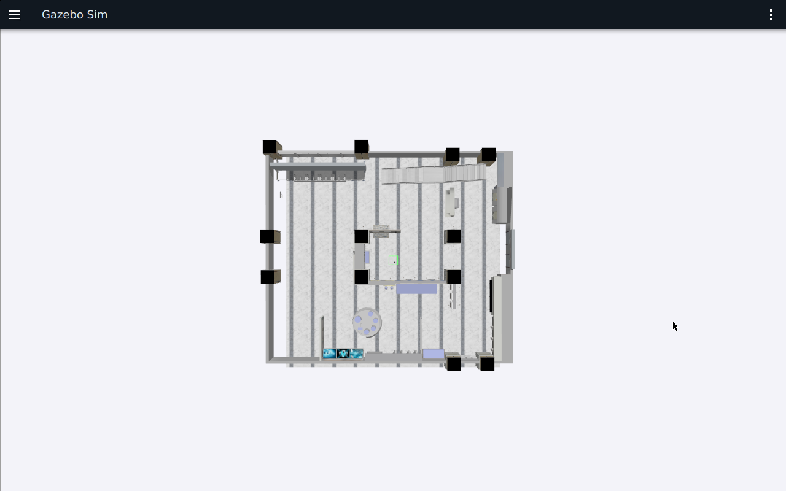

[`frontiers.hpp`](../src_k3_com260_kit/auto_explorer/include/auto_explorer/frontiers.hpp) 在实时地图中寻找已知自由区与未知区的边界，排除靠近障碍物、不可达和已尝试的目标，再交给 Nav2 导航。建图期间由 slam_toolbox 发布地图和定位变换，不启动 AMCL。直行速度上限为 0.22 m/s。

停止键盘控制后，在 **COM260 新终端**执行：

```bash
source ~/.config/ros2-course-com260-ch22-ch23/env.bash
source ~/.config/ros2-course-com260-ch22-ch23/dds.bash
ros2 run auto_explorer auto_explorer --ros-args -p use_sim_time:=true
```

观察终端覆盖率与 RViz 地图。完成后节点取消当前导航、停车，自动保存 COM260 的 `~/maps/final_map.pgm` 和 `.yaml` 并退出。返回 x86 终端，用上方 `map_saver_cli` 命令保存同一张地图为 `~/maps/my_map`，供后续处理与导航使用。提前结束按 Ctrl+C：节点取消导航并停车，不把未达到 95% 的地图报告为完成。若报告没有可达新边界，先检查 RViz 中的通道、激光和定位，不能把退出当成建图成功。

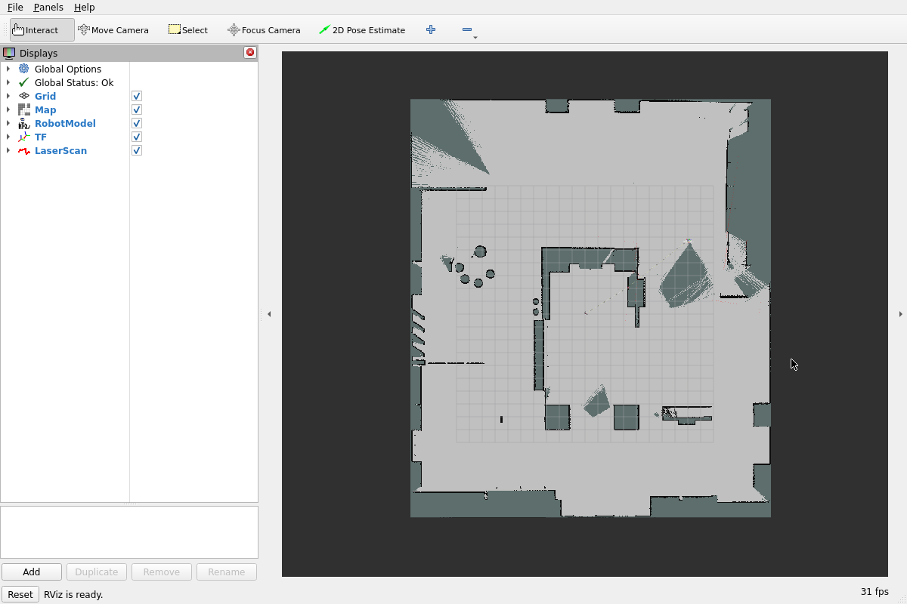

[自主探索 GIF](../lab_manuals_k3_com260_kit/images/ch23/ch23-explorer.gif) · [连续 RViz 片段（约 8 分 15 秒）](../lab_manuals_k3_com260_kit/images/ch23/ch23-explorer.mp4) · [完整 COM260 终端记录](../lab_manuals_k3_com260_kit/images/ch23/ch23-explorer.cast)

### 23.2.3 使用Cartographer建图

```bash
# x86：先停止 slam_toolbox 仿真，再启动带 IMU 的传感器与 Cartographer
bash course_support/k3_com260_kit/scripts/x86-ch22-ch23.bash stop ch23-map
bash course_support/k3_com260_kit/scripts/x86-ch22-ch23.bash start-camera ch23-carto use_rviz:=false
bash course_support/k3_com260_kit/scripts/x86-ch22-ch23.bash exec ch23-carto \
  ros2 launch sensor_fusion_cpp fusion_mapping.launch.py use_rviz:=true
# 另一个 x86 终端使用 teleop_twist_keyboard 控制机器人，停车后保存。

# x86 新终端进入容器
bash course_support/k3_com260_kit/scripts/x86-ch22-ch23.bash exec ch23-carto bash
ros2 service call /finish_trajectory cartographer_ros_msgs/srv/FinishTrajectory "{trajectory_id: 0}"
ros2 service call /write_state cartographer_ros_msgs/srv/WriteState \
  "{filename: /maps/map.pbstream, include_unfinished_submaps: true}"
ros2 run cartographer_ros cartographer_pbstream_to_ros_map \
  -pbstream_filename /maps/map.pbstream -map_filestem /maps/cartographer_map -resolution 0.05
# 地图导出后，在启动建图 Launch 的终端按 Ctrl+C，等待建图节点退出。
# 此终端执行 exit 返回 x86 主机，再执行 stop ch23-carto 结束仿真。
```

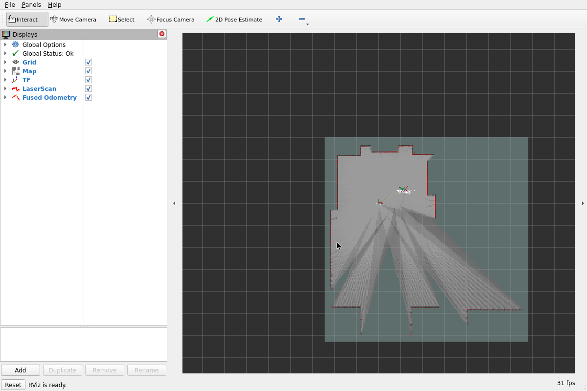

[建图 GIF](../lab_manuals_k3_com260_kit/images/ch23/ch23-cartographer.gif) · [30 秒连续 RViz 录像](../lab_manuals_k3_com260_kit/images/ch23/ch23-cartographer.mp4)

### 23.2.4 地图后处理

```cpp
#include <filesystem>
#include <iostream>
#include <opencv2/imgcodecs.hpp>
#include <opencv2/imgproc.hpp>
#include <yaml-cpp/yaml.h>
#include <fstream>

int main(int argc, char ** argv) {
  if (argc != 4) { std::cerr << "Usage: map_postprocessor INPUT.pgm INPUT.yaml OUTPUT_PREFIX\n"; return 2; }
  try {
    auto image = cv::imread(argv[1], cv::IMREAD_GRAYSCALE);
    if (image.empty()) { throw std::runtime_error("Cannot read map image"); }
    auto meta = YAML::LoadFile(argv[2]);
    const cv::Mat observed_obstacles = image < 200;
    cv::medianBlur(image, image, 3);
    cv::morphologyEx(image, image, cv::MORPH_CLOSE, cv::getStructuringElement(cv::MORPH_ELLIPSE, {5,5}));
    image.setTo(0, observed_obstacles);
    cv::Mat binary;
    cv::threshold(image, binary, 200, 255, cv::THRESH_BINARY);
    cv::erode(binary, binary, cv::getStructuringElement(cv::MORPH_ELLIPSE, {7,7}));
    image.setTo(0, binary == 0);
    std::vector<cv::Point> points;
    cv::findNonZero(image, points);
    if (!points.empty()) {
      const auto bounds = cv::boundingRect(points);
      image = image(bounds).clone();
      const double resolution = meta["resolution"].as<double>();
      meta["origin"][0] = meta["origin"][0].as<double>() + bounds.x*resolution;
      meta["origin"][1] = meta["origin"][1].as<double>() + bounds.y*resolution;
    }
    const std::string prefix = argv[3];
    if (!cv::imwrite(prefix+".pgm", image)) { throw std::runtime_error("Cannot write map image"); }
    meta["image"] = std::filesystem::path(prefix).filename().string()+".pgm";
    meta["free_thresh"] = 0.196;
    std::ofstream output(prefix+".yaml");
    output << meta << '\n';
    if (!output) { throw std::runtime_error("Cannot write map metadata"); }
    std::cout << "地图已保存: " << prefix << ".pgm, " << prefix << ".yaml\n";
  } catch (const std::exception & e) { std::cerr << e.what() << '\n'; return 1; }
}
```

在 x86 主机终端处理上一步保存的地图。`offline` 启动临时工具容器，执行结束后自动退出，不需要仍在运行的仿真：

```bash
cd ~/ROS2_RISCV_COM260_CH22_CH23
bash course_support/k3_com260_kit/scripts/x86-ch22-ch23.bash offline \
  ros2 run map_tools_cpp map_postprocessor /maps/my_map.pgm /maps/my_map.yaml /maps/processed_map
```

依次执行 3×3 中值滤波、5×5 椭圆闭运算、半径 3 的障碍膨胀和边界裁剪。COM260 仿真地图中的墙线可能仅有一个栅格宽，滤波和闭运算后恢复原图已观测到的障碍，再进行膨胀，避免墙线消失而影响 AMCL 定位。输出 YAML 的 `free_thresh=0.196`，使灰度 205 保持为未知栅格；0.25 会将该灰度误归为可通行区域。处理后查看墙体、窄通道和地图原点，确认没有把可通行区域封闭，再装载导航。

| 保存的地图 | 后处理地图 |
|---|---|
| 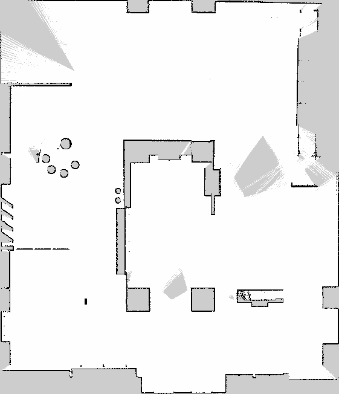 | 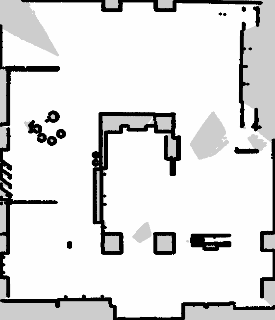 |

[处理与评价终端记录](../lab_manuals_k3_com260_kit/images/ch23/ch23-map-tools.cast) · [终端 GIF](../lab_manuals_k3_com260_kit/images/ch23/ch23-map-tools.gif) · [示例 PGM/YAML 地图](../lab_manuals_k3_com260_kit/images/ch23/ch23-saved-map.zip)。灰色表示未观测区域。场内覆盖率使用后处理前的实测地图和固定区域掩码计算，后处理生成的像素不计入观测结果。


### 23.2.5 官方要点——slam_toolbox 官方 Wiki：建图、保存与序列化

练习第 1 题的每一步在 slam_toolbox 官方 Wiki 都有对应说明：异步建图（`sync`/`async` 两种模式，后者不阻塞回调）结束后，用 `map_saver_cli -f mymap` 导出 pgm+yaml 地图对；Wiki 强调更推荐用 `/slam_toolbox/serialize_map` 服务保存 `.posegraph` 序列化文件，它保留了位姿图与原始扫描，后续可 `deserialize_map` 继续增量建图——这是"边运营边补图"的官方工作流。Wiki 还给出了占用栅格参数（resolution、map_update_interval）与建图模式（localization-only 模式加载已有位姿图）的切换方法，正好覆盖练习第 1 题从建图到定位的全链路。

## 23.3 自主导航配置

### 23.3.1 Nav2参数配置

```yaml
# nav2_params.yaml - 主要导航参数
bt_navigator:
  ros__parameters:
    default_nav_to_pose_bt_xml: ""  # 空值使用 Humble 默认导航树
    plugin_lib_names:
      - nav2_compute_path_to_pose_action_bt_node
      - nav2_follow_path_action_bt_node
      - nav2_spin_action_bt_node
      - nav2_back_up_action_bt_node
      - nav2_wait_action_bt_node
      - nav2_clear_costmap_service_bt_node
      - nav2_recovery_node_bt_node
      - nav2_pipeline_sequence_bt_node

planner_server:
  ros__parameters:
    planner_plugins: ["GridBased"]
    GridBased:
      plugin: "nav2_navfn_planner/NavfnPlanner"
      tolerance: 0.5
      use_astar: true

controller_server:
  ros__parameters:
    controller_plugins: ["FollowPath"]
    FollowPath:
      plugin: "dwb_core::DWBLocalPlanner"
      min_vel_x: 0.0
      max_vel_x: 0.5
      max_vel_theta: 1.0
      acc_lim_x: 2.5
      acc_lim_theta: 3.2
      critics: ["RotateToGoal", "Oscillation", "BaseObstacle",
                "GoalAlign", "PathAlign", "PathDist", "GoalDist"]
      RotateToGoal.scale: 32.0
      BaseObstacle.scale: 0.02
      PathAlign.scale: 32.0
      GoalDist.scale: 24.0

local_costmap:
  local_costmap:
    ros__parameters:
      update_frequency: 5.0
      publish_frequency: 2.0
      global_frame: odom
      robot_base_frame: base_link
      rolling_window: true
      width: 4
      height: 4
      resolution: 0.05
      plugins: ["voxel_layer", "inflation_layer"]
      voxel_layer:
        plugin: "nav2_costmap_2d::VoxelLayer"
        enabled: True
        observation_sources: scan
        scan:
          topic: /scan
          max_obstacle_height: 2.0
          clearing: True
          marking: True
      inflation_layer:
        plugin: "nav2_costmap_2d::InflationLayer"
        inflation_radius: 0.55
        cost_scaling_factor: 3.0

global_costmap:
  global_costmap:
    ros__parameters:
      update_frequency: 1.0
      publish_frequency: 1.0
      global_frame: map
      robot_base_frame: base_link
      resolution: 0.05
      track_unknown_space: True
      plugins: ["static_layer", "obstacle_layer", "inflation_layer"]
      static_layer:
        plugin: "nav2_costmap_2d::StaticLayer"
        map_subscribe_transient_local: True
      obstacle_layer:
        plugin: "nav2_costmap_2d::ObstacleLayer"
        enabled: True
        observation_sources: scan
        scan:
          topic: /scan
          max_obstacle_height: 2.0
          clearing: True
          marking: True
      inflation_layer:
        plugin: "nav2_costmap_2d::InflationLayer"
        inflation_radius: 0.55
        cost_scaling_factor: 3.0

amcl:
  ros__parameters:
    max_particles: 2000
    min_particles: 500
    laser_model_type: "likelihood_field"
    update_min_a: 0.2
    update_min_d: 0.1
    z_hit: 0.95
    z_rand: 0.05
    sigma_hit: 0.2
    initial_pose.x: 0.0
    initial_pose.y: 0.0
    initial_pose.yaw: 0.0

behavior_server:
  ros__parameters:
    behavior_plugins: ["spin", "backup", "drive_on_heading", "wait"]
    spin:
      plugin: "nav2_behaviors/Spin"
      max_rotational_vel: 1.0
    backup:
      plugin: "nav2_behaviors/BackUp"
      max_linear_vel: 0.1
```

完整参数文件位于 `navigation_console/config/nav2_params.yaml`，包含 Nav2 所需的服务器、插件和生命周期配置。COM260 双端仿真使用 `BaseObstacle.scale=0.02`，平衡障碍代价与路径、目标评分；`32.0` 在此场景中会使机器人过度回避膨胀区域，导致部分航点迟迟不能到达。调整的是评分权重，碰撞检查仍启用。`default_nav_to_pose_bt_xml` 为空时使用 Humble 默认树；更换树时填 x86 容器可读取的 XML 绝对路径。

### 23.3.2 导航启动文件

```python
"""Launch the SLAM project map and navigation configuration."""
from pathlib import Path
from ament_index_python.packages import get_package_share_directory
from launch import LaunchDescription
from launch.actions import DeclareLaunchArgument, IncludeLaunchDescription
from launch.conditions import IfCondition
from launch.launch_description_sources import PythonLaunchDescriptionSource
from launch.substitutions import LaunchConfiguration
from launch_ros.actions import Node


def generate_launch_description():
    share = lambda package: Path(get_package_share_directory(package))
    course = share('param_demo_cpp')
    params = LaunchConfiguration('params_file')
    return LaunchDescription([
        DeclareLaunchArgument('gui', default_value='true'),
        DeclareLaunchArgument('use_rviz', default_value='true'),
        DeclareLaunchArgument('gz_partition', default_value='com260_navigation'),
        DeclareLaunchArgument('map', default_value='/maps/processed_map.yaml'),
        DeclareLaunchArgument('params_file', default_value=str(share('navigation_console') / 'config/nav2_params.yaml')),
        IncludeLaunchDescription(PythonLaunchDescriptionSource(str(share('robot_sim_demo') / 'launch/gazebo2.launch.py')),
            launch_arguments={'gui': LaunchConfiguration('gui'), 'rviz': 'false', 'drive': 'false',
                              'world': str(share('auto_explorer') / 'config/project_museum.sdf'),
                              'gui_config': str(share('auto_explorer') / 'config/project.gui.config'),
                              'spawn_x': '0.0', 'spawn_y': '0.0', 'spawn_yaw': '0.0',
                              'gz_partition': LaunchConfiguration('gz_partition')}.items()),
        IncludeLaunchDescription(PythonLaunchDescriptionSource(str(share('nav2_bringup') / 'launch/bringup_launch.py')),
            launch_arguments={'map': LaunchConfiguration('map'), 'params_file': params, 'use_sim_time': 'true',
                              'autostart': 'true', 'use_composition': 'False'}.items()),
        Node(package='rviz2', executable='rviz2', name='navigation_rviz',
             arguments=['-d', str(course / 'rviz/navigation.rviz')], parameters=[{'use_sim_time': True}],
             condition=IfCondition(LaunchConfiguration('use_rviz'))),
    ])
```

完成地图后处理并停止建图容器，在 x86 主机启动项目：

```bash
bash course_support/k3_com260_kit/scripts/x86-ch22-ch23.bash start-project ch23-project
```

默认读取 `/maps/processed_map.yaml`，初始位姿为 `(0,0,0)`。每次更换地图，先确认起点、航点和地图坐标一致。项目启动的是扩大后的场景，应使用本节生成的地图，不要装载未放大场景的预置地图。

### 23.3.3 多点导航控制台

```cpp
#include <array>
#include <chrono>
#include <cmath>
#include <csignal>
#include <type_traits>
#include <rclcpp/rclcpp.hpp>
#include <rclcpp_action/rclcpp_action.hpp>
#include <nav2_msgs/action/navigate_to_pose.hpp>
#include <nav2_msgs/action/follow_waypoints.hpp>
#include <nav_msgs/msg/odometry.hpp>
#include <yaml-cpp/yaml.h>

using namespace std::chrono_literals;
using Waypoint=std::array<double,3>;
using Navigate=nav2_msgs::action::NavigateToPose;
using Follow=nav2_msgs::action::FollowWaypoints;
volatile std::sig_atomic_t stopped=0;

class NavigationConsole : public rclcpp::Node {
public:
  NavigationConsole() : Node("navigation_console") {
    declare_parameter<std::string>("mode","patrol");
    declare_parameter<std::string>("mission","");
    declare_parameter("loops",2);
    odom=create_subscription<nav_msgs::msg::Odometry>("/odom",10,
      [this](nav_msgs::msg::Odometry::ConstSharedPtr msg) {
        const auto & p=msg->pose.pose.position;
        if (has_position) { path_length+=std::hypot(p.x-x,p.y-y); }
        x=p.x; y=p.y; has_position=true;
      });
  }
  bool navigate(const Waypoint & point) {
    Navigate::Goal goal; goal.pose=pose(point);
    RCLCPP_INFO(get_logger(),"导航至: (%.2f, %.2f, %.1f°)",point[0],point[1],point[2]*180/M_PI);
    return execute<Navigate>("navigate_to_pose",goal);
  }
  bool follow(const std::vector<Waypoint> & points) {
    Follow::Goal goal;
    for(const auto & point:points) {goal.poses.push_back(pose(point));}
    return execute<Follow>("follow_waypoints",goal);
  }
  bool patrol(const std::vector<Waypoint> & points,int loops=3) {
    for(int round=0;round<loops&&!stopped;++round) {
      RCLCPP_INFO(get_logger(),"巡逻第 %d/%d 轮",round+1,loops);
      for(const auto & point:points) {if(!navigate(point)) {return false;}}
    }
    return !stopped;
  }
  bool mission(const std::string & file) {
    const auto data=YAML::LoadFile(file);
    RCLCPP_INFO(get_logger(),"加载任务: %s",data["name"].as<std::string>().c_str());
    for(const auto & task:data["tasks"]) {
      const auto type=task["type"].as<std::string>();
      if(type=="navigation") {
        if(!navigate({task["x"].as<double>(),task["y"].as<double>(),task["yaw"].as<double>(0)})) {return false;}
      } else if(type=="wait") {
        const auto end=std::chrono::steady_clock::now()+std::chrono::duration<double>(task["duration"].as<double>());
        while(!stopped&&std::chrono::steady_clock::now()<end) {rclcpp::spin_some(shared_from_this());rclcpp::sleep_for(20ms);}
      } else if(type=="patrol") {
        std::vector<Waypoint> points;
        for(const auto & p:task["waypoints"]) {points.push_back(p.as<Waypoint>());}
        if(!patrol(points,task["loops"].as<int>(3))) {return false;}
      } else {throw std::runtime_error("Unknown mission task: "+type);}
      if(stopped) {return false;}
    }
    return true;
  }
  bool test(const std::vector<Waypoint> & points) {
    int successes=0;
    const auto start=std::chrono::steady_clock::now();
    for(const auto & point:points) {if(stopped) {break;} if(navigate(point)) {++successes;}}
    const double elapsed=std::chrono::duration<double>(std::chrono::steady_clock::now()-start).count();
    RCLCPP_INFO(get_logger(),"测试: %d/%zu 成功，成功率 %.1f%%，平均耗时 %.2fs",
      successes,points.size(),100.0*successes/points.size(),elapsed/points.size());
    return successes==int(points.size());
  }
private:
  geometry_msgs::msg::PoseStamped pose(const Waypoint & point) {
    geometry_msgs::msg::PoseStamped p;
    p.header.frame_id="map"; p.header.stamp=now();
    p.pose.position.x=point[0]; p.pose.position.y=point[1];
    p.pose.orientation.z=std::sin(point[2]/2); p.pose.orientation.w=std::cos(point[2]/2);
    return p;
  }
  template<class Action> bool execute(const std::string & name,const typename Action::Goal & goal) {
    auto client=rclcpp_action::create_client<Action>(this,name);
    if(stopped||!client->wait_for_action_server(30s)) {return false;}
    typename rclcpp_action::Client<Action>::SendGoalOptions options;
    options.feedback_callback=[this](auto,auto feedback) {
      if constexpr(std::is_same_v<Action,Navigate>) {
        RCLCPP_INFO_THROTTLE(get_logger(),*get_clock(),2000,"剩余距离: %.2fm",feedback->distance_remaining);
      } else {RCLCPP_INFO_THROTTLE(get_logger(),*get_clock(),2000,"前往航点 #%u",feedback->current_waypoint);}
    };
    auto sent=client->async_send_goal(goal,options);
    if(rclcpp::spin_until_future_complete(shared_from_this(),sent,10s)!=rclcpp::FutureReturnCode::SUCCESS||!sent.get()) {return false;}
    auto result=client->async_get_result(sent.get());
    const auto start=std::chrono::steady_clock::now();
    const double initial_path=path_length;
    bool canceled=false;
    auto deadline=start+180s;
    while(result.wait_for(0s)!=std::future_status::ready) {
      rclcpp::spin_some(shared_from_this());
      if(!canceled&&(stopped||std::chrono::steady_clock::now()>deadline)) {
        client->async_cancel_goal(sent.get()); canceled=true; deadline=std::chrono::steady_clock::now()+10s;
      }
      if(canceled&&std::chrono::steady_clock::now()>deadline) {return false;}
      rclcpp::sleep_for(20ms);
    }
    const auto completed=result.get();
    bool ok=completed.code==rclcpp_action::ResultCode::SUCCEEDED;
    if constexpr(std::is_same_v<Action,Follow>) {ok=ok&&completed.result->missed_waypoints.empty();}
    RCLCPP_INFO(get_logger(),"导航%s，实际路径长度: %.2fm",ok?"成功":"失败或取消",path_length-initial_path);
    return ok;
  }
  double x=0,y=0,path_length=0;
  bool has_position=false;
  rclcpp::Subscription<nav_msgs::msg::Odometry>::SharedPtr odom;
};
int main(int argc,char ** argv) {
  rclcpp::init(argc,argv,rclcpp::InitOptions(),rclcpp::SignalHandlerOptions::None);
  std::signal(SIGINT,[](int){stopped=1;}); std::signal(SIGTERM,[](int){stopped=1;});
  auto console=std::make_shared<NavigationConsole>();
  const std::vector<Waypoint> points{{1,.5,0},{2,1,M_PI/4},{1.5,2,M_PI/2},{0,1.5,M_PI}};
  bool ok=false;
  try {
    const auto mode=console->get_parameter("mode").as_string();
    if(mode=="patrol") {ok=console->patrol(points,console->get_parameter("loops").as_int());}
    else if(mode=="waypoints") {ok=console->follow(points);}
    else if(mode=="mission") {ok=console->mission(console->get_parameter("mission").as_string());}
    else if(mode=="test") {ok=console->test(points);}
    else {throw std::runtime_error("Use mode patrol, waypoints, mission or test");}
  } catch(const std::exception & e) {RCLCPP_ERROR(console->get_logger(),"%s",e.what());}
  rclcpp::shutdown(); return stopped?130:(ok?0:1);
}
```

COM260 新终端加载公共环境后运行，默认按 `(1,0.5,0)`、`(2,1,π/4)`、`(1.5,2,π/2)`、`(0,1.5,π)` 巡逻两轮：

```bash
ros2 run navigation_console navigation_console --ros-args -p use_sim_time:=true -p mode:=patrol -p loops:=2
```

也可顺次检验航点 Action 和 YAML 任务，每次等上一条完成后再运行：

```bash
ros2 run navigation_console navigation_console --ros-args -p use_sim_time:=true -p mode:=waypoints
ros2 run navigation_console navigation_console --ros-args -p use_sim_time:=true -p mode:=mission \
  -p mission:="$(ros2 pkg prefix navigation_console)/share/navigation_console/config/mission.yaml"
```

按 Ctrl+C 取消当前任务，等待取消结果，再检查 `/odom` 中的速度归零。完成后在 x86 主机使用 `stop ch23-project` 关闭仿真。

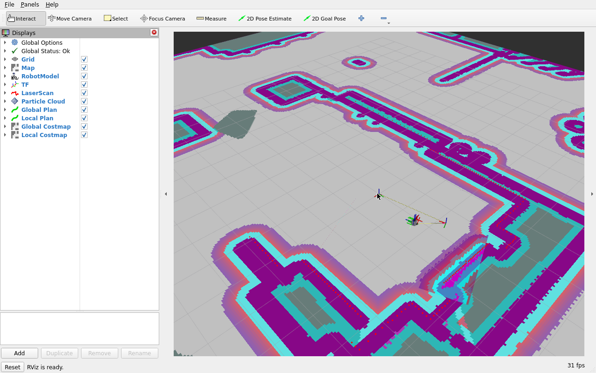

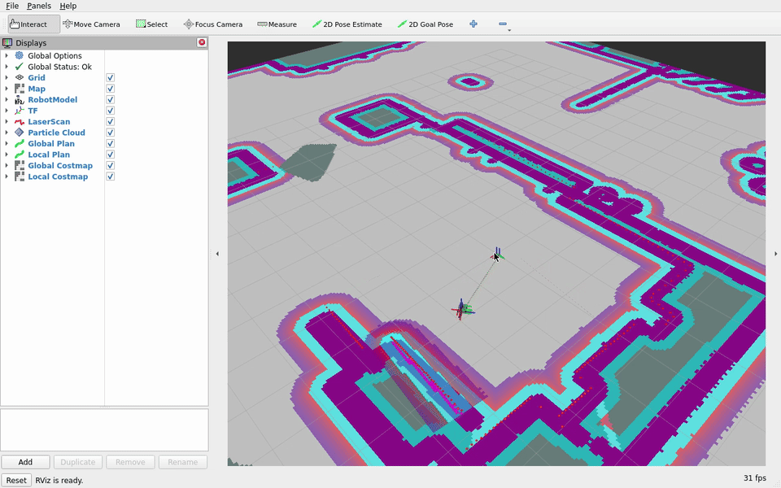

[巡逻、航点跟随、任务文件和测试的连续 RViz 录像](../lab_manuals_k3_com260_kit/images/ch23/ch23-project-navigation.mp4) · [COM260 实际命令与结果](../lab_manuals_k3_com260_kit/images/ch23/ch23-project-navigation.cast)。


### 23.3.4 官方要点——Nav2 官方：从建图到导航的误差控制

Nav2 官方调优文档把练习第 4 题的"误差来源"拆成了三层：建图层—— slam_toolbox 的 `minimum_travel_distance`（关键帧间距）过大导致局部细节缺失，官方建议在拐角处降低阈值；定位层——AMCL 的 `set_initial_pose` 未设时首帧需人工给位姿，`laser_model_type` 与 `max_beams` 直接决定粒子发散速度（官方文档建议室内 360° 雷达用 likelihood_field 模型）；规划层——代价地图 inflation_radius 取值过小会造成贴墙路径，过大则狭窄通道不可达，官方调优指南给出" inflation = 机器人半径 + 动态余量"的经验公式。三层误差会相乘式放大，官方因此强调"每层单独验证"（先 rosbag 回放定位精度，再全链路导航）。

## 23.4 多机器人调度

### 23.4.1 多机器人架构

```cpp
#include <algorithm>
#include <chrono>
#include <cmath>
#include <csignal>
#include <map>
#include <iostream>
#include <rclcpp/rclcpp.hpp>
#include <rclcpp_action/rclcpp_action.hpp>
#include <nav2_msgs/action/navigate_to_pose.hpp>
#include <yaml-cpp/yaml.h>

using namespace std::chrono_literals;
using Navigate=nav2_msgs::action::NavigateToPose;
using Client=rclcpp_action::Client<Navigate>;
using Handle=rclcpp_action::ClientGoalHandle<Navigate>;
volatile std::sig_atomic_t stopped=0;

class FleetScheduler : public rclcpp::Node {
  struct Robot {Client::SharedPtr client; Handle::SharedPtr handle; bool busy=false,has_pose=false; double x=0,y=0;};
  struct Task {std::string robot; double x,y,yaw; int priority; bool dispatched=false,complete=false;};
public:
  FleetScheduler() : Node("multi_robot_scheduler") {
    for(const auto & name:{"robot1","robot2","robot3"}) {
      robots[name].client=rclcpp_action::create_client<Navigate>(this,std::string("/")+name+"/navigate_to_pose");
    }
    const auto data=YAML::LoadFile(declare_parameter<std::string>("task_file","tasks.yaml"));
    for(const auto & item:data["tasks"]) {
      const auto name=item["robot"].as<std::string>();
      if(!robots.count(name)) {throw std::runtime_error("Unknown robot: "+name);}
      tasks.push_back({name,item["x"].as<double>(),item["y"].as<double>(),item["yaw"].as<double>(0),item["priority"].as<int>(0)});
    }
    if(tasks.empty()) {throw std::runtime_error("Task file is empty");}
    std::stable_sort(tasks.begin(),tasks.end(),[](const Task & a,const Task & b){return a.priority>b.priority;});
    timer=create_wall_timer(1s,[this]{dispatch();});
  }
  bool done() const {return std::all_of(tasks.begin(),tasks.end(),[](const Task & t){return t.complete;});}
  bool failed=false;
  void cancel() {
    timer->cancel(); canceling=true;
    for(auto & [name,robot]:robots) {if(robot.handle) {robot.client->async_cancel_goal(robot.handle);}}
  }
  bool active() const {
    return std::any_of(robots.begin(),robots.end(),[](const auto & entry){return entry.second.busy;});
  }
private:
  void dispatch() {
    for(auto & task:tasks) {
      auto & robot=robots.at(task.robot);
      if(task.dispatched||robot.busy||!robot.client->action_server_is_ready()) {continue;}
      Navigate::Goal goal;
      goal.pose.header.frame_id="map"; goal.pose.header.stamp=now();
      goal.pose.pose.position.x=task.x; goal.pose.pose.position.y=task.y;
      goal.pose.pose.orientation.z=std::sin(task.yaw/2); goal.pose.pose.orientation.w=std::cos(task.yaw/2);
      robot.busy=true; task.dispatched=true;
      Client::SendGoalOptions options;
      options.goal_response_callback=[this,&task,&robot](Handle::SharedPtr handle) {
        robot.handle=handle;
        if(!handle) {robot.busy=false;task.complete=true;failed=true;}
        else if(canceling) {robot.client->async_cancel_goal(handle);}
        RCLCPP_INFO(get_logger(),"%s: %s",task.robot.c_str(),handle?"ACCEPTED":"REJECTED");
      };
      options.feedback_callback=[&robot](Handle::SharedPtr,auto feedback) {
        robot.x=feedback->current_pose.pose.position.x; robot.y=feedback->current_pose.pose.position.y;
        robot.has_pose=true;
      };
      options.result_callback=[this,&task,&robot](const Handle::WrappedResult & result) {
        const bool ok=result.code==rclcpp_action::ResultCode::SUCCEEDED;
        failed|=!ok; robot.busy=false; robot.handle.reset(); task.complete=true;
        RCLCPP_INFO(get_logger(),"%s: %s",task.robot.c_str(),ok?"SUCCEEDED":"FAILED_OR_CANCELED");
        if(robot.has_pose) {RCLCPP_INFO(get_logger(),"%s 反馈位置 (%.3f, %.3f)",task.robot.c_str(),robot.x,robot.y);}
      };
      robot.client->async_send_goal(goal,options);
      RCLCPP_INFO(get_logger(),"派发 %s priority=%d → (%.2f, %.2f)",task.robot.c_str(),task.priority,task.x,task.y);
    }
  }
  bool canceling=false;
  std::map<std::string,Robot> robots;
  std::vector<Task> tasks;
  rclcpp::TimerBase::SharedPtr timer;
};
int main(int argc,char ** argv) {
  rclcpp::init(argc,argv,rclcpp::InitOptions(),rclcpp::SignalHandlerOptions::None);
  std::signal(SIGINT,[](int){stopped=1;}); std::signal(SIGTERM,[](int){stopped=1;});
  int status=1;
  try {
    auto node=std::make_shared<FleetScheduler>();
    const auto deadline=std::chrono::steady_clock::now()+180s;
    while(!stopped&&!node->done()&&std::chrono::steady_clock::now()<deadline) {
      rclcpp::spin_some(node);rclcpp::sleep_for(20ms);
    }
    status=node->done()&&!node->failed?0:1;
    node->cancel();
    const auto cancel_deadline=std::chrono::steady_clock::now()+10s;
    while(node->active()&&std::chrono::steady_clock::now()<cancel_deadline) {rclcpp::spin_some(node);rclcpp::sleep_for(20ms);}
    if(stopped) {status=130;}
  } catch(const std::exception & e) {std::cerr<<e.what()<<'\n';}
  rclcpp::shutdown(); return status;
}
```

调度器按优先级派发指定机器人的任务，收到真实 Action 结果后释放该机器人。目标区域占用类用于说明中心距离小于 1 m 的冲突检查，尚未接入完整轨迹避碰；区域预留与释放应在设计题中接入调度流程。COM260 可运行 `ros2 run fleet_scheduler conflict_demo` 检查占用、边界与释放行为。

### 23.4.2 多机器人仿真启动

```bash
# x86：停止上一组仿真后启动三台机器人及各自的 Nav2
cd ~/ROS2_RISCV_COM260_CH22_CH23
source ~/.config/ros2-course-com260-ch22-ch23/dds.bash
bash course_support/k3_com260_kit/scripts/x86-ch22-ch23.bash start-fleet ch23-fleet

# COM260 新终端
source ~/.config/ros2-course-com260-ch22-ch23/env.bash
source ~/.config/ros2-course-com260-ch22-ch23/dds.bash
ros2 run fleet_scheduler fleet_scheduler --ros-args -p use_sim_time:=true \
  -p task_file:="$(ros2 pkg prefix fleet_scheduler)/share/fleet_scheduler/config/tasks.yaml"
```

只有三台机器人分别输出 `SUCCEEDED`，并且各自 `/robotN/odom` 显示停车，才说明任务执行完成。Ctrl+C 会取消本节点已派发的目标。最后在 x86 主机执行 `stop ch23-fleet`。

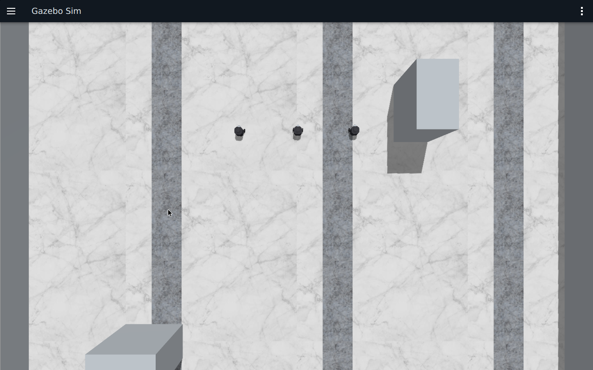

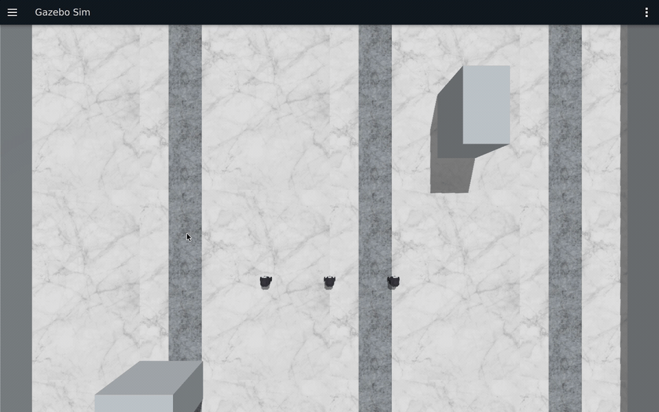

[三车连续 Gazebo 录像](../lab_manuals_k3_com260_kit/images/ch23/ch23-fleet.mp4) · [COM260 调度终端](../lab_manuals_k3_com260_kit/images/ch23/ch23-fleet.cast)。

### 23.4.3 官方要点——多机器人：官方示例与调度架构

练习第 3 题可参考两个官方项目：Nav2 官方文档的 multi-robot 页面给出了"每机器人一个独立 namespace + 各自 costmap/AMCL，共享一张合并地图"的推荐架构，配合 `multirobot_map_merge` 与 `multi_nav2` 示例包；调度层面官方推荐用一个中心化节点封装 Simple Commander 的 `followWaypoints`（支持为每个航点分配不同机器人），并通过 `robot_state` 话题广播各机状态实现冲突避免（如充电桩互斥、窄道会车让行）。RoboCup@Home 与 AWS RoboMaker 官方示例也展示了"任务队列 + 优先级抢占"的调度器框架，与练习第 6 题商超多机器人（清洁/巡检/导购）的任务分配需求同构。

## 23.5 项目文档规范

### 23.5.1 项目文档结构

```text
ROS2_RISCV_COM260_CH22_CH23/
├── src_k3_com260_kit/
│   ├── auto_explorer/          # 自动探索与地图保存
│   ├── map_tools_cpp/          # 后处理与地图评价
│   ├── navigation_console/    # Nav2 参数、Launch、多点任务
│   ├── fleet_scheduler/       # 三车任务队列与区域占用示例
│   ├── slam_bringup_lab/       # 建图实验
│   └── nav_bringup_lab/        # 导航实验
├── course_support/k3_com260_kit/
│   ├── scripts/               # 双端环境、启动与停止
│   └── config/                # 场景与多机器人配置
├── teaching_docs_k3_com260_kit/
└── lab_manuals_k3_com260_kit/
    ├── ch13_lab.md
    ├── ch14_lab.md
    └── images/ch23/            # 截图、GIF 与录像
```

### 23.5.2 设计文档模板

模板内数值用于展示填写方式，应替换成自己的测量结果。

```markdown
# 项目名称：SLAM与导航综合实训项目

## 1. 项目概述
- 项目目标：
- 技术栈：ROS 2 Humble, TurtleBot3 Burger, Nav2, slam_toolbox
- 实现功能：

## 2. 系统架构
### 2.1 架构图
[系统架构图]

### 2.2 模块说明
| 模块名称 | 功能描述 | 输入 | 输出 |
|---------|---------|------|------|
| SLAM建图 | 构建环境地图 | /scan, /tf | /map |
| AMCL定位 | 已知地图定位 | /scan, /map, /tf | /amcl_pose |
| 全局规划 | 全局路径规划 | 目标点, 代价地图 | /plan |
| 局部控制 | 路径跟踪 | /plan, /scan | /cmd_vel |

## 3. 建图方案
### 3.1 算法选择
- 使用 slam_toolbox 在线异步建图
- 地图分辨率：0.05m
- 建图方式：自动探索

### 3.2 建图参数
[关键参数说明]

## 4. 导航方案
### 4.1 路径规划
- 全局规划：Navfn + A*
- 局部控制：DWB

### 4.2 定位方案
- AMCL粒子滤波
- 初始位姿设定

## 5. 测试与评估
### 5.1 建图评估
| 指标 | 数值 |
|------|------|
| 地图覆盖率 | 95% |
| 建图时间 | 15min |
| 回环闭合 | 成功 |

### 5.2 导航评估
| 指标 | 数值 |
|------|------|
| 导航成功率 | 93% |
| 平均规划时间 | 0.5s |
| 路径长度误差 | <5% |

## 6. 问题与解决方案
[记录开发过程中遇到的问题和解决方案]
```

### 23.5.3 测试方案

```cpp
  bool test(const std::vector<Waypoint> & points) {
    int successes=0;
    const auto start=std::chrono::steady_clock::now();
    for(const auto & point:points) {if(stopped) {break;} if(navigate(point)) {++successes;}}
    const double elapsed=std::chrono::duration<double>(std::chrono::steady_clock::now()-start).count();
    RCLCPP_INFO(get_logger(),"测试: %d/%zu 成功，成功率 %.1f%%，平均耗时 %.2fs",
      successes,points.size(),100.0*successes/points.size(),elapsed/points.size());
    return successes==int(points.size());
  }
```

在 COM260 运行 `ros2 run navigation_console navigation_console --ros-args -p use_sim_time:=true -p mode:=test`。成功率由每个真实导航结果统计，不能用目标接受率代替到达率。

## 23.6 性能评估与优化

### 23.6.1 建图质量评估

```cpp
#include <iostream>
#include <opencv2/imgcodecs.hpp>
#include <opencv2/imgproc.hpp>

int main(int argc, char ** argv) {
  if (argc < 2 || argc > 3) { std::cerr << "Usage: map_evaluator MAP.pgm [GROUND_TRUTH.pgm]\n"; return 2; }
  const auto image = cv::imread(argv[1], cv::IMREAD_GRAYSCALE);
  if (image.empty()) { std::cerr << "Cannot read map image\n"; return 1; }
  cv::Mat edges;
  cv::Canny(image, edges, 50, 150);
  const double cells = image.total();
  std::cout << "known_grid_ratio=" << 100.0*cv::countNonZero(image != 205)/cells
            << "% clarity=" << cv::countNonZero(edges)/cells << " total_cells=" << image.total();
  if (argc == 3) {
    const auto truth = cv::imread(argv[2], cv::IMREAD_GRAYSCALE);
    if (truth.empty() || truth.size() != image.size()) { std::cerr << "\nGround truth must have the same size and coordinates\n"; return 1; }
    cv::Mat difference;
    cv::absdiff(image, truth, difference);
    std::cout << " accuracy=" << 1.0-cv::countNonZero(difference > 50)/cells;
  } else { std::cout << " accuracy=unmeasured"; }
  std::cout << '\n';
}
```

在 x86 主机终端执行：

```bash
cd ~/ROS2_RISCV_COM260_CH22_CH23
bash course_support/k3_com260_kit/scripts/x86-ch22-ch23.bash offline \
  ros2 run map_tools_cpp map_evaluator /maps/processed_map.pgm
```

`known_grid_ratio` 是保存图像矩形内的已知栅格比例，不是场内覆盖率。场内覆盖率使用建图时相同的固定区域计算，在 x86 终端执行：

```bash
bash course_support/k3_com260_kit/scripts/x86-ch22-ch23.bash offline bash -c \
  'ros2 run map_tools_cpp map_coverage /maps/my_map.yaml "$(ros2 pkg prefix auto_explorer)/share/auto_explorer/config/exploration_area.yaml"'
```

要求 `area_m2` 不少于 500、`coverage` 超过 95%，并输出 `pass=true`。使用后处理前的实测地图计算，不能将插补或膨胀产生的像素计入观测结果。

没有同尺寸、同坐标系的真值图时，`accuracy=unmeasured`；有真值时将其 PGM 路径作为第二个参数。此处 accuracy 是像素差阈值指标，不能直接当作定位误差。

### 23.6.2 导航性能优化清单

```markdown
# 导航性能优化清单

## 建图阶段
- [ ] 充分探索所有区域（覆盖率>95%）
- [ ] 地图后处理（噪声滤波、空洞填补）
- [ ] 设置合适的地图原点
- [ ] 检查地图与真值匹配度

## 定位阶段
- [ ] 正确设置初始位姿
- [ ] 调整AMCL粒子数（500-2000）
- [ ] 选择适合的激光模型（似然域/波束）
- [ ] 检查TF变换正确性

## 规划阶段
- [ ] 选择适合的全局规划器
- [ ] 调整膨胀半径（机器人半径×2）
- [ ] 优化代价地图更新频率
- [ ] 设置合理的规划超时时间

## 控制阶段
- [ ] 调整最大速度（安全范围内）
- [ ] 优化DWB评分器权重
- [ ] 配置合理的恢复行为
- [ ] 调节前瞻距离（Pure Pursuit）

## 系统级优化
- [ ] 降低代价地图分辨率（大型环境）
- [ ] 增加局部地图尺寸
- [ ] 配置生命周期节点自动启动
- [ ] 启用fast_odom模式
```

## 23.7 常见问题排查

```cpp
#include <iostream>
struct TroubleshootingGuide {
  static void check_slam_issues() {
    std::cout<<R"(
        SLAM常见问题:

        1. 建图漂移
           → 检查激光频率(>5Hz)
           → 降低移动速度
           → 启用回环检测

        2. 地图错位
           → 检查里程计精度
           → 增加粒子数
           → 调整扫描匹配参数

        3. 地图不完整
           → 增加探索时间
           → 检查激光范围设置
           → 确保死角被覆盖
        )";
  }
  static void check_navigation_issues() {
    std::cout<<R"(
        导航常见问题:

        1. 路径规划失败
           → 检查代价地图状态
           → 检查起点/终点是否可通行
           → 清除代价地图重试

        2. 导航卡住
           → 增大膨胀半径
           → 降低最大速度
           → 检查恢复行为配置

        3. 定位丢失
           → 检查AMCL状态
           → 重新设置初始位姿
           → 增加粒子数

        4. 避障失败
           → 检查传感器数据
           → 调整障碍物层参数
           → 减小最大速度
        )";
  }
  static void run_diagnostics() {
    std::cout<<R"(
        # 检查话题
        ros2 topic list
        ros2 topic hz /scan
        # Ctrl+C 后再分别检查 /odom 和 /tf

        # 检查节点
        ros2 node list
        ros2 lifecycle get /bt_navigator

        # 检查参数
        ros2 param list /planner_server
        ros2 param list /controller_server

        # 检查TF树
        ros2 run tf2_tools view_frames

        # 查看代价地图
        ros2 topic echo /global_costmap/costmap --once

        # 查看AMCL状态
        ros2 topic echo /particlecloud --once
        )";
  }
};
```

### 23.7.1 官方要点——自动探索与健康管理：官方生态的收尾组件

练习第 2 题的自主探索建图在官方生态中有成熟模板：`explore-lite`（m-explore 的 ROS 2 移植）以"边界点（frontier）检测 + Nav2 导航"循环建图，其 README 明确支持与 slam_toolbox 组合；把"覆盖率>95% 自动保存"改为订阅地图元数据统计自由区域即可。健康管理方面，Nav2 官方文档建议用 `diagnostic_updater` 汇报各服务器活性（bt_navigator、controller_server 的心跳），配合 `lifecycle_manager` 的 `bond_timeout` 实现进程级看门狗——服务器失联时自动触发树级恢复而非整机重启，这是商超长期运营方案（练习第 6 题）的系统监控基座。Robotics Back-End 的实训教程把这些组件串成了完整的"建图→保存→定位→导航→探索→监控"脚本模板。

## 课后练习

1. **操作题:** 完成从SLAM建图到自主导航的完整流程：启动仿真→slam_toolbox建图→保存地图→启动AMCL定位→发送导航目标到达目标点。

2. **编程题:** 编写一个完整的自动探索建图节点，支持在未知环境中自主移动完成建图，并在覆盖率超过95%时自动保存地图。

3. **设计题:** 设计一个支持3个机器人的多机器人调度系统，要求支持任务分配、冲突避免和状态监控，给出系统架构图和核心代码框架。

4. **分析题:** 分析从SLAM建图到自主导航的完整流程中，哪些环节最容易引入误差，如何通过参数调优和算法选择来减小误差。

5. **文档题:** 仿照本节的设计文档模板，为你的SLAM与导航项目撰写完整的设计文档，包含需求分析、系统架构、参数配置、测试方案和问题记录。

6. **综合题:** 设计一个面向大型商超的机器人服务方案（包括清洁、巡检、导购等多类型机器人），涵盖SLAM建图方案（跨楼层）、多机器人调度（任务优先级）、人机交互（目标下达）和系统监控（健康管理）。

---

## 仿真结合实例：从在线建图切换到 Nav2 导航

### 目标与知识点对应

先用 `slam_sim_demo_ros2` 在 Gazebo 中建立地图并检查地图增长，再用 `nav_bringup_lab` 加载预置地图启动 Nav2，串联 SLAM、定位、规划与控制四个阶段。

### 运行步骤

```bash
# x86：在线建图
cd ~/ROS2_RISCV_COM260_CH22_CH23
source ~/.config/ros2-course-com260-ch22-ch23/dds.bash
bash course_support/k3_com260_kit/scripts/x86-ch22-ch23.bash start-slam ch13

# COM260 新终端：驱动并检查地图
source ~/.config/ros2-course-com260-ch22-ch23/env.bash
source ~/.config/ros2-course-com260-ch22-ch23/dds.bash
ros2 run slam_bringup_lab slam_map_runner --ros-args -p use_sim_time:=true
```

完成输入检查后，停止该组进程，在新的 ROS 域或干净终端中运行：

```bash
# x86：停止建图，加载预置地图启动 Nav2
bash course_support/k3_com260_kit/scripts/x86-ch22-ch23.bash stop ch13
bash course_support/k3_com260_kit/scripts/x86-ch22-ch23.bash start-nav ch14
bash course_support/k3_com260_kit/scripts/x86-ch22-ch23.bash exec ch14 ros2 lifecycle get /bt_navigator

# COM260：四目标自动导航，节点会检查四个生命周期节点
ros2 run nav_bringup_lab nav_goal_runner --ros-args -p use_sim_time:=true
```

### 观察结果

第一阶段观察 `/map` 更新和 `slam-map-updated`；第二阶段观察 Nav2 组件激活、RViz 地图/路径和 `/odom` 变化。

### 源码与证据

SLAM 和导航源码分别位于 `src_k3_com260_kit/slam_bringup_lab/`、`src_k3_com260_kit/nav_bringup_lab/`；Gazebo 模型复用 `src_k3_pico_itx/robot_sim_demo/`。实测结果见[第23章运行证据](../lab_manuals_k3_com260_kit/runtime_evidence.md#ch23)。

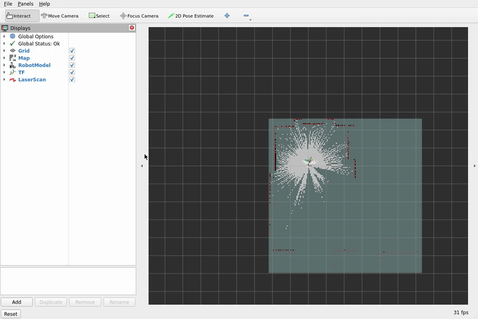

[建图连续录像](../lab_manuals_k3_com260_kit/images/ch23/ch13-slam-motion.mp4)。

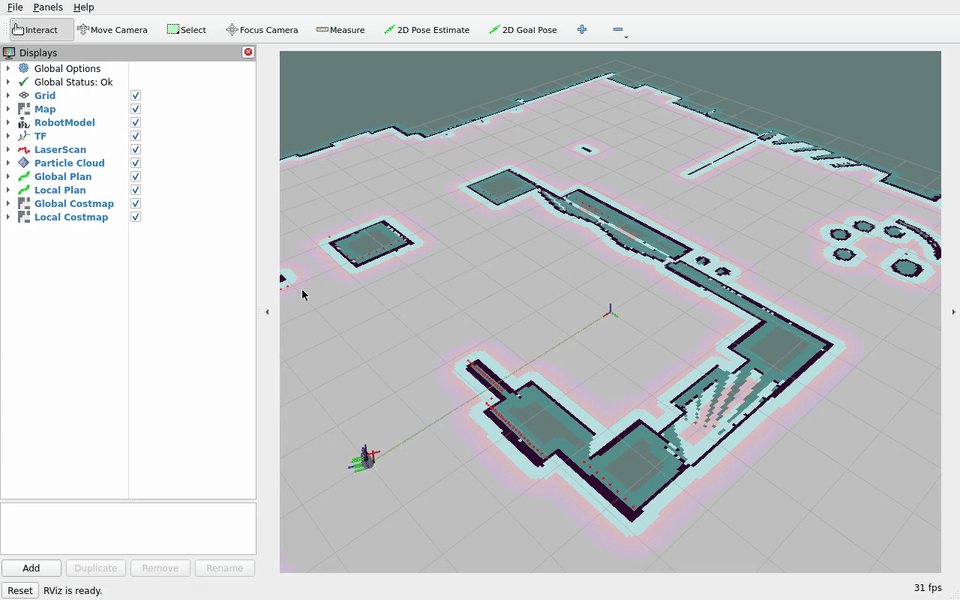

[导航连续录像](../lab_manuals_k3_com260_kit/images/ch23/ch14-nav-rviz.mp4)。

两套 Launch 都可能启动 Gazebo，切换时必须先停止上一套进程，避免两个仿真器争用同一 ROS/Gazebo 图。

学习材料：
- slam_toolbox 官方 Wiki（SteveMacenski）：https://wiki.ros.org/slam_toolbox
- Nav2 官方文档 —— 地图服务、调优与多机器人：https://docs.nav2.org/
- navigation2 仓库 —— multi_nav2 与 Simple Commander 示例：https://github.com/ros-navigation/navigation2
- explore-lite 官方仓库（m-explore ROS 2 移植）：https://github.com/robo-friends/m-explore-ros2
- The Construct —— SLAM 与导航综合实训课程：https://www.theconstructsim.com/
- Robotics Back-End —— 建图导航衔接实战教程：https://roboticsbackend.com/
