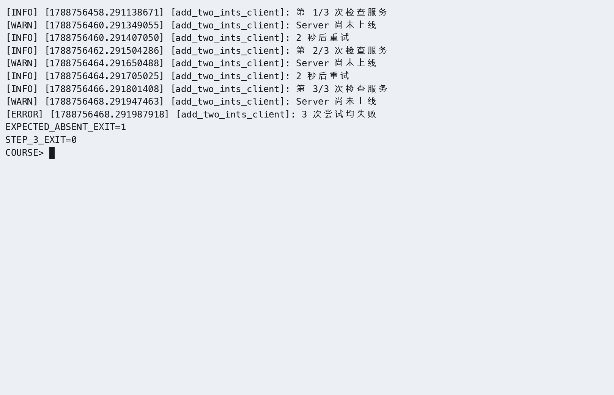
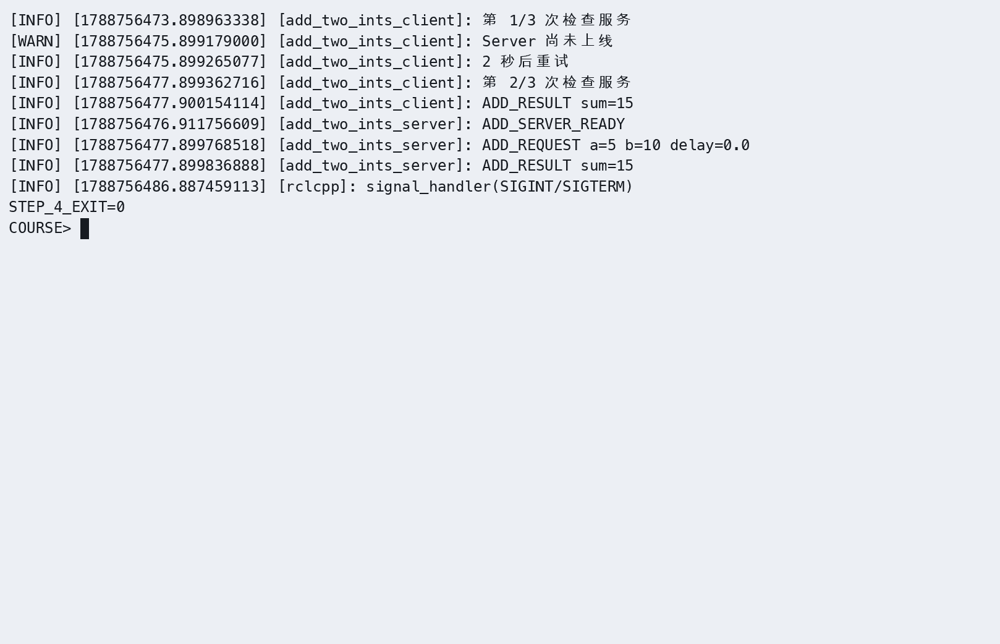

# 第4章：服务通信（Services）

> **课程**：ROS 2 C++17 编程
> **章节**：第4章  
> **课时**：2 课时（90 分钟）  
> **教学方式**：讲授 + 演示  

连接和双端分工见[公共环境](../lab_manuals_k3_pico_itx/ch00_common_setup.md)。服务和客户端在 K3 执行；Gazebo 在 x86 Humble 课程容器执行。

---

## 4.1 请求-响应模型

### 知识点 4.1.1：服务通信架构

服务通信采用 **同步请求-响应** 模式，适用于需要立即获取结果的一次性操作：

```
Client                                   Server
  │                                         │
  │ ──── Request (call_id, args) ────────►  │
  │                                         │ process_request()
  │ ◄──── Response (call_id, result) ────   │
  │                                         │
```

图 4-1：服务通信请求-响应时序图。一个 Server 可并发处理多个 Client 请求。

### 知识点 4.1.2：服务接口定义 (.srv 文件)

```text
# example_interfaces/srv/AddTwoInts
int64 a
int64 b
---
int64 sum
```

> 分隔线 `---` 上方定义 **Request** 字段，下方定义 **Response** 字段。

### 知识点 4.1.3：C++ Server API

```cpp
#include <memory>
#include "rclcpp/rclcpp.hpp"
#include "example_interfaces/srv/add_two_ints.hpp"
using AddTwoInts = example_interfaces::srv::AddTwoInts;

class AddTwoIntsServer : public rclcpp::Node
{
public:
  AddTwoIntsServer() : Node("add_two_ints_server")
  {
    service_ = create_service<AddTwoInts>("add_two_ints",
      [this](const AddTwoInts::Request::SharedPtr request,
        AddTwoInts::Response::SharedPtr response) {
        response->sum = request->a + request->b;
        RCLCPP_INFO(get_logger(), "收到请求: %ld + %ld = %ld",
          request->a, request->b, response->sum);
      });
  }
private:
  rclcpp::Service<AddTwoInts>::SharedPtr service_;
};
```

程序 4-1：Service Server 类示例。按已确认的修正，标准 AddTwoInts 响应仅含 `sum`；原文误写的 `message` 字段已改为日志说明。

### 知识点 4.1.4：C++ Client API

```cpp
#include <chrono>
#include <memory>
#include "rclcpp/rclcpp.hpp"
#include "example_interfaces/srv/add_two_ints.hpp"
using AddTwoInts = example_interfaces::srv::AddTwoInts;
using namespace std::chrono_literals;

class AddTwoIntsClient : public rclcpp::Node
{
public:
  AddTwoIntsClient() : Node("add_two_ints_client")
  {
    client_ = create_client<AddTwoInts>("add_two_ints");
  }
  auto send_request(int64_t a, int64_t b)
  {
    while (!client_->wait_for_service(1s)) {
      RCLCPP_INFO(get_logger(), "等待服务上线...");
    }
    auto request = std::make_shared<AddTwoInts::Request>();
    request->a = a;
    request->b = b;
    return client_->async_send_request(request);
  }
private:
  rclcpp::Client<AddTwoInts>::SharedPtr client_;
};
```

程序 4-2：Service Client 异步调用示例。使用 `async_send_request` 发送异步请求，返回 future 对象。

### 知识点 4.1.5：官方要点——服务模型与命令行工具

官方 Understanding ROS 2 services 以小乌龟的 `/spawn`、`/clear`、`/set_pen` 等服务为例说明：服务（Service）是一种请求-响应的同步通信模式，适合「查询状态、触发一次性动作」这类短任务，与长时程的任务型动作（Action）形成互补。教程要求掌握 `ros2 service list`（列出服务）、`ros2 service type`（查询类型）、`ros2 service find`（按类型找服务）与 `ros2 service call`（命令行直接调用）。

命令行调用是调试服务端最快捷的手段：`ros2 service call /spawn turtlesim/srv/Spawn "{x: 2.0, y: 2.0, theta: 0.0, name: ''}"` 会立即生成一只新乌龟——不写一行代码即可验证服务端逻辑。Articulated Robotics 强调：服务适合「一问一答」；如果任务耗时数秒且有进度，就该改用第 5 章的动作通信。

### 知识点 4.1.6：官方要点——自定义服务消息与接口包

Creating custom msg and srv files 教程补充了 `.srv` 文件的写法：文件内用 `---` 分隔请求（上半部分）与响应（下半部分），例如 `int64 a\nint64 b\n---\nint64 sum`。这与本章 4.1.2 节 `.srv` 文件的定义方式一致。接口包编译后即可被服务端与客户端共同引用，跨包引用其他包定义的类型（如 `sensor_msgs/Image`）也在此教程中示范。

一个实用细节：接口类型定义改动后，所有依赖它的包都必须重新 `colcon build`，否则运行时会出现「接口不匹配」的隐晦错误。因此官方建议接口包保持独立、少量高频改动，这是大型团队协作的基本约定。

---

## 4.2 同步调用 vs 异步调用

### 知识点 4.2.1：同步调用

```cpp
// 在客户端成员函数中发出请求并同步等待。
auto request = std::make_shared<AddTwoInts::Request>();
request->a = 10;
request->b = 20;
auto future = client_->async_send_request(request);
if (rclcpp::spin_until_future_complete(shared_from_this(), future, 5s) ==
  rclcpp::FutureReturnCode::SUCCESS)
{
  RCLCPP_INFO(get_logger(), "Result: %ld", future.get()->sum);
} else {
  client_->remove_pending_request(future);
  RCLCPP_ERROR(get_logger(), "服务调用超时或中断");
}
```

### 知识点 4.2.2：异步调用

```cpp
// 放入客户端类；主程序仍需 spin 节点来执行响应回调。
void send_request_async(int64_t a, int64_t b)
{
  auto request = std::make_shared<AddTwoInts::Request>();
  request->a = a;
  request->b = b;
  client_->async_send_request(request,
    [this](rclcpp::Client<AddTwoInts>::SharedFuture future) {
      try {
        RCLCPP_INFO(get_logger(), "Result: %ld", future.get()->sum);
      } catch (const std::exception & error) {
        RCLCPP_ERROR(get_logger(), "调用失败: %s", error.what());
      }
    });
}
```

### 知识点 4.2.3：官方要点——编写 Service 与 Client

官方服务教程以 add_two_ints 为例：服务端构造 `create_service<AddTwoInts>("add_two_ints", callback)`，回调接收请求与响应指针，并填充响应；客户端构造 `create_client` 后先 `wait_for_service(timeout_sec)` 等待服务上线，再 `async_send_request(request)` 发起异步调用，最后用 `spin_until_future_complete` 等待结果。教程强调客户端在服务端未启动时调用会立即报错，因此「先等待、再调用」是标准姿势。

官方还演示了在回调中记日志的规范写法：服务回调运行在 `spin` 的执行线程内，复杂工作应移到独立线程或使用 Action，避免阻塞其他回调——这一点与本章 4.2 节关于同步/异步调用阻塞行为的说明完全对应。

---

## 4.3 服务超时与重试机制

### 知识点 4.3.1：超时处理

```cpp
// 放入客户端类；需要 <chrono> 和 <future>。
AddTwoInts::Response::SharedPtr call_with_timeout(
  int64_t a, int64_t b, double timeout = 5.0)
{
  auto request = std::make_shared<AddTwoInts::Request>();
  request->a = a;
  request->b = b;
  auto future = client_->async_send_request(request);
  const auto start = std::chrono::steady_clock::now();
  while (rclcpp::ok()) {
    rclcpp::spin_some(shared_from_this());
    if (future.wait_for(100ms) == std::future_status::ready) {
      return future.get();
    }
    if (std::chrono::duration<double>(std::chrono::steady_clock::now() - start).count()
      > timeout)
    {
      RCLCPP_ERROR(get_logger(), "服务调用超时！");
      client_->remove_pending_request(future);
      return nullptr;
    }
  }
  client_->remove_pending_request(future);
  return nullptr;
}
```

程序 4-3：服务调用超时处理模式。

### 知识点 4.3.2：重试机制

```cpp
// 放入客户端类。
AddTwoInts::Response::SharedPtr call_with_retry(
  int64_t a, int64_t b, int max_retries = 3)
{
  for (int attempt = 0; attempt < max_retries; ++attempt) {
    if (client_->wait_for_service(2s)) {
      auto request = std::make_shared<AddTwoInts::Request>();
      request->a = a;
      request->b = b;
      auto future = client_->async_send_request(request);
      if (rclcpp::spin_until_future_complete(shared_from_this(), future, 5s) ==
        rclcpp::FutureReturnCode::SUCCESS)
      {
        return future.get();
      }
      client_->remove_pending_request(future);
    }
    RCLCPP_WARN(get_logger(), "重试 %d/%d...", attempt + 1, max_retries);
  }
  RCLCPP_ERROR(get_logger(), "所有重试均失败！");
  return nullptr;
}
```

### 知识点 4.3.3：官方要点——调用模式与容错实践

rclcpp 客户端库文档系统介绍了 Future 的用法：`async_send_request` 返回的 Future 可在 `async_send_request` 的回调参数中处理完成结果，也可以配合 `spin_until_future_complete` 阻塞等待。在真实机器人系统中，服务端可能未启动、网络可能抖动，因此工程实践普遍要求在调用侧实现「超时 + 重试 + 降级」三层容错：第一层是超时，`spin_until_future_complete(node, future, timeout)` 超过时限即放弃（对应本章 4.3.1 节的超时处理）；第二层是重试，对超时或网络错误进行有限次退避重试（对应 4.3.2 节的 `call_with_retry`）；第三层是降级，多次失败后切换到备用策略（如本地默认值），避免任务中断。

The Construct 的课程将这层设计称为「健壮服务客户端模式（Robust Service Client Pattern）」，并指出它在导航、机械臂等真实应用中被大量使用；建议读者将本章练习 4.5 的并发测试与上述模式结合，观察服务端在并发请求下的行为。

---

## 4.4 本章小结

本章围绕服务通信总结了六个要点：服务通信是同步请求-响应模式，Client 发送 Request，Server 返回 Response；`.srv` 文件包含 Request（`---` 上方）和 Response（`---` 下方）两部分；Server 使用 `create_service(type, name, callback)`，回调签名为 `fn(request, response)`；Client 使用 `create_client(type, name)`，通过 `call_async()` 发送请求；同步调用使用 `spin_until_future_complete()`，异步调用使用 `add_done_callback()`；生产环境必须处理超时和重试，提高系统鲁棒性。

---

## 4.5 练习题

**练习 4.1**：基于 `example_interfaces/srv/AddTwoInts` 编写 Server 和 Client 节点，验证加法功能。

**练习 4.2**：设计一个 `.srv` 文件 `WeatherQuery.srv`（输入：城市名 string，输出：温度 float64 + 天气 string），实现查询服务。

**练习 4.3**：测试服务超时：Client 设置 1 秒超时，Server 处理时间设为 3 秒，观察超时行为。

**练习 4.4**：编写带重试机制的 Client，当 Server 不在线时自动重试 3 次。
# 新建 client_wait.cpp

保留原章每次等待服务 2 秒、响应等待 5 秒、最多 3 次及间隔 2 秒的行为。完整参考代码如下：
```cpp
#include <cerrno>
#include <chrono>
#include <cstdint>
#include <cstdlib>
#include <iostream>
#include <memory>
#include <thread>

#include "example_interfaces/srv/add_two_ints.hpp"
#include "rclcpp/rclcpp.hpp"

using namespace std::chrono_literals;

bool parse_integer(const char * text, std::int64_t & value)
{
  errno = 0;
  char * end = nullptr;
  const long long parsed = std::strtoll(text, &end, 10);
  if (errno == ERANGE || end == text || *end != '\0') {
    return false;
  }
  value = static_cast<std::int64_t>(parsed);
  return true;
}

class AddWaitClient : public rclcpp::Node
{
public:
  AddWaitClient()
  : Node("add_two_ints_client")
  {
    client_ = create_client<example_interfaces::srv::AddTwoInts>("add_two_ints");
  }

  int run(std::int64_t a, std::int64_t b)
  {
    for (int attempt = 1; attempt <= 3; ++attempt) {
      RCLCPP_INFO(get_logger(), "第 %d/3 次检查服务", attempt);
      if (client_->wait_for_service(2s)) {
        auto request = std::make_shared<example_interfaces::srv::AddTwoInts::Request>();
        request->a = a;
        request->b = b;
        auto future = client_->async_send_request(request);
        if (rclcpp::spin_until_future_complete(shared_from_this(), future, 5s) ==
          rclcpp::FutureReturnCode::SUCCESS)
        {
          try {
            RCLCPP_INFO(get_logger(), "ADD_RESULT sum=%ld", future.get()->sum);
            return 0;
          } catch (const std::exception & error) {
            RCLCPP_ERROR(get_logger(), "服务调用失败：%s", error.what());
          }
        } else {
          client_->remove_pending_request(future);
          RCLCPP_WARN(get_logger(), "等待服务响应超时");
        }
      } else {
        RCLCPP_WARN(get_logger(), "Server 尚未上线");
      }
      if (attempt < 3) {
        RCLCPP_INFO(get_logger(), "2 秒后重试");
        std::this_thread::sleep_for(2s);
      }
    }
    RCLCPP_ERROR(get_logger(), "3 次尝试均失败");
    return 1;
  }

private:
  rclcpp::Client<example_interfaces::srv::AddTwoInts>::SharedPtr client_;
};

int main(int argc, char ** argv)
{
  if (argc > 3) {
    std::cerr << "Usage: ros2 run service_demo_lab_cpp client_wait [a] [b]\n";
    return 2;
  }
  std::int64_t a = 5;
  std::int64_t b = 3;
  if ((argc > 1 && !parse_integer(argv[1], a)) ||
    (argc > 2 && !parse_integer(argv[2], b)))
  {
    std::cerr << "a and b must be integers\n";
    return 2;
  }
  rclcpp::init(argc, argv);
  auto node = std::make_shared<AddWaitClient>();
  const int result = node->run(a, b);
  rclcpp::shutdown();
  return result;
}
```
在 `service_demo_lab_cpp/CMakeLists.txt` 的 `ament_package()` 前注册入口：

```cmake
add_executable(client_wait src/client_wait.cpp)
target_compile_features(client_wait PUBLIC cxx_std_17)
ament_target_dependencies(client_wait rclcpp example_interfaces)
install(TARGETS client_wait DESTINATION lib/${PROJECT_NAME})
```

# 编译：
```bash
cd ~/my_ros2_ws
colcon build --packages-select service_demo_lab_cpp --symlink-install
source install/setup.bash
```
# 先不启动server，只启动client_wait
```bash
ros2 run service_demo_lab_cpp client_wait 5 10
```



# 再次启动 client_wait，在首次重试间隔内另开终端启动 server。若前一次客户端已退出，必须重新运行客户端。
```bash
source ~/my_ros2_ws/install/setup.bash
ros2 run service_demo_lab_cpp server --ros-args -p delay_sec:=0.0
```



**练习 4.5**：测试多个 Client 同时向同一个 Server 发送请求时的并发处理行为。

**练习 4.6**：使用 `ros2 service call` 命令行调用服务，验证 Server 响应。

---

## 仿真结合实例（当前仓库）：服务节点与 Gazebo 巡检仿真并行运行

### 目标与知识点对应

服务适合执行一次性的请求-响应操作。本实例让服务客户端/服务器与 `robot_sim_demo` 处于同一个 ROS 2 图中：Gazebo 持续发布机器人传感器数据，服务节点完成一次任务请求，借此区分持续的 Topic 数据流和一次性的 Service 调用。

### 运行步骤

【K3】服务端和客户端各开一个终端，先加载：

```bash
# K3 服务终端环境
source ~/.config/ros2-course-k3/env.bash
source ~/ros2_course_k3_ws/install/setup.bash
```

【x86 课程容器，终端 1】

```bash
source /opt/ros/humble/setup.bash
source /workspace/install/setup.bash
# 启动 Gazebo 仿真，不自动巡航
ros2 launch robot_sim_demo gazebo2.launch.py gui:=false rviz:=false drive:=false
```

```bash
# 终端 2：启动服务端
ros2 run service_demo_cpp server
```

```bash
# 终端 3：查询服务并发送请求
ros2 service list | grep greetings
ros2 run service_demo_cpp client
```

### 观察结果

运行后应看到三类现象：`ros2 service list` 能发现 `/greetings`，客户端返回服务器的响应文本；Gazebo 仍独立发布 `/scan`、`/odom` 和 `/tf`，服务调用不会替代传感器话题；原版 Python 示例见 `src/service_demo_py/`，可对照阅读两种语言的 Client/Server API。

### 源码与边界

服务实现位于 `src_k3_pico_itx/service_demo_cpp/src/server.cpp`、`src_k3_pico_itx/service_demo_cpp/src/client.cpp`；Python 实现位于 `src/service_demo_py/service_demo_py/server_demo.py`、`client_demo.py`；仿真入口位于 `src_k3_pico_itx/robot_sim_demo/launch/gazebo2.launch.py`。

该实例验证服务通信和仿真系统的并行集成；`/greetings` 是教学服务，不代表已经为 Gazebo 增加了业务服务接口。


---

学习材料：
- ROS 2 Documentation (Humble) —— Understanding ROS 2 services：https://docs.ros.org/en/humble/Tutorials/Beginner-CLI-Tools/Understanding-ROS2-Services.html
- ROS 2 Documentation (Humble) —— Writing a simple service and client (Python)：https://docs.ros.org/en/humble/Tutorials/Beginner-Client-Libraries/Writing-A-Simple-Py-Service-And-Client.html
- ROS 2 Documentation (Humble) —— Creating custom msg and srv files：https://docs.ros.org/en/humble/Tutorials/Beginner-Client-Libraries/Custom-ROS2-Interfaces.html
- ROS 2 API 文档 —— rclcpp 客户端库：https://docs.ros2.org/humble/api/rclpy/
- The Construct —— ROS 2 Basics in 5 Days：https://www.theconstructsim.com/
- Articulated Robotics —— ROS 2 Basics 系列视频：https://www.youtube.com/@ArticulatedRobotics